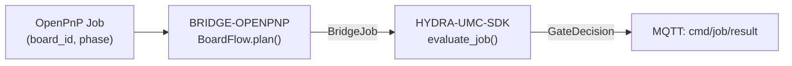

<!-- =============================================================================
HYDRA-UMC-BRIDGE-OPENPNP - OpenPnP board-flow coordination bridge
Copyright (C) JuanenRac (Electro Hobby 3D) <electrohobby3d@gmail.com>
GPL-3.0-or-later - see LICENSE
============================================================================= -->

<p align="center">
  
</p>

# 🔩 HYDRA-UMC-BRIDGE-OPENPNP

<p align="center">🇺🇸 <b>English</b> | <a href="README_spa.md">🇪🇸 Español</a> | <a href="README_fra.md">🇫🇷 Français</a> | <a href="README_ita.md">🇮🇹 Italiano</a> | <a href="README_deu.md">🇩🇪 Deutsch</a> | <a href="README_zho.md">🇨🇳 简体中文</a> | <a href="README_jpn.md">🇯🇵 日本語</a> | <a href="README_por.md">🇵🇹 Português</a></p>

### 📋 Traceable Board-Flow Coordination Bridge for OpenPnP

<p align="center">
  
  
  
  
  
  
</p>

---

> **Honesty check - what actually runs today:** the traceable board-flow core and safety gate (`board_flow.py`'s `BoardFlow`, funneling every job through `HYDRA-UMC-SDK`'s own `evaluate_job()`), the read-only OpenPnP profile inspector (`configuration.py`), the trace-only hand-off/cycle simulators (`handoff.py`, `evidence.py`), and the MQTT command/evidence transport (`mqtt_transport.py`) are real and covered by 208 passing `unittest` cases (`python tools/build_test.py` - `test_board_flow.py`, `test_mqtt_transport.py`). None of it has ever opened OpenPnP, a real machine link, or a real MQTT broker - `test_mqtt_transport.py`, `test_hardening.py`, `test_idempotency.py`, `test_mqtt_environment.py` uses a fake broker client, `configuration.py` only ever parses a saved `machine.xml` file, and `handoff.py`/`evidence.py`'s simulators are explicitly local-only with no OpenPnP, serial or machine I/O. There is no live OpenPnP extension/API integration yet - see "Roadmap & Known limits" below, which already says this plainly, and `CHANGELOG.md` for exactly what has shipped so far.

> **Safety and security status:** this ecosystem is not a certified safety system. There is no hardware E-STOP path, no firmware-enforced limits or interlocks and no verified motion command yet; firmware images are checked with CRC-32 and an Ed25519 signature, and a release build refuses the published development keys (the tool heads and expansion boards behind the relay still run URTC bootloaders, which take a shared-key HMAC-SHA256 instead of a signature); TLS and mutual TLS are optional and off by default; no custom board has been populated or tested yet. Read the [security baseline](https://github.com/JuanenRac/HYDRA-UMC-DOCS/blob/main/docs/SECURITY_BASELINE.md) and the [threat model](https://github.com/JuanenRac/HYDRA-UMC-DOCS/blob/main/docs/THREAT_MODEL.md) before relying on any statement here for the safety of a person.

---

## 📋 At a glance

| | |
|---|---|
| Version | `0.2.0` |
| Maturity | Functional |
| Tests | 208 (`python tools/build_test.py`) |
| Stack | Python / OpenPnP / HYDRA-UMC-SDK |
| Target | The Raspberry Pi CM5 of a HYDRA-UMC cell |
| On real hardware | Simulated only: tested against emulators, fakes or simulators; no run on real hardware is recorded for this version |

**Jump to:** [Overview](#-overview) · [Architecture](#-architecture) · [Features](#-features) · [Security & Safety](#-security--safety) · [Interfaces](#-interfaces) · [Configuration](#-configuration) · [Quick start](#-quick-start) · [Testing](#-testing) · [Troubleshooting](#-troubleshooting) · [Repository Structure](#-repository-structure) · [Related Projects](#-related-projects)

## 🚦 Project status

Each line is one part of this repository and the light says how far it is today. It is written from what the repository can show (tests, builds, runs), not from what is planned.

🟢 Done and verified · 🟡 Works, with known limits · 🟠 Partly done or not verified yet · 🔴 Not done or not working

| Area | State | What it means here |
|---|---|---|
| Software | 🟡 | Works for its main purpose; the honesty check above lists what is still missing |
| Tests | 🟢 | 208 automated tests, run on every change |
| Real hardware | 🟠 | Simulated only: tested against emulators, fakes or simulators; no run on real hardware is recorded for this version |
| Documentation | 🟢 | README in eight languages, checked against the manifest on every change |

## 🎯 Overview

**HYDRA-UMC-BRIDGE-OPENPNP** is the high-level board-flow bridge between HYDRA-UMC and OpenPnP. It coordinates PCB preparation, robot loading, native placement, robot unloading and traceable completion. It does not implement placement kinematics, feeder control or raw motion — those stay entirely inside OpenPnP.

It belongs to the **External Automation Bridges** family: a set of sibling repositories (CNC, LASER, OPENPNP, PRINTER3D, ROS2) that all speak the same shared safety contract from `HYDRA-UMC-SDK`, so no bridge can invent its own definition of "safe to work".

## 🧩 Role in HYDRA-UMC

**HYDRA-UMC-BRIDGE-OPENPNP** sits between an OpenPnP pick-and-place machine and its SMT line and the robot cell. It reports what that side says, asks the shared gate before any auxiliary work and never takes over the authority of the machine it coordinates with.

Every bridge speaks the shared safety contract of `HYDRA-UMC-SDK`: a job is accepted only after the shared `evaluate_job()` gate says so, and the gate fails closed. The parent project is `HYDRA-UMC-SERVER`; this bridge does not call it, it answers over MQTT through `HYDRA-UMC-MQTT-BROKER` to whoever commands the cell.

## 🏛️ Architecture

<p align="center">
  
</p>

<details>
<summary>Text version of the diagram (Mermaid)</summary>



</details>

**Why it is built this way**

* **Why `board_id` validation happens before anything else in `plan()`.** `BoardFlow.plan()`'s very first check is `not IDENTIFIER.fullmatch(board_id)` — a malformed or ambiguous board identifier is rejected immediately, with an explicit reason, instead of being forwarded downstream where it would be harder to trace.
* **Why hand-offs are a fixed dictionary keyed by `JobPhase`, not string formatting.** `BoardFlow._handoffs` maps each of the six supported phases to one literal, unambiguous description. An unknown future phase is rejected with `unrecognized-phase`; it cannot become an allowed hand-off merely because the common SDK gate is otherwise ready.
* **Why the bridge only plans a productive transfer when the external machine is `IDLE` and the cell is `READY`.** Board hand-off is a two-sided physical operation; if either side is not in a known-safe state, planning a transfer would be asking a robot to move into an unpredictable machine.
* **Why `ABORT` can still be requested during a fault.** `JobPhase.ABORT` maps to `request-controlled-stop`, which the shared `evaluate_job()` gate does not block the same way it blocks productive phases — an operator or supervisor must always be able to ask for a controlled stop, even mid-fault.
* **Why the live OpenPnP extension/API is still deferred.** The saved machine profile can now be inspected read-only, but choosing a plugin interface or live surface still requires a non-production test session; that prevents this bridge from embedding unverified motion or feeder assumptions.
* **How this fits the rest of the ecosystem.** BRIDGE-OPENPNP sits between an OpenPnP job and `HYDRA-UMC-SDK` → `HYDRA-UMC-MQTT-BROKER` → cell safety — it coordinates the robot side of a board hand-off, it never claims placement kinematics or feeder control that belong to OpenPnP itself.

## ✨ Features

* ✅ **Real traceable board-flow core:** `board_flow.py`'s `BoardFlow.plan()` rejects any job whose `board_id` is empty or has leading/trailing whitespace *before* even evaluating the safety gate — every hand-off is required to carry a stable, clean identifier. *(implemented, tested in `tests/test_board_flow.py`)*
* ✅ **Real per-phase hand-off map:** a fixed dictionary maps every `JobPhase` (`PREPARE`, `LOAD`, `PROCESS`, `UNLOAD`, `COMPLETE`, `ABORT`) to one explicit, human-readable hand-off description — `verify-board-and-fixture`, `robot-loads-board-into-pnp-fixture`, `openpnp-places-declared-job`, and so on. *(implemented)*
* ✅ **Real shared safety gate:** every valid job is evaluated through `evaluate_job()` from `HYDRA-UMC-SDK`'s `bridge_contract`, the same gate every sibling bridge uses; a productive hand-off only proceeds when the external machine reports `IDLE` and the HYDRA-UMC cell is `READY`. *(implemented)*
* ✅ **Non-mutating build/test:** `build-test.bat`/`.sh` compile the source and run the board-traceability and fail-safe test suite without touching version files or CHANGELOG. *(implemented, see Build & Release below)*
* ✅ **Read-only OpenPnP profile inspection:** `inspect_openpnp_config.py` parses a saved `machine.xml`, while `openpnp-scripts/HYDRA-UMC/inspect_profile.js` is a manually invoked OpenPnP menu-script template; both report only class and component counts, and the template presents that result in an informational dialog without sending a machine command. *(implemented, tested)*
* ✅ **Trace-only hand-off simulation:** `BoardIdentity` binds board, recipe, revision and lot identifiers before `simulate_board_handoff()` applies the shared SDK gate; it emits a deterministic SHA-256 trace fingerprint only for an allowed plan and has no OpenPnP, serial or machine I/O. Optional `slot_id`/`rack_id`/`table_id` fields track the real physical placement (which feeder slot, storage rack and table this exact hand-off used) as its own separate identity, so two placements of the same board are never fingerprinted as indistinguishable. *(implemented, tested)*
* ✅ **Trace-only productive-cycle simulation:** `simulate_board_cycle()` evaluates the ordered `PREPARE → LOAD → PROCESS → UNLOAD → COMPLETE` sequence under one explicit cell/machine state; every productive step fails closed outside `READY/IDLE`, and `ABORT` remains separate in the SDK safety path. *(implemented, tested)*
* ✅ **Deterministic evidence contract:** `docs/BOARD_TRANSFER_EVIDENCE.md` defines schema `1.0` emitted by both simulators. It carries only phase, decision, reason and a permitted identity fingerprint; raw board, recipe, revision and lot values never enter the JSON record. *(implemented, tested)*
* ✅ **Retained messages and repeated keys:** `mqtt_transport.py` ignores retained messages (the broker replays them at every reconnect) and, given an `IdempotencyStore`, answers a repeated `idempotency_key` with the answer it gave the first time instead of evaluating the job again. *(implemented, tested in `tests/test_idempotency.py`)*
* ✅ **Observed machine state (the OpenPnP event scripts):** OpenPnP has no RPC API, so `openpnp-scripts/HYDRA-UMC/Events` holds event scripts (`Job.Starting`, `Job.Placement.Complete`, `Job.Finished`, `Machine.AfterHoming`, `Machine.AfterDisabled`) and a menu script (`Report_state.js`) that write one small JSON file, atomically, with the state each event implies; `observation.py` reads it (`OpenPnpStateSource`, `HYDRA_UMC_OPENPNP_STATE_FILE`) and the bridge gates on it instead of on the claim of the job message. A file that is missing, older than 15 minutes (`HYDRA_UMC_OPENPNP_STATE_MAX_AGE_SECONDS`), written by anyone else or malformed is an OFFLINE machine that refuses the job; `cmd/status` publishes the retained `state`. The scripts are tested in Node against the few Java classes they use; they have not run inside OpenPnP, and the event names are the documented ones. *(implemented, not tried in OpenPnP)*
* ✅ **SMEMA hand-over signals:** `smema.py`'s `SmemaReceiver` (the cell takes boards from an upstream machine: reads `board available`, drives `machine ready`) and `SmemaSender` (the cell gives boards to a downstream machine: drives `board available`, reads `machine ready`) take part in the SMEMA handshake of an SMT line. Reading is debounced; DRIVING an output goes through the shared gate: only for a READY cell, a machine that was observed idle and an empty fixture (or a staged board), and an output is withdrawn whenever its condition stops being true, on every abort and when a line cannot be written. `cmd/smema_status`, `cmd/smema_ready` and `cmd/smema_offer` expose it. Tested against a simulated neighbour; the CM5 pins need an interface board for the 12 to 24 V cable. *(implemented, simulated only)*
* ✅ **Per-board traceability:** `traceability.py` puts the hand-offs of each board together and, when its cycle ends, publishes the trace on `hydra/bridges/openpnp/event/board` (QoS 1, not retained) and sends HYDRA-UMC-DATALAKE one `board_handoff` sample per step under `board-<fingerprint>` plus one `production_event` (`good`, `cycleTimeS`) that HYDRA-UMC-PRODUCTION-REPORTS computes OEE from. Only the fingerprint leaves by default; the identifiers can be included when a plant allows it. A data lake that is down never stops the cell, the samples wait and go with the next trace. *(implemented, tested against a local HTTP server)*
* ✅ **Code on the board:** `board_code.py` compares the DataMatrix read from the board with the board of the job (`HYDRA_UMC_OPENPNP_BOARD_CODE`: `off` by default, `advisory` or `required`); a different code is refused, a job without a board takes the single code read, and what is not a stable identifier is not a code. The code comes from HYDRA-UMC-VISION-NODE's `POST /read-code` (`VisionNodeCodeSource`). *(implemented, not tried on a real label)*
* ✅ **Hardened MQTT loop and honest answers:** a payload that is too large (over 16 KiB) or cannot be read, deeply nested JSON and any unexpected failure are answered with a refusal on the result topic and never end the loop; `cmd/job` and `cmd/handoff` keep separate idempotency key spaces (`job:`/`handoff:`), so a job checked with the gate can still be handed off with the same key and keeps its identity fingerprint; `cmd/job` answers say `"mode": "simulation-only"` and `"observed": false` (nothing looks at OpenPnP: the machine state is the one the requester declares) and an ABORT through it says that nothing was stopped; the gate and the hand-off trace share one board-identifier rule, `cmd/handoff` accepts `slot_id`, `rack_id` and `table_id`, and a `machine.xml` with a DOCTYPE is refused in any encoding; the bridge announces itself on an `availability` topic with a Last Will. *(implemented, tested in `tests/test_hardening.py`)*

## 🔒 Security & Safety

| Threat | Defence | Where |
|---|---|---|
| A job for a cell or machine that is not in a safe state | Every job goes through the shared `evaluate_job()` gate of the SDK, which fails closed; the bridge has no accept/reject logic of its own | SDK `bridge_contract` |
| Oversized or unbounded job data | At most 32 parameters, keys up to 64 characters, values up to 1024, identifiers up to 128 (`MAX_PARAMETERS`, `MAX_PARAMETER_KEY_CHARS`, `MAX_PARAMETER_VALUE_CHARS`, `MAX_IDENTIFIER_CHARS`) | SDK `bridge_contract` |
| A repeated or replayed order | An `IdempotencyStore` remembers each key for 24 hours and at most 10 000 entries; a repeat gets the first answer instead of being evaluated again | SDK `job_intake` |
| A huge or hostile MQTT payload | A payload over 16 KiB, unreadable or deeply nested JSON and any unexpected failure are answered with a refusal on the result topic and never end the loop | `mqtt_transport.py` |
| The wrong board in the machine | `board_code.py` reads the DataMatrix and compares it with the board of the job; `HYDRA_UMC_OPENPNP_BOARD_CODE` is `off`, `advisory` or `required` | `board_code.py` |
| A stale or false OpenPnP state | The state file is trusted only while it is fresh (15 minutes by default), at most 16 KiB, written by the origin `openpnp-events`; an unknown word is `OFFLINE` | `observation.py` |
| Unbounded traceability data and unsafe SMEMA outputs | At most 256 open traces and 5000 pending samples (sent in batches of 500); board identifiers match `^[A-Za-z0-9][A-Za-z0-9._-]{0,95}$`; the SMEMA outputs obey the safety rules of the cell | `traceability.py`, `smema.py`, `board_flow.py` |
| A retained command replayed on reconnect | A retained `cmd/` message is ignored on reconnect | `mqtt_transport.py` |

**What it never does:** it is not a placement-motion driver and it never opens or changes the OpenPnP machine when it inspects its XML.

## 🔌 Interfaces

Topics under `hydra/bridges/openpnp/`; there is no stop verb (`STOP_VERBS` is empty).

| Topic or route | What it carries |
|---|---|
| `cmd/status`, `cmd/job`, `cmd/handoff` | commands in; each is answered on `<verb>/result` |
| `cmd/smema_offer`, `cmd/smema_ready`, `cmd/smema_status` | the SMEMA handshake with the neighbours on the line |
| `state`, `availability`, `event/board` | the state, `online`/`offline`, and the records of each board (`board_handoff`, `production_event`, schema version `1.0`) for the data lake and the OEE report |

## ⚙️ Configuration

| Variable | Default | What it sets |
|---|---|---|
| `HYDRA_UMC_OPENPNP_BOARD_CODE` | `off` | `off`, `advisory` or `required`; an unknown value means `off` |
| `HYDRA_UMC_OPENPNP_STATE_FILE` | unset | path of the file that OpenPnP's event scripts write; unset means no state source |
| `HYDRA_UMC_OPENPNP_STATE_MAX_AGE_SECONDS` | `900` | how old the state file may be before it is no longer trusted |
| `HYDRA_MQTT_USERNAME` | none | The MQTT user name; the broker binds it to a client-ID prefix |
| `HYDRA_MQTT_PASSWORD` | none | The password; only valid together with the user name |
| `HYDRA_MQTT_PASSWORD_FILE` | none | The password read from a file (a Docker or systemd secret); ignored when `HYDRA_MQTT_PASSWORD` is set |
| `HYDRA_MQTT_TLS_CA` | none | The CA file that signed the broker's certificate: the connection is TLS and the certificate is verified |
| `HYDRA_MQTT_TLS` | off | `1` turns TLS on, verified against the system's trusted CAs |
| `HYDRA_MQTT_TLS_CERT` / `HYDRA_MQTT_TLS_KEY` | none | The client certificate and its key for a broker that demands mutual TLS; both are needed |

## 🚀 Quick start

Requires Python 3.11 or newer. The tests and the build scripts expect `HYDRA-UMC-SDK` checked out next to this repository (`../HYDRA-UMC-SDK`) or pointed at with `HYDRA_UMC_SDK_ROOT`.

Try it without hardware (this checks the whole bridge against its emulators and fakes):

```bash
py -3 tools/build_test.py          # Windows
python3 tools/build_test.py         # Linux, macOS
```

Start the service (there is no console script: the service is the `run_forever()` of the MQTT transport, which you call from your own start-up code):

```python
from hydra_umc_bridge_openpnp.mqtt_transport import OpenPnpMqttBridge, run_forever
bridge = OpenPnpMqttBridge(cell_state=lambda: cell_state)   # state_source, smema_*, trace_recorder are optional
run_forever(bridge, host="192.168.0.180")                  # serves cmd/# forever
```

The user name, the password and the TLS files come from the `HYDRA_MQTT_*` variables (see Configuration); the code above needs no credentials of its own.

## 🧪 Testing

208 automated `unittest` cases run with `python tools/build_test.py` (it also compiles every module). The tests need no hardware, no network and no optional package: the ones that would need `paho-mqtt`, `pyserial` or a vendor library use a stand-in or are skipped when the package is missing.

| Test file | Tests | What it covers |
|---|---|---|
| `test_board_flow.py`, `test_board_code.py`, `test_observation.py` | - | hand-off phases, the board code, the state file and the event scripts |
| `test_smema.py`, `test_traceability.py` | - | SMEMA against an in-memory neighbour; the trace, the data-lake samples and a real local HTTP sink |
| `test_mqtt_transport.py`, `test_mqtt_environment.py`, `test_hardening.py`, `test_edge_cases.py`, `test_idempotency.py` | - | topic dispatch, the credentials of the environment, hostile clients, edge cases, repeated keys |

The CI runs `HYDRA_UMC_CI=1 python tools/ci_validate.py`, which checks the manifest, the documents, the eight READMEs and the pictures, and runs the tests with an SDK checkout.

## 🏗️ Build & Release

Requires Python 3.11+. `tools/build_test.py` expects `HYDRA-UMC-SDK` checked out as a sibling directory (`../HYDRA-UMC-SDK`) or pointed at via the `HYDRA_UMC_SDK_ROOT` environment variable.

```bash
# Windows
build-test.bat      # validate only — no version/CHANGELOG change
build.bat            # Validate and build (building never changes the version)

# Linux/macOS
bash build-test.sh
bash build.sh
```

`build-test` compiles every module under `src/` with `py_compile` and runs the full `unittest` suite discovered under `tests/` (`test_board_flow.py`, `test_mqtt_transport.py` - 208 tests), proving board-traceability rejection and fail-safe gating among everything else covered — it never modifies the repository. `build` runs that same validation first and, only on success, calls `tools/bump_version.py` to synchronize the version across `pyproject.toml`, `hydra-umc.project.json` and `CHANGELOG.md`. There is no live machine `run` command yet — that requires a validated OpenPnP integration.

## 🩺 Troubleshooting

| You see | Because | Do |
|---|---|---|
| `ModuleNotFoundError: hydra_umc_sdk` | The SDK is not installed or not next to this repository | Check out `HYDRA-UMC-SDK` next to this repository or set `HYDRA_UMC_SDK_ROOT` |
| `paho-mqtt is not installed` | The MQTT client is an optional extra | `pip install ".[mqtt]"` (it needs `paho-mqtt` 2.1 or newer, below 3) |
| `password was given without a username` | MQTT credentials need both parts | Set `HYDRA_MQTT_USERNAME` as well as the password |
| `could not reach the MQTT broker after N attempts` | The broker is down, the address is wrong or the port is closed | Start `HYDRA-UMC-MQTT-BROKER`, check the host and port given to the transport (it tries 5 times, 2 seconds apart); a TLS handshake failure is not retried |
| `the MQTT broker refused the connection` | The broker refused the credential (or did not answer within the time limit) | Check `HYDRA_MQTT_USERNAME` and the password; the client ID must start with the prefix the broker bound to the credential |
| `"allowed": false` + `reason` | The shared gate or a guard refused the order | Read `reason` and fix the cause; do not retry blindly |
| `OFFLINE` although OpenPnP is running | The state file is missing, older than the limit or written by another origin | Install the scripts of `openpnp-scripts/` in OpenPnP, point `HYDRA_UMC_OPENPNP_STATE_FILE` at the file they write and raise `HYDRA_UMC_OPENPNP_STATE_MAX_AGE_SECONDS` only if the machine is idle for long |

## 📂 Repository Structure

<p align="center">
  
</p>

<details>
<summary>Text version of the tree</summary>

```text
HYDRA-UMC-BRIDGE-OPENPNP/
├── src/hydra_umc_bridge_openpnp/
│   ├── board_flow.py                                        PCB hand-off phases (not a placement driver)
│   ├── board_code.py                                        board DataMatrix against the job
│   ├── observation.py                                       OpenPnP state file, trusted while fresh
│   ├── smema.py                                             the SMEMA handshake with the neighbours on the line
│   ├── traceability.py                                      the story of each board, for the data lake and OEE
│   ├── handoff.py                                           traceable hand-off, simulated
│   ├── evidence.py                                          deterministic local evidence
│   ├── configuration.py                                     read-only check of a machine XML
│   └── mqtt_transport.py                                    MQTT command, state and board-event transport
├── tests/                                                   208 tests, with SMEMA and traceability fixtures
├── docs/                                                    bridge guide, hand-off evidence
├── openpnp-scripts/                                         event scripts that write the state file OpenPnP exposes
├── tools/                                                   build and test runner, version bump, CI validator, README and picture generators and checks
├── images/                                                  banner and the pictures of the README
├── .github/                                                 CI workflow and issue templates
├── pyproject.toml                                           package metadata and dependencies
├── hydra-umc.project.json                                   manifest: version, maturity, family
├── CHANGELOG.md                                             what changed in each version
├── build.sh build.bat                                       build scripts (they never change the version)
├── build-test.sh build-test.bat                             build scripts (they never change the version)
├── test.sh test.bat                                         run the tests
├── inspect-openpnp-config.sh / inspect-openpnp-config.bat   read-only check of a machine XML
└── SECURITY.md SUPPORT.md CONTRIBUTING.md CODE_OF_CONDUCT.md LICENSE LICENSE.md
```

</details>

## 🗺️ Roadmap & Known limits

**Known limits today**

**Real today:** version `0.2.0`, a locally tested traceable PCB hand-off core (`BoardFlow`) backed by `HYDRA-UMC-SDK`'s shared job gate, a real MQTT command/evidence transport (`mqtt_transport.py`), a deterministic 208-test `unittest` suite, a saved-profile inspector reporting real OpenPnP actuator/signaler/nozzle-tip evidence alongside head/camera/driver/feeder counts, a visible read-only OpenPnP menu-script template, identity-bound hand-off/cycle simulations, and a CI-verified non-sensitive JSON evidence contract with no machine I/O.

**Integration boundary:** OpenPnP retains placement kinematics, feeder control and raw motion at all times; this bridge only ever gates and traces the *hand-off* around it — robot loading, native placement completion, robot unloading.

**Still ahead:** no live machine connection is claimed — the concrete OpenPnP extension/API will be selected only in an isolated non-production session with an operator present.

## 🌍 Languages

This README and the documents of the repository exist in eight languages: English, Spanish, German, French, Italian, Japanese, Chinese and Portuguese (Portugal). They are written together and checked in the CI so that the eight files have the same sections and the same links. This repository has no screen or message catalogue of its own, so there are no interface strings to translate.

## 🔗 Related Projects

This project is part of the HYDRA-UMC robotics ecosystem by the same author (JuanenRac / Electro Hobby 3D). Worth knowing about, since a request might actually be about one of these rather than this repository.

**Parent Project**
- **[HYDRA-UMC-SERVER](https://github.com/JuanenRac/HYDRA-UMC-SERVER)** — the real headless backend (REST/WebSocket) every control client actually talks to; this bridge does not call it - it answers over MQTT, through HYDRA-UMC-MQTT-BROKER, to whoever commands the cell.

**Sibling Projects** — also talk to HYDRA-UMC-SERVER's own API, each their own client
- **[HYDRA-UMC-STUDIO](https://github.com/JuanenRac/HYDRA-UMC-STUDIO)** — web control dashboard with real-time multi-robot 3D visualization.
- **[HYDRA-UMC-SUITE](https://github.com/JuanenRac/HYDRA-UMC-SUITE)** — desktop (PySide6) swarm command center for multiple servers at once, packaged as a standalone executable.
- **[HYDRA-UMC-ANDROID-CONTROL](https://github.com/JuanenRac/HYDRA-UMC-ANDROID-CONTROL)** — native Android control app with biometric login and a paired Wear OS companion.
- **[HYDRA-UMC-IOS-CONTROL](https://github.com/JuanenRac/HYDRA-UMC-IOS-CONTROL)** — iOS/iPadOS control app (Flutter) with real-time WebSocket sync.
- **[HYDRA-UMC-DSI](https://github.com/JuanenRac/HYDRA-UMC-DSI)** — native touch UI for the onboard 7" DSI touchscreen, embedded on the CM5 itself.
- **[HYDRA-UMC-BRIDGE-AMR](https://github.com/JuanenRac/HYDRA-UMC-BRIDGE-AMR)** — coordination boundary for AGV/AMR fleets via a VDA 5050 MQTT publisher (tested against an emulated fleet only).
- **[HYDRA-UMC-BRIDGE-CNC](https://github.com/JuanenRac/HYDRA-UMC-BRIDGE-CNC)** — high-level CNC-cell coordinator with GRBL status/control-byte access (tested against an emulator only).
- **[HYDRA-UMC-BRIDGE-DROIDS](https://github.com/JuanenRac/HYDRA-UMC-BRIDGE-DROIDS)** — coordination boundary for legged/humanoid droids, with a Boston Dynamics Spot command sender (tested against an emulator only).
- **[HYDRA-UMC-BRIDGE-LASER](https://github.com/JuanenRac/HYDRA-UMC-BRIDGE-LASER)** — laser-cell coordinator reading 3 key/enclosure/interlock GPIO signals (tested against a fake chip only; it cannot arm or fire a laser).
- **[HYDRA-UMC-BRIDGE-PRINTER3D](https://github.com/JuanenRac/HYDRA-UMC-BRIDGE-PRINTER3D)** — safe coordination boundary for Moonraker/Klipper 3D printers, with real gated job commands.
- **[HYDRA-UMC-BRIDGE-ROS2](https://github.com/JuanenRac/HYDRA-UMC-BRIDGE-ROS2)** — coordinator with a lazily imported rclpy ROS 2 transport (not yet run against a ROS 2 installation).
- **[HYDRA-UMC-BRIDGE-UAV](https://github.com/JuanenRac/HYDRA-UMC-BRIDGE-UAV)** — coordination boundary for camera-equipped UAVs, with a MAVLink command sender (tested against an emulator only).

**Directly Related**
- **[HYDRA-UMC-SDK](https://github.com/JuanenRac/HYDRA-UMC-SDK)** — the shared JSON-Schema contract and software job-gate boundary every bridge validates its commands against (not a certified safety function).
- **[HYDRA-UMC-CONNECTOR-HUB](https://github.com/JuanenRac/HYDRA-UMC-CONNECTOR-HUB)** — declarative adapter-manifest registry and validator for external-machine connectors; extends the SDK's own contract idea to external machines without replacing the industrial-gateway projects.
- **[HYDRA-UMC-MQTT-BROKER](https://github.com/JuanenRac/HYDRA-UMC-MQTT-BROKER)** — `mqtt_transport.py`'s real transport for this bridge's own `hydra/bridges/openpnp/...` topics — the job gate plus a full traceable hand-off simulation, with no `state` topic since there's no real machine transport here to observe; see that repo's own `docs/BRIDGE_TOPICS.md`.
- **[HYDRA-UMC-SAFETY-ZONES](https://github.com/JuanenRac/HYDRA-UMC-SAFETY-ZONES)** — future cell-zone safety evidence for this bridge.

**Also Part of the Ecosystem**

*Core Hardware & Platform*
- **[HYDRA-UMC](https://github.com/JuanenRac/HYDRA-UMC)** — the robot-arm motherboard design: CM5 host + dual-core STM32H745, meant to orchestrate up to 8 tool arms over CAN-OTA/SPI-OTA (firmware at an early stage; no populated board yet).
- **[HYDRA-UMC-OS](https://github.com/JuanenRac/HYDRA-UMC-OS)** — reproducible Raspberry Pi OS product layer for the CM5: read-only agent, validated config/profiles, WiFi first-contact provisioning.

*Core Backend & Clients*
- **[HYDRA-UMC-EDITOR-URDF](https://github.com/JuanenRac/HYDRA-UMC-EDITOR-URDF)** — desktop graphical URDF creator/editor that pushes finished models into STUDIO's own catalog.
- **[HYDRA-UMC-EDITOR-STL](https://github.com/JuanenRac/HYDRA-UMC-EDITOR-STL)** — desktop STL model editor, transforming/replacing/removing/adding real parts in the same model catalog HYDRA-UMC-EDITOR-URDF also edits.

*URTC Tool Platform*
- **[URTC](https://github.com/JuanenRac/URTC)** — firmware for the physical Universal Robot Tool Controller PCB, 25+ tool profiles over CAN bus.
- **[URTC-FLASHER](https://github.com/JuanenRac/URTC-FLASHER)** — desktop GUI flashing tool for URTC boards, CAN-OTA plus full-chip SWD/JTAG.
- **[URTC-TESTER](https://github.com/JuanenRac/URTC-TESTER)** — desktop live CAN-bus diagnostic tool for URTC boards, one panel per tool profile.
- **[URTC-WEB-STUDIO](https://github.com/JuanenRac/URTC-WEB-STUDIO)** — browser-based alternative to URTC-TESTER via the Web Serial API, no local install needed.
- **[URTC-GATEWAY](https://github.com/JuanenRac/URTC-GATEWAY)** — gateway in front of the URTC CAN bus: an allowed list of identifiers, a rate limit and a session key; software tested on a computer, not yet on a real bus.

*Vision AI Node (Hailo-8)*
- **[HYDRA-UMC-VISION-NODE](https://github.com/JuanenRac/HYDRA-UMC-VISION-NODE)** — integration hub for the Hailo-8 vision pipeline, with a real per-stage hardware-readiness check.
- **[HYDRA-UMC-DETECTION-HEF](https://github.com/JuanenRac/HYDRA-UMC-DETECTION-HEF)** — real compiled-model registry with Hailo-architecture/checksum safe-load verification.
- **[HYDRA-UMC-VISION-STREAMER](https://github.com/JuanenRac/HYDRA-UMC-VISION-STREAMER)** — real GStreamer pipeline + MediaMTX config generator with a real HailoRT integration boundary.
- **[HYDRA-UMC-VISUAL-SERVOING-API](https://github.com/JuanenRac/HYDRA-UMC-VISUAL-SERVOING-API)** — Position-Based Visual Servoing correction law with authorisation gated on the zone state; no camera pose estimation yet.

*Cognitive AI Node (Hailo-10)*
- **[HYDRA-UMC-COGNITIVE-NODE](https://github.com/JuanenRac/HYDRA-UMC-COGNITIVE-NODE)** — integration hub for the Hailo-10 cognitive pipeline (LLM/VLA/voice orchestration).
- **[HYDRA-UMC-VLA-ENGINE](https://github.com/JuanenRac/HYDRA-UMC-VLA-ENGINE)** — real action-token encoding/decoding and trajectory generation for a Vision-Language-Action model.
- **[HYDRA-UMC-VOICE-UI](https://github.com/JuanenRac/HYDRA-UMC-VOICE-UI)** — real voice front-end (VAD + intent parser) with a bounded, confirmation-gated Watch relay.
- **[HYDRA-UMC-SEMANTIC-PLANNER](https://github.com/JuanenRac/HYDRA-UMC-SEMANTIC-PLANNER)** — real rule-based task decomposition and semantic error recovery over MCU error codes.
- **[HYDRA-UMC-DOCS-QA](https://github.com/JuanenRac/HYDRA-UMC-DOCS-QA)** — real stdlib-only TF-IDF document search over this ecosystem's own Markdown docs.
- **[HYDRA-UMC-LOCAL-TECHNICIAN](https://github.com/JuanenRac/HYDRA-UMC-LOCAL-TECHNICIAN)** — local, policy-gated AI maintenance technician for the ecosystem itself - observes, diagnoses and proposes fixes; the two highest risk levels are deliberately not implemented yet.

*Orchestration & Swarm*
- **[HYDRA-UMC-ORCHESTRATOR](https://github.com/JuanenRac/HYDRA-UMC-ORCHESTRATOR)** — integration hub with a real gRPC/Protobuf health-report contract and mission state machine.
- **[HYDRA-UMC-JOB-DISPATCHER](https://github.com/JuanenRac/HYDRA-UMC-JOB-DISPATCHER)** — real priority-based job queue with deduplication, over a real HTTP API.
- **[HYDRA-UMC-NODE-HEALING](https://github.com/JuanenRac/HYDRA-UMC-NODE-HEALING)** — real gRPC-based fleet health watchdog with retry/backoff and identity-mismatch detection.
- **[HYDRA-UMC-PATH-PLANNER-3D](https://github.com/JuanenRac/HYDRA-UMC-PATH-PLANNER-3D)** — real RRT-based 3D path planner with real obstacle/workspace collision validation.
- **[HYDRA-UMC-SWARM-SYNC](https://github.com/JuanenRac/HYDRA-UMC-SWARM-SYNC)** — real CRDT LWW-Element-Map state sync, property-tested for multi-cell convergence.

*Digital Twin & Simulation*
- **[HYDRA-UMC-TWIN](https://github.com/JuanenRac/HYDRA-UMC-TWIN)** — integration hub for the digital-twin engine, with a real version-compatibility sync contract.
- **[HYDRA-UMC-HIL-BRIDGE](https://github.com/JuanenRac/HYDRA-UMC-HIL-BRIDGE)** — hardware-in-the-loop router with a software collision interlock between simulation and real hardware (tested without real hardware).
- **[HYDRA-UMC-PHYSICS-REPLICA](https://github.com/JuanenRac/HYDRA-UMC-PHYSICS-REPLICA)** — real forward kinematics and joint-limit validation over a real URDF subset.
- **[HYDRA-UMC-SYNTHETIC-DATA-GEN](https://github.com/JuanenRac/HYDRA-UMC-SYNTHETIC-DATA-GEN)** — real procedural 2D scene generator with YOLO/COCO annotation export.

*Data & Analytics*
- **[HYDRA-UMC-DATALAKE](https://github.com/JuanenRac/HYDRA-UMC-DATALAKE)** — real sqlite3-backed time-series store with a real ingest/query HTTP API.
- **[HYDRA-UMC-ANOMALY-DETECTOR](https://github.com/JuanenRac/HYDRA-UMC-ANOMALY-DETECTOR)** — real FFT + statistical baseline anomaly detector with drift monitoring.
- **[HYDRA-UMC-PRODUCTION-REPORTS](https://github.com/JuanenRac/HYDRA-UMC-PRODUCTION-REPORTS)** — real OEE/availability calculation over DATALAKE history, with reproducible CSV export.
- **[HYDRA-UMC-TELEMETRY-COLLECTOR](https://github.com/JuanenRac/HYDRA-UMC-TELEMETRY-COLLECTOR)** — real CAN/WebSocket ingestion pipeline into DATALAKE, with sequence deduplication.

*Industrial Gateway*
- **[HYDRA-UMC-GATEWAY-INDUSTRIAL](https://github.com/JuanenRac/HYDRA-UMC-GATEWAY-INDUSTRIAL)** — integration hub relaying to industrial protocols, with a real command allowlist/backpressure layer.
- **[HYDRA-UMC-OPCUA-SERVER](https://github.com/JuanenRac/HYDRA-UMC-OPCUA-SERVER)** — real OPC-UA address space, verified with a real binary-protocol client session.
- **[HYDRA-UMC-MTCONNECT-ADAPTER](https://github.com/JuanenRac/HYDRA-UMC-MTCONNECT-ADAPTER)** — real MTConnect `/probe` and `/current` XML endpoints with degraded-mode output.

*Complementary Tools & Ecosystem Operations*
- **[HYDRA-UMC-DASHBOARD-AI](https://github.com/JuanenRac/HYDRA-UMC-DASHBOARD-AI)** — Smart Summaries and Anomaly Highlighting panels over DATALAKE/ANOMALY-DETECTOR, with an honest statistical fallback.
- **[HYDRA-UMC-TOOL-CLI](https://github.com/JuanenRac/HYDRA-UMC-TOOL-CLI)** — fleet CLI with a real, stable exit-code contract, a genuine live client of HYDRA-UMC-SERVER's own API.
- **[HYDRA-UMC-WATCH](https://github.com/JuanenRac/HYDRA-UMC-WATCH)** — WearOS companion app with haptic alert patterns and a paired-phone voice relay (not yet run on a physical watch).
- **[URTC-SMART-RACK](https://github.com/JuanenRac/URTC-SMART-RACK)** — firmware for a board-mounting rack with real tool-ID decoding and Smart Idle pre-heating logic.
- **[URTC-VISION-TOOL](https://github.com/JuanenRac/URTC-VISION-TOOL)** — firmware plus a real Python vision companion for a thermal/RGB inspection tool head.
- **[HYDRA-UMC-UPDATER](https://github.com/JuanenRac/HYDRA-UMC-UPDATER)** — administrative desktop tool that discovers, clones and updates every repo in this ecosystem.
- **[HYDRA-UMC-OS-REBUILDER](https://github.com/JuanenRac/HYDRA-UMC-OS-REBUILDER)** — Windows/Linux desktop tool that builds a ready-to-flash CM5 image pre-loaded with the ecosystem's most current versions, with Raspberry-Pi-Imager-style first-boot Wi-Fi/user/SSH configuration.
- **[HYDRA-UMC-OPS-AGENT](https://github.com/JuanenRac/HYDRA-UMC-OPS-AGENT)** — maintenance-incident coordinator: a low-privilege edge role collects a sanitized inventory/health snapshot, a control-plane role renders it read-only and asks an AI provider to suggest a diagnosis - never applies a patch or deploys anything.
- **[HYDRA-UMC-DEV-SERVER](https://github.com/JuanenRac/HYDRA-UMC-DEV-SERVER)** — reproducible development host (Raspberry Pi 5 / CM5) that stores the ecosystem's source and runs bounded build/test tasks under a durable queue; a dedicated dev role, explicitly not an operational CM5.

## 📚 Documentation

Where to read more:

* [docs/BRIDGE_GUIDE.md](docs/BRIDGE_GUIDE.md) - scope, board flow, the state file, SMEMA, traceability, scripts
* [docs/BOARD_TRANSFER_EVIDENCE.md](docs/BOARD_TRANSFER_EVIDENCE.md) - what a traceable hand-off leaves as evidence
* [Security baseline of the ecosystem](https://github.com/JuanenRac/HYDRA-UMC-DOCS/blob/main/docs/SECURITY_BASELINE.md)
* [Threat model of the ecosystem](https://github.com/JuanenRac/HYDRA-UMC-DOCS/blob/main/docs/THREAT_MODEL.md)
* [Changelog of this repository](CHANGELOG.md)
* [License of this repository](LICENSE.md)

## 🤝 Contributing & Community

* Before a pull request run `HYDRA_UMC_CI=1 py -3 tools/ci_validate.py` (or `HYDRA_UMC_CI=1 python3 tools/ci_validate.py`): it must print `CI_VALIDATION=PASS`. Do not run `build.sh` or `build.bat` for this check; building is not a check.
* The eight READMEs are written from one source in HYDRA-UMC-DOCS; do not edit them by hand. Change the source and write them again with `tools/make_readmes.py`.
* Do not state in a README what has not run: say "simulated" or "not tried on hardware" where that is the truth.
* See [CONTRIBUTING.md](CONTRIBUTING.md), the [code of conduct](CODE_OF_CONDUCT.md), [SECURITY.md](SECURITY.md) and [SUPPORT.md](SUPPORT.md).

## 👤 AUTHOR

**JuanenRac (Electro Hobby 3D)** · electrohobby3d@gmail.com

## 📜 LICENSE

GPL-3.0-or-later - [LICENSE](LICENSE).
