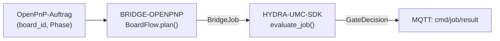

<!-- =============================================================================
HYDRA-UMC-BRIDGE-OPENPNP - OpenPnP board-flow coordination bridge
Copyright (C) JuanenRac (Electro Hobby 3D) <electrohobby3d@gmail.com>
GPL-3.0-or-later - see LICENSE
============================================================================= -->

<p align="center">
  
</p>

# 🔩 HYDRA-UMC-BRIDGE-OPENPNP

<p align="center"><a href="README.md">🇺🇸 English</a> | <a href="README_spa.md">🇪🇸 Español</a> | <a href="README_fra.md">🇫🇷 Français</a> | <a href="README_ita.md">🇮🇹 Italiano</a> | 🇩🇪 <b>Deutsch</b> | <a href="README_zho.md">🇨🇳 简体中文</a> | <a href="README_jpn.md">🇯🇵 日本語</a> | <a href="README_por.md">🇵🇹 Português</a></p>

### 📋 Nachvollziehbare Board-Flow-Koordinationsbrücke für OpenPnP

<p align="center">
  
  
  
  
  
  
</p>

---

> **Ehrlichkeitscheck - was heute wirklich läuft:** der nachvollziehbare Board-Flow-Kern und sein Sicherheitsgate (`board_flow.py` mit `BoardFlow`, das jeden Job durch das echte `evaluate_job()` von `HYDRA-UMC-SDK` leitet), der schreibgeschützte OpenPnP-Profilinspektor (`configuration.py`), die reinen Trace-Übergabe-/Zyklus-Simulatoren (`handoff.py`, `evidence.py`) und der MQTT-Befehls-/Evidenztransport (`mqtt_transport.py`) sind real und durch 215 bestehende `unittest`-Fälle abgedeckt (`python tools/build_test.py` - `test_board_flow.py`, `test_mqtt_transport.py`). Nichts davon hat je OpenPnP, eine echte Maschinenverbindung oder einen echten MQTT-Broker geöffnet - `test_mqtt_transport.py`, `test_hardening.py`, `test_idempotency.py`, `test_mqtt_environment.py` verwendet einen simulierten Broker-Client, `configuration.py` liest ausschließlich eine gespeicherte `machine.xml`-Datei, und die Simulatoren in `handoff.py`/`evidence.py` sind ausdrücklich rein lokal, ohne OpenPnP-, Seriell- oder Maschinen-E/A. Es gibt noch keine Live-Integration mit der OpenPnP-Erweiterung/API - siehe „Aktueller Status und nächste Schritte" weiter unten, das dies bereits klar sagt, sowie `CHANGELOG.md` für das, was bisher genau ausgeliefert wurde. Der MQTT-Transport wurde außerdem auf einem Entwicklungsrechner gegen einen echten HYDRA-UMC-MQTT-BROKER ausgeführt (`tests/test_broker_integration.py`, übersprungen, wenn kein Broker installiert ist): Publish und Subscribe mit QoS 0, 1 und 2, die zurückbehaltene Verfügbarkeit samt Last Will und die Rückkehr, nachdem der Broker ausgefallen und wieder gestartet wurde.

> **Stand von Sicherheit (Safety) und Security:** Dieses Ökosystem ist kein zertifiziertes Sicherheitssystem. Es gibt noch keinen Hardware-E-STOP-Pfad, keine von der Firmware durchgesetzten Grenzen oder Verriegelungen und keinen verifizierten Bewegungsbefehl; Firmware-Images werden mit CRC-32 und einer Ed25519-Signatur geprüft, und ein Release-Build verweigert die veröffentlichten Entwicklungsschlüssel (die Werkzeugköpfe und Erweiterungsplatinen hinter dem Relais laufen noch mit URTC-Bootloadern, die statt einer Signatur ein HMAC-SHA256 mit gemeinsamem Schlüssel verwenden); TLS und gegenseitiges TLS sind optional und standardmäßig aus; noch keine eigene Platine wurde bestückt oder getestet. Lesen Sie die [Sicherheitsbasis](https://github.com/JuanenRac/HYDRA-UMC-DOCS/blob/main/docs/SECURITY_BASELINE.md) und das [Bedrohungsmodell](https://github.com/JuanenRac/HYDRA-UMC-DOCS/blob/main/docs/THREAT_MODEL.md), bevor Sie sich für die Sicherheit einer Person auf eine Aussage hier verlassen.

---

## 📋 Auf einen Blick

| | |
|---|---|
| Version | `0.2.1` |
| Reifegrad | Funktionsfähig |
| Tests | 215 (`python tools/build_test.py`) |
| Technik | Python / OpenPnP / HYDRA-UMC-SDK |
| Ziel | Der Raspberry Pi CM5 einer HYDRA-UMC-Zelle |
| Auf echter Hardware | Nur simuliert: gegen Emulatoren, Attrappen oder Simulatoren getestet; für diese Version ist kein Lauf auf echter Hardware vermerkt |

**Springe zu:** [Überblick](#-überblick) · [Architektur](#-architektur) · [Funktionen](#-funktionen) · [Sicherheit und Schutz](#-sicherheit-und-schutz) · [Schnittstellen](#-schnittstellen) · [Konfiguration](#-konfiguration) · [Schnellstart](#-schnellstart) · [Tests](#-tests) · [Fehlerbehebung](#-fehlerbehebung) · [Struktur des Repositorys](#-struktur-des-repositorys) · [Verwandte Projekte](#-verwandte-projekte)

## 🚦 Projektstatus

Jede Zeile ist ein Teil dieses Repositorys, und die Ampel sagt, wie weit er heute ist. Sie beruht auf dem, was das Repository zeigen kann (Tests, Builds, Läufe), nicht auf dem, was geplant ist.

🟢 Fertig und überprüft · 🟡 Funktioniert, mit bekannten Grenzen · 🟠 Teilweise fertig oder noch nicht überprüft · 🔴 Nicht gemacht oder funktioniert nicht

| Bereich | Stand | Was das hier bedeutet |
|---|---|---|
| Software | 🟡 | Funktioniert für seinen Hauptzweck; die Ehrlichkeitsprüfung oben nennt, was noch fehlt |
| Tests | 🟢 | 215 automatische Tests, bei jeder Änderung ausgeführt |
| Echte Hardware | 🟠 | Nur simuliert: gegen Emulatoren, Attrappen oder Simulatoren getestet; für diese Version ist kein Lauf auf echter Hardware vermerkt |
| Dokumentation | 🟢 | README in acht Sprachen, bei jeder Änderung gegen das Manifest geprüft |

## 🎯 Überblick

**HYDRA-UMC-BRIDGE-OPENPNP** ist die High-Level-Board-Flow-Brücke zwischen HYDRA-UMC und OpenPnP. Sie koordiniert PCB-Vorbereitung, Roboterbeladung, native Bestückung, Roboterentladung und nachvollziehbaren Abschluss. Sie implementiert weder Bestückungskinematik, Feeder-Steuerung noch rohe Bewegung — das bleibt vollständig innerhalb von OpenPnP.

Sie gehört zur Familie **External Automation Bridges**: einer Gruppe von Schwester-Repositories (CNC, LASER, OPENPNP, PRINTER3D, ROS2), die alle denselben gemeinsamen Sicherheitsvertrag von `HYDRA-UMC-SDK` sprechen, sodass keine Brücke ihre eigene Definition von "sicher zum Arbeiten" erfinden kann.

## 🧩 Rolle in HYDRA-UMC

**HYDRA-UMC-BRIDGE-OPENPNP** sitzt zwischen einem OpenPnP-Bestückautomaten und seiner SMT-Linie und der Roboterzelle. Er meldet, was diese Seite sagt, fragt vor jeder Hilfsarbeit das gemeinsame Tor und übernimmt nie die Hoheit der Maschine, mit der er sich abstimmt.

Jeder Bridge spricht den gemeinsamen Sicherheitsvertrag von `HYDRA-UMC-SDK`: Ein Auftrag wird nur angenommen, wenn das gemeinsame Tor `evaluate_job()` zustimmt, und das Tor schließt im Zweifel. Das Elternprojekt ist `HYDRA-UMC-SERVER`; dieser Bridge ruft es nicht auf, er antwortet über MQTT und `HYDRA-UMC-MQTT-BROKER` dem, der die Zelle steuert.

## 🏛️ Architektur

<p align="center">
  
</p>

<details>
<summary>Textversion des Diagramms (Mermaid)</summary>



</details>

**Warum es so gebaut ist**

* **Warum die `board_id`-Validierung vor allem anderen in `plan()` erfolgt.** Die allererste Prüfung in `BoardFlow.plan()` ist `not IDENTIFIER.fullmatch(board_id)` — eine fehlerhafte oder mehrdeutige Board-Kennung wird sofort mit einer expliziten Begründung abgelehnt, statt stromabwärts weitergereicht zu werden, wo sie schwerer nachzuverfolgen wäre.
* **Warum Übergaben ein festes, nach `JobPhase` indiziertes Dictionary sind und keine String-Formatierung.** `BoardFlow._handoffs` ordnet jede der sechs unterstützten Phasen einer wörtlichen, eindeutigen Beschreibung zu. Eine unbekannte zukünftige Phase wird als `unrecognized-phase` abgelehnt; sie kann nicht allein wegen eines bereiten gemeinsamen SDK-Gatters zu einer erlaubten Übergabe werden.
* **Warum die Brücke einen produktiven Transfer nur plant, wenn die externe Maschine `IDLE` und die Zelle `READY` ist.** Board-Übergabe ist eine zweiseitige physische Operation; ist eine der beiden Seiten nicht in einem bekannt sicheren Zustand, würde die Planung eines Transfers bedeuten, einen Roboter in eine unvorhersehbare Maschine hinein zu bewegen.
* **Warum `ABORT` auch während eines Fehlers angefordert werden kann.** `JobPhase.ABORT` wird auf `request-controlled-stop` abgebildet, das das gemeinsame `evaluate_job()`-Gatter nicht so blockiert wie produktive Phasen — ein Bediener oder Aufseher muss immer einen kontrollierten Stopp anfordern können, selbst mitten in einem Fehlerzustand.
* **Warum die Live-OpenPnP-Erweiterung/-API weiter zurückgestellt wird.** Das gespeicherte Maschinenprofil kann nun schreibgeschützt geprüft werden, doch die Wahl einer Plugin-Schnittstelle oder Live-Oberfläche erfordert weiterhin eine nicht-produktive Testsitzung; so werden unbestätigte Bewegungs- oder Feeder-Annahmen vermieden.
* **Wie das in den Rest des Ökosystems passt.** BRIDGE-OPENPNP sitzt zwischen einem OpenPnP-Auftrag und `HYDRA-UMC-SDK` → `HYDRA-UMC-MQTT-BROKER` → Zellsicherheit: es koordiniert die Roboterseite einer Board-Übergabe, es beansprucht niemals die Bestückungskinematik oder Feeder-Steuerung, die zu OpenPnP selbst gehören.

## ✨ Funktionen

* ✅ **Echter nachvollziehbarer Board-Flow-Kern:** `board_flow.py` — `BoardFlow.plan()` lehnt jeden Auftrag ab, dessen `board_id` leer ist oder führende/nachgestellte Leerzeichen enthält, *noch bevor* überhaupt das Sicherheitsgatter bewertet wird — jede Übergabe muss eine stabile, saubere Kennung tragen. *(implementiert, getestet in `tests/test_board_flow.py`)*
* ✅ **Echte Übergabe-Zuordnung pro Phase:** ein festes Dictionary ordnet jeder `JobPhase` (`PREPARE`, `LOAD`, `PROCESS`, `UNLOAD`, `COMPLETE`, `ABORT`) eine explizite, lesbare Übergabebeschreibung zu — `verify-board-and-fixture`, `robot-loads-board-into-pnp-fixture`, `openpnp-places-declared-job` usw. *(implementiert)*
* ✅ **Echtes gemeinsames Sicherheitsgatter:** jeder gültige Auftrag wird über `evaluate_job()` aus dem `bridge_contract` von `HYDRA-UMC-SDK` bewertet — demselben Gatter, das jede Schwesterbrücke verwendet; eine produktive Übergabe erfolgt nur, wenn die externe Maschine `IDLE` meldet und die HYDRA-UMC-Zelle `READY` ist. *(implementiert)*
* ✅ **Nicht-mutierender Build/Test:** `build-test.bat`/`.sh` kompilieren den Quellcode und führen die Test-Suite für Board-Rückverfolgbarkeit und Ausfallsicherheit aus, ohne Versionsdateien oder das CHANGELOG anzufassen. *(implementiert, siehe Build und Veröffentlichung unten)*
* ✅ **Schreibgeschützte OpenPnP-Profilprüfung:** `inspect_openpnp_config.py` analysiert eine gespeicherte `machine.xml`, während `openpnp-scripts/HYDRA-UMC/inspect_profile.js` eine manuell aufgerufene Vorlage für ein OpenPnP-Menüskript ist; beide melden nur Klasse und Komponentenanzahlen, und die Vorlage zeigt dieses Ergebnis in einem Informationsdialog ohne Maschinenbefehl. *(implementiert, getestet)*
* ✅ **Nur nachvollziehbare Übergabesimulation:** `BoardIdentity` bindet Kennungen für Platine, Rezept, Revision und Los, bevor `simulate_board_handoff()` das gemeinsame SDK-Gatter anwendet; sie erzeugt nur für einen erlaubten Plan einen deterministischen SHA-256-Fingerabdruck und hat keine OpenPnP-, serielle oder Maschinen-E/A. Optionale `slot_id`/`rack_id`/`table_id`-Felder verfolgen die reale physische Platzierung (welcher Feeder-Slot, welches Lagerregal und welcher Tisch bei dieser genauen Übergabe verwendet wurden) als eigene, separate Identität, sodass zwei Platzierungen derselben Platine nie als ununterscheidbar erscheinen. *(implementiert, getestet)*
* ✅ **Nur nachvollziehbare produktive Zyklussimulation:** `simulate_board_cycle()` bewertet die geordnete Folge `PREPARE → LOAD → PROCESS → UNLOAD → COMPLETE` unter einem expliziten Zellen-/Maschinenzustand; jeder produktive Schritt schlägt außerhalb von `READY/IDLE` sicher fehl, und `ABORT` bleibt im SDK-Sicherheitspfad getrennt. *(implementiert, getestet)*
* ✅ **Deterministischer Evidenzvertrag:** `docs/BOARD_TRANSFER_EVIDENCE.md` definiert das von beiden Simulatoren ausgegebene Schema `1.0`. Es enthält nur Phase, Entscheidung, Grund und einen erlaubten Identitätsfingerabdruck; rohe Werte für Platine, Rezept, Revision und Los gelangen nie in den JSON-Datensatz. *(implementiert, getestet)*
* ✅ **Zurückgehaltene Nachrichten und wiederholte Schlüssel:** `mqtt_transport.py` ignoriert zurückgehaltene Nachrichten (der Broker spielt sie bei jeder Wiederverbindung erneut ab) und beantwortet, wenn es einen `IdempotencyStore` erhält, einen wiederholten `idempotency_key` mit der Antwort vom ersten Mal, statt den Auftrag erneut zu bewerten. *(implementiert, getestet in `tests/test_idempotency.py`)*
* ✅ **Beobachteter Maschinenzustand (die Ereignisskripte von OpenPnP):** OpenPnP hat keine RPC-API, daher enthält `openpnp-scripts/HYDRA-UMC/Events` Ereignisskripte (`Job.Starting`, `Job.Placement.Complete`, `Job.Finished`, `Machine.AfterHoming`, `Machine.AfterDisabled`) und ein Menüskript (`Report_state.js`), die atomar eine kleine JSON-Datei mit dem Zustand schreiben, den das jeweilige Ereignis nahelegt; `observation.py` liest sie (`OpenPnpStateSource`, `HYDRA_UMC_OPENPNP_STATE_FILE`) und die Bridge entscheidet danach statt nach der Behauptung der Auftragsnachricht. Eine fehlende, über 15 Minuten alte (`HYDRA_UMC_OPENPNP_STATE_MAX_AGE_SECONDS`), von anderen geschriebene oder fehlerhafte Datei ist eine OFFLINE-Maschine, die den Auftrag ablehnt; `cmd/status` veröffentlicht den zurückgehaltenen `state`. Die Skripte sind in Node gegen die wenigen Java-Klassen getestet, die sie nutzen; in OpenPnP selbst liefen sie nicht, und die Ereignisnamen sind die dokumentierten. *(implementiert, nicht in OpenPnP erprobt)*
* ✅ **SMEMA-Übergabesignale:** `SmemaReceiver` (die Zelle nimmt Platinen von einer vorgelagerten Maschine: liest `board available`, steuert `machine ready`) und `SmemaSender` (die Zelle gibt Platinen an eine nachgelagerte Maschine: steuert `board available`, liest `machine ready`) aus `smema.py` nehmen am SMEMA-Handshake einer SMT-Linie teil. Das Lesen wird gegen Prellen entprellt; einen Ausgang ZU STEUERN läuft über das gemeinsame Gate: nur bei einer READY-Zelle, einer als ruhend beobachteten Maschine und leerer Aufnahme (oder bereitgestellter Platine), und ein Ausgang wird zurückgenommen, sobald seine Bedingung nicht mehr gilt, bei jedem Abbruch und wenn eine Leitung nicht beschrieben werden kann. `cmd/smema_status`, `cmd/smema_ready` und `cmd/smema_offer` machen es verfügbar. Gegen einen simulierten Nachbarn getestet; die CM5-Pins brauchen für das 12-bis-24-V-Kabel eine Schnittstellenplatine. *(implementiert, nur simuliert)*
* ✅ **Rückverfolgbarkeit pro Platine:** `traceability.py` fasst die Übergaben jeder Platine zusammen und veröffentlicht am Ende ihres Zyklus die Spur auf `hydra/bridges/openpnp/event/board` (QoS 1, nicht zurückgehalten) und sendet HYDRA-UMC-DATALAKE pro Schritt einen `board_handoff`-Messwert unter `board-<Fingerabdruck>` sowie ein `production_event` (`good`, `cycleTimeS`), aus dem HYDRA-UMC-PRODUCTION-REPORTS die OEE berechnet. Standardmäßig verlässt nur der Fingerabdruck die Bridge; die Kennungen lassen sich einschließen, wenn ein Werk es erlaubt. Ein ausgefallenes Data Lake hält die Zelle nie an: die Messwerte warten und gehen mit der nächsten Spur. *(implementiert, gegen einen lokalen HTTP-Server getestet)*
* ✅ **Code auf der Platine:** `board_code.py` vergleicht den von der Platine gelesenen DataMatrix mit der Platine des Auftrags (`HYDRA_UMC_OPENPNP_BOARD_CODE`: standardmäßig `off`, `advisory` oder `required`); ein anderer Code wird abgelehnt, ein Auftrag ohne Platine übernimmt den einzigen gelesenen Code, und was keine stabile Kennung ist, ist kein Code. Der Code kommt vom `POST /read-code` von HYDRA-UMC-VISION-NODE (`VisionNodeCodeSource`). *(implementiert, nicht an einem echten Etikett erprobt)*
* ✅ **Gehärtete MQTT-Schleife und ehrliche Antworten:** eine zu große (über 16 KiB) oder unlesbare Nutzlast, tief verschachteltes JSON und jeder unerwartete Fehler werden mit einer Ablehnung auf dem Ergebnis-Topic beantwortet und beenden die Schleife nie; `cmd/job` und `cmd/handoff` führen getrennte Idempotenz-Schlüsselräume (`job:`/`handoff:`), sodass ein mit dem Gatter geprüfter Auftrag mit demselben Schlüssel noch übergeben werden kann und seinen Identitäts-Fingerabdruck behält; die Antworten von `cmd/job` tragen `"mode": "simulation-only"` und `"observed": false` (nichts betrachtet OpenPnP: der Maschinenzustand ist der, den der Anfragende angibt), und ein ABORT darüber sagt, dass nichts gestoppt wurde; Gatter und Übergabe-Nachweis teilen sich eine Regel für Platinen-Kennungen, `cmd/handoff` akzeptiert `slot_id`, `rack_id` und `table_id`, und eine `machine.xml` mit DOCTYPE wird in jeder Kodierung abgelehnt; die Bridge meldet sich auf einem `availability`-Topic mit Last Will. *(implementiert, getestet in `tests/test_hardening.py`)*

## 🔒 Sicherheit und Schutz

| Bedrohung | Abwehr | Wo |
|---|---|---|
| Ein Auftrag für eine Zelle oder Maschine, die nicht sicher ist | Jeder Auftrag läuft durch das gemeinsame Tor `evaluate_job()` des SDK, das im Zweifel schließt; der Bridge hat keine eigene Annahmelogik | SDK `bridge_contract` |
| Überlange oder unbegrenzte Auftragsdaten | Höchstens 32 Parameter, Schlüssel bis 64 Zeichen, Werte bis 1024, Bezeichner bis 128 (`MAX_PARAMETERS`, `MAX_PARAMETER_KEY_CHARS`, `MAX_PARAMETER_VALUE_CHARS`, `MAX_IDENTIFIER_CHARS`) | SDK `bridge_contract` |
| Ein wiederholter oder erneut gesendeter Befehl | Ein `IdempotencyStore` merkt sich jeden Schlüssel 24 Stunden und höchstens 10 000 Einträge; eine Wiederholung bekommt die erste Antwort, statt neu bewertet zu werden | SDK `job_intake` |
| Eine riesige oder feindliche MQTT-Nutzlast | Eine Nutzlast über 16 KiB, unlesbares oder tief verschachteltes JSON und jeder unerwartete Fehler werden mit einer Ablehnung auf dem Ergebnis-Topic beantwortet und beenden die Schleife nie | `mqtt_transport.py` |
| Die falsche Platine in der Maschine | `board_code.py` liest den DataMatrix und vergleicht ihn mit der Platine des Auftrags; `HYDRA_UMC_OPENPNP_BOARD_CODE` ist `off`, `advisory` oder `required` | `board_code.py` |
| Ein veralteter oder falscher OpenPnP-Zustand | Die Zustandsdatei gilt nur, solange sie frisch ist (standardmäßig 15 Minuten), höchstens 16 KiB, vom Ursprung `openpnp-events`; ein unbekanntes Wort ist `OFFLINE` | `observation.py` |
| Unbegrenzte Rückverfolgbarkeitsdaten und unsichere SMEMA-Ausgänge | Höchstens 256 offene Traces und 5000 ausstehende Messwerte (in Paketen zu 500); Platinenkennungen entsprechen `^[A-Za-z0-9][A-Za-z0-9._-]{0,95}$`; die SMEMA-Ausgänge befolgen die Sicherheitsregeln der Zelle | `traceability.py`, `smema.py`, `board_flow.py` |
| Ein gehaltener Befehl, der beim Wiederverbinden erneut läuft | Eine gehaltene `cmd/`-Nachricht wird beim Wiederverbinden ignoriert | `mqtt_transport.py` |

**Was er nie tut:** er ist kein Bestückungs-Bewegungstreiber und öffnet oder ändert die OpenPnP-Maschine nie, wenn er ihr XML prüft.

## 🔌 Schnittstellen

Topics unter `hydra/bridges/openpnp/`; es gibt kein Stopp-Verb (`STOP_VERBS` ist leer).

| Topic oder Route | Was es trägt |
|---|---|
| `cmd/status`, `cmd/job`, `cmd/handoff` | Befehle hinein; jeder wird auf `<verb>/result` beantwortet |
| `cmd/smema_offer`, `cmd/smema_ready`, `cmd/smema_status` | der SMEMA-Handshake mit den Nachbarn in der Linie |
| `state`, `availability`, `event/board` | der Zustand, `online`/`offline` und die Datensätze jeder Platine (`board_handoff`, `production_event`, Schemaversion `1.0`) für den Data Lake und den OEE-Bericht |

## ⚙️ Konfiguration

| Variable | Standard | Was sie festlegt |
|---|---|---|
| `HYDRA_UMC_OPENPNP_BOARD_CODE` | `off` | `off`, `advisory` oder `required`; ein unbekannter Wert bedeutet `off` |
| `HYDRA_UMC_OPENPNP_STATE_FILE` | nicht gesetzt | Pfad der Datei, die die Ereignisskripte von OpenPnP schreiben; nicht gesetzt heißt keine Zustandsquelle |
| `HYDRA_UMC_OPENPNP_STATE_MAX_AGE_SECONDS` | `900` | wie alt die Zustandsdatei sein darf, bevor ihr nicht mehr vertraut wird |
| `HYDRA_MQTT_USERNAME` | keiner | Der MQTT-Benutzername; der Broker bindet ihn an ein Client-ID-Präfix |
| `HYDRA_MQTT_PASSWORD` | keiner | Das Passwort; nur zusammen mit dem Benutzernamen gültig |
| `HYDRA_MQTT_PASSWORD_FILE` | keiner | Das Passwort aus einer Datei (Docker- oder systemd-Secret); wird ignoriert, wenn `HYDRA_MQTT_PASSWORD` gesetzt ist |
| `HYDRA_MQTT_TLS_CA` | keiner | Die CA-Datei, die das Zertifikat des Brokers signiert hat: Die Verbindung ist TLS und das Zertifikat wird geprüft |
| `HYDRA_MQTT_TLS` | aus | `1` schaltet TLS ein, geprüft gegen die vertrauenswürdigen CAs des Systems |
| `HYDRA_MQTT_TLS_CERT` / `HYDRA_MQTT_TLS_KEY` | keiner | Das Clientzertifikat und sein Schlüssel für einen Broker mit gegenseitigem TLS; beide sind nötig |

## 🚀 Schnellstart

Benötigt Python 3.11 oder neuer. Die Tests und die Build-Skripte erwarten `HYDRA-UMC-SDK` neben diesem Repository (`../HYDRA-UMC-SDK`) oder über `HYDRA_UMC_SDK_ROOT` angegeben.

Ohne Hardware ausprobieren (das prüft den ganzen Bridge gegen seine Emulatoren und Attrappen):

```bash
py -3 tools/build_test.py          # Windows
python3 tools/build_test.py         # Linux, macOS
```

Den Dienst starten (es gibt kein Konsolenskript: Der Dienst ist das `run_forever()` des MQTT-Transports, das du aus deinem eigenen Startcode aufrufst):

```python
from hydra_umc_bridge_openpnp.mqtt_transport import OpenPnpMqttBridge, run_forever
bridge = OpenPnpMqttBridge(cell_state=lambda: cell_state)   # state_source, smema_*, trace_recorder are optional
run_forever(bridge, host="192.168.0.180")                  # serves cmd/# forever
```

Benutzername, Passwort und TLS-Dateien kommen aus den Variablen `HYDRA_MQTT_*` (siehe Konfiguration); der Code oben braucht keine eigenen Zugangsdaten.

## 🧪 Tests

215 automatische `unittest`-Fälle laufen mit `python tools/build_test.py` (das kompiliert auch jedes Modul). Die Tests brauchen weder Hardware noch Netz noch optionale Pakete: Die, die `paho-mqtt`, `pyserial` oder eine Herstellerbibliothek bräuchten, nutzen einen Ersatz oder werden übersprungen, wenn das Paket fehlt.

| Testdatei | Tests | Was sie abdeckt |
|---|---|---|
| `test_board_flow.py`, `test_board_code.py`, `test_observation.py` | - | Übergabephasen, der Platinencode, die Zustandsdatei und die Ereignisskripte |
| `test_smema.py`, `test_traceability.py` | - | SMEMA gegen einen Speicher-Nachbarn; die Trace, die Data-Lake-Messwerte und eine echte lokale HTTP-Senke |
| `test_mqtt_transport.py`, `test_mqtt_environment.py`, `test_hardening.py`, `test_edge_cases.py`, `test_idempotency.py` | - | Topic-Verteilung, Zugangsdaten der Umgebung, feindliche Clients, Randfälle, wiederholte Schlüssel |

Die CI führt `HYDRA_UMC_CI=1 python tools/ci_validate.py` aus; das prüft das Manifest, die Dokumente, die acht READMEs und die Bilder und führt die Tests mit einem SDK-Checkout aus.

## 🏗️ Build und Veröffentlichung

Erfordert Python 3.11+. `tools/build_test.py` erwartet, dass `HYDRA-UMC-SDK` als Schwesterverzeichnis (`../HYDRA-UMC-SDK`) ausgecheckt oder über die Umgebungsvariable `HYDRA_UMC_SDK_ROOT` angegeben ist.

```bash
# Windows
build-test.bat      # nur Validierung — keine Versions-/CHANGELOG-Änderung
build.bat            # Validiert und baut (Bauen ändert nie die Version)

# Linux/macOS
bash build-test.sh
bash build.sh
```

`build-test` kompiliert jedes Modul unter `src/` mit `py_compile` und führt die vollständige, unter `tests/` entdeckte `unittest`-Suite aus (`test_board_flow.py`, `test_mqtt_transport.py` - 215 Tests), was unter anderem die Ablehnung wegen Board-Rückverfolgbarkeit und das Ausfallsicherheitsgatter belegt — es ändert das Repository nie. `build` führt zuerst dieselbe Validierung aus und ruft nur bei Erfolg `tools/bump_version.py` auf, um die Version in `pyproject.toml`, `hydra-umc.project.json` und `CHANGELOG.md` zu synchronisieren. Es gibt noch keinen echten Maschinen-`run`-Befehl — dafür ist eine validierte OpenPnP-Integration erforderlich.

## 🩺 Fehlerbehebung

| Du siehst | Weil | Tu |
|---|---|---|
| `ModuleNotFoundError: hydra_umc_sdk` | Das SDK ist nicht installiert oder liegt nicht neben diesem Repository | `HYDRA-UMC-SDK` neben dieses Repository klonen oder `HYDRA_UMC_SDK_ROOT` setzen |
| `paho-mqtt is not installed` | Der MQTT-Client ist ein optionales Extra | `pip install ".[mqtt]"` (braucht `paho-mqtt` ab 2.1, unter 3) |
| `password was given without a username` | MQTT-Zugangsdaten brauchen beide Teile | Setze auch `HYDRA_MQTT_USERNAME`, nicht nur das Passwort |
| `could not reach the MQTT broker after N attempts` | Der Broker ist aus, die Adresse falsch oder der Port geschlossen | Starte `HYDRA-UMC-MQTT-BROKER` und prüfe Host und Port des Transports (5 Versuche im Abstand von 2 Sekunden); ein TLS-Handshake-Fehler wird nicht wiederholt |
| `the MQTT broker refused the connection` | Der Broker hat die Zugangsdaten abgelehnt (oder nicht rechtzeitig geantwortet) | Prüfe `HYDRA_MQTT_USERNAME` und das Passwort; die Client-ID muss mit dem Präfix beginnen, das der Broker an die Zugangsdaten gebunden hat |
| `"allowed": false` + `reason` | Das gemeinsame Tor oder eine Sperre hat den Befehl abgelehnt | Lies `reason` und behebe die Ursache; nicht blind wiederholen |
| `OFFLINE` although OpenPnP is running | Die Zustandsdatei fehlt, ist älter als das Limit oder stammt von einem anderen Ursprung | Installiere die Skripte aus `openpnp-scripts/` in OpenPnP, richte `HYDRA_UMC_OPENPNP_STATE_FILE` auf die geschriebene Datei und erhöhe `HYDRA_UMC_OPENPNP_STATE_MAX_AGE_SECONDS` nur, wenn die Maschine lange ruht |

## 📂 Struktur des Repositorys

<p align="center">
  
</p>

<details>
<summary>Textversion des Baums</summary>

```text
HYDRA-UMC-BRIDGE-OPENPNP/
├── src/hydra_umc_bridge_openpnp/
│   ├── board_flow.py                                        Phasen der Platinenübergabe (kein Bestückungstreiber)
│   ├── board_code.py                                        Platinen-DataMatrix gegen den Auftrag
│   ├── observation.py                                       OpenPnP-Zustandsdatei, nur solange frisch
│   ├── smema.py                                             der SMEMA-Handshake mit den Nachbarn in der Linie
│   ├── traceability.py                                      die Geschichte jeder Platine, für den Data Lake und OEE
│   ├── handoff.py                                           nachvollziehbare Übergabe, simuliert
│   ├── evidence.py                                          deterministische lokale Nachweise
│   ├── configuration.py                                     schreibgeschützte XML-Prüfung
│   └── mqtt_transport.py                                    MQTT-Transport für Befehle, Status und Platinenereignisse
├── tests/                                                   208 Tests, mit SMEMA- und Rückverfolgbarkeits-Fixtures
├── docs/                                                    Bridge-Leitfaden, Übergabenachweise
├── openpnp-scripts/                                         Ereignisskripte, die die von OpenPnP bereitgestellte Zustandsdatei schreiben
├── tools/                                                   Build- und Testläufer, Versionserhöhung, CI-Prüfer, README- und Bildgeneratoren samt Prüfungen
├── images/                                                  Banner und die Bilder der README
├── .github/                                                 CI-Workflow und Issue-Vorlagen
├── pyproject.toml                                           Paketmetadaten und Abhängigkeiten
├── hydra-umc.project.json                                   Manifest: Version, Reifegrad, Familie
├── CHANGELOG.md                                             was sich in jeder Version geändert hat
├── build.sh build.bat                                       Build-Skripte (ändern die Version nie)
├── build-test.sh build-test.bat                             Build-Skripte (ändern die Version nie)
├── test.sh test.bat                                         führen die Tests aus
├── inspect-openpnp-config.sh / inspect-openpnp-config.bat   schreibgeschützte Prüfung eines Maschinen-XML
└── SECURITY.md SUPPORT.md CONTRIBUTING.md CODE_OF_CONDUCT.md LICENSE LICENSE.md
```

</details>

## 🗺️ Roadmap und bekannte Grenzen

**Bekannte Grenzen heute**

**Heute real:** Version `0.2.1`, ein lokal getesteter nachvollziehbarer PCB-Übergabekern (`BoardFlow`), gestützt auf das gemeinsame Auftragsgatter von `HYDRA-UMC-SDK`, ein echter MQTT-Befehls-/Evidenztransport (`mqtt_transport.py`), eine deterministische `unittest`-Suite mit sechsund215 Tests, ein Prüfer für ein gespeichertes Profil, der echte OpenPnP-Aktuator-/Signalgeber-/Düsenspitzen-Evidenz zusammen mit Kopf-/Kamera-/Treiber-/Feeder-Zählungen meldet, eine sichtbare schreibgeschützte OpenPnP-Menüvorlage, identitätsgebundene Übergabe-/Zyklus-Simulationen und ein CI-verifizierter nicht-sensibler JSON-Evidenzvertrag ohne Maschinen-E/A.

**Integrationsgrenze:** OpenPnP behält jederzeit Bestückungskinematik, Feeder-Steuerung und rohe Bewegung; diese Brücke steuert und verfolgt ausschließlich die *Übergabe* darum herum — Roboterbeladung, Abschluss der nativen Bestückung, Roboterentladung.

**Noch offen:** es wird keine Live-Verbindung zu einer OpenPnP-Maschine behauptet — die konkrete Erweiterung/API wird nur in einer isolierten, nicht-produktiven Sitzung mit anwesendem Bediener gewählt.

## 🌍 Sprachen

Diese README und die Dokumente des Repositorys gibt es in acht Sprachen: Englisch, Spanisch, Deutsch, Französisch, Italienisch, Japanisch, Chinesisch und Portugiesisch (Portugal). Sie entstehen gemeinsam, und die CI prüft, dass die acht Dateien dieselben Abschnitte und dieselben Links haben. Dieses Repository hat weder eine eigene Oberfläche noch einen eigenen Meldungskatalog, es gibt also keine Oberflächentexte zu übersetzen.

## 🔗 Verwandte Projekte

Dieses Projekt ist Teil des HYDRA-UMC-Robotik-Ökosystems desselben Autors (JuanenRac / Electro Hobby 3D). Gut zu wissen, da eine Anfrage eigentlich eines dieser Projekte betreffen könnte statt dieses Repositorys.

**Übergeordnetes Projekt**
- **[HYDRA-UMC-SERVER](https://github.com/JuanenRac/HYDRA-UMC-SERVER)** — das reale Headless-Backend (REST/WebSocket), mit dem jeder Steuerungsclient tatsächlich spricht; diese Bridge ruft es nicht auf: sie antwortet über MQTT, via HYDRA-UMC-MQTT-BROKER, demjenigen, der die Zelle steuert.

**Geschwisterprojekte** — sprechen ebenfalls mit der eigenen API von HYDRA-UMC-SERVER, jeweils als eigener Client
- **[HYDRA-UMC-STUDIO](https://github.com/JuanenRac/HYDRA-UMC-STUDIO)** — Web-Steuerungs-Dashboard mit Echtzeit-3D-Visualisierung mehrerer Roboter.
- **[HYDRA-UMC-SUITE](https://github.com/JuanenRac/HYDRA-UMC-SUITE)** — Desktop-Schwarmleitstand (PySide6) für mehrere Server gleichzeitig, verpackt als eigenständige ausführbare Datei.
- **[HYDRA-UMC-ANDROID-CONTROL](https://github.com/JuanenRac/HYDRA-UMC-ANDROID-CONTROL)** — native Android-Steuerungs-App mit biometrischem Login und einer gekoppelten Wear-OS-Begleit-App.
- **[HYDRA-UMC-IOS-CONTROL](https://github.com/JuanenRac/HYDRA-UMC-IOS-CONTROL)** — iOS/iPadOS-Steuerungs-App (Flutter) mit Echtzeit-WebSocket-Synchronisierung.
- **[HYDRA-UMC-DSI](https://github.com/JuanenRac/HYDRA-UMC-DSI)** — native Touch-UI für das eingebaute 7"-DSI-Touchscreen, direkt auf dem CM5 eingebettet.
- **[HYDRA-UMC-BRIDGE-AMR](https://github.com/JuanenRac/HYDRA-UMC-BRIDGE-AMR)** — Koordinationsschranke für AGV-/AMR-Flotten über einen VDA-5050-MQTT-Publisher (nur gegen eine emulierte Flotte getestet).
- **[HYDRA-UMC-BRIDGE-CNC](https://github.com/JuanenRac/HYDRA-UMC-BRIDGE-CNC)** — High-Level-Koordinator für CNC-Zellen mit GRBL-Status-/Steuerbyte-Zugriff (nur gegen einen Emulator getestet).
- **[HYDRA-UMC-BRIDGE-DROIDS](https://github.com/JuanenRac/HYDRA-UMC-BRIDGE-DROIDS)** — Koordinationsschranke für laufende/humanoide Droiden, mit einem Boston-Dynamics-Spot-Befehlssender (nur gegen einen Emulator getestet).
- **[HYDRA-UMC-BRIDGE-LASER](https://github.com/JuanenRac/HYDRA-UMC-BRIDGE-LASER)** — Koordinator für Laserzellen, liest 3 Schlüssel-/Gehäuse-/Verriegelungs-GPIO-Signale (nur gegen einen simulierten Chip getestet; kann keinen Laser scharfschalten oder auslösen).
- **[HYDRA-UMC-BRIDGE-PRINTER3D](https://github.com/JuanenRac/HYDRA-UMC-BRIDGE-PRINTER3D)** — sichere Koordinationsschranke für Moonraker/Klipper-3D-Drucker, mit echten gesicherten Job-Befehlen.
- **[HYDRA-UMC-BRIDGE-ROS2](https://github.com/JuanenRac/HYDRA-UMC-BRIDGE-ROS2)** — Koordinator mit einem träge importierten rclpy-ROS-2-Transport (noch nicht gegen eine ROS-2-Installation ausgeführt).
- **[HYDRA-UMC-BRIDGE-UAV](https://github.com/JuanenRac/HYDRA-UMC-BRIDGE-UAV)** — Koordinationsschranke für kameraausgestattete UAVs, mit einem MAVLink-Befehlssender (nur gegen einen Emulator getestet).

**Direkt verwandt**
- **[HYDRA-UMC-SDK](https://github.com/JuanenRac/HYDRA-UMC-SDK)** — der gemeinsame JSON-Schema-Vertrag und die Software-Auftragsschranke, gegen die jede Bridge ihre Befehle validiert (keine zertifizierte Sicherheitsfunktion).
- **[HYDRA-UMC-CONNECTOR-HUB](https://github.com/JuanenRac/HYDRA-UMC-CONNECTOR-HUB)** — deklaratives Adapter-Manifest-Register und Validator für Konnektoren externer Maschinen; erweitert die eigene Vertragsidee des SDK auf externe Maschinen, ohne die Industrie-Gateway-Projekte zu ersetzen.
- **[HYDRA-UMC-MQTT-BROKER](https://github.com/JuanenRac/HYDRA-UMC-MQTT-BROKER)** — der echte Transport von `mqtt_transport.py` für die eigenen `hydra/bridges/openpnp/...`-Topics dieser Bridge — die Job-Schranke plus eine vollständig nachvollziehbare Übergabe-Simulation, ohne `state`-Topic, da es hier keinen echten Maschinen-Transport zu beobachten gibt; siehe die eigene `docs/BRIDGE_TOPICS.md` dieses Repositorys.
- **[HYDRA-UMC-SAFETY-ZONES](https://github.com/JuanenRac/HYDRA-UMC-SAFETY-ZONES)** — zukünftiger Zellzonen-Sicherheitsnachweis für diese Bridge.

**Ebenfalls Teil des Ökosystems**

*Kern-Hardware & Plattform*
- **[HYDRA-UMC](https://github.com/JuanenRac/HYDRA-UMC)** — der Entwurf des Motherboards des Roboterarms: CM5-Host + Dual-Core-STM32H745, gedacht zur Koordination von bis zu 8 Werkzeugarmen über CAN-OTA/SPI-OTA (Firmware in einer frühen Phase; noch keine bestückte Platine).
- **[HYDRA-UMC-OS](https://github.com/JuanenRac/HYDRA-UMC-OS)** — reproduzierbare Raspberry-Pi-OS-Produktschicht für den CM5: schreibgeschützter Agent, validierte Konfiguration/Profile, WiFi-Ersteinrichtung.

*Kern-Backend & Clients*
- **[HYDRA-UMC-EDITOR-URDF](https://github.com/JuanenRac/HYDRA-UMC-EDITOR-URDF)** — grafischer Desktop-URDF-Ersteller/-Editor, der fertige Modelle in STUDIOs eigenen Katalog überträgt.
- **[HYDRA-UMC-EDITOR-STL](https://github.com/JuanenRac/HYDRA-UMC-EDITOR-STL)** — Desktop-STL-Modelleditor, der echte Teile im selben Modellkatalog transformiert/ersetzt/entfernt/hinzufügt, den auch HYDRA-UMC-EDITOR-URDF bearbeitet.

*URTC-Werkzeugplattform*
- **[URTC](https://github.com/JuanenRac/URTC)** — Firmware für die physische Universal-Robot-Tool-Controller-Platine, 25+ Werkzeugprofile über CAN-Bus.
- **[URTC-FLASHER](https://github.com/JuanenRac/URTC-FLASHER)** — Desktop-GUI-Flash-Tool für URTC-Platinen, CAN-OTA plus Full-Chip-SWD/JTAG.
- **[URTC-TESTER](https://github.com/JuanenRac/URTC-TESTER)** — Desktop-Live-CAN-Bus-Diagnosetool für URTC-Platinen, ein Panel pro Werkzeugprofil.
- **[URTC-WEB-STUDIO](https://github.com/JuanenRac/URTC-WEB-STUDIO)** — browserbasierte Alternative zu URTC-TESTER über die Web-Serial-API, ohne lokale Installation.
- **[URTC-GATEWAY](https://github.com/JuanenRac/URTC-GATEWAY)** — Gateway vor dem CAN-Bus von URTC: Liste erlaubter Kennungen, Ratenbegrenzung und Sitzungsschlüssel; Software auf dem Computer getestet, noch nicht an einem echten Bus.

*Vision-KI-Knoten (Hailo-8)*
- **[HYDRA-UMC-VISION-NODE](https://github.com/JuanenRac/HYDRA-UMC-VISION-NODE)** — Integrationsknoten für die Hailo-8-Vision-Pipeline, mit einer echten stufenweisen Hardware-Bereitschaftsprüfung.
- **[HYDRA-UMC-DETECTION-HEF](https://github.com/JuanenRac/HYDRA-UMC-DETECTION-HEF)** — echte Registry für kompilierte Modelle mit Hailo-Architektur-/Prüfsummen-Safe-Load-Verifizierung.
- **[HYDRA-UMC-VISION-STREAMER](https://github.com/JuanenRac/HYDRA-UMC-VISION-STREAMER)** — echter GStreamer-Pipeline- + MediaMTX-Konfigurationsgenerator mit einer echten HailoRT-Integrationsschranke.
- **[HYDRA-UMC-VISUAL-SERVOING-API](https://github.com/JuanenRac/HYDRA-UMC-VISUAL-SERVOING-API)** — Position-Based-Visual-Servoing-Korrekturgesetz mit Freigabe abhängig vom Zonenstatus; noch keine Posenschätzung per Kamera.

*Kognitiver KI-Knoten (Hailo-10)*
- **[HYDRA-UMC-COGNITIVE-NODE](https://github.com/JuanenRac/HYDRA-UMC-COGNITIVE-NODE)** — Integrationsknoten für die Hailo-10-Cognitive-Pipeline (LLM-/VLA-/Sprach-Orchestrierung).
- **[HYDRA-UMC-VLA-ENGINE](https://github.com/JuanenRac/HYDRA-UMC-VLA-ENGINE)** — echte Aktions-Token-Kodierung/-Dekodierung und Trajektoriengenerierung für ein Vision-Language-Action-Modell.
- **[HYDRA-UMC-VOICE-UI](https://github.com/JuanenRac/HYDRA-UMC-VOICE-UI)** — echtes Sprach-Frontend (VAD + Intent-Parser) mit einem begrenzten, bestätigungsgesicherten Watch-Relay.
- **[HYDRA-UMC-SEMANTIC-PLANNER](https://github.com/JuanenRac/HYDRA-UMC-SEMANTIC-PLANNER)** — echte regelbasierte Aufgabenzerlegung und semantische Fehlerbehebung über MCU-Fehlercodes.
- **[HYDRA-UMC-DOCS-QA](https://github.com/JuanenRac/HYDRA-UMC-DOCS-QA)** — echte, nur auf der Standardbibliothek basierende TF-IDF-Dokumentensuche über die eigenen Markdown-Dokumente dieses Ökosystems.
- **[HYDRA-UMC-LOCAL-TECHNICIAN](https://github.com/JuanenRac/HYDRA-UMC-LOCAL-TECHNICIAN)** — lokaler, richtlinien-gesteuerter KI-Wartungstechniker für das Ökosystem selbst - beobachtet, diagnostiziert und schlägt Korrekturen vor; die zwei höchsten Risikostufen sind absichtlich noch nicht implementiert.

*Orchestrierung & Schwarm*
- **[HYDRA-UMC-ORCHESTRATOR](https://github.com/JuanenRac/HYDRA-UMC-ORCHESTRATOR)** — Integrationsknoten mit einem echten gRPC/Protobuf-Health-Report-Vertrag und einer Missions-Zustandsmaschine.
- **[HYDRA-UMC-JOB-DISPATCHER](https://github.com/JuanenRac/HYDRA-UMC-JOB-DISPATCHER)** — echte prioritätsbasierte Job-Queue mit Deduplizierung, über eine echte HTTP-API.
- **[HYDRA-UMC-NODE-HEALING](https://github.com/JuanenRac/HYDRA-UMC-NODE-HEALING)** — echter gRPC-basierter Flotten-Health-Watchdog mit Retry/Backoff und Identitäts-Mismatch-Erkennung.
- **[HYDRA-UMC-PATH-PLANNER-3D](https://github.com/JuanenRac/HYDRA-UMC-PATH-PLANNER-3D)** — echter RRT-basierter 3D-Pfadplaner mit echter Hindernis-/Arbeitsraum-Kollisionsvalidierung.
- **[HYDRA-UMC-SWARM-SYNC](https://github.com/JuanenRac/HYDRA-UMC-SWARM-SYNC)** — echte CRDT-LWW-Element-Map-Zustandssynchronisation, eigenschaftsgetestet auf Multi-Zellen-Konvergenz.

*Digitaler Zwilling & Simulation*
- **[HYDRA-UMC-TWIN](https://github.com/JuanenRac/HYDRA-UMC-TWIN)** — Integrationsknoten für die Digital-Twin-Engine, mit einem echten Versionskompatibilitäts-Sync-Vertrag.
- **[HYDRA-UMC-HIL-BRIDGE](https://github.com/JuanenRac/HYDRA-UMC-HIL-BRIDGE)** — Hardware-in-the-Loop-Router mit einer Software-Kollisionsverriegelung zwischen Simulation und echter Hardware (ohne echte Hardware getestet).
- **[HYDRA-UMC-PHYSICS-REPLICA](https://github.com/JuanenRac/HYDRA-UMC-PHYSICS-REPLICA)** — echte Vorwärtskinematik und Gelenkgrenzenvalidierung über eine echte URDF-Teilmenge.
- **[HYDRA-UMC-SYNTHETIC-DATA-GEN](https://github.com/JuanenRac/HYDRA-UMC-SYNTHETIC-DATA-GEN)** — echter prozeduraler 2D-Szenengenerator mit YOLO/COCO-Annotationsexport.

*Daten & Analytik*
- **[HYDRA-UMC-DATALAKE](https://github.com/JuanenRac/HYDRA-UMC-DATALAKE)** — echter sqlite3-gestützter Zeitreihenspeicher mit einer echten Ingest-/Abfrage-HTTP-API.
- **[HYDRA-UMC-ANOMALY-DETECTOR](https://github.com/JuanenRac/HYDRA-UMC-ANOMALY-DETECTOR)** — echter FFT- + statistischer Basislinien-Anomaliedetektor mit Drift-Überwachung.
- **[HYDRA-UMC-PRODUCTION-REPORTS](https://github.com/JuanenRac/HYDRA-UMC-PRODUCTION-REPORTS)** — echte OEE-/Verfügbarkeitsberechnung über den DATALAKE-Verlauf, mit reproduzierbarem CSV-Export.
- **[HYDRA-UMC-TELEMETRY-COLLECTOR](https://github.com/JuanenRac/HYDRA-UMC-TELEMETRY-COLLECTOR)** — echte CAN/WebSocket-Ingestion-Pipeline in DATALAKE, mit Sequenz-Deduplizierung.

*Industrie-Gateway*
- **[HYDRA-UMC-GATEWAY-INDUSTRIAL](https://github.com/JuanenRac/HYDRA-UMC-GATEWAY-INDUSTRIAL)** — Integrationsknoten, der zu Industrieprotokollen weiterleitet, mit einer echten Befehls-Allowlist-/Backpressure-Schicht.
- **[HYDRA-UMC-OPCUA-SERVER](https://github.com/JuanenRac/HYDRA-UMC-OPCUA-SERVER)** — echter OPC-UA-Adressraum, verifiziert mit einer echten Binärprotokoll-Client-Session.
- **[HYDRA-UMC-MTCONNECT-ADAPTER](https://github.com/JuanenRac/HYDRA-UMC-MTCONNECT-ADAPTER)** — echte MTConnect-`/probe`- und `/current`-XML-Endpunkte mit Degraded-Mode-Ausgabe.

*Ergänzende Tools & Ökosystembetrieb*
- **[HYDRA-UMC-DASHBOARD-AI](https://github.com/JuanenRac/HYDRA-UMC-DASHBOARD-AI)** — Smart-Summaries- und Anomaly-Highlighting-Panels über DATALAKE/ANOMALY-DETECTOR, mit einem ehrlichen statistischen Fallback.
- **[HYDRA-UMC-TOOL-CLI](https://github.com/JuanenRac/HYDRA-UMC-TOOL-CLI)** — Flotten-CLI mit einem echten, stabilen Exit-Code-Vertrag, ein echter Live-Client der eigenen API von HYDRA-UMC-SERVER.
- **[HYDRA-UMC-WATCH](https://github.com/JuanenRac/HYDRA-UMC-WATCH)** — WearOS-Begleit-App mit haptischen Alarmmustern und einem Sprach-Relay zum gekoppelten Telefon (noch nicht auf einer physischen Uhr ausgeführt).
- **[URTC-SMART-RACK](https://github.com/JuanenRac/URTC-SMART-RACK)** — Firmware für ein Platinenmontagegestell mit echter Werkzeug-ID-Dekodierung und Smart-Idle-Vorheizlogik.
- **[URTC-VISION-TOOL](https://github.com/JuanenRac/URTC-VISION-TOOL)** — Firmware plus ein echter Python-Vision-Begleiter für einen Thermal-/RGB-Inspektionswerkzeugkopf.
- **[HYDRA-UMC-UPDATER](https://github.com/JuanenRac/HYDRA-UMC-UPDATER)** — administratives Desktop-Tool, das jedes Repository in diesem Ökosystem entdeckt, klont und aktualisiert.
- **[HYDRA-UMC-OS-REBUILDER](https://github.com/JuanenRac/HYDRA-UMC-OS-REBUILDER)** — Windows/Linux-Desktop-Tool, das ein flashbereites CM5-Image baut, vorgeladen mit den aktuellsten Versionen des Ökosystems, mit Ersteinrichtungs-Konfiguration für WLAN/Benutzer/SSH im Stil von Raspberry Pi Imager.
- **[HYDRA-UMC-OPS-AGENT](https://github.com/JuanenRac/HYDRA-UMC-OPS-AGENT)** — Wartungsvorfall-Koordinator: eine Edge-Rolle mit niedrigem Privileg sammelt einen bereinigten Inventar-/Gesundheits-Snapshot, eine Control-Plane-Rolle rendert ihn schreibgeschützt und bittet einen KI-Anbieter um einen Diagnosevorschlag - wendet nie einen Patch an und stellt nie etwas bereit.
- **[HYDRA-UMC-DEV-SERVER](https://github.com/JuanenRac/HYDRA-UMC-DEV-SERVER)** — reproduzierbarer Entwicklungshost (Raspberry Pi 5 / CM5), der den Quellcode des Ökosystems vorhält und begrenzte Build-/Test-Aufgaben über eine dauerhafte Warteschlange ausführt; eine dedizierte Entwicklerrolle, ausdrücklich kein operativer CM5.

## 📚 Dokumentation

Hier steht mehr:

* [docs/BRIDGE_GUIDE.md](docs/BRIDGE_GUIDE.md) - Umfang, Platinenfluss, Zustandsdatei, SMEMA, Rückverfolgbarkeit, Skripte
* [docs/BOARD_TRANSFER_EVIDENCE.md](docs/BOARD_TRANSFER_EVIDENCE.md) - welche Nachweise eine nachvollziehbare Übergabe hinterlässt
* [Sicherheitsgrundlage des Ökosystems](https://github.com/JuanenRac/HYDRA-UMC-DOCS/blob/main/docs/SECURITY_BASELINE.md)
* [Bedrohungsmodell des Ökosystems](https://github.com/JuanenRac/HYDRA-UMC-DOCS/blob/main/docs/THREAT_MODEL.md)
* [Änderungsprotokoll dieses Repositorys](CHANGELOG.md)
* [Lizenz dieses Repositorys](LICENSE.md)

## 🤝 Mitwirken und Community

* Führe vor einem Pull Request `HYDRA_UMC_CI=1 py -3 tools/ci_validate.py` (oder `HYDRA_UMC_CI=1 python3 tools/ci_validate.py`) aus: Es muss `CI_VALIDATION=PASS` ausgeben. Führe dafür nicht `build.sh` oder `build.bat` aus; Bauen ist keine Prüfung.
* Die acht READMEs entstehen aus einer einzigen Quelle in HYDRA-UMC-DOCS; bearbeite sie nicht von Hand. Ändere die Quelle und schreibe sie mit `tools/make_readmes.py` neu.
* Behaupte in einer README nichts, was nicht gelaufen ist: Schreibe „simuliert“ oder „nicht auf Hardware erprobt“, wo das stimmt.
* Siehe [CONTRIBUTING.md](CONTRIBUTING.md), den [Verhaltenskodex](CODE_OF_CONDUCT.md), [SECURITY.md](SECURITY.md) und [SUPPORT.md](SUPPORT.md).

## 👤 AUTOR

**JuanenRac (Electro Hobby 3D)** · electrohobby3d@gmail.com

## 📜 LIZENZ

GPL-3.0-or-later - [LICENSE](LICENSE).
