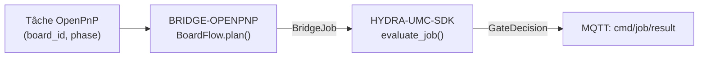

<!-- =============================================================================
HYDRA-UMC-BRIDGE-OPENPNP - OpenPnP board-flow coordination bridge
Copyright (C) JuanenRac (Electro Hobby 3D) <electrohobby3d@gmail.com>
GPL-3.0-or-later - see LICENSE
============================================================================= -->

<p align="center">
  
</p>

# 🔩 HYDRA-UMC-BRIDGE-OPENPNP

<p align="center"><a href="README.md">🇺🇸 English</a> | <a href="README_spa.md">🇪🇸 Español</a> | 🇫🇷 <b>Français</b> | <a href="README_ita.md">🇮🇹 Italiano</a> | <a href="README_deu.md">🇩🇪 Deutsch</a> | <a href="README_zho.md">🇨🇳 简体中文</a> | <a href="README_jpn.md">🇯🇵 日本語</a> | <a href="README_por.md">🇵🇹 Português</a></p>

### 📋 Pont de coordination de flux de cartes traçable pour OpenPnP

<p align="center">
  
  
  
  
  
  
</p>

---

> **Vérification d'honnêteté - ce qui fonctionne réellement aujourd'hui :** le noyau traçable de flux de cartes et sa porte de sécurité (`board_flow.py` avec `BoardFlow`, faisant passer chaque tâche par le propre `evaluate_job()` de `HYDRA-UMC-SDK`), l'inspecteur de profil OpenPnP en lecture seule (`configuration.py`), les simulateurs de transfert/cycle en traçage uniquement (`handoff.py`, `evidence.py`), et le transport MQTT de commandes/d'évidence (`mqtt_transport.py`) sont réels et couverts par 208 cas `unittest` qui passent (`python tools/build_test.py` - `test_board_flow.py`, `test_mqtt_transport.py`). Rien de tout cela n'a jamais ouvert OpenPnP, une vraie liaison machine, ou un vrai broker MQTT - `test_mqtt_transport.py`, `test_hardening.py`, `test_idempotency.py`, `test_mqtt_environment.py` utilise un client de broker factice, `configuration.py` ne fait qu'analyser un fichier `machine.xml` enregistré, et les simulateurs de `handoff.py`/`evidence.py` sont explicitement locaux uniquement, sans E/S OpenPnP, série ou machine. Il n'existe pas encore d'intégration en direct avec l'extension/API OpenPnP - voir « Feuille de route et limites connues » ci-dessous, qui le dit déjà clairement, et `CHANGELOG.md` pour ce qui a été exactement livré jusqu'à présent.

> **État de la sûreté et de la cybersécurité :** cet écosystème n'est pas un système de sécurité certifié. Il n'existe pas encore de chaîne d'E-STOP matérielle, ni de limites ou de verrouillages imposés par le firmware, ni de commande de mouvement vérifiée ; les images de firmware sont contrôlées par CRC32 et un HMAC-SHA256 à clé partagée, pas par une signature asymétrique ; TLS et TLS mutuel sont optionnels et désactivés par défaut ; aucune carte propre n'a encore été assemblée ni testée. Lisez la [base de sécurité](https://github.com/JuanenRac/HYDRA-UMC-DOCS/blob/main/docs/SECURITY_BASELINE.md) et le [modèle de menaces](https://github.com/JuanenRac/HYDRA-UMC-DOCS/blob/main/docs/THREAT_MODEL.md) avant de vous fier à une affirmation d'ici pour la sécurité d'une personne.

---

## 📋 En un coup d'œil

| | |
|---|---|
| Version | `0.2.0` |
| Maturité | Fonctionnel |
| Tests | 208 (`python tools/build_test.py`) |
| Technologie | Python / OpenPnP / HYDRA-UMC-SDK |
| Cible | Le Raspberry Pi CM5 d'une cellule HYDRA-UMC |
| Sur matériel réel | Simulé seulement : testé avec des émulateurs, des doubles de test ou des simulateurs ; aucune exécution sur du matériel réel n'est consignée pour cette version |

**Aller à :** [Présentation](#-présentation) · [Architecture](#-architecture) · [Fonctionnalités](#-fonctionnalités) · [Sécurité et protection](#-sécurité-et-protection) · [Interfaces](#-interfaces) · [Configuration](#-configuration) · [Démarrage rapide](#-démarrage-rapide) · [Tests](#-tests) · [Dépannage](#-dépannage) · [Structure du dépôt](#-structure-du-dépôt) · [Projets liés](#-projets-liés)

## 🚦 État du projet

Chaque ligne est une partie de ce dépôt et le feu dit où elle en est aujourd'hui. Elle est écrite d'après ce que le dépôt peut montrer (tests, compilations, exécutions), pas d'après ce qui est prévu.

🟢 Fait et vérifié · 🟡 Fonctionne, avec des limites connues · 🟠 À moitié fait ou pas encore vérifié · 🔴 Pas fait ou ne fonctionne pas

| Domaine | État | Ce que cela veut dire ici |
|---|---|---|
| Logiciel | 🟡 | Fonctionne pour son usage principal ; la vérification d'honnêteté ci-dessus liste ce qui manque encore |
| Tests | 🟢 | 208 tests automatiques, exécutés à chaque modification |
| Matériel réel | 🟠 | Simulé seulement : testé avec des émulateurs, des doubles de test ou des simulateurs ; aucune exécution sur du matériel réel n'est consignée pour cette version |
| Documentation | 🟢 | README en huit langues, vérifié par rapport au manifeste à chaque modification |

## 🎯 Présentation

**HYDRA-UMC-BRIDGE-OPENPNP** est le pont haut niveau de flux de cartes entre HYDRA-UMC et OpenPnP. Il coordonne la préparation des PCB, le chargement par robot, le placement natif, le déchargement par robot et l'achèvement traçable. Il n'implémente ni la cinématique de placement, ni le contrôle des chargeurs, ni le mouvement brut — tout cela reste entièrement à l'intérieur d'OpenPnP.

Il appartient à la famille **External Automation Bridges** : un ensemble de dépôts frères (CNC, LASER, OPENPNP, PRINTER3D, ROS2) qui partagent le même contrat de sécurité de `HYDRA-UMC-SDK`, afin qu'aucun pont ne puisse inventer sa propre définition du « sûr pour travailler ».

## 🧩 Rôle dans HYDRA-UMC

**HYDRA-UMC-BRIDGE-OPENPNP** se place entre une machine pick-and-place OpenPnP et sa ligne SMT et la cellule de robots. Il rapporte ce que dit ce côté, interroge la porte partagée avant tout travail auxiliaire et ne prend jamais l'autorité de la machine avec laquelle il coordonne.

Chaque bridge parle le contrat de sécurité partagé de `HYDRA-UMC-SDK` : un travail n'est accepté que si la porte partagée `evaluate_job()` le permet, et cette porte échoue en position fermée. Le projet parent est `HYDRA-UMC-SERVER` ; ce bridge ne l'appelle pas, il répond en MQTT, via `HYDRA-UMC-MQTT-BROKER`, à celui qui commande la cellule.

## 🏛️ Architecture

<p align="center">
  
</p>

<details>
<summary>Version texte du diagramme (Mermaid)</summary>



</details>

**Pourquoi il est construit ainsi**

* **Pourquoi la validation du `board_id` a lieu avant toute autre chose dans `plan()`.** La toute première vérification de `BoardFlow.plan()` est `not IDENTIFIER.fullmatch(board_id)` — un identifiant de carte malformé ou ambigu est rejeté immédiatement, avec une raison explicite, plutôt que transmis en aval où il serait plus difficile à tracer.
* **Pourquoi les transferts sont un dictionnaire fixe indexé par `JobPhase`, et non un formatage de chaîne.** `BoardFlow._handoffs` associe chacune des six phases prises en charge à une description littérale et non ambiguë. Une future phase inconnue est rejetée comme `unrecognized-phase` ; elle ne peut pas devenir un transfert autorisé simplement parce que le portail commun du SDK est prêt.
* **Pourquoi le pont ne planifie un transfert productif que lorsque la machine externe est `IDLE` et la cellule `READY`.** Le transfert de carte est une opération physique à deux acteurs ; si l'un des deux côtés n'est pas dans un état connu et sûr, planifier un transfert reviendrait à demander à un robot de se déplacer vers une machine imprévisible.
* **Pourquoi `ABORT` peut toujours être demandé pendant un défaut.** `JobPhase.ABORT` est associé à `request-controlled-stop`, que le portail partagé `evaluate_job()` ne bloque pas de la même manière que les phases productives — un opérateur ou un superviseur doit toujours pouvoir demander un arrêt contrôlé, même en plein défaut.
* **Pourquoi l'extension/API OpenPnP en direct reste reportée.** Le profil machine enregistré peut désormais être inspecté en lecture seule, mais choisir une interface de plugin ou une surface en direct exige toujours une session d'essai non productive ; cela évite d'intégrer des hypothèses de mouvement ou de chargeur non vérifiées.
* **Comment cela s'intègre dans le reste de l'écosystème.** BRIDGE-OPENPNP se situe entre une tâche OpenPnP et `HYDRA-UMC-SDK` → `HYDRA-UMC-MQTT-BROKER` → sécurité de cellule : il coordonne le côté robotique d'un transfert de carte, il ne revendique jamais la cinématique de placement ni le contrôle des chargeurs qui appartiennent à OpenPnP lui-même.

## ✨ Fonctionnalités

* ✅ **Noyau de flux de cartes traçable, réel :** `board_flow.py` — `BoardFlow.plan()` rejette toute tâche dont le `board_id` est vide ou comporte des espaces en début/fin *avant même* d'évaluer le portail de sécurité ; chaque transfert doit porter un identifiant stable et propre. *(implémenté, testé dans `tests/test_board_flow.py`)*
* ✅ **Carte de transfert par phase, réelle :** un dictionnaire fixe associe chaque `JobPhase` (`PREPARE`, `LOAD`, `PROCESS`, `UNLOAD`, `COMPLETE`, `ABORT`) à une description explicite et lisible du transfert — `verify-board-and-fixture`, `robot-loads-board-into-pnp-fixture`, `openpnp-places-declared-job`, etc. *(implémenté)*
* ✅ **Portail de sécurité partagé, réel :** chaque tâche valide est évaluée via `evaluate_job()` du `bridge_contract` de `HYDRA-UMC-SDK`, le même portail utilisé par tous les ponts frères ; un transfert productif n'avance que lorsque la machine externe rapporte `IDLE` et que la cellule HYDRA-UMC est `READY`. *(implémenté)*
* ✅ **Build/test non mutant :** `build-test.bat`/`.sh` compilent le code source et exécutent la suite de tests de traçabilité des cartes et de sécurité intrinsèque sans toucher aux fichiers de version ni au CHANGELOG. *(implémenté, voir Compilation et publication ci-dessous)*
* ✅ **Inspection en lecture seule du profil OpenPnP :** `inspect_openpnp_config.py` analyse un `machine.xml` enregistré, tandis que `openpnp-scripts/HYDRA-UMC/inspect_profile.js` est un modèle de script de menu OpenPnP invoqué manuellement ; les deux ne rapportent que la classe et le nombre de composants, et le modèle affiche ce résultat dans une boîte d'information sans envoyer de commande machine. *(implémenté, testé)*
* ✅ **Simulation de transfert uniquement traçable :** `BoardIdentity` lie les identifiants de carte, recette, révision et lot avant que `simulate_board_handoff()` applique le portail partagé du SDK ; il n'émet une empreinte SHA-256 déterministe que pour un plan autorisé et n'a aucune E/S OpenPnP, série ou machine. Des champs optionnels `slot_id`/`rack_id`/`table_id` suivent le placement physique réel (quel emplacement de chargeur, quel rack de stockage et quelle table ce transfert exact a utilisés) comme identité propre et séparée, afin que deux placements de la même carte ne soient jamais fingerprintés de façon indiscernable. *(implémenté, testé)*
* ✅ **Simulation du cycle productif uniquement traçable :** `simulate_board_cycle()` évalue la séquence ordonnée `PREPARE → LOAD → PROCESS → UNLOAD → COMPLETE` sous un état explicite de cellule/machine ; chaque étape productive échoue fermée hors de `READY/IDLE`, et `ABORT` reste séparé dans le chemin de sécurité du SDK. *(implémenté, testé)*
* ✅ **Contrat d'évidence déterministe :** `docs/BOARD_TRANSFER_EVIDENCE.md` définit le schéma `1.0` émis par les deux simulateurs. Il ne transporte que phase, décision, motif et une empreinte d'identité autorisée ; les valeurs brutes de carte, recette, révision et lot n'entrent jamais dans l'enregistrement JSON. *(implémenté, testé)*
* ✅ **Messages retenus et clés répétées :** `mqtt_transport.py` ignore les messages retenus (le broker les rejoue à chaque reconnexion) et, s'il reçoit un `IdempotencyStore`, répond à une `idempotency_key` répétée avec la réponse donnée la première fois au lieu d'évaluer de nouveau le travail. *(implémenté, testé dans `tests/test_idempotency.py`)*
* ✅ **État de la machine observé (les scripts d'événements d'OpenPnP) :** OpenPnP n'a pas d'API RPC, donc `openpnp-scripts/HYDRA-UMC/Events` contient des scripts d'événements (`Job.Starting`, `Job.Placement.Complete`, `Job.Finished`, `Machine.AfterHoming`, `Machine.AfterDisabled`) et un script de menu (`Report_state.js`) qui écrivent un petit fichier JSON, de façon atomique, avec l'état que chaque événement implique ; `observation.py` le lit (`OpenPnpStateSource`, `HYDRA_UMC_OPENPNP_STATE_FILE`) et le bridge décide d'après lui plutôt que d'après ce que prétend le message du travail. Un fichier absent, de plus de 15 minutes (`HYDRA_UMC_OPENPNP_STATE_MAX_AGE_SECONDS`), écrit par un autre ou mal formé est une machine OFFLINE qui refuse le travail ; `cmd/status` publie le `state` retenu. Les scripts sont testés dans Node contre les quelques classes Java qu'ils utilisent ; ils n'ont pas tourné dans OpenPnP et les noms d'événements sont ceux de la documentation. *(implémenté, pas essayé dans OpenPnP)*
* ✅ **Signaux de passage SMEMA :** `SmemaReceiver` (la cellule reçoit des cartes d'une machine amont : lit `board available`, pilote `machine ready`) et `SmemaSender` (la cellule donne des cartes à une machine aval : pilote `board available`, lit `machine ready`) de `smema.py` participent à la poignée de main SMEMA d'une ligne CMS. La lecture est filtrée contre les rebonds ; PILOTER une sortie passe par la porte partagée : seulement pour une cellule READY, une machine observée au repos et un montage vide (ou une carte préparée), et une sortie est retirée dès que sa condition cesse d'être vraie, à chaque abandon et quand une ligne ne peut pas être écrite. `cmd/smema_status`, `cmd/smema_ready` et `cmd/smema_offer` l'exposent. Testé contre un voisin simulé ; les broches de la CM5 demandent une carte d'interface pour le câble 12 à 24 V. *(implémenté, simulé seulement)*
* ✅ **Traçabilité par carte :** `traceability.py` rassemble les passages de chaque carte et, à la fin de son cycle, publie la trace sur `hydra/bridges/openpnp/event/board` (QoS 1, non retenu) et envoie à HYDRA-UMC-DATALAKE un échantillon `board_handoff` par étape sous `board-<empreinte>` plus un `production_event` (`good`, `cycleTimeS`) dont HYDRA-UMC-PRODUCTION-REPORTS calcule l'OEE. Par défaut seule l'empreinte sort ; les identifiants peuvent être inclus quand une usine le permet. Un data lake arrêté n'arrête jamais la cellule : les échantillons attendent et partent avec la trace suivante. *(implémenté, testé contre un serveur HTTP local)*
* ✅ **Code de la carte :** `board_code.py` compare le DataMatrix lu sur la carte avec la carte du travail (`HYDRA_UMC_OPENPNP_BOARD_CODE` : `off` par défaut, `advisory` ou `required`) ; un code différent est refusé, un travail sans carte prend l'unique code lu, et ce qui n'est pas un identifiant stable n'est pas un code. Le code vient du `POST /read-code` de HYDRA-UMC-VISION-NODE (`VisionNodeCodeSource`). *(implémenté, pas essayé sur une vraie étiquette)*
* ✅ **Boucle MQTT durcie et réponses honnêtes :** une charge trop grande (plus de 16 Kio) ou illisible, un JSON très imbriqué et toute défaillance inattendue reçoivent un refus sur le topic de résultat et ne terminent jamais la boucle ; `cmd/job` et `cmd/handoff` ont des espaces de clés d'idempotence séparés (`job:`/`handoff:`), de sorte qu'une tâche vérifiée avec le portail peut encore être transférée avec la même clé et garde son empreinte d'identité ; les réponses de `cmd/job` portent `"mode": "simulation-only"` et `"observed": false` (rien ne regarde OpenPnP : l'état de la machine est celui que déclare le demandeur) et un ABORT par ce biais indique que rien n'a été arrêté ; le portail et la trace du transfert partagent une seule règle d'identifiant de carte, `cmd/handoff` accepte `slot_id`, `rack_id` et `table_id`, et un `machine.xml` avec DOCTYPE est refusé quel que soit l'encodage ; le bridge s'annonce sur un topic `availability` avec un Last Will. *(implémenté, testé dans `tests/test_hardening.py`)*

## 🔒 Sécurité et protection

| Menace | Défense | Où |
|---|---|---|
| Un travail pour une cellule ou une machine qui n'est pas en état sûr | Chaque travail passe par la porte partagée `evaluate_job()` du SDK, qui échoue en position fermée ; le bridge n'a aucune logique propre d'acceptation | SDK `bridge_contract` |
| Données de travail démesurées | Au plus 32 paramètres, clés jusqu'à 64 caractères, valeurs jusqu'à 1024, identifiants jusqu'à 128 (`MAX_PARAMETERS`, `MAX_PARAMETER_KEY_CHARS`, `MAX_PARAMETER_VALUE_CHARS`, `MAX_IDENTIFIER_CHARS`) | SDK `bridge_contract` |
| Un ordre répété ou rejoué | Un `IdempotencyStore` retient chaque clé 24 heures et au plus 10 000 entrées ; une répétition reçoit la première réponse au lieu d'être réévaluée | SDK `job_intake` |
| Une charge MQTT énorme ou hostile | Une charge de plus de 16 KiB, un JSON illisible ou très imbriqué et tout échec inattendu reçoivent un refus sur le topic de résultat et ne terminent jamais la boucle | `mqtt_transport.py` |
| La mauvaise carte dans la machine | `board_code.py` lit le DataMatrix et le compare à la carte du travail ; `HYDRA_UMC_OPENPNP_BOARD_CODE` vaut `off`, `advisory` ou `required` | `board_code.py` |
| Un état OpenPnP périmé ou faux | Le fichier d'état n'est fiable que tant qu'il est frais (15 minutes par défaut), 16 KiB au plus, écrit par l'origine `openpnp-events` ; un mot inconnu donne `OFFLINE` | `observation.py` |
| Données de traçabilité sans limite et sorties SMEMA dangereuses | Au plus 256 traces ouvertes et 5000 échantillons en attente (envoyés par lots de 500) ; les identifiants de carte respectent `^[A-Za-z0-9][A-Za-z0-9._-]{0,95}$` ; les sorties SMEMA obéissent aux règles de sécurité de la cellule | `traceability.py`, `smema.py`, `board_flow.py` |
| Une commande retenue rejouée à la reconnexion | Un message `cmd/` retenu est ignoré à la reconnexion | `mqtt_transport.py` |

**Ce qu'il ne fait jamais :** il n'est pas un pilote de mouvement de placement et n'ouvre ni ne modifie jamais la machine OpenPnP quand il inspecte son XML.

## 🔌 Interfaces

Topics sous `hydra/bridges/openpnp/` ; il n'y a pas de verbe d'arrêt (`STOP_VERBS` est vide).

| Topic ou route | Ce qu'il porte |
|---|---|
| `cmd/status`, `cmd/job`, `cmd/handoff` | commandes en entrée ; chacune reçoit sa réponse sur `<verbe>/result` |
| `cmd/smema_offer`, `cmd/smema_ready`, `cmd/smema_status` | la poignée de main SMEMA avec les voisins de la ligne |
| `state`, `availability`, `event/board` | l'état, `online`/`offline` et les enregistrements de chaque carte (`board_handoff`, `production_event`, version de schéma `1.0`) pour le data lake et le rapport OEE |

## ⚙️ Configuration

| Variable | Par défaut | Ce qu'elle définit |
|---|---|---|
| `HYDRA_UMC_OPENPNP_BOARD_CODE` | `off` | `off`, `advisory` ou `required` ; une valeur inconnue vaut `off` |
| `HYDRA_UMC_OPENPNP_STATE_FILE` | non défini | chemin du fichier qu'écrivent les scripts d'événements d'OpenPnP ; non défini signifie aucune source d'état |
| `HYDRA_UMC_OPENPNP_STATE_MAX_AGE_SECONDS` | `900` | l'âge maximal du fichier d'état avant qu'il ne soit plus cru |
| `HYDRA_MQTT_USERNAME` | aucun | Le nom d'utilisateur MQTT ; le broker le lie à un préfixe d'identifiant client |
| `HYDRA_MQTT_PASSWORD` | aucun | Le mot de passe ; valable seulement avec le nom d'utilisateur |
| `HYDRA_MQTT_PASSWORD_FILE` | aucun | Le mot de passe lu dans un fichier (secret Docker ou systemd) ; ignoré si `HYDRA_MQTT_PASSWORD` est défini |
| `HYDRA_MQTT_TLS_CA` | aucun | Le fichier de l'AC qui a signé le certificat du broker : la connexion est en TLS et le certificat est vérifié |
| `HYDRA_MQTT_TLS` | désactivé | `1` active TLS, vérifié avec les AC de confiance du système |
| `HYDRA_MQTT_TLS_CERT` / `HYDRA_MQTT_TLS_KEY` | aucun | Le certificat client et sa clé pour un broker qui exige du TLS mutuel ; les deux sont requis |

## 🚀 Démarrage rapide

Nécessite Python 3.11 ou plus récent. Les tests et les scripts de build attendent `HYDRA-UMC-SDK` cloné à côté de ce dépôt (`../HYDRA-UMC-SDK`) ou indiqué par `HYDRA_UMC_SDK_ROOT`.

Essayez-le sans matériel (cela vérifie tout le bridge avec ses émulateurs et ses doubles de test) :

```bash
py -3 tools/build_test.py          # Windows
python3 tools/build_test.py         # Linux, macOS
```

Démarrer le service (il n'y a pas de script de console : le service est le `run_forever()` du transport MQTT, que vous appelez depuis votre propre code de démarrage) :

```python
from hydra_umc_bridge_openpnp.mqtt_transport import OpenPnpMqttBridge, run_forever
bridge = OpenPnpMqttBridge(cell_state=lambda: cell_state)   # state_source, smema_*, trace_recorder are optional
run_forever(bridge, host="192.168.0.180")                  # serves cmd/# forever
```

Le nom d'utilisateur, le mot de passe et les fichiers TLS viennent des variables `HYDRA_MQTT_*` (voir Configuration) ; le code ci-dessus n'a besoin d'aucun identifiant propre.

## 🧪 Tests

208 cas `unittest` automatiques s'exécutent avec `python tools/build_test.py` (qui compile aussi chaque module). Les tests n'ont besoin ni de matériel, ni de réseau, ni de paquet optionnel : ceux qui exigeraient `paho-mqtt`, `pyserial` ou une bibliothèque de fabricant utilisent un substitut ou sont ignorés si le paquet manque.

| Fichier de tests | Tests | Ce qu'il couvre |
|---|---|---|
| `test_board_flow.py`, `test_board_code.py`, `test_observation.py` | - | phases de transfert, le code de carte, le fichier d'état et les scripts d'événements |
| `test_smema.py`, `test_traceability.py` | - | SMEMA contre un voisin en mémoire ; la trace, les échantillons du data lake et une vraie destination HTTP locale |
| `test_mqtt_transport.py`, `test_mqtt_environment.py`, `test_hardening.py`, `test_edge_cases.py`, `test_idempotency.py` | - | répartition des topics, identifiants de l'environnement, clients hostiles, cas limites, clés répétées |

La CI exécute `HYDRA_UMC_CI=1 python tools/ci_validate.py`, qui vérifie le manifeste, les documents, les huit README et les images, et lance les tests avec une copie du SDK.

## 🏗️ Compilation et publication

Nécessite Python 3.11+. `tools/build_test.py` attend que `HYDRA-UMC-SDK` soit cloné en tant que répertoire frère (`../HYDRA-UMC-SDK`) ou indiqué via la variable d'environnement `HYDRA_UMC_SDK_ROOT`.

```bash
# Windows
build-test.bat      # validation uniquement — pas de changement de version/CHANGELOG
build.bat            # Valide et compile (compiler ne change jamais la version)

# Linux/macOS
bash build-test.sh
bash build.sh
```

`build-test` compile chaque module sous `src/` avec `py_compile` et exécute la suite complète `unittest` découverte sous `tests/` (`test_board_flow.py`, `test_mqtt_transport.py` - 208 tests), démontrant le rejet par traçabilité des cartes et le portail de sécurité parmi tout le reste couvert — il ne modifie jamais le dépôt. `build` exécute d'abord cette même validation et, seulement en cas de succès, appelle `tools/bump_version.py` pour synchroniser la version dans `pyproject.toml`, `hydra-umc.project.json` et `CHANGELOG.md`. Il n'existe pas encore de commande `run` machine réelle — cela nécessite une intégration OpenPnP validée.

## 🩺 Dépannage

| Vous voyez | Parce que | Faites |
|---|---|---|
| `ModuleNotFoundError: hydra_umc_sdk` | Le SDK n'est ni installé ni à côté de ce dépôt | Clonez `HYDRA-UMC-SDK` à côté de ce dépôt ou définissez `HYDRA_UMC_SDK_ROOT` |
| `paho-mqtt is not installed` | Le client MQTT est un extra optionnel | `pip install ".[mqtt]"` (il faut `paho-mqtt` 2.1 ou plus, avant 3) |
| `password was given without a username` | Les identifiants MQTT exigent les deux parties | Définissez aussi `HYDRA_MQTT_USERNAME`, pas seulement le mot de passe |
| `could not reach the MQTT broker after N attempts` | Le broker est arrêté, l'adresse est fausse ou le port est fermé | Démarrez `HYDRA-UMC-MQTT-BROKER` et vérifiez l'hôte et le port donnés au transport (5 essais à 2 secondes d'écart) ; un échec de la poignée de main TLS n'est pas réessayé |
| `the MQTT broker refused the connection` | Le broker a refusé l'identifiant (ou n'a pas répondu à temps) | Vérifiez `HYDRA_MQTT_USERNAME` et le mot de passe ; l'identifiant client doit commencer par le préfixe que le broker a lié à l'identifiant |
| `"allowed": false` + `reason` | La porte partagée ou une garde a refusé l'ordre | Lisez `reason` et corrigez la cause ; ne réessayez pas à l'aveugle |
| `OFFLINE` although OpenPnP is running | Le fichier d'état manque, dépasse la limite d'âge ou vient d'une autre origine | Installez les scripts de `openpnp-scripts/` dans OpenPnP, pointez `HYDRA_UMC_OPENPNP_STATE_FILE` vers le fichier qu'ils écrivent et n'augmentez `HYDRA_UMC_OPENPNP_STATE_MAX_AGE_SECONDS` que si la machine reste longtemps inactive |

## 📂 Structure du dépôt

<p align="center">
  
</p>

<details>
<summary>Version texte de l'arborescence</summary>

```text
HYDRA-UMC-BRIDGE-OPENPNP/
├── src/hydra_umc_bridge_openpnp/
│   ├── board_flow.py                                        phases de transfert des cartes (pas un pilote de placement)
│   ├── board_code.py                                        DataMatrix de la carte face au travail
│   ├── observation.py                                       fichier d'état d'OpenPnP, fiable s'il est frais
│   ├── smema.py                                             la poignée de main SMEMA avec les voisins de la ligne
│   ├── traceability.py                                      l'histoire de chaque carte, pour le data lake et l'OEE
│   ├── handoff.py                                           transfert traçable, simulé
│   ├── evidence.py                                          preuves locales déterministes
│   ├── configuration.py                                     contrôle XML en lecture seule
│   └── mqtt_transport.py                                    transport MQTT des commandes, de l'état et des événements de carte
├── tests/                                                   208 tests, avec des bancs SMEMA et de traçabilité
├── docs/                                                    guide du bridge, preuves de transfert
├── openpnp-scripts/                                         scripts d'événements qui écrivent le fichier d'état exposé par OpenPnP
├── tools/                                                   exécuteur de build et de tests, montée de version, validateur CI, générateurs et vérifications des README et des images
├── images/                                                  bannière et images du README
├── .github/                                                 workflow CI et modèles de tickets
├── pyproject.toml                                           métadonnées du paquet et dépendances
├── hydra-umc.project.json                                   manifeste : version, maturité, famille
├── CHANGELOG.md                                             ce qui a changé à chaque version
├── build.sh build.bat                                       scripts de build (ils ne changent jamais la version)
├── build-test.sh build-test.bat                             scripts de build (ils ne changent jamais la version)
├── test.sh test.bat                                         lancent les tests
├── inspect-openpnp-config.sh / inspect-openpnp-config.bat   contrôle en lecture seule d'un XML de machine
└── SECURITY.md SUPPORT.md CONTRIBUTING.md CODE_OF_CONDUCT.md LICENSE LICENSE.md
```

</details>

## 🗺️ Feuille de route et limites connues

**Limites connues aujourd'hui**

**Réel aujourd'hui :** version `0.2.0`, un noyau de transfert de PCB traçable testé localement (`BoardFlow`) adossé au portail de tâches partagé de `HYDRA-UMC-SDK`, un vrai transport MQTT de commandes/d'évidence (`mqtt_transport.py`), une suite `unittest` déterministe de 208 tests, un inspecteur de profil enregistré rapportant une évidence réelle d'actionneurs/signaleurs/embouts de buse OpenPnP ainsi que les décomptes de têtes/caméras/pilotes/chargeurs, un modèle de menu OpenPnP visible en lecture seule, des simulations de transfert/cycle liées à l'identité et un contrat JSON d'évidence non sensible vérifié par CI sans E/S machine.

**Frontière d'intégration :** OpenPnP conserve à tout moment la cinématique de placement, le contrôle des chargeurs et le mouvement brut ; ce pont ne fait que réguler et tracer le *transfert* autour de cela — chargement par robot, achèvement du placement natif, déchargement par robot.

**Encore à venir :** aucune connexion en direct à une machine OpenPnP n'est revendiquée — l'extension/API concrète ne sera choisie que dans une session isolée non productive avec un opérateur présent.

## 🌍 Langues

Ce README et les documents du dépôt existent en huit langues : anglais, espagnol, allemand, français, italien, japonais, chinois et portugais (Portugal). Ils sont écrits ensemble et la CI vérifie que les huit fichiers ont les mêmes sections et les mêmes liens. Ce dépôt n'a ni écran ni catalogue de messages propre, il n'y a donc aucune chaîne d'interface à traduire.

## 🔗 Projets liés

Ce projet fait partie de l'écosystème robotique HYDRA-UMC du même auteur (JuanenRac / Electro Hobby 3D). Bon à savoir, car une demande pourrait en réalité concerner l'un de ceux-ci plutôt que ce dépôt.

**Projet Parent**
- **[HYDRA-UMC-SERVER](https://github.com/JuanenRac/HYDRA-UMC-SERVER)** — le vrai backend headless (REST/WebSocket) auquel parle réellement chaque client de contrôle ; ce bridge ne l'appelle pas : il répond en MQTT, via HYDRA-UMC-MQTT-BROKER, à qui pilote la cellule.

**Projets Frères** — parlent également à la propre API de HYDRA-UMC-SERVER, chacun en tant que son propre client
- **[HYDRA-UMC-STUDIO](https://github.com/JuanenRac/HYDRA-UMC-STUDIO)** — tableau de bord de contrôle web avec visualisation 3D multi-robot en temps réel.
- **[HYDRA-UMC-SUITE](https://github.com/JuanenRac/HYDRA-UMC-SUITE)** — centre de commande d'essaim de bureau (PySide6) pour plusieurs serveurs à la fois, empaqueté en exécutable autonome.
- **[HYDRA-UMC-ANDROID-CONTROL](https://github.com/JuanenRac/HYDRA-UMC-ANDROID-CONTROL)** — application de contrôle Android native avec connexion biométrique et un compagnon Wear OS jumelé.
- **[HYDRA-UMC-IOS-CONTROL](https://github.com/JuanenRac/HYDRA-UMC-IOS-CONTROL)** — application de contrôle iOS/iPadOS (Flutter) avec synchronisation WebSocket en temps réel.
- **[HYDRA-UMC-DSI](https://github.com/JuanenRac/HYDRA-UMC-DSI)** — interface tactile native pour l'écran tactile DSI 7" embarqué, intégrée directement sur le CM5.
- **[HYDRA-UMC-BRIDGE-AMR](https://github.com/JuanenRac/HYDRA-UMC-BRIDGE-AMR)** — frontière de coordination pour les flottes AGV/AMR via un éditeur MQTT VDA 5050 (testé uniquement contre une flotte émulée).
- **[HYDRA-UMC-BRIDGE-CNC](https://github.com/JuanenRac/HYDRA-UMC-BRIDGE-CNC)** — coordinateur haut niveau pour cellules CNC avec accès au statut/octets de contrôle GRBL (testé uniquement contre un émulateur).
- **[HYDRA-UMC-BRIDGE-DROIDS](https://github.com/JuanenRac/HYDRA-UMC-BRIDGE-DROIDS)** — frontière de coordination pour droïdes à pattes/humanoïdes, avec un émetteur de commandes Boston Dynamics Spot (testé uniquement contre un émulateur).
- **[HYDRA-UMC-BRIDGE-LASER](https://github.com/JuanenRac/HYDRA-UMC-BRIDGE-LASER)** — coordinateur de cellules laser lisant 3 signaux GPIO de clé/enceinte/verrouillage (testé uniquement contre une puce simulée ; il ne peut ni armer ni tirer un laser).
- **[HYDRA-UMC-BRIDGE-PRINTER3D](https://github.com/JuanenRac/HYDRA-UMC-BRIDGE-PRINTER3D)** — frontière de coordination sûre pour imprimantes 3D Moonraker/Klipper, avec de vraies commandes de tâche contrôlées.
- **[HYDRA-UMC-BRIDGE-ROS2](https://github.com/JuanenRac/HYDRA-UMC-BRIDGE-ROS2)** — coordinateur avec un transport ROS 2 rclpy à importation paresseuse (pas encore exécuté contre une installation ROS 2).
- **[HYDRA-UMC-BRIDGE-UAV](https://github.com/JuanenRac/HYDRA-UMC-BRIDGE-UAV)** — frontière de coordination pour UAV équipés de caméra, avec un émetteur de commandes MAVLink (testé uniquement contre un émulateur).

**Directement Liés**
- **[HYDRA-UMC-SDK](https://github.com/JuanenRac/HYDRA-UMC-SDK)** — le contrat JSON-Schema partagé et la barrière logicielle de contrôle des jobs contre laquelle chaque bridge valide ses commandes (pas une fonction de sécurité certifiée).
- **[HYDRA-UMC-CONNECTOR-HUB](https://github.com/JuanenRac/HYDRA-UMC-CONNECTOR-HUB)** — registre déclaratif et validateur de manifestes d'adaptateur pour les connecteurs de machines externes ; étend la propre idée de contrat du SDK aux machines externes sans remplacer les projets de passerelle industrielle.
- **[HYDRA-UMC-MQTT-BROKER](https://github.com/JuanenRac/HYDRA-UMC-MQTT-BROKER)** — le vrai transport de `mqtt_transport.py` pour les propres topics `hydra/bridges/openpnp/...` de ce bridge — la barrière de tâches plus une simulation de passation entièrement traçable, sans topic `state` puisqu'il n'y a ici aucun vrai transport machine à observer ; voir le propre `docs/BRIDGE_TOPICS.md` de ce dépôt.
- **[HYDRA-UMC-SAFETY-ZONES](https://github.com/JuanenRac/HYDRA-UMC-SAFETY-ZONES)** — future preuve de sécurité de zone de cellule pour ce bridge.

**Fait Également Partie de l'Écosystème**

*Matériel & Plateforme de Base*
- **[HYDRA-UMC](https://github.com/JuanenRac/HYDRA-UMC)** — la conception de la carte mère du bras robotique : hôte CM5 + coprocesseur STM32H745 double cœur, destinée à coordonner jusqu'à 8 bras-outils via CAN-OTA/SPI-OTA (firmware à un stade précoce ; aucune carte assemblée pour l'instant).
- **[HYDRA-UMC-OS](https://github.com/JuanenRac/HYDRA-UMC-OS)** — couche produit reproductible sur Raspberry Pi OS pour le CM5 : agent en lecture seule, config/profils validés, provisionnement WiFi de premier contact.

*Backend Central & Clients*
- **[HYDRA-UMC-EDITOR-URDF](https://github.com/JuanenRac/HYDRA-UMC-EDITOR-URDF)** — créateur/éditeur graphique de bureau pour URDF qui envoie les modèles terminés vers le propre catalogue de STUDIO.
- **[HYDRA-UMC-EDITOR-STL](https://github.com/JuanenRac/HYDRA-UMC-EDITOR-STL)** — éditeur de bureau de modèles STL, transformant/remplaçant/retirant/ajoutant de vraies pièces dans le même catalogue de modèles qu'édite aussi HYDRA-UMC-EDITOR-URDF.

*Plateforme d'Outils URTC*
- **[URTC](https://github.com/JuanenRac/URTC)** — firmware pour la carte physique Universal Robot Tool Controller, plus de 25 profils d'outil sur bus CAN.
- **[URTC-FLASHER](https://github.com/JuanenRac/URTC-FLASHER)** — outil de bureau à interface graphique pour flasher les cartes URTC, CAN-OTA plus SWD/JTAG puce complète.
- **[URTC-TESTER](https://github.com/JuanenRac/URTC-TESTER)** — outil de bureau de diagnostic CAN-bus en direct pour cartes URTC, un panneau par profil d'outil.
- **[URTC-WEB-STUDIO](https://github.com/JuanenRac/URTC-WEB-STUDIO)** — alternative basée navigateur à URTC-TESTER via la Web Serial API, sans installation locale.
- **[URTC-GATEWAY](https://github.com/JuanenRac/URTC-GATEWAY)** — passerelle devant le bus CAN d'URTC : liste d'identifiants autorisés, limite de débit et clé de session ; logiciel testé sur ordinateur, pas encore sur un bus réel.

*Nœud IA de Vision (Hailo-8)*
- **[HYDRA-UMC-VISION-NODE](https://github.com/JuanenRac/HYDRA-UMC-VISION-NODE)** — hub d'intégration pour le pipeline de vision Hailo-8, avec une vraie vérification de disponibilité matérielle par étape.
- **[HYDRA-UMC-DETECTION-HEF](https://github.com/JuanenRac/HYDRA-UMC-DETECTION-HEF)** — registre réel de modèles compilés avec vérification de chargement sécurisé par architecture Hailo/checksum.
- **[HYDRA-UMC-VISION-STREAMER](https://github.com/JuanenRac/HYDRA-UMC-VISION-STREAMER)** — générateur réel de pipeline GStreamer + config MediaMTX, avec une vraie frontière d'intégration HailoRT.
- **[HYDRA-UMC-VISUAL-SERVOING-API](https://github.com/JuanenRac/HYDRA-UMC-VISUAL-SERVOING-API)** — loi de correction Position-Based Visual Servoing avec autorisation conditionnée à l'état de zone ; pas encore d'estimation de pose par caméra.

*Nœud IA Cognitif (Hailo-10)*
- **[HYDRA-UMC-COGNITIVE-NODE](https://github.com/JuanenRac/HYDRA-UMC-COGNITIVE-NODE)** — hub d'intégration pour le pipeline cognitif Hailo-10 (orchestration LLM/VLA/voix).
- **[HYDRA-UMC-VLA-ENGINE](https://github.com/JuanenRac/HYDRA-UMC-VLA-ENGINE)** — vrai encodage/décodage de jetons d'action et génération de trajectoire pour un modèle Vision-Language-Action.
- **[HYDRA-UMC-VOICE-UI](https://github.com/JuanenRac/HYDRA-UMC-VOICE-UI)** — vrai front-end vocal (VAD + analyseur d'intention) avec un relais Watch borné et soumis à confirmation.
- **[HYDRA-UMC-SEMANTIC-PLANNER](https://github.com/JuanenRac/HYDRA-UMC-SEMANTIC-PLANNER)** — vraie décomposition de tâches basée sur des règles et récupération sémantique d'erreurs sur les codes d'erreur MCU.
- **[HYDRA-UMC-DOCS-QA](https://github.com/JuanenRac/HYDRA-UMC-DOCS-QA)** — vraie recherche documentaire TF-IDF (bibliothèque standard uniquement) sur les propres documents Markdown de cet écosystème.
- **[HYDRA-UMC-LOCAL-TECHNICIAN](https://github.com/JuanenRac/HYDRA-UMC-LOCAL-TECHNICIAN)** — technicien de maintenance IA local et à portes de politique pour l'écosystème lui-même - observe, diagnostique et propose des corrections ; les deux niveaux de risque les plus élevés ne sont délibérément pas encore implémentés.

*Orchestration & Essaim*
- **[HYDRA-UMC-ORCHESTRATOR](https://github.com/JuanenRac/HYDRA-UMC-ORCHESTRATOR)** — hub d'intégration avec un vrai contrat de rapport de santé gRPC/Protobuf et une machine à états de mission.
- **[HYDRA-UMC-JOB-DISPATCHER](https://github.com/JuanenRac/HYDRA-UMC-JOB-DISPATCHER)** — vraie file de tâches basée sur la priorité avec déduplication, via une vraie API HTTP.
- **[HYDRA-UMC-NODE-HEALING](https://github.com/JuanenRac/HYDRA-UMC-NODE-HEALING)** — vrai chien de garde de santé de flotte basé sur gRPC, avec retry/backoff et détection d'incohérence d'identité.
- **[HYDRA-UMC-PATH-PLANNER-3D](https://github.com/JuanenRac/HYDRA-UMC-PATH-PLANNER-3D)** — vrai planificateur de trajectoire 3D basé sur RRT, avec vraie validation des collisions obstacle/espace de travail.
- **[HYDRA-UMC-SWARM-SYNC](https://github.com/JuanenRac/HYDRA-UMC-SWARM-SYNC)** — vraie synchronisation d'état CRDT LWW-Element-Map, testée par propriétés pour la convergence multi-cellule.

*Jumeau Numérique & Simulation*
- **[HYDRA-UMC-TWIN](https://github.com/JuanenRac/HYDRA-UMC-TWIN)** — hub d'intégration pour le moteur de jumeau numérique, avec un vrai contrat de synchronisation par compatibilité de version.
- **[HYDRA-UMC-HIL-BRIDGE](https://github.com/JuanenRac/HYDRA-UMC-HIL-BRIDGE)** — routeur hardware-in-the-loop avec un verrouillage logiciel de collision entre simulation et matériel réel (testé sans matériel réel).
- **[HYDRA-UMC-PHYSICS-REPLICA](https://github.com/JuanenRac/HYDRA-UMC-PHYSICS-REPLICA)** — vraie cinématique directe et validation des limites articulaires sur un vrai sous-ensemble URDF.
- **[HYDRA-UMC-SYNTHETIC-DATA-GEN](https://github.com/JuanenRac/HYDRA-UMC-SYNTHETIC-DATA-GEN)** — vrai générateur procédural de scènes 2D avec export d'annotations YOLO/COCO.

*Données & Analytique*
- **[HYDRA-UMC-DATALAKE](https://github.com/JuanenRac/HYDRA-UMC-DATALAKE)** — vrai magasin de séries temporelles basé sur sqlite3, avec une vraie API HTTP d'ingestion/requête.
- **[HYDRA-UMC-ANOMALY-DETECTOR](https://github.com/JuanenRac/HYDRA-UMC-ANOMALY-DETECTOR)** — vrai détecteur d'anomalies FFT + ligne de base statistique, avec surveillance de dérive.
- **[HYDRA-UMC-PRODUCTION-REPORTS](https://github.com/JuanenRac/HYDRA-UMC-PRODUCTION-REPORTS)** — vrai calcul OEE/disponibilité sur l'historique de DATALAKE, avec export CSV reproductible.
- **[HYDRA-UMC-TELEMETRY-COLLECTOR](https://github.com/JuanenRac/HYDRA-UMC-TELEMETRY-COLLECTOR)** — vrai pipeline d'ingestion CAN/WebSocket vers DATALAKE, avec déduplication par séquence.

*Passerelle Industrielle*
- **[HYDRA-UMC-GATEWAY-INDUSTRIAL](https://github.com/JuanenRac/HYDRA-UMC-GATEWAY-INDUSTRIAL)** — hub d'intégration relayant vers les protocoles industriels, avec une vraie couche de liste blanche de commandes/contre-pression.
- **[HYDRA-UMC-OPCUA-SERVER](https://github.com/JuanenRac/HYDRA-UMC-OPCUA-SERVER)** — vrai espace d'adressage OPC-UA, vérifié avec une vraie session client du protocole binaire.
- **[HYDRA-UMC-MTCONNECT-ADAPTER](https://github.com/JuanenRac/HYDRA-UMC-MTCONNECT-ADAPTER)** — vrais points de terminaison XML MTConnect `/probe` et `/current`, avec sortie en mode dégradé.

*Outils Complémentaires & Opérations de l'Écosystème*
- **[HYDRA-UMC-DASHBOARD-AI](https://github.com/JuanenRac/HYDRA-UMC-DASHBOARD-AI)** — panneaux Smart Summaries et Anomaly Highlighting sur DATALAKE/ANOMALY-DETECTOR, avec un repli statistique honnête.
- **[HYDRA-UMC-TOOL-CLI](https://github.com/JuanenRac/HYDRA-UMC-TOOL-CLI)** — CLI de flotte avec un vrai contrat de codes de sortie stable, un vrai client en direct de la propre API de HYDRA-UMC-SERVER.
- **[HYDRA-UMC-WATCH](https://github.com/JuanenRac/HYDRA-UMC-WATCH)** — application compagnon WearOS avec des motifs d'alerte haptique et un relais vocal vers le téléphone jumelé (pas encore exécutée sur une montre physique).
- **[URTC-SMART-RACK](https://github.com/JuanenRac/URTC-SMART-RACK)** — firmware pour un rack de montage de cartes avec décodage réel d'ID d'outil et logique de préchauffage Smart Idle.
- **[URTC-VISION-TOOL](https://github.com/JuanenRac/URTC-VISION-TOOL)** — firmware plus un vrai compagnon de vision Python pour une tête d'outil d'inspection thermique/RGB.
- **[HYDRA-UMC-UPDATER](https://github.com/JuanenRac/HYDRA-UMC-UPDATER)** — outil administratif de bureau qui découvre, clone et met à jour chaque dépôt de cet écosystème.
- **[HYDRA-UMC-OS-REBUILDER](https://github.com/JuanenRac/HYDRA-UMC-OS-REBUILDER)** — outil de bureau Windows/Linux qui construit une image de la CM5 prête à graver, préchargée avec les versions les plus actuelles de l'écosystème, avec une configuration de premier démarrage Wi-Fi/utilisateur/SSH façon Raspberry Pi Imager.
- **[HYDRA-UMC-OPS-AGENT](https://github.com/JuanenRac/HYDRA-UMC-OPS-AGENT)** — coordinateur d'incidents de maintenance : un rôle edge à faible privilège collecte un instantané d'inventaire/santé assaini, un rôle control-plane le rend en lecture seule et demande à un fournisseur d'IA de suggérer un diagnostic - n'applique jamais de correctif ni ne déploie rien.
- **[HYDRA-UMC-DEV-SERVER](https://github.com/JuanenRac/HYDRA-UMC-DEV-SERVER)** — hôte de développement reproductible (Raspberry Pi 5 / CM5) qui héberge le code source de l'écosystème et exécute des tâches de compilation/test délimitées via une file d'attente durable ; un rôle de développement dédié, explicitement distinct d'un CM5 opérationnel.

## 📚 Documentation

Où lire la suite :

* [docs/BRIDGE_GUIDE.md](docs/BRIDGE_GUIDE.md) - périmètre, flux des cartes, fichier d'état, SMEMA, traçabilité, scripts
* [docs/BOARD_TRANSFER_EVIDENCE.md](docs/BOARD_TRANSFER_EVIDENCE.md) - quelle preuve laisse un transfert traçable
* [Base de sécurité de l'écosystème](https://github.com/JuanenRac/HYDRA-UMC-DOCS/blob/main/docs/SECURITY_BASELINE.md)
* [Modèle de menaces de l'écosystème](https://github.com/JuanenRac/HYDRA-UMC-DOCS/blob/main/docs/THREAT_MODEL.md)
* [Journal des modifications de ce dépôt](CHANGELOG.md)
* [Licence de ce dépôt](LICENSE.md)

## 🤝 Contribuer et communauté

* Avant une pull request, exécutez `HYDRA_UMC_CI=1 py -3 tools/ci_validate.py` (ou `HYDRA_UMC_CI=1 python3 tools/ci_validate.py`) : il doit afficher `CI_VALIDATION=PASS`. N'exécutez pas `build.sh` ni `build.bat` pour cette vérification ; compiler n'est pas vérifier.
* Les huit README sont écrits à partir d'une source unique dans HYDRA-UMC-DOCS ; ne les modifiez pas à la main. Changez la source et réécrivez-les avec `tools/make_readmes.py`.
* N'affirmez pas dans un README ce qui n'a pas tourné : écrivez « simulé » ou « non essayé sur matériel » quand c'est la vérité.
* Voir [CONTRIBUTING.md](CONTRIBUTING.md), le [code de conduite](CODE_OF_CONDUCT.md), [SECURITY.md](SECURITY.md) et [SUPPORT.md](SUPPORT.md).

## 👤 AUTEUR

**JuanenRac (Electro Hobby 3D)** · electrohobby3d@gmail.com

## 📜 LICENCE

GPL-3.0-or-later - [LICENSE](LICENSE).
