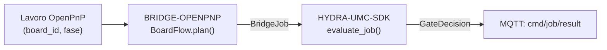

<!-- =============================================================================
HYDRA-UMC-BRIDGE-OPENPNP - OpenPnP board-flow coordination bridge
Copyright (C) JuanenRac (Electro Hobby 3D) <electrohobby3d@gmail.com>
GPL-3.0-or-later - see LICENSE
============================================================================= -->

<p align="center">
  
</p>

# 🔩 HYDRA-UMC-BRIDGE-OPENPNP

<p align="center"><a href="README.md">🇺🇸 English</a> | <a href="README_spa.md">🇪🇸 Español</a> | <a href="README_fra.md">🇫🇷 Français</a> | 🇮🇹 <b>Italiano</b> | <a href="README_deu.md">🇩🇪 Deutsch</a> | <a href="README_zho.md">🇨🇳 简体中文</a> | <a href="README_jpn.md">🇯🇵 日本語</a> | <a href="README_por.md">🇵🇹 Português</a></p>

### 📋 Ponte di coordinamento tracciabile del flusso schede per OpenPnP

<p align="center">
  
  
  
  
  
  
</p>

---

> **Verifica di onestà - cosa funziona davvero oggi:** il nucleo tracciabile del flusso di schede e il suo gate di sicurezza (`board_flow.py` con `BoardFlow`, che fa passare ogni lavoro attraverso il vero `evaluate_job()` di `HYDRA-UMC-SDK`), l'ispettore di profilo OpenPnP di sola lettura (`configuration.py`), i simulatori di passaggio/ciclo solo di traccia (`handoff.py`, `evidence.py`), e il trasporto MQTT di comandi/evidenza (`mqtt_transport.py`) sono reali e coperti da 240 casi `unittest` superati (`python tools/build_test.py` - `test_board_flow.py`, `test_mqtt_transport.py`). Nulla di tutto ciò ha mai aperto OpenPnP, un vero collegamento macchina, o un vero broker MQTT - `test_mqtt_transport.py`, `test_hardening.py`, `test_idempotency.py`, `test_mqtt_environment.py` usa un client broker fittizio, `configuration.py` si limita ad analizzare un file `machine.xml` salvato, e i simulatori di `handoff.py`/`evidence.py` sono esplicitamente solo locali, senza I/O OpenPnP, seriale o macchina. Non esiste ancora un'integrazione live con l'estensione/API OpenPnP - vedi "Roadmap e limiti noti" qui sotto, che lo dice già chiaramente, e `CHANGELOG.md` per cosa è stato esattamente consegnato finora. Il trasporto MQTT è stato eseguito anche contro un vero HYDRA-UMC-MQTT-BROKER su una macchina di sviluppo (`tests/test_broker_integration.py`, saltato se nessun broker è installato): pubblicazione e sottoscrizione con QoS 0, 1 e 2, la disponibilità trattenuta e il suo last will, e il ritorno dopo che il broker si è fermato ed è ripartito.

> **Stato di sicurezza (safety e security):** questo ecosistema non è un sistema di sicurezza certificato. Non esiste ancora un percorso E-STOP hardware, né limiti o interblocchi imposti dal firmware, né un comando di movimento verificato; le immagini firmware sono controllate con CRC-32 e una firma Ed25519, e una compilazione di rilascio rifiuta le chiavi di sviluppo pubblicate (le teste utensile e le schede di espansione dietro il relè usano ancora i bootloader di URTC, che accettano un HMAC-SHA256 a chiave condivisa invece di una firma); TLS e TLS reciproco sono opzionali e disattivati per impostazione predefinita; nessuna scheda propria è stata ancora assemblata o provata. Leggi la [base di sicurezza](https://github.com/JuanenRac/HYDRA-UMC-DOCS/blob/main/docs/SECURITY_BASELINE.md) e il [modello delle minacce](https://github.com/JuanenRac/HYDRA-UMC-DOCS/blob/main/docs/THREAT_MODEL.md) prima di fidarti di qualsiasi affermazione qui per la sicurezza di una persona.

---

## 📋 In breve

| | |
|---|---|
| Versione | `0.2.1` |
| Maturità | Funzionale |
| Test | 240 (`python tools/build_test.py`) |
| Tecnologia | Python / OpenPnP / HYDRA-UMC-SDK |
| Destinazione | Il Raspberry Pi CM5 di una cella HYDRA-UMC |
| Su hardware reale | Solo simulato: provato con emulatori, test double o simulatori; per questa versione non risulta alcuna esecuzione su hardware reale |

**Vai a:** [Panoramica](#-panoramica) · [Architettura](#-architettura) · [Funzionalità](#-funzionalità) · [Sicurezza e protezione](#-sicurezza-e-protezione) · [Interfacce](#-interfacce) · [Configurazione](#-configurazione) · [Avvio rapido](#-avvio-rapido) · [Test](#-test) · [Risoluzione dei problemi](#-risoluzione-dei-problemi) · [Struttura del repository](#-struttura-del-repository) · [Progetti correlati](#-progetti-correlati)

## 🚦 Stato del progetto

Ogni riga è una parte di questo repository e il semaforo dice a che punto è oggi. È scritta in base a ciò che il repository può mostrare (test, compilazioni, esecuzioni), non a ciò che è previsto.

🟢 Fatto e verificato · 🟡 Funziona, con limiti noti · 🟠 Fatto a metà o non ancora verificato · 🔴 Non fatto o non funzionante

| Area | Stato | Cosa significa qui |
|---|---|---|
| Software | 🟡 | Funziona per il suo scopo principale; la verifica di onestà qui sopra elenca ciò che manca ancora |
| Test | 🟢 | 240 test automatici, eseguiti a ogni modifica |
| Hardware reale | 🟠 | Solo simulato: provato con emulatori, test double o simulatori; per questa versione non risulta alcuna esecuzione su hardware reale |
| Documentazione | 🟢 | README in otto lingue, verificato rispetto al manifesto a ogni modifica |

## 🎯 Panoramica

**HYDRA-UMC-BRIDGE-OPENPNP** è il ponte di alto livello per il flusso schede tra HYDRA-UMC e OpenPnP. Coordina la preparazione dei PCB, il carico da parte del robot, il posizionamento nativo, lo scarico da parte del robot e il completamento tracciabile. Non implementa la cinematica di posizionamento, il controllo dei feeder o il movimento grezzo — tutto ciò resta interamente all'interno di OpenPnP.

Appartiene alla famiglia **External Automation Bridges**: un insieme di repository fratelli (CNC, LASER, OPENPNP, PRINTER3D, ROS2) che condividono lo stesso contratto di sicurezza di `HYDRA-UMC-SDK`, così nessun ponte può inventare una propria definizione di "sicuro per lavorare".

## 🧩 Ruolo in HYDRA-UMC

**HYDRA-UMC-BRIDGE-OPENPNP** sta tra una macchina pick-and-place OpenPnP e la sua linea SMT e la cella di robot. Riferisce ciò che dice quel lato, interroga la porta condivisa prima di qualsiasi lavoro ausiliario e non assume mai l'autorità della macchina con cui si coordina.

Ogni bridge parla il contratto di sicurezza condiviso di `HYDRA-UMC-SDK`: un lavoro viene accettato solo se la porta condivisa `evaluate_job()` lo permette, e quella porta fallisce chiusa. Il progetto padre è `HYDRA-UMC-SERVER`; questo bridge non lo chiama, risponde via MQTT, attraverso `HYDRA-UMC-MQTT-BROKER`, a chi comanda la cella.

## 🏛️ Architettura

<p align="center">
  
</p>

<details>
<summary>Versione testuale del diagramma (Mermaid)</summary>



</details>

**Perché è fatto così**

* **Perché la validazione di `board_id` avviene prima di qualsiasi altra cosa in `plan()`.** Il primissimo controllo di `BoardFlow.plan()` è `not IDENTIFIER.fullmatch(board_id)` — un identificatore di scheda malformato o ambiguo viene rifiutato immediatamente, con una motivazione esplicita, invece di essere inoltrato a valle dove sarebbe più difficile da tracciare.
* **Perché i passaggi sono un dizionario fisso indicizzato per `JobPhase`, non una formattazione di stringhe.** `BoardFlow._handoffs` mappa ciascuna delle sei fasi supportate su una descrizione letterale e univoca. Una futura fase sconosciuta viene rifiutata come `unrecognized-phase`; non può diventare un passaggio consentito solo perché la porta comune dell'SDK è pronta.
* **Perché il ponte pianifica un trasferimento produttivo solo quando la macchina esterna è `IDLE` e la cella è `READY`.** Il passaggio di schede è un'operazione fisica a due parti; se uno dei due lati non è in uno stato sicuro e noto, pianificare un trasferimento significherebbe chiedere a un robot di muoversi verso una macchina imprevedibile.
* **Perché `ABORT` può comunque essere richiesto durante un guasto.** `JobPhase.ABORT` viene mappato su `request-controlled-stop`, che la porta condivisa `evaluate_job()` non blocca allo stesso modo in cui blocca le fasi produttive — un operatore o un supervisore deve sempre poter richiedere un arresto controllato, anche in pieno guasto.
* **Perché l'estensione/API OpenPnP dal vivo resta rimandata.** Il profilo macchina salvato può ora essere ispezionato in sola lettura, ma scegliere un'interfaccia plugin o una superficie dal vivo richiede ancora una sessione di prova non produttiva; ciò evita di incorporare ipotesi non verificate di movimento o feeder.
* **Come si inserisce nel resto dell'ecosistema.** BRIDGE-OPENPNP si trova tra un lavoro OpenPnP e `HYDRA-UMC-SDK` → `HYDRA-UMC-MQTT-BROKER` → sicurezza di cella: coordina il lato robotico di un passaggio di schede, non rivendica mai la cinematica di posizionamento o il controllo dei feeder che appartengono a OpenPnP stesso.

## ✨ Funzionalità

* ✅ **Nucleo tracciabile di flusso schede, reale:** `board_flow.py` — `BoardFlow.plan()` rifiuta qualsiasi lavoro il cui `board_id` sia vuoto o presenti spazi iniziali/finali *ancor prima* di valutare la porta di sicurezza; ogni passaggio deve portare un identificatore stabile e pulito. *(implementato, testato in `tests/test_board_flow.py`)*
* ✅ **Mappa di passaggio per fase, reale:** un dizionario fisso associa ogni `JobPhase` (`PREPARE`, `LOAD`, `PROCESS`, `UNLOAD`, `COMPLETE`, `ABORT`) a una descrizione esplicita e leggibile del passaggio — `verify-board-and-fixture`, `robot-loads-board-into-pnp-fixture`, `openpnp-places-declared-job`, ecc. *(implementato)*
* ✅ **Porta di sicurezza condivisa, reale:** ogni lavoro valido viene valutato tramite `evaluate_job()` del `bridge_contract` di `HYDRA-UMC-SDK`, la stessa porta usata da tutti i ponti fratelli; un passaggio produttivo procede solo quando la macchina esterna riporta `IDLE` e la cella HYDRA-UMC è `READY`. *(implementato)*
* ✅ **Build/test non mutante:** `build-test.bat`/`.sh` compilano il codice sorgente ed eseguono la suite di test di tracciabilità delle schede e fail-safe senza toccare i file di versione o il CHANGELOG. *(implementato, vedi Compilazione e rilascio più sotto)*
* ✅ **Ispezione del profilo OpenPnP in sola lettura:** `inspect_openpnp_config.py` analizza un `machine.xml` salvato, mentre `openpnp-scripts/HYDRA-UMC/inspect_profile.js` è un modello di script del menu OpenPnP invocato manualmente; entrambi riportano solo classe e conteggi dei componenti e il modello mostra il risultato in una finestra informativa senza inviare comandi alla macchina. *(implementato, testato)*
* ✅ **Simulazione di passaggio solo tracciabile:** `BoardIdentity` associa identificatori di scheda, ricetta, revisione e lotto prima che `simulate_board_handoff()` applichi la porta condivisa dell'SDK; emette un'impronta SHA-256 deterministica solo per un piano consentito e non ha I/O OpenPnP, seriale o macchina. Campi opzionali `slot_id`/`rack_id`/`table_id` tracciano il reale posizionamento fisico (quale slot feeder, quale rack di stoccaggio e quale tavolo ha usato esattamente questo passaggio) come identità propria e separata, così due posizionamenti della stessa scheda non risultano mai indistinguibili nell'impronta. *(implementato, testato)*
* ✅ **Simulazione del ciclo produttivo solo tracciabile:** `simulate_board_cycle()` valuta la sequenza ordinata `PREPARE → LOAD → PROCESS → UNLOAD → COMPLETE` sotto uno stato esplicito cella/macchina; ogni passaggio produttivo fallisce chiuso fuori da `READY/IDLE`, e `ABORT` resta separato nel percorso di sicurezza dell'SDK. *(implementato, testato)*
* ✅ **Contratto di evidenza deterministico:** `docs/BOARD_TRANSFER_EVIDENCE.md` definisce lo schema `1.0` emesso da entrambi i simulatori. Trasporta solo fase, decisione, motivo e impronta di identità consentita; i valori grezzi di scheda, ricetta, revisione e lotto non entrano mai nel record JSON. *(implementato, testato)*
* ✅ **Messaggi trattenuti e chiavi ripetute:** `mqtt_transport.py` ignora i messaggi trattenuti (il broker li ripropone a ogni riconnessione) e, se riceve un `IdempotencyStore`, risponde a una `idempotency_key` ripetuta con la risposta data la prima volta invece di valutare di nuovo il lavoro. *(implementato, testato in `tests/test_idempotency.py`)*
* ✅ **Stato della macchina osservato (gli script di eventi di OpenPnP):** OpenPnP non ha un'API RPC, quindi `openpnp-scripts/HYDRA-UMC/Events` contiene script di eventi (`Job.Starting`, `Job.Placement.Complete`, `Job.Finished`, `Machine.AfterHoming`, `Machine.AfterDisabled`) e uno script di menu (`Report_state.js`) che scrivono un piccolo file JSON, in modo atomico, con lo stato che ogni evento implica; `observation.py` lo legge (`OpenPnpStateSource`, `HYDRA_UMC_OPENPNP_STATE_FILE`) e il bridge decide su di esso invece che su quanto afferma il messaggio del lavoro. Un file assente, più vecchio di 15 minuti (`HYDRA_UMC_OPENPNP_STATE_MAX_AGE_SECONDS`), scritto da altri o malformato è una macchina OFFLINE che rifiuta il lavoro; `cmd/status` pubblica lo `state` trattenuto. Gli script sono testati in Node contro le poche classi Java che usano; non sono stati eseguiti dentro OpenPnP e i nomi degli eventi sono quelli documentati. *(implementato, non provato in OpenPnP)*
* ✅ **Segnali di passaggio SMEMA:** `SmemaReceiver` (la cella riceve schede da una macchina a monte: legge `board available`, pilota `machine ready`) e `SmemaSender` (la cella consegna schede a una macchina a valle: pilota `board available`, legge `machine ready`) di `smema.py` partecipano all'handshake SMEMA di una linea SMT. La lettura è filtrata contro i rimbalzi; PILOTARE un'uscita passa per il gate condiviso: solo con una cella READY, una macchina osservata a riposo e l'attrezzatura vuota (o una scheda pronta), e un'uscita viene ritirata appena la sua condizione smette di valere, a ogni abort e quando una linea non può essere scritta. `cmd/smema_status`, `cmd/smema_ready` e `cmd/smema_offer` la espongono. Testato contro un vicino simulato; i pin della CM5 richiedono una scheda di interfaccia per il cavo da 12 a 24 V. *(implementato, solo simulato)*
* ✅ **Tracciabilità per scheda:** `traceability.py` riunisce i passaggi di ogni scheda e, alla fine del suo ciclo, pubblica la traccia su `hydra/bridges/openpnp/event/board` (QoS 1, non trattenuta) e invia a HYDRA-UMC-DATALAKE un campione `board_handoff` per passo sotto `board-<impronta>` più un `production_event` (`good`, `cycleTimeS`) da cui HYDRA-UMC-PRODUCTION-REPORTS calcola l'OEE. Per impostazione predefinita esce solo l'impronta; gli identificatori si possono includere quando uno stabilimento lo consente. Un data lake fermo non ferma mai la cella: i campioni aspettano e partono con la traccia successiva. *(implementato, testato contro un server HTTP locale)*
* ✅ **Codice sulla scheda:** `board_code.py` confronta il DataMatrix letto sulla scheda con la scheda del lavoro (`HYDRA_UMC_OPENPNP_BOARD_CODE`: `off` per impostazione predefinita, `advisory` o `required`); un codice diverso viene rifiutato, un lavoro senza scheda prende l'unico codice letto, e ciò che non è un identificatore stabile non è un codice. Il codice arriva dal `POST /read-code` di HYDRA-UMC-VISION-NODE (`VisionNodeCodeSource`). *(implementato, non provato su un'etichetta reale)*
* ✅ **Ciclo MQTT blindato e risposte oneste:** un payload troppo grande (oltre 16 KiB) o illeggibile, un JSON profondamente annidato e qualsiasi guasto inatteso ricevono un rifiuto sul topic di risultato e non terminano mai il ciclo; `cmd/job` e `cmd/handoff` mantengono spazi di chiavi di idempotenza separati (`job:`/`handoff:`), così un lavoro verificato con il gate può ancora essere passato con la stessa chiave e conserva la sua impronta di identità; le risposte di `cmd/job` riportano `"mode": "simulation-only"` e `"observed": false` (nulla guarda OpenPnP: lo stato della macchina è quello dichiarato dal richiedente) e un ABORT passato di lì dice che nulla è stato fermato; il gate e la traccia del passaggio condividono un'unica regola per gli identificatori di scheda, `cmd/handoff` accetta `slot_id`, `rack_id` e `table_id`, e un `machine.xml` con DOCTYPE viene rifiutato in qualsiasi codifica; il bridge si annuncia su un topic `availability` con Last Will. *(implementato, testato in `tests/test_hardening.py`)*
* ✅ **Segue l'arresto globale (disattivato per impostazione predefinita):** con `HYDRA_UMC_OPENPNP_GLOBAL_STOP=1` il bridge legge l'annuncio retained del server su `hydra/swarm/safety/estop`; finché dice `SAFE_STOP`, o non è leggibile, rifiuta con un motivo: un lavoro (un abort passa), un passaggio di consegna e l'attivazione di una linea SMEMA. Gli arresti e le richieste di sola lettura continuano a funzionare e solo `READY` termina il rifiuto. *(implementato, testato contro un broker reale; mai eseguito con un server reale)*

## 🔒 Sicurezza e protezione

| Minaccia | Difesa | Dove |
|---|---|---|
| Un lavoro per una cella o macchina che non è in stato sicuro | Ogni lavoro passa dalla porta condivisa `evaluate_job()` dell'SDK, che fallisce chiusa; il bridge non ha una logica propria di accettazione | SDK `bridge_contract` |
| Dati di lavoro smisurati | Al massimo 32 parametri, chiavi fino a 64 caratteri, valori fino a 1024, identificatori fino a 128 (`MAX_PARAMETERS`, `MAX_PARAMETER_KEY_CHARS`, `MAX_PARAMETER_VALUE_CHARS`, `MAX_IDENTIFIER_CHARS`) | SDK `bridge_contract` |
| Un ordine ripetuto o rinviato | Un `IdempotencyStore` ricorda ogni chiave per 24 ore e al massimo 10 000 voci; una ripetizione riceve la prima risposta invece di essere valutata di nuovo | SDK `job_intake` |
| Un payload MQTT enorme o ostile | Un payload oltre 16 KiB, un JSON illeggibile o molto annidato e qualsiasi errore imprevisto ricevono un rifiuto sul topic di risultato e non terminano mai il ciclo | `mqtt_transport.py` |
| La scheda sbagliata nella macchina | `board_code.py` legge il DataMatrix e lo confronta con la scheda del lavoro; `HYDRA_UMC_OPENPNP_BOARD_CODE` è `off`, `advisory` o `required` | `board_code.py` |
| Uno stato OpenPnP scaduto o falso | Il file di stato è affidabile solo finché è fresco (15 minuti per impostazione predefinita), al massimo 16 KiB, scritto dall'origine `openpnp-events`; una parola sconosciuta è `OFFLINE` | `observation.py` |
| Dati di tracciabilità illimitati e uscite SMEMA non sicure | Al massimo 256 tracce aperte e 5000 campioni in attesa (inviati a lotti di 500); gli identificatori di scheda rispettano `^[A-Za-z0-9][A-Za-z0-9._-]{0,95}$`; le uscite SMEMA obbediscono alle regole di sicurezza della cella | `traceability.py`, `smema.py`, `board_flow.py` |
| Un comando trattenuto rieseguito alla riconnessione | Un messaggio `cmd/` trattenuto viene ignorato alla riconnessione | `mqtt_transport.py` |

**Cosa non fa mai:** non è un driver di movimento di posizionamento e non apre né modifica mai la macchina OpenPnP quando ne ispeziona l'XML.

## 🔌 Interfacce

Topic sotto `hydra/bridges/openpnp/`; non c'è un verbo di arresto (`STOP_VERBS` è vuoto).

| Topic o rotta | Cosa porta |
|---|---|
| `cmd/status`, `cmd/job`, `cmd/handoff` | comandi in ingresso; ognuno riceve risposta su `<verbo>/result` |
| `cmd/smema_offer`, `cmd/smema_ready`, `cmd/smema_status` | l'handshake SMEMA con i vicini della linea |
| `state`, `availability`, `event/board` | lo stato, `online`/`offline` e i record di ogni scheda (`board_handoff`, `production_event`, versione schema `1.0`) per il data lake e il rapporto OEE |

## ⚙️ Configurazione

| Variabile | Predefinito | Cosa imposta |
|---|---|---|
| `HYDRA_UMC_OPENPNP_BOARD_CODE` | `off` | `off`, `advisory` o `required`; un valore sconosciuto equivale a `off` |
| `HYDRA_UMC_OPENPNP_STATE_FILE` | non impostato | percorso del file scritto dagli script di eventi di OpenPnP; non impostato significa nessuna fonte di stato |
| `HYDRA_UMC_OPENPNP_STATE_MAX_AGE_SECONDS` | `900` | quanto può invecchiare il file di stato prima di non essere più affidabile |
| `HYDRA_UMC_OPENPNP_GLOBAL_STOP` | disattivato | `1` segue l'arresto globale del server: finché l'ultimo annuncio sul topic retained `hydra/swarm/safety/estop` dice `SAFE_STOP` (o non è leggibile), il bridge rifiuta con un motivo: un lavoro (un abort passa), un passaggio di consegna e l'attivazione di una linea SMEMA; solo `READY` lo termina. `HYDRA_UMC_OPENPNP_GLOBAL_STOP_TOPIC` cambia il topic e `HYDRA_UMC_OPENPNP_GLOBAL_STOP_STRICT=1` rifiuta anche finché non arriva il primo annuncio |
| `HYDRA_MQTT_USERNAME` | nessuno | Il nome utente MQTT; il broker lo lega a un prefisso di ID client |
| `HYDRA_MQTT_PASSWORD` | nessuno | La password; valida solo insieme al nome utente |
| `HYDRA_MQTT_PASSWORD_FILE` | nessuno | La password letta da un file (segreto Docker o systemd); ignorata se `HYDRA_MQTT_PASSWORD` è impostata |
| `HYDRA_MQTT_TLS_CA` | nessuno | Il file della CA che ha firmato il certificato del broker: la connessione è TLS e il certificato viene verificato |
| `HYDRA_MQTT_TLS` | disattivato | `1` attiva TLS, verificato con le CA fidate del sistema |
| `HYDRA_MQTT_TLS_CERT` / `HYDRA_MQTT_TLS_KEY` | nessuno | Il certificato client e la sua chiave per un broker che richiede TLS reciproco; servono entrambi |

## 🚀 Avvio rapido

Richiede Python 3.11 o successivo. I test e gli script di build si aspettano `HYDRA-UMC-SDK` clonato accanto a questo repository (`../HYDRA-UMC-SDK`) o indicato con `HYDRA_UMC_SDK_ROOT`.

Provalo senza hardware (questo verifica tutto il bridge con i suoi emulatori e test double):

```bash
py -3 tools/build_test.py          # Windows
python3 tools/build_test.py         # Linux, macOS
```

Avviare il servizio (non c'è uno script da console: il servizio è il `run_forever()` del trasporto MQTT, che chiami dal tuo codice di avvio):

```python
from hydra_umc_bridge_openpnp.mqtt_transport import OpenPnpMqttBridge, run_forever
bridge = OpenPnpMqttBridge(cell_state=lambda: cell_state)   # state_source, smema_*, trace_recorder are optional
run_forever(bridge, host="192.168.0.180")                  # serves cmd/# forever
```

Nome utente, password e file TLS vengono dalle variabili `HYDRA_MQTT_*` (vedi Configurazione); il codice sopra non ha bisogno di credenziali proprie.

## 🧪 Test

240 casi `unittest` automatici si eseguono con `python tools/build_test.py` (che compila anche ogni modulo). I test non richiedono hardware, rete né pacchetti opzionali: quelli che richiederebbero `paho-mqtt`, `pyserial` o una libreria del produttore usano un sostituto o vengono saltati se il pacchetto manca.

| File di test | Test | Cosa copre |
|---|---|---|
| `test_board_flow.py`, `test_board_code.py`, `test_observation.py` | - | fasi di passaggio, il codice scheda, il file di stato e gli script di eventi |
| `test_smema.py`, `test_traceability.py` | - | SMEMA contro un vicino in memoria; la traccia, i campioni del data lake e una vera destinazione HTTP locale |
| `test_mqtt_transport.py`, `test_mqtt_environment.py`, `test_hardening.py`, `test_edge_cases.py`, `test_idempotency.py` | - | smistamento dei topic, credenziali dell'ambiente, client ostili, casi limite, chiavi ripetute |

La CI esegue `HYDRA_UMC_CI=1 python tools/ci_validate.py`, che controlla il manifesto, i documenti, gli otto README e le immagini, ed esegue i test con una copia dell'SDK.

## 🏗️ Compilazione e rilascio

Richiede Python 3.11+. `tools/build_test.py` si aspetta che `HYDRA-UMC-SDK` sia clonato come directory fratella (`../HYDRA-UMC-SDK`) o indicato tramite la variabile d'ambiente `HYDRA_UMC_SDK_ROOT`.

```bash
# Windows
build-test.bat      # solo validazione — nessun cambio di versione/CHANGELOG
build.bat            # valida e, se ha successo, aggiorna versione + CHANGELOG

# Linux/macOS
bash build-test.sh
bash build.sh
```

`build-test` compila ogni modulo sotto `src/` con `py_compile` ed esegue l'intera suite `unittest` individuata sotto `tests/` (`test_board_flow.py`, `test_mqtt_transport.py` - 240 test), dimostrando il rifiuto per tracciabilità delle schede e la porta fail-safe tra tutto il resto coperto — non modifica mai il repository. `build` esegue prima quella stessa validazione e, solo in caso di successo, chiama `tools/bump_version.py` per sincronizzare la versione in `pyproject.toml`, `hydra-umc.project.json` e `CHANGELOG.md`. Non esiste ancora un comando `run` macchina reale — serve un'integrazione OpenPnP validata.

## 🩺 Risoluzione dei problemi

| Vedi | Perché | Fai |
|---|---|---|
| `ModuleNotFoundError: hydra_umc_sdk` | L'SDK non è installato né accanto a questo repository | Clona `HYDRA-UMC-SDK` accanto a questo repository o imposta `HYDRA_UMC_SDK_ROOT` |
| `paho-mqtt is not installed` | Il client MQTT è un extra opzionale | `pip install ".[mqtt]"` (serve `paho-mqtt` 2.1 o successivo, inferiore a 3) |
| `password was given without a username` | Le credenziali MQTT richiedono entrambe le parti | Imposta anche `HYDRA_MQTT_USERNAME`, non solo la password |
| `could not reach the MQTT broker after N attempts` | Il broker è spento, l'indirizzo è sbagliato o la porta è chiusa | Avvia `HYDRA-UMC-MQTT-BROKER` e controlla host e porta dati al trasporto (5 tentativi a 2 secondi di distanza); un errore dell'handshake TLS non viene ritentato |
| `the MQTT broker refused the connection` | Il broker ha rifiutato la credenziale (o non ha risposto entro il tempo limite) | Controlla `HYDRA_MQTT_USERNAME` e la password; l'ID client deve iniziare con il prefisso che il broker ha legato alla credenziale |
| `"allowed": false` + `reason` | La porta condivisa o una guardia ha rifiutato l'ordine | Leggi `reason` e correggi la causa; non riprovare alla cieca |
| `OFFLINE` although OpenPnP is running | Il file di stato manca, è più vecchio del limite o è scritto da un'altra origine | Installa gli script di `openpnp-scripts/` in OpenPnP, punta `HYDRA_UMC_OPENPNP_STATE_FILE` al file che scrivono e alza `HYDRA_UMC_OPENPNP_STATE_MAX_AGE_SECONDS` solo se la macchina resta a lungo inattiva |

## 📂 Struttura del repository

<p align="center">
  
</p>

<details>
<summary>Versione testuale dell'albero</summary>

```text
HYDRA-UMC-BRIDGE-OPENPNP/
├── src/hydra_umc_bridge_openpnp/
│   ├── board_flow.py                                        fasi di passaggio delle schede (non un driver di posizionamento)
│   ├── board_code.py                                        DataMatrix della scheda contro il lavoro
│   ├── observation.py                                       file di stato di OpenPnP, affidabile se fresco
│   ├── smema.py                                             l'handshake SMEMA con i vicini della linea
│   ├── traceability.py                                      la storia di ogni scheda, per il data lake e l'OEE
│   ├── handoff.py                                           passaggio tracciabile, simulato
│   ├── evidence.py                                          prove locali deterministiche
│   ├── configuration.py                                     controllo XML di sola lettura
│   └── mqtt_transport.py                                    trasporto MQTT di comandi, stato ed eventi di scheda
├── tests/                                                   208 test, con fixture SMEMA e di tracciabilità
├── docs/                                                    guida del bridge, prove di passaggio
├── openpnp-scripts/                                         script di eventi che scrivono il file di stato esposto da OpenPnP
├── tools/                                                   esecutore di build e test, aumento di versione, validatore CI, generatori e controlli di README e immagini
├── images/                                                  banner e immagini del README
├── .github/                                                 workflow CI e modelli di segnalazione
├── pyproject.toml                                           metadati del pacchetto e dipendenze
├── hydra-umc.project.json                                   manifesto: versione, maturità, famiglia
├── CHANGELOG.md                                             cosa è cambiato in ogni versione
├── build.sh build.bat                                       script di build (non cambiano mai la versione)
├── build-test.sh build-test.bat                             script di build (non cambiano mai la versione)
├── test.sh test.bat                                         eseguono i test
├── inspect-openpnp-config.sh / inspect-openpnp-config.bat   controllo di sola lettura di un XML di macchina
└── SECURITY.md SUPPORT.md CONTRIBUTING.md CODE_OF_CONDUCT.md LICENSE LICENSE.md
```

</details>

## 🗺️ Roadmap e limiti noti

**Limiti noti oggi**

**Reale oggi:** versione `0.2.1`, un nucleo di passaggio PCB tracciabile testato in locale (`BoardFlow`) appoggiato sulla porta di lavoro condivisa di `HYDRA-UMC-SDK`, un vero trasporto MQTT di comandi/evidenza (`mqtt_transport.py`), una suite `unittest` deterministica di 240 test, un ispettore di profilo salvato che riporta evidenza reale di attuatori/segnalatori/punte ugello OpenPnP insieme ai conteggi di teste/telecamere/driver/alimentatori, un modello visibile di menu OpenPnP in sola lettura, simulazioni di passaggio/ciclo legate all'identità e un contratto JSON di evidenza non sensibile verificato da CI senza I/O macchina.

**Confine di integrazione:** OpenPnP mantiene sempre la cinematica di posizionamento, il controllo dei feeder e il movimento grezzo; questo ponte regola e traccia solo il *passaggio* attorno ad esso — carico da parte del robot, completamento del posizionamento nativo, scarico da parte del robot.

**Ancora da fare:** non viene rivendicata alcuna connessione dal vivo a una macchina OpenPnP — l'estensione/API concreta verrà scelta solo in una sessione isolata non produttiva con un operatore presente.

## 🌍 Lingue

Questo README e i documenti del repository esistono in otto lingue: inglese, spagnolo, tedesco, francese, italiano, giapponese, cinese e portoghese (Portogallo). Sono scritti insieme e la CI verifica che gli otto file abbiano le stesse sezioni e gli stessi link. Questo repository non ha uno schermo né un catalogo di messaggi propri, quindi non ci sono stringhe di interfaccia da tradurre.

## 🔗 Progetti correlati

Questo progetto fa parte dell'ecosistema robotico HYDRA-UMC dello stesso autore (JuanenRac / Electro Hobby 3D). Vale la pena conoscerlo, poiché una richiesta potrebbe in realtà riguardare uno di questi invece di questo repository.

**Progetto Padre**
- **[HYDRA-UMC-SERVER](https://github.com/JuanenRac/HYDRA-UMC-SERVER)** — il vero backend headless (REST/WebSocket) con cui parla davvero ogni client di controllo; questo bridge non lo chiama: risponde via MQTT, attraverso HYDRA-UMC-MQTT-BROKER, a chi comanda la cella.

**Progetti Fratelli** — parlano anch'essi con la stessa API di HYDRA-UMC-SERVER, ciascuno come proprio client
- **[HYDRA-UMC-STUDIO](https://github.com/JuanenRac/HYDRA-UMC-STUDIO)** — dashboard di controllo web con visualizzazione 3D multi-robot in tempo reale.
- **[HYDRA-UMC-SUITE](https://github.com/JuanenRac/HYDRA-UMC-SUITE)** — centro di comando sciame desktop (PySide6) per più server contemporaneamente, pacchettizzato come eseguibile standalone.
- **[HYDRA-UMC-ANDROID-CONTROL](https://github.com/JuanenRac/HYDRA-UMC-ANDROID-CONTROL)** — app di controllo nativa per Android con login biometrico e un companion Wear OS abbinato.
- **[HYDRA-UMC-IOS-CONTROL](https://github.com/JuanenRac/HYDRA-UMC-IOS-CONTROL)** — app di controllo per iOS/iPadOS (Flutter) con sincronizzazione WebSocket in tempo reale.
- **[HYDRA-UMC-DSI](https://github.com/JuanenRac/HYDRA-UMC-DSI)** — interfaccia touch nativa per il touchscreen DSI da 7" a bordo, incorporata direttamente nel CM5.
- **[HYDRA-UMC-BRIDGE-AMR](https://github.com/JuanenRac/HYDRA-UMC-BRIDGE-AMR)** — barriera di coordinamento per flotte AGV/AMR tramite un publisher MQTT VDA 5050 (testato solo contro una flotta emulata).
- **[HYDRA-UMC-BRIDGE-CNC](https://github.com/JuanenRac/HYDRA-UMC-BRIDGE-CNC)** — coordinatore ad alto livello per celle CNC con accesso a stato/byte di controllo GRBL (testato solo contro un emulatore).
- **[HYDRA-UMC-BRIDGE-DROIDS](https://github.com/JuanenRac/HYDRA-UMC-BRIDGE-DROIDS)** — barriera di coordinamento per droidi con zampe/umanoidi, con un mittente di comandi per Boston Dynamics Spot (testato solo contro un emulatore).
- **[HYDRA-UMC-BRIDGE-LASER](https://github.com/JuanenRac/HYDRA-UMC-BRIDGE-LASER)** — coordinatore per celle laser che legge 3 segnali GPIO di chiave/involucro/interblocco (testato solo contro un chip simulato; non può armare né far partire un laser).
- **[HYDRA-UMC-BRIDGE-PRINTER3D](https://github.com/JuanenRac/HYDRA-UMC-BRIDGE-PRINTER3D)** — barriera di coordinamento sicura per stampanti 3D Moonraker/Klipper, con comandi di lavoro reali e controllati.
- **[HYDRA-UMC-BRIDGE-ROS2](https://github.com/JuanenRac/HYDRA-UMC-BRIDGE-ROS2)** — coordinatore con un trasporto ROS 2 rclpy importato in modo lazy (non ancora eseguito contro un'installazione ROS 2).
- **[HYDRA-UMC-BRIDGE-UAV](https://github.com/JuanenRac/HYDRA-UMC-BRIDGE-UAV)** — barriera di coordinamento per UAV dotati di fotocamera, con un mittente di comandi MAVLink (testato solo contro un emulatore).

**Direttamente Correlati**
- **[HYDRA-UMC-SDK](https://github.com/JuanenRac/HYDRA-UMC-SDK)** — il contratto JSON-Schema condiviso e la barriera software di controllo dei job contro cui ogni bridge valida i propri comandi (non è una funzione di sicurezza certificata).
- **[HYDRA-UMC-CONNECTOR-HUB](https://github.com/JuanenRac/HYDRA-UMC-CONNECTOR-HUB)** — registro dichiarativo e validatore di manifesti adattatore per connettori di macchine esterne; estende la propria idea di contratto dell'SDK alle macchine esterne senza sostituire i progetti di gateway industriale.
- **[HYDRA-UMC-MQTT-BROKER](https://github.com/JuanenRac/HYDRA-UMC-MQTT-BROKER)** — il vero trasporto di `mqtt_transport.py` per i propri topic `hydra/bridges/openpnp/...` di questo bridge — la barriera di lavoro più una simulazione di passaggio di consegne completamente tracciabile, senza topic `state` poiché qui non c'è alcun trasporto macchina reale da osservare; vedi il proprio `docs/BRIDGE_TOPICS.md` di quel repository.
- **[HYDRA-UMC-SAFETY-ZONES](https://github.com/JuanenRac/HYDRA-UMC-SAFETY-ZONES)** — futura evidenza di sicurezza della zona cella per questo bridge.

**Fa Anche Parte dell'Ecosistema**

*Hardware e Piattaforma di Base*
- **[HYDRA-UMC](https://github.com/JuanenRac/HYDRA-UMC)** — il progetto della scheda madre del braccio robotico: host CM5 + coprocessore STM32H745 dual-core, pensato per coordinare fino a 8 bracci utensile via CAN-OTA/SPI-OTA (firmware in fase iniziale; nessuna scheda assemblata per ora).
- **[HYDRA-UMC-OS](https://github.com/JuanenRac/HYDRA-UMC-OS)** — livello prodotto riproducibile su Raspberry Pi OS per il CM5: agente in sola lettura, config/profili validati, provisioning WiFi al primo contatto.

*Backend Centrale e Client*
- **[HYDRA-UMC-EDITOR-URDF](https://github.com/JuanenRac/HYDRA-UMC-EDITOR-URDF)** — creatore/editor grafico desktop di URDF che invia i modelli finiti al catalogo di STUDIO.
- **[HYDRA-UMC-EDITOR-STL](https://github.com/JuanenRac/HYDRA-UMC-EDITOR-STL)** — editor desktop di modelli STL, che trasforma/sostituisce/rimuove/aggiunge veri pezzi nello stesso catalogo di modelli modificato anche da HYDRA-UMC-EDITOR-URDF.

*Piattaforma Strumenti URTC*
- **[URTC](https://github.com/JuanenRac/URTC)** — firmware per la scheda fisica dell'Universal Robot Tool Controller, oltre 25 profili utensile su bus CAN.
- **[URTC-FLASHER](https://github.com/JuanenRac/URTC-FLASHER)** — strumento desktop con GUI per il flashing delle schede URTC, CAN-OTA più SWD/JTAG a chip intero.
- **[URTC-TESTER](https://github.com/JuanenRac/URTC-TESTER)** — strumento desktop di diagnostica CAN-bus dal vivo per schede URTC, un pannello per profilo utensile.
- **[URTC-WEB-STUDIO](https://github.com/JuanenRac/URTC-WEB-STUDIO)** — alternativa basata su browser a URTC-TESTER tramite la Web Serial API, senza installazione locale.
- **[URTC-GATEWAY](https://github.com/JuanenRac/URTC-GATEWAY)** — gateway davanti al bus CAN di URTC: elenco di identificatori consentiti, limite di frequenza e chiave di sessione; software provato su computer, non ancora su un bus reale.

*Nodo IA Visione (Hailo-8)*
- **[HYDRA-UMC-VISION-NODE](https://github.com/JuanenRac/HYDRA-UMC-VISION-NODE)** — hub di integrazione per la pipeline di visione Hailo-8, con un vero controllo di prontezza hardware per fase.
- **[HYDRA-UMC-DETECTION-HEF](https://github.com/JuanenRac/HYDRA-UMC-DETECTION-HEF)** — registro reale di modelli compilati con verifica di caricamento sicuro per architettura Hailo/checksum.
- **[HYDRA-UMC-VISION-STREAMER](https://github.com/JuanenRac/HYDRA-UMC-VISION-STREAMER)** — generatore reale di pipeline GStreamer + config MediaMTX, con una vera barriera di integrazione HailoRT.
- **[HYDRA-UMC-VISUAL-SERVOING-API](https://github.com/JuanenRac/HYDRA-UMC-VISUAL-SERVOING-API)** — legge di correzione Position-Based Visual Servoing con autorizzazione condizionata allo stato di zona; ancora nessuna stima di posa da telecamera.

*Nodo IA Cognitivo (Hailo-10)*
- **[HYDRA-UMC-COGNITIVE-NODE](https://github.com/JuanenRac/HYDRA-UMC-COGNITIVE-NODE)** — hub di integrazione per la pipeline cognitiva Hailo-10 (orchestrazione LLM/VLA/voce).
- **[HYDRA-UMC-VLA-ENGINE](https://github.com/JuanenRac/HYDRA-UMC-VLA-ENGINE)** — vera codifica/decodifica di token d'azione e generazione di traiettoria per un modello Vision-Language-Action.
- **[HYDRA-UMC-VOICE-UI](https://github.com/JuanenRac/HYDRA-UMC-VOICE-UI)** — vero front-end vocale (VAD + parser di intenti) con un relay verso Watch limitato e soggetto a conferma.
- **[HYDRA-UMC-SEMANTIC-PLANNER](https://github.com/JuanenRac/HYDRA-UMC-SEMANTIC-PLANNER)** — vera scomposizione dei task basata su regole e recupero semantico degli errori sui codici errore MCU.
- **[HYDRA-UMC-DOCS-QA](https://github.com/JuanenRac/HYDRA-UMC-DOCS-QA)** — vera ricerca documentale TF-IDF (solo libreria standard) sui documenti Markdown di questo ecosistema.
- **[HYDRA-UMC-LOCAL-TECHNICIAN](https://github.com/JuanenRac/HYDRA-UMC-LOCAL-TECHNICIAN)** — tecnico di manutenzione IA locale e con cancelli di policy per l'ecosistema stesso - osserva, diagnostica e propone correzioni; i due livelli di rischio più alti non sono deliberatamente ancora implementati.

*Orchestrazione e Sciame*
- **[HYDRA-UMC-ORCHESTRATOR](https://github.com/JuanenRac/HYDRA-UMC-ORCHESTRATOR)** — hub di integrazione con un vero contratto di health-report gRPC/Protobuf e una macchina a stati di missione.
- **[HYDRA-UMC-JOB-DISPATCHER](https://github.com/JuanenRac/HYDRA-UMC-JOB-DISPATCHER)** — vera coda di lavori basata su priorità con deduplicazione, su una vera API HTTP.
- **[HYDRA-UMC-NODE-HEALING](https://github.com/JuanenRac/HYDRA-UMC-NODE-HEALING)** — vero watchdog di salute della flotta basato su gRPC, con retry/backoff e rilevamento di discrepanza d'identità.
- **[HYDRA-UMC-PATH-PLANNER-3D](https://github.com/JuanenRac/HYDRA-UMC-PATH-PLANNER-3D)** — vero pianificatore di percorsi 3D basato su RRT, con vera validazione delle collisioni ostacolo/spazio di lavoro.
- **[HYDRA-UMC-SWARM-SYNC](https://github.com/JuanenRac/HYDRA-UMC-SWARM-SYNC)** — vera sincronizzazione di stato CRDT LWW-Element-Map, con property test per la convergenza multi-cella.

*Gemello Digitale e Simulazione*
- **[HYDRA-UMC-TWIN](https://github.com/JuanenRac/HYDRA-UMC-TWIN)** — hub di integrazione per il motore di gemello digitale, con un vero contratto di sincronizzazione per compatibilità di versione.
- **[HYDRA-UMC-HIL-BRIDGE](https://github.com/JuanenRac/HYDRA-UMC-HIL-BRIDGE)** — router hardware-in-the-loop con un interblocco software di collisione tra simulazione e hardware reale (testato senza hardware reale).
- **[HYDRA-UMC-PHYSICS-REPLICA](https://github.com/JuanenRac/HYDRA-UMC-PHYSICS-REPLICA)** — vera cinematica diretta e validazione dei limiti articolari su un vero sottoinsieme URDF.
- **[HYDRA-UMC-SYNTHETIC-DATA-GEN](https://github.com/JuanenRac/HYDRA-UMC-SYNTHETIC-DATA-GEN)** — vero generatore procedurale di scene 2D con esportazione di annotazioni YOLO/COCO.

*Dati e Analisi*
- **[HYDRA-UMC-DATALAKE](https://github.com/JuanenRac/HYDRA-UMC-DATALAKE)** — vero archivio di serie temporali basato su sqlite3, con una vera API HTTP di ingestione/query.
- **[HYDRA-UMC-ANOMALY-DETECTOR](https://github.com/JuanenRac/HYDRA-UMC-ANOMALY-DETECTOR)** — vero rilevatore di anomalie FFT + baseline statistica, con monitoraggio della deriva.
- **[HYDRA-UMC-PRODUCTION-REPORTS](https://github.com/JuanenRac/HYDRA-UMC-PRODUCTION-REPORTS)** — vero calcolo OEE/disponibilità sullo storico di DATALAKE, con esportazione CSV riproducibile.
- **[HYDRA-UMC-TELEMETRY-COLLECTOR](https://github.com/JuanenRac/HYDRA-UMC-TELEMETRY-COLLECTOR)** — vera pipeline di ingestione CAN/WebSocket verso DATALAKE, con deduplicazione per sequenza.

*Gateway Industriale*
- **[HYDRA-UMC-GATEWAY-INDUSTRIAL](https://github.com/JuanenRac/HYDRA-UMC-GATEWAY-INDUSTRIAL)** — hub di integrazione che inoltra ai protocolli industriali, con un vero livello di allowlist dei comandi/backpressure.
- **[HYDRA-UMC-OPCUA-SERVER](https://github.com/JuanenRac/HYDRA-UMC-OPCUA-SERVER)** — vero spazio di indirizzi OPC-UA, verificato con una vera sessione client del protocollo binario.
- **[HYDRA-UMC-MTCONNECT-ADAPTER](https://github.com/JuanenRac/HYDRA-UMC-MTCONNECT-ADAPTER)** — veri endpoint XML `/probe` e `/current` di MTConnect, con output in modalità degradata.

*Strumenti Complementari e Operazioni dell'Ecosistema*
- **[HYDRA-UMC-DASHBOARD-AI](https://github.com/JuanenRac/HYDRA-UMC-DASHBOARD-AI)** — pannelli Smart Summaries e Anomaly Highlighting su DATALAKE/ANOMALY-DETECTOR, con un fallback statistico onesto.
- **[HYDRA-UMC-TOOL-CLI](https://github.com/JuanenRac/HYDRA-UMC-TOOL-CLI)** — CLI di flotta con un vero e stabile contratto di exit-code, un client live reale della stessa API di HYDRA-UMC-SERVER.
- **[HYDRA-UMC-WATCH](https://github.com/JuanenRac/HYDRA-UMC-WATCH)** — app companion WearOS con schemi di avviso aptico e un relay vocale verso il telefono abbinato (non ancora eseguita su un orologio fisico).
- **[URTC-SMART-RACK](https://github.com/JuanenRac/URTC-SMART-RACK)** — firmware per un rack di montaggio schede con decodifica reale dell'ID utensile e logica di preriscaldamento Smart Idle.
- **[URTC-VISION-TOOL](https://github.com/JuanenRac/URTC-VISION-TOOL)** — firmware più un vero companion di visione Python per una testa utensile di ispezione termica/RGB.
- **[HYDRA-UMC-UPDATER](https://github.com/JuanenRac/HYDRA-UMC-UPDATER)** — strumento amministrativo desktop che scopre, clona e aggiorna ogni repository di questo ecosistema.
- **[HYDRA-UMC-OS-REBUILDER](https://github.com/JuanenRac/HYDRA-UMC-OS-REBUILDER)** — strumento desktop Windows/Linux che costruisce un'immagine della CM5 pronta da scrivere, precaricata con le versioni più aggiornate dell'ecosistema, con configurazione di primo avvio Wi-Fi/utente/SSH in stile Raspberry Pi Imager.
- **[HYDRA-UMC-OPS-AGENT](https://github.com/JuanenRac/HYDRA-UMC-OPS-AGENT)** — coordinatore di incidenti di manutenzione: un ruolo edge a basso privilegio raccoglie uno snapshot di inventario/salute sanificato, un ruolo control-plane lo rende in sola lettura e chiede a un provider di IA di suggerire una diagnosi - non applica mai una patch né distribuisce nulla.
- **[HYDRA-UMC-DEV-SERVER](https://github.com/JuanenRac/HYDRA-UMC-DEV-SERVER)** — host di sviluppo riproducibile (Raspberry Pi 5 / CM5) che conserva il codice sorgente dell'ecosistema ed esegue attività delimitate di build/test tramite una coda durevole; un ruolo di sviluppo dedicato, esplicitamente distinto da un CM5 operativo.

## 📚 Documentazione

Dove leggere di più:

* [docs/BRIDGE_GUIDE.md](docs/BRIDGE_GUIDE.md) - ambito, flusso delle schede, file di stato, SMEMA, tracciabilità, script
* [docs/BOARD_TRANSFER_EVIDENCE.md](docs/BOARD_TRANSFER_EVIDENCE.md) - quali prove lascia un passaggio tracciabile
* [Base di sicurezza dell'ecosistema](https://github.com/JuanenRac/HYDRA-UMC-DOCS/blob/main/docs/SECURITY_BASELINE.md)
* [Modello delle minacce dell'ecosistema](https://github.com/JuanenRac/HYDRA-UMC-DOCS/blob/main/docs/THREAT_MODEL.md)
* [Registro delle modifiche di questo repository](CHANGELOG.md)
* [Licenza di questo repository](LICENSE.md)

## 🤝 Contribuire e comunità

* Prima di una pull request esegui `HYDRA_UMC_CI=1 py -3 tools/ci_validate.py` (oppure `HYDRA_UMC_CI=1 python3 tools/ci_validate.py`): deve stampare `CI_VALIDATION=PASS`. Non eseguire `build.sh` né `build.bat` per questa verifica; compilare non è verificare.
* I otto README sono scritti da un'unica fonte in HYDRA-UMC-DOCS; non modificarli a mano. Cambia la fonte e riscrivili con `tools/make_readmes.py`.
* Non affermare in un README ciò che non è stato eseguito: scrivi «simulato» o «non provato su hardware» quando è la verità.
* Vedi [CONTRIBUTING.md](CONTRIBUTING.md), il [codice di condotta](CODE_OF_CONDUCT.md), [SECURITY.md](SECURITY.md) e [SUPPORT.md](SUPPORT.md).

## 👤 AUTORE

**JuanenRac (Electro Hobby 3D)** · electrohobby3d@gmail.com

## 📜 LICENZA

GPL-3.0-or-later - [LICENSE](LICENSE).
