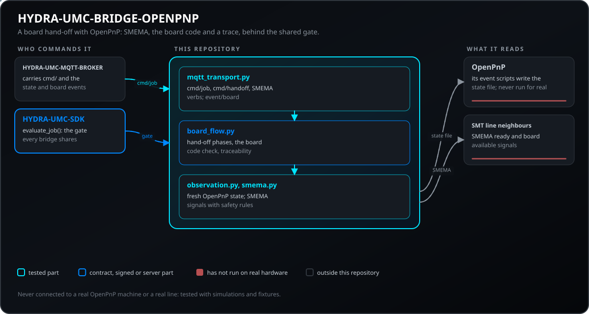
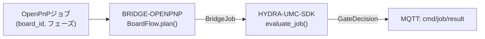
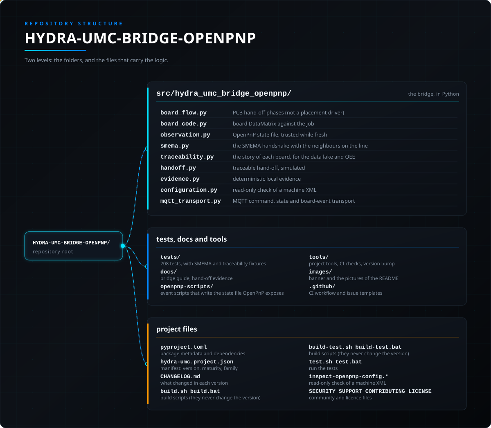

<!-- =============================================================================
HYDRA-UMC-BRIDGE-OPENPNP - OpenPnP board-flow coordination bridge
Copyright (C) JuanenRac (Electro Hobby 3D) <electrohobby3d@gmail.com>
GPL-3.0-or-later - see LICENSE
============================================================================= -->

<p align="center">
  
</p>

# 🔩 HYDRA-UMC-BRIDGE-OPENPNP

<p align="center"><a href="README.md">🇺🇸 English</a> | <a href="README_spa.md">🇪🇸 Español</a> | <a href="README_fra.md">🇫🇷 Français</a> | <a href="README_ita.md">🇮🇹 Italiano</a> | <a href="README_deu.md">🇩🇪 Deutsch</a> | <a href="README_zho.md">🇨🇳 简体中文</a> | 🇯🇵 <b>日本語</b> | <a href="README_por.md">🇵🇹 Português</a></p>

### 📋 OpenPnP向け追跡可能なボードフロー連携ブリッジ

<p align="center">
  
  
  
  
  
  
</p>

---

> **誠実性チェック - 今日実際に動くもの:** 追跡可能なボードフローコアと安全ゲート（`board_flow.py` の `BoardFlow`。すべてのジョブは `HYDRA-UMC-SDK` 自身の本物の `evaluate_job()` を通過する）、読み取り専用の OpenPnP プロファイル検査器（`configuration.py`）、トレース専用の受け渡し/サイクルシミュレータ（`handoff.py`、`evidence.py`）、および MQTT コマンド/エビデンストランスポート（`mqtt_transport.py`）は本物であり、215件の通過する `unittest` ケースで検証されている（`python tools/build_test.py` - `test_board_flow.py`、`test_mqtt_transport.py`）。これらはいずれも OpenPnP、実際のマシン接続、あるいは本物の MQTT ブローカーを一度も開いたことがない - `test_mqtt_transport.py`、`test_hardening.py`、`test_idempotency.py`、`test_mqtt_environment.py` は模擬ブローカークライアントを使用し、`configuration.py` は保存済みの `machine.xml` ファイルを解析するだけであり、`handoff.py`/`evidence.py` のシミュレータは明示的にローカル限定で、OpenPnP・シリアル・マシンの I/O は一切ない。OpenPnP の拡張機能・API とのライブ統合はまだ存在しない - 詳細は下記の「ロードマップと既知の制限」に既に明記されており、これまでに実際に出荷された内容は `CHANGELOG.md` を参照。 MQTT トランスポートは、開発用マシン上の本物の HYDRA-UMC-MQTT-BROKER に対しても実行されています(`tests/test_broker_integration.py`。ブローカーが未インストールの場合はスキップされます)。QoS 0・1・2 でのパブリッシュとサブスクライブ、保持された可用性とそのラストウィル、ブローカーが停止して再起動した後の復帰を確認しています。

> **安全性とセキュリティの現状:** このエコシステムは認証された安全システムではありません。ハードウェアの E-STOP 経路、ファームウェアが強制する制限やインターロック、検証済みの動作コマンドはまだありません。ファームウェアイメージは CRC-32 と Ed25519 署名で検査し、リリースビルドは公開済みの開発用鍵を拒否します(リレーの先のツールヘッドと拡張ボードは引き続き URTC のブートローダーを使い、署名ではなく共有鍵の HMAC-SHA256 を使います)。TLS と相互 TLS は任意で、既定では無効です。独自基板はまだ実装も試験もされていません。ここに書かれた内容を人の安全のために頼る前に、[セキュリティベースライン](https://github.com/JuanenRac/HYDRA-UMC-DOCS/blob/main/docs/SECURITY_BASELINE.md)と[脅威モデル](https://github.com/JuanenRac/HYDRA-UMC-DOCS/blob/main/docs/THREAT_MODEL.md)をお読みください。

---

## 📋 ひと目で

| | |
|---|---|
| バージョン | `0.2.1` |
| 成熟度 | 機能する |
| テスト | 215 (`python tools/build_test.py`) |
| 技術 | Python / OpenPnP / HYDRA-UMC-SDK |
| 対象 | HYDRA-UMC セルの Raspberry Pi CM5 |
| 実機での確認 | シミュレーションのみ：エミュレーター、模擬部品、シミュレーターで試験済み。このバージョンについて実機での動作記録はありません |

**移動：** [概要](#-概要) · [アーキテクチャ](#-アーキテクチャ) · [機能](#-機能) · [セキュリティと安全](#-セキュリティと安全) · [インターフェース](#-インターフェース) · [設定](#-設定) · [クイックスタート](#-クイックスタート) · [テスト](#-テスト) · [トラブルシューティング](#-トラブルシューティング) · [リポジトリの構成](#-リポジトリの構成) · [関連プロジェクト](#-関連プロジェクト)

## 🚦 プロジェクトの状況

各行はこのリポジトリの一部分で、信号は今日どこまで進んでいるかを示します。計画ではなく、リポジトリが示せるもの（テスト、ビルド、実行）に基づいて書かれています。

🟢 完了・検証済み · 🟡 動作する（既知の制限あり） · 🟠 一部のみ、または未検証 · 🔴 未実装または動作しない

| 領域 | 状態 | ここでの意味 |
|---|---|---|
| ソフトウェア | 🟡 | 主な目的では動作します。足りない点は上の正直さの確認に書かれています |
| テスト | 🟢 | 自動テスト 215 件。変更のたびに実行されます |
| 実機 | 🟠 | シミュレーションのみ：エミュレーター、模擬部品、シミュレーターで試験済み。このバージョンについて実機での動作記録はありません |
| ドキュメント | 🟢 | 8 言語の README。変更のたびにマニフェストと照合されます |

## 🎯 概要

**HYDRA-UMC-BRIDGE-OPENPNP** は、HYDRA-UMCとOpenPnPとを結ぶ高レベルのボードフローブリッジである。PCB準備、ロボット搭載、ネイティブ実装、ロボット取り出し、追跡可能な完了処理を連携させる。実装キネマティクス、フィーダー制御、生の動作は実装しない —— それらは完全にOpenPnP内部にとどまる。

本リポジトリは **External Automation Bridges** ファミリーに属する。CNC・LASER・OPENPNP・PRINTER3D・ROS2という兄弟リポジトリ群が、すべて `HYDRA-UMC-SDK` の同じ安全契約を共有しており、いずれのブリッジも独自の「作業に安全」という定義を勝手に作ることはできない。

## 🧩 HYDRA-UMC での役割

**HYDRA-UMC-BRIDGE-OPENPNP** は OpenPnP のピックアンドプレース機とその SMT ライン とロボットセルの間に位置します。相手側の報告を伝え、補助作業の前に共通ゲートへ問い合わせ、協調する機械の権限を決して引き継ぎません。

すべてのブリッジは `HYDRA-UMC-SDK` の共通の安全契約に従います。ジョブは共通の `evaluate_job()` ゲートが許可したときだけ受け付けられ、ゲートは安全側（閉）に倒れます。親プロジェクトは `HYDRA-UMC-SERVER` で、このブリッジはそれを呼び出さず、`HYDRA-UMC-MQTT-BROKER` 経由の MQTT でセルを指令する側に応答します。

## 🏛️ アーキテクチャ

<p align="center">
  
</p>

<details>
<summary>図のテキスト版（Mermaid）</summary>



</details>

**この作りにした理由**

* **なぜ `board_id` の検証が `plan()` の中で他の何よりも先に行われるのか。** `BoardFlow.plan()` の最初のチェックは `not IDENTIFIER.fullmatch(board_id)` である —— 不正または曖昧なボード識別子は、下流に転送されて追跡がより困難になる前に、明示的な理由とともに即座に拒否される。
* **なぜ受け渡しは文字列フォーマットではなく `JobPhase` をキーとする固定辞書なのか。** `BoardFlow._handoffs` はサポートされる6つのフェーズそれぞれを、文字通りの曖昧さのない説明にマッピングする。未知の将来フェーズは `unrecognized-phase` として拒否され、共通SDKゲートがREADYであるだけで許可済み受け渡しになることはない。
* **なぜブリッジは外部機械が `IDLE` でセルが `READY` の場合にのみ実際の転送を計画するのか。** ボードの受け渡しは両者が関わる物理的な操作である。いずれかの側が既知の安全な状態にない場合、転送を計画することは、予測不能な機械へロボットを移動させるよう要求することになる。
* **なぜ故障中でも `ABORT` を要求できるのか。** `JobPhase.ABORT` は `request-controlled-stop` にマッピングされ、これは共有の `evaluate_job()` ゲートが実際のフェーズを阻止するのと同じようには阻止しない —— オペレーターや監督者は、故障の最中であっても常に制御された停止を要求できなければならない。
* **なぜライブOpenPnP拡張/APIは引き続き保留なのか。** 保存済みマシンプロファイルは読み取り専用で検査できるようになったが、プラグインインターフェースまたはライブ面の選択には依然として非本番テストセッションが必要である。これにより、未検証の動作やフィーダーの前提を組み込まない。
* **エコシステムの他部分とどう関係するか。** BRIDGE-OPENPNPはOpenPnPジョブと `HYDRA-UMC-SDK` → `HYDRA-UMC-MQTT-BROKER` → セル安全との間に位置する。ボード受け渡しのロボット側を連携させるものであり、OpenPnP自身に属する実装キネマティクスやフィーダー制御を主張することは決してない。

## ✨ 機能

* ✅ **実在する追跡可能なボードフローコア:** `board_flow.py` の `BoardFlow.plan()` は、安全ゲートを評価する*前に*、`board_id` が空であるか先頭・末尾に空白を含むジョブをすべて拒否する —— すべての受け渡しは安定した、クリーンな識別子を持つことが求められる。*(実装済み、`tests/test_board_flow.py` でテスト済み)*
* ✅ **実在するフェーズ別受け渡しマップ:** 固定辞書が各 `JobPhase`(`PREPARE`、`LOAD`、`PROCESS`、`UNLOAD`、`COMPLETE`、`ABORT`)を明示的で読みやすい受け渡し説明にマッピングする —— `verify-board-and-fixture`、`robot-loads-board-into-pnp-fixture`、`openpnp-places-declared-job` など。*(実装済み)*
* ✅ **実在する共有安全ゲート:** 有効なジョブはすべて `HYDRA-UMC-SDK` の `bridge_contract` にある `evaluate_job()` を通じて評価される。これは他のすべての兄弟ブリッジが使うのと同じゲートである。実際の受け渡しが進むのは、外部機械が `IDLE` を報告し、HYDRA-UMCセルが `READY` である場合のみである。*(実装済み)*
* ✅ **非破壊的なビルド/テスト:** `build-test.bat`/`.sh` はソースをコンパイルし、バージョンファイルやCHANGELOGに一切触れずにボード追跡性とフェイルセーフのテストスイートを実行する。*(実装済み、下記「ビルドとリリース」を参照)*
* ✅ **読み取り専用のOpenPnPプロファイル検査:** `inspect_openpnp_config.py` は保存済みの `machine.xml` を解析し、`openpnp-scripts/HYDRA-UMC/inspect_profile.js` は手動で呼び出す OpenPnP メニュースクリプトのテンプレートである。両者はクラスとコンポーネント数のみを報告し、テンプレートは情報ダイアログに結果を表示する。機械コマンドは一切送信しない。*(実装・テスト済み)*
* ✅ **追跡専用の受け渡しシミュレーション:** `BoardIdentity` は `simulate_board_handoff()` が共有 SDK ゲートを適用する前に基板、レシピ、リビジョン、ロットの識別子を束ねる。許可された計画に対してのみ決定論的な SHA-256 追跡指紋を出力し、OpenPnP、シリアル、機械 I/O は一切持たない。オプションの `slot_id`/`rack_id`/`table_id` フィールドは、この受け渡しが実際に使用したフィーダースロット・保管ラック・テーブルという実際の物理的な配置を、それ自体独立した識別情報として追跡する——これにより同じ基板の2つの異なる配置が指紋上で区別できなくなることはない。*(実装・テスト済み)*
* ✅ **追跡専用の生産サイクルシミュレーション:** `simulate_board_cycle()` は明示的なセル/機械状態で、順序付けられた `PREPARE → LOAD → PROCESS → UNLOAD → COMPLETE` を評価する。各生産ステップは `READY/IDLE` 以外では安全に拒否され、`ABORT` は SDK の安全経路で独立したままである。*(実装・テスト済み)*
* ✅ **決定論的エビデンス契約:** `docs/BOARD_TRANSFER_EVIDENCE.md` は両シミュレーターが出力するスキーマ `1.0` を定義する。フェーズ、判断、理由、許可された識別子指紋のみを含み、生の基板、レシピ、リビジョン、ロット値は JSON レコードに一切入らない。*(実装・テスト済み)*
* ✅ **保持メッセージと重複キー:** `mqtt_transport.py` は保持メッセージ（ブローカーが再接続のたびに再送するもの）を無視し、`IdempotencyStore` が渡された場合は、重複した `idempotency_key` に対してジョブを再評価せず、初回に返した応答を返します。*（実装済み、`tests/test_idempotency.py` でテスト済み）*
* ✅ **観測された機械の状態(OpenPnP のイベントスクリプト):** OpenPnP には RPC API がないため、`openpnp-scripts/HYDRA-UMC/Events` にイベントスクリプト(`Job.Starting`、`Job.Placement.Complete`、`Job.Finished`、`Machine.AfterHoming`、`Machine.AfterDisabled`)とメニュースクリプト(`Report_state.js`)を置き、各イベントが意味する状態を小さな JSON ファイルにアトミックに書き込みます。`observation.py` がそれを読み(`OpenPnpStateSource`、`HYDRA_UMC_OPENPNP_STATE_FILE`)、ブリッジはジョブメッセージの申告ではなくそれに基づいて判断します。ファイルがない、15 分より古い(`HYDRA_UMC_OPENPNP_STATE_MAX_AGE_SECONDS`)、他者が書いた、または不正な場合は、ジョブを拒否する OFFLINE の機械として扱われます。`cmd/status` は保持された `state` を発行します。スクリプトは使用する少数の Java クラスに対して Node でテスト済みで、OpenPnP の中では動かしておらず、イベント名は文書にあるものです。*(実装済み、OpenPnP では未検証)*
* ✅ **SMEMA 受け渡し信号:** `smema.py` の `SmemaReceiver`(セルが上流の機械から基板を受け取る:`board available` を読み、`machine ready` を駆動)と `SmemaSender`(セルが下流の機械へ基板を渡す:`board available` を駆動し、`machine ready` を読む)が、SMT ラインの SMEMA ハンドシェイクに参加します。読み取りはチャタリング除去され、出力の駆動は共有ゲートを通ります。READY のセル、アイドルと観測された機械、空の治具(または用意された基板)のときだけ出力され、条件が成り立たなくなったとき、中止のたび、ラインに書き込めないときは出力が引き下げられます。`cmd/smema_status`、`cmd/smema_ready`、`cmd/smema_offer` で公開します。模擬の隣接機に対してテスト済み。CM5 のピンで 12〜24 V のケーブルをつなぐにはインターフェース基板が必要です。*(実装済み、シミュレーションのみ)*
* ✅ **基板ごとのトレーサビリティ:** `traceability.py` は各基板の受け渡しをまとめ、サイクルの終了時にトレースを `hydra/bridges/openpnp/event/board`(QoS 1、保持なし)に発行し、HYDRA-UMC-DATALAKE に各ステップごとの `board_handoff` サンプル(`board-<フィンガープリント>` の下)と、HYDRA-UMC-PRODUCTION-REPORTS が OEE を算出する元になる `production_event`(`good`、`cycleTimeS`)を 1 件送ります。既定ではフィンガープリントだけが外に出ます。工場が許可する場合は識別子も含められます。データレイクが止まってもセルは止まらず、サンプルは待機して次のトレースと一緒に送られます。*(実装済み、ローカル HTTP サーバーに対してテスト済み)*
* ✅ **基板上のコード:** `board_code.py` は基板から読んだ DataMatrix をジョブが指す基板と照合します(`HYDRA_UMC_OPENPNP_BOARD_CODE`:既定は `off`、`advisory` または `required`)。異なるコードは拒否され、基板を指定しないジョブは読み取った唯一のコードを採用し、安定した識別子でないものはコードとして扱われません。コードは HYDRA-UMC-VISION-NODE の `POST /read-code`(`VisionNodeCodeSource`)から得ます。*(実装済み、実際のラベルでは未検証)*
* ✅ **堅牢化したMQTTループと正直な応答:** 大きすぎる(16 KiB超)または読めないペイロード、深くネストされたJSON、想定外の障害には、結果トピックで拒否を返し、ループは決して終了しない。`cmd/job` と `cmd/handoff` は冪等キーの空間を分けて持つ(`job:`/`handoff:`)ため、ゲートで確認したジョブを同じキーで受け渡しでき、アイデンティティのフィンガープリントも保たれる。`cmd/job` の応答には `"mode": "simulation-only"` と `"observed": false` が付き(OpenPnPを見ているものはない: マシン状態は要求者の申告である)、そこを通したABORTは何も停止していないことを明示する。ゲートと受け渡しトレースは基板識別子の規則を共有し、`cmd/handoff` は `slot_id`、`rack_id`、`table_id` を受け付け、DOCTYPEを含む `machine.xml` はどのエンコーディングでも拒否される。ブリッジはLast Will付きの `availability` トピックで自らを告知する。*(実装済み、`tests/test_hardening.py` でテスト済み)*

## 🔒 セキュリティと安全

| 脅威 | 防御 | 場所 |
|---|---|---|
| 安全でない状態のセルや機械へのジョブ | すべてのジョブは SDK の共通 `evaluate_job()` ゲートを通り、ゲートは安全側に倒れます。ブリッジ自身に受理・拒否のロジックはありません | SDK `bridge_contract` |
| 過大なジョブデータ | パラメーターは最大 32 個、キーは 64 文字、値は 1024 文字、識別子は 128 文字まで（`MAX_PARAMETERS`、`MAX_PARAMETER_KEY_CHARS`、`MAX_PARAMETER_VALUE_CHARS`、`MAX_IDENTIFIER_CHARS`） | SDK `bridge_contract` |
| 繰り返された、または再送された命令 | `IdempotencyStore` は各キーを 24 時間、最大 10 000 件まで記憶し、再送には再評価せず最初の応答を返します | SDK `job_intake` |
| 巨大または悪意のある MQTT ペイロード | 16 KiB を超えるペイロード、読めない・深く入れ子になった JSON、想定外の失敗は、結果トピックで拒否として応答され、ループを終わらせません | `mqtt_transport.py` |
| 機械に入った誤った基板 | `board_code.py` が DataMatrix を読み、ジョブの基板と照合します。`HYDRA_UMC_OPENPNP_BOARD_CODE` は `off`・`advisory`・`required` | `board_code.py` |
| 古い、または偽の OpenPnP 状態 | 状態ファイルは新しい間（既定 15 分）だけ、最大 16 KiB、出所 `openpnp-events` のものだけ信頼します。未知の語は `OFFLINE` です | `observation.py` |
| 無制限のトレーサビリティデータと安全でない SMEMA 出力 | オープンなトレースは最大 256、保留サンプルは最大 5000（500 件ずつ送信）。基板 ID は `^[A-Za-z0-9][A-Za-z0-9._-]{0,95}$` に一致し、SMEMA 出力はセルの安全規則に従います | `traceability.py`, `smema.py`, `board_flow.py` |
| 再接続時に再実行される保持コマンド | 保持された `cmd/` メッセージは再接続時に無視されます | `mqtt_transport.py` |

**絶対にしないこと：** 実装動作のドライバーではなく、XML を検査するときも OpenPnP の機械を開いたり変更したりしません。

## 🔌 インターフェース

`hydra/bridges/openpnp/` 以下のトピック。停止用の動詞はありません（`STOP_VERBS` は空）。

| トピックまたはルート | 内容 |
|---|---|
| `cmd/status`, `cmd/job`, `cmd/handoff` | コマンド入力。それぞれ `<verb>/result` で応答されます |
| `cmd/smema_offer`, `cmd/smema_ready`, `cmd/smema_status` | ラインの隣接機との SMEMA ハンドシェイク |
| `state`, `availability`, `event/board` | 状態、`online`/`offline`、各基板のレコード（`board_handoff`、`production_event`、スキーマ版 `1.0`）。データレイクと OEE レポート用 |

## ⚙️ 設定

| 変数 | 既定値 | 設定する内容 |
|---|---|---|
| `HYDRA_UMC_OPENPNP_BOARD_CODE` | `off` | `off`・`advisory`・`required`。未知の値は `off` と同じです |
| `HYDRA_UMC_OPENPNP_STATE_FILE` | 未設定 | OpenPnP のイベントスクリプトが書くファイルのパス。未設定なら状態の入力元なし |
| `HYDRA_UMC_OPENPNP_STATE_MAX_AGE_SECONDS` | `900` | 状態ファイルが信頼されなくなるまでの古さの上限 |
| `HYDRA_MQTT_USERNAME` | なし | MQTT のユーザー名。ブローカーはクライアント ID のプレフィックスに結び付けます |
| `HYDRA_MQTT_PASSWORD` | なし | パスワード。ユーザー名と一緒にのみ有効です |
| `HYDRA_MQTT_PASSWORD_FILE` | なし | ファイルから読むパスワード（Docker や systemd のシークレット）。`HYDRA_MQTT_PASSWORD` があれば無視されます |
| `HYDRA_MQTT_TLS_CA` | なし | ブローカーの証明書に署名した CA のファイル。接続は TLS になり、証明書が検証されます |
| `HYDRA_MQTT_TLS` | オフ | `1` で TLS を有効にし、システムの信頼する CA で検証します |
| `HYDRA_MQTT_TLS_CERT` / `HYDRA_MQTT_TLS_KEY` | なし | 相互 TLS を求めるブローカー用のクライアント証明書とその鍵。両方が必要です |

## 🚀 クイックスタート

Python 3.11 以上が必要です。テストとビルドスクリプトは、このリポジトリの隣にある `HYDRA-UMC-SDK`（`../HYDRA-UMC-SDK`）、または `HYDRA_UMC_SDK_ROOT` で指定した場所を前提にします。

ハードウェアなしで試す（エミュレーターと模擬部品でブリッジ全体を確認します）：

```bash
py -3 tools/build_test.py          # Windows
python3 tools/build_test.py         # Linux, macOS
```

サービスを起動する（コンソールスクリプトはありません。サービスは MQTT トランスポートの `run_forever()` で、自分の起動コードから呼び出します）：

```python
from hydra_umc_bridge_openpnp.mqtt_transport import OpenPnpMqttBridge, run_forever
bridge = OpenPnpMqttBridge(cell_state=lambda: cell_state)   # state_source, smema_*, trace_recorder are optional
run_forever(bridge, host="192.168.0.180")                  # serves cmd/# forever
```

ユーザー名、パスワード、TLS ファイルは `HYDRA_MQTT_*` 変数から読まれます（設定を参照）。上のコード自体に認証情報は不要です。

## 🧪 テスト

`python tools/build_test.py` で自動 `unittest` 215 件を実行します（各モジュールのコンパイルも行います）。テストにハードウェア、ネットワーク、オプションのパッケージは不要で、`paho-mqtt`・`pyserial`・ベンダーのライブラリが必要なものは代用品を使うか、パッケージがなければスキップされます。

| テストファイル | テスト数 | 対象 |
|---|---|---|
| `test_board_flow.py`, `test_board_code.py`, `test_observation.py` | - | 受け渡しの段階、基板コード、状態ファイル、イベントスクリプト |
| `test_smema.py`, `test_traceability.py` | - | メモリ上の隣接機に対する SMEMA、トレース、データレイクのサンプル、実際のローカル HTTP 受け口 |
| `test_mqtt_transport.py`, `test_mqtt_environment.py`, `test_hardening.py`, `test_edge_cases.py`, `test_idempotency.py` | - | トピックの振り分け、環境の認証情報、悪意あるクライアント、境界ケース、繰り返しキー |

CI は `HYDRA_UMC_CI=1 python tools/ci_validate.py` を実行し、マニフェスト、文書、8 つの README、図を検査し、SDK のチェックアウトを使ってテストを実行します。

## 🏗️ ビルドとリリース

Python 3.11以上が必要。`tools/build_test.py` は `HYDRA-UMC-SDK` が兄弟ディレクトリ(`../HYDRA-UMC-SDK`)としてチェックアウトされているか、環境変数 `HYDRA_UMC_SDK_ROOT` で指定されていることを期待する。

```bash
# Windows
build-test.bat      # 検証のみ —— バージョン/CHANGELOGの変更なし
build.bat            # 検証後、成功時にバージョン + CHANGELOG を更新

# Linux/macOS
bash build-test.sh
bash build.sh
```

`build-test` は `src/` 配下の各モジュールを `py_compile` でコンパイルし、`tests/` 配下で検出される `unittest` の全スイート(`test_board_flow.py`、`test_mqtt_transport.py` - 215件のテスト)を実行して、ボード追跡性による拒否とフェイルセーフゲートを実証する —— リポジトリを一切変更しない。`build` はまず同じ検証を実行し、成功した場合のみ `tools/bump_version.py` を呼び出して `pyproject.toml`、`hydra-umc.project.json`、`CHANGELOG.md` の間でバージョンを同期する。実際の機械向け `run` コマンドはまだ存在しない —— それには検証済みのOpenPnP統合が必要である。

## 🩺 トラブルシューティング

| 表示 | 原因 | 対処 |
|---|---|---|
| `ModuleNotFoundError: hydra_umc_sdk` | SDK がインストールされておらず、このリポジトリの隣にもありません | `HYDRA-UMC-SDK` をこのリポジトリの隣に置くか、`HYDRA_UMC_SDK_ROOT` を設定します |
| `paho-mqtt is not installed` | MQTT クライアントはオプションの追加パッケージです | `pip install ".[mqtt]"`（`paho-mqtt` 2.1 以上 3 未満が必要） |
| `password was given without a username` | MQTT の認証情報にはユーザー名とパスワードの両方が必要です | パスワードに加えて `HYDRA_MQTT_USERNAME` も設定します |
| `could not reach the MQTT broker after N attempts` | ブローカーが停止している、アドレスが違う、またはポートが閉じています | `HYDRA-UMC-MQTT-BROKER` を起動し、トランスポートに渡したホストとポートを確認します（2 秒間隔で 5 回試行。TLS ハンドシェイクの失敗は再試行しません） |
| `the MQTT broker refused the connection` | ブローカーが認証を拒否しました（または制限時間内に応答しませんでした） | `HYDRA_MQTT_USERNAME` とパスワードを確認します。クライアント ID はブローカーが認証情報に結び付けたプレフィックスで始まる必要があります |
| `"allowed": false` + `reason` | 共通ゲートまたはガードが命令を拒否しました | `reason` を読んで原因を直します。やみくもに再試行しないでください |
| `OFFLINE` although OpenPnP is running | 状態ファイルがない、上限より古い、または別の出所のものです | `openpnp-scripts/` のスクリプトを OpenPnP に入れ、`HYDRA_UMC_OPENPNP_STATE_FILE` をそれが書くファイルに向け、機械が長く待機する場合だけ `HYDRA_UMC_OPENPNP_STATE_MAX_AGE_SECONDS` を上げます |

## 📂 リポジトリの構成

<p align="center">
  
</p>

<details>
<summary>ツリーのテキスト版</summary>

```text
HYDRA-UMC-BRIDGE-OPENPNP/
├── src/hydra_umc_bridge_openpnp/
│   ├── board_flow.py                                        基板受け渡しの段階（実装動作のドライバーではない）
│   ├── board_code.py                                        基板の DataMatrix とジョブの照合
│   ├── observation.py                                       OpenPnP の状態ファイル（新しい間だけ信頼）
│   ├── smema.py                                             ラインの隣接機との SMEMA ハンドシェイク
│   ├── traceability.py                                      各基板の履歴（データレイクと OEE 用）
│   ├── handoff.py                                           追跡可能な受け渡し（シミュレーション）
│   ├── evidence.py                                          決定論的なローカルの証拠
│   ├── configuration.py                                     XML の読み取り専用検査
│   └── mqtt_transport.py                                    MQTT のコマンド・状態・基板イベントのトランスポート
├── tests/                                                   208 件（SMEMA とトレーサビリティのフィクスチャ付き）
├── docs/                                                    ブリッジガイド、受け渡しの証拠
├── openpnp-scripts/                                         OpenPnP が公開する状態ファイルを書くイベントスクリプト
├── tools/                                                   ビルド・テスト実行、バージョン引き上げ、CI 検証、README と図の生成・検査
├── images/                                                  バナーと README の図
├── .github/                                                 CI ワークフローと Issue テンプレート
├── pyproject.toml                                           パッケージのメタデータと依存関係
├── hydra-umc.project.json                                   マニフェスト：バージョン・成熟度・ファミリー
├── CHANGELOG.md                                             各バージョンの変更点
├── build.sh build.bat                                       ビルドスクリプト（バージョンは変えません）
├── build-test.sh build-test.bat                             ビルドスクリプト（バージョンは変えません）
├── test.sh test.bat                                         テストを実行
├── inspect-openpnp-config.sh / inspect-openpnp-config.bat   機械 XML の読み取り専用検査
└── SECURITY.md SUPPORT.md CONTRIBUTING.md CODE_OF_CONDUCT.md LICENSE LICENSE.md
```

</details>

## 🗺️ ロードマップと既知の制限

**現時点の既知の制限**

**現時点で実在するもの:** バージョン `0.2.1`。ローカルでテスト済みの追跡可能なPCB受け渡しコア(`BoardFlow`)が `HYDRA-UMC-SDK` の共有ジョブゲートの上に構築されており、実際の MQTT コマンド/エビデンストランスポート(`mqtt_transport.py`)、215件の決定論的な `unittest` スイート、ヘッド/カメラ/ドライバー/フィーダーの数とともに実際の OpenPnP アクチュエータ/シグナラー/ノズルチップの証拠を報告する保存済みプロファイル検査器、可視の手動読み取り専用 OpenPnP メニューテンプレート、識別子結合の受け渡し/サイクルシミュレーション、機械 I/O のない CI 検証済み非機密 JSON エビデンス契約を備える。

**統合境界:** OpenPnPは常に実装キネマティクス、フィーダー制御、生の動作を保持する。このブリッジがゲート・追跡するのはあくまでその周りの*受け渡し*のみである —— ロボットによる搭載、ネイティブ実装の完了、ロボットによる取り出し。

**今後の課題:** OpenPnPマシンへのライブ接続は主張されていない —— 具体的な拡張/APIは、オペレーター同席の隔離された非本番セッションでのみ選定される。

## 🌍 言語

この README とリポジトリの文書は、英語・スペイン語・ドイツ語・フランス語・イタリア語・日本語・中国語・ポルトガル語（ポルトガル）の 8 言語で提供されています。8 つのファイルは同時に書かれ、同じ節と同じリンクを持つことを CI が確認します。 このリポジトリには独自の画面もメッセージカタログもないため、翻訳すべきインターフェース文字列はありません。

## 🔗 関連プロジェクト

本プロジェクトは、同じ作者(JuanenRac / Electro Hobby 3D)による HYDRA-UMC ロボティクスエコシステムの一部です。リクエストが実はこの中のどれかについてのものである可能性があるため、知っておく価値があります。

**親プロジェクト**
- **[HYDRA-UMC-SERVER](https://github.com/JuanenRac/HYDRA-UMC-SERVER)** — すべての制御クライアントが実際に通信する、本物のヘッドレスバックエンド(REST/WebSocket)。このブリッジはこれを呼び出さず、HYDRA-UMC-MQTT-BROKER を介したMQTTで、セルを指揮する側に応答する。

**兄弟プロジェクト** —— それぞれ独自のクライアントとして、同じく HYDRA-UMC-SERVER 自身の API と通信する
- **[HYDRA-UMC-STUDIO](https://github.com/JuanenRac/HYDRA-UMC-STUDIO)** — リアルタイムのマルチロボット 3D 可視化を備えたウェブ制御ダッシュボード。
- **[HYDRA-UMC-SUITE](https://github.com/JuanenRac/HYDRA-UMC-SUITE)** — 複数のサーバーを同時に扱えるデスクトップ(PySide6)スウォームコマンドセンター、スタンドアロン実行ファイルとしてパッケージ化。
- **[HYDRA-UMC-ANDROID-CONTROL](https://github.com/JuanenRac/HYDRA-UMC-ANDROID-CONTROL)** — 生体認証ログインとペアリングされた Wear OS コンパニオンを備えたネイティブ Android 制御アプリ。
- **[HYDRA-UMC-IOS-CONTROL](https://github.com/JuanenRac/HYDRA-UMC-IOS-CONTROL)** — リアルタイム WebSocket 同期を備えた iOS/iPadOS 制御アプリ(Flutter)。
- **[HYDRA-UMC-DSI](https://github.com/JuanenRac/HYDRA-UMC-DSI)** — 本体搭載の 7 インチ DSI タッチスクリーン向けネイティブタッチ UI、CM5 自体に組み込み。
- **[HYDRA-UMC-BRIDGE-AMR](https://github.com/JuanenRac/HYDRA-UMC-BRIDGE-AMR)** — VDA 5050 MQTT パブリッシャーによる AGV/AMR フリートの調整境界(エミュレートしたフリートに対してのみテスト済み)。
- **[HYDRA-UMC-BRIDGE-CNC](https://github.com/JuanenRac/HYDRA-UMC-BRIDGE-CNC)** — GRBL ステータス/制御バイトへのアクセスを持つ、CNC セルの高レベルコーディネーター(エミュレーターに対してのみテスト済み)。
- **[HYDRA-UMC-BRIDGE-DROIDS](https://github.com/JuanenRac/HYDRA-UMC-BRIDGE-DROIDS)** — Boston Dynamics Spot コマンド送信機能を持つ、脚型/ヒューマノイドドロイドの調整境界(エミュレーターに対してのみテスト済み)。
- **[HYDRA-UMC-BRIDGE-LASER](https://github.com/JuanenRac/HYDRA-UMC-BRIDGE-LASER)** — キー/筐体/インターロックの GPIO 信号 3 系統を読み取るレーザーセルのコーディネーター(模擬チップに対してのみテスト済み。レーザーの武装や発射はできない)。
- **[HYDRA-UMC-BRIDGE-PRINTER3D](https://github.com/JuanenRac/HYDRA-UMC-BRIDGE-PRINTER3D)** — 実際にゲート制御されたジョブコマンドを持つ、Moonraker/Klipper 3D プリンター向けの安全な調整境界。
- **[HYDRA-UMC-BRIDGE-ROS2](https://github.com/JuanenRac/HYDRA-UMC-BRIDGE-ROS2)** — 遅延インポートの rclpy ROS 2 トランスポートを持つコーディネーター(ROS 2 環境ではまだ実行していない)。
- **[HYDRA-UMC-BRIDGE-UAV](https://github.com/JuanenRac/HYDRA-UMC-BRIDGE-UAV)** — MAVLink コマンド送信機能を持つ、カメラ搭載 UAV の調整境界(エミュレーターに対してのみテスト済み)。

**直接関連**
- **[HYDRA-UMC-SDK](https://github.com/JuanenRac/HYDRA-UMC-SDK)** — すべてのブリッジが自身のコマンドを検証する共有 JSON-Schema 契約とソフトウェアのジョブゲート境界(認証済みの安全機能ではない)。
- **[HYDRA-UMC-CONNECTOR-HUB](https://github.com/JuanenRac/HYDRA-UMC-CONNECTOR-HUB)** — 外部マシン用コネクタのための宣言的アダプターマニフェストのレジストリとバリデーター。SDK 自身の契約という発想を外部マシンにまで拡張し、産業用ゲートウェイ系のプロジェクトを置き換えることはありません。
- **[HYDRA-UMC-MQTT-BROKER](https://github.com/JuanenRac/HYDRA-UMC-MQTT-BROKER)** — このブリッジ自身の `hydra/bridges/openpnp/...` トピック向けの `mqtt_transport.py` の実際のトランスポート——ジョブゲートと完全に追跡可能な引き渡しシミュレーション。ここには観測すべき実際のマシントランスポートが存在しないため `state` トピックはない。詳細はそのリポジトリ自身の `docs/BRIDGE_TOPICS.md` を参照。
- **[HYDRA-UMC-SAFETY-ZONES](https://github.com/JuanenRac/HYDRA-UMC-SAFETY-ZONES)** — 本ブリッジ向けの将来のセルゾーン安全実証。

**エコシステムの他のプロジェクト**

*コアハードウェア&プラットフォーム*
- **[HYDRA-UMC](https://github.com/JuanenRac/HYDRA-UMC)** — ロボットアームのマザーボードの設計——CM5 ホスト + デュアルコア STM32H745、CAN-OTA/SPI-OTA 経由で最大 8 本のツールアームを統括することを目指す(ファームウェアは初期段階で、実装済みの基板はまだない)。
- **[HYDRA-UMC-OS](https://github.com/JuanenRac/HYDRA-UMC-OS)** — CM5 向けの再現可能な Raspberry Pi OS プロダクト層——読み取り専用エージェント、検証済み設定/プロファイル、WiFi 初回接続プロビジョニング。

*コアバックエンド&クライアント*
- **[HYDRA-UMC-EDITOR-URDF](https://github.com/JuanenRac/HYDRA-UMC-EDITOR-URDF)** — 完成したモデルを STUDIO 自身のカタログへ送信するデスクトップ用グラフィカル URDF 作成/編集ツール。
- **[HYDRA-UMC-EDITOR-STL](https://github.com/JuanenRac/HYDRA-UMC-EDITOR-STL)** — HYDRA-UMC-EDITOR-URDF も編集する同じモデルカタログ内で、実在するパーツを変換/置換/削除/追加するデスクトップ STL モデルエディタ。

*URTC ツールプラットフォーム*
- **[URTC](https://github.com/JuanenRac/URTC)** — 物理的な Universal Robot Tool Controller 基板向けファームウェア、CAN バス経由の 25 以上のツールプロファイル。
- **[URTC-FLASHER](https://github.com/JuanenRac/URTC-FLASHER)** — URTC 基板用のデスクトップ GUI 書き込みツール、CAN-OTA およびフルチップ SWD/JTAG。
- **[URTC-TESTER](https://github.com/JuanenRac/URTC-TESTER)** — URTC 基板向けのデスクトップ CAN バスライブ診断ツール、ツールプロファイルごとに 1 パネル。
- **[URTC-WEB-STUDIO](https://github.com/JuanenRac/URTC-WEB-STUDIO)** — Web Serial API を使ったブラウザベースの URTC-TESTER の代替、ローカルインストール不要。
- **[URTC-GATEWAY](https://github.com/JuanenRac/URTC-GATEWAY)** — URTC の CAN バスの前に置くゲートウェイ：許可する識別子のリスト、レート制限、セッション鍵。コンピューター上でテスト済みで、実際のバスではまだ試していません。

*ビジョン AI ノード(Hailo-8)*
- **[HYDRA-UMC-VISION-NODE](https://github.com/JuanenRac/HYDRA-UMC-VISION-NODE)** — Hailo-8 ビジョンパイプラインの統合ハブ、段階ごとの実際のハードウェア準備状況チェック付き。
- **[HYDRA-UMC-DETECTION-HEF](https://github.com/JuanenRac/HYDRA-UMC-DETECTION-HEF)** — Hailo アーキテクチャ/チェックサムによる安全読み込み検証を備えた、実際のコンパイル済みモデルレジストリ。
- **[HYDRA-UMC-VISION-STREAMER](https://github.com/JuanenRac/HYDRA-UMC-VISION-STREAMER)** — 実際の HailoRT 統合境界を持つ、実際の GStreamer パイプライン + MediaMTX 設定生成器。
- **[HYDRA-UMC-VISUAL-SERVOING-API](https://github.com/JuanenRac/HYDRA-UMC-VISUAL-SERVOING-API)** — ゾーン状態を条件に承認する Position-Based Visual Servoing 補正則。カメラによる姿勢推定はまだない。

*コグニティブ AI ノード(Hailo-10)*
- **[HYDRA-UMC-COGNITIVE-NODE](https://github.com/JuanenRac/HYDRA-UMC-COGNITIVE-NODE)** — Hailo-10 コグニティブパイプライン(LLM/VLA/音声オーケストレーション)の統合ハブ。
- **[HYDRA-UMC-VLA-ENGINE](https://github.com/JuanenRac/HYDRA-UMC-VLA-ENGINE)** — Vision-Language-Action モデル向けの、実際のアクショントークンのエンコード/デコードと軌道生成。
- **[HYDRA-UMC-VOICE-UI](https://github.com/JuanenRac/HYDRA-UMC-VOICE-UI)** — 確認ゲート付きの限定的な Watch リレーを備えた、実際の音声フロントエンド(VAD + 意図解析)。
- **[HYDRA-UMC-SEMANTIC-PLANNER](https://github.com/JuanenRac/HYDRA-UMC-SEMANTIC-PLANNER)** — MCU エラーコードに対する、実際のルールベースのタスク分解と意味的エラー復旧。
- **[HYDRA-UMC-DOCS-QA](https://github.com/JuanenRac/HYDRA-UMC-DOCS-QA)** — このエコシステム自身の Markdown ドキュメントに対する、標準ライブラリのみの実際の TF-IDF 文書検索。
- **[HYDRA-UMC-LOCAL-TECHNICIAN](https://github.com/JuanenRac/HYDRA-UMC-LOCAL-TECHNICIAN)** — エコシステム自身のための、ローカルでポリシーゲート付きのAIメンテナンス技術者 — 観察、診断し、修正を提案する;最上位の2つのリスクレベルは意図的にまだ実装されていない。

*オーケストレーション&スウォーム*
- **[HYDRA-UMC-ORCHESTRATOR](https://github.com/JuanenRac/HYDRA-UMC-ORCHESTRATOR)** — 実際の gRPC/Protobuf ヘルスレポート契約とミッションステートマシンを持つ統合ハブ。
- **[HYDRA-UMC-JOB-DISPATCHER](https://github.com/JuanenRac/HYDRA-UMC-JOB-DISPATCHER)** — 実際の HTTP API 上に構築された、優先度ベースの実際のジョブキュー(重複排除付き)。
- **[HYDRA-UMC-NODE-HEALING](https://github.com/JuanenRac/HYDRA-UMC-NODE-HEALING)** — リトライ/バックオフとアイデンティティ不一致検出を備えた、実際の gRPC ベースのフリートヘルスウォッチドッグ。
- **[HYDRA-UMC-PATH-PLANNER-3D](https://github.com/JuanenRac/HYDRA-UMC-PATH-PLANNER-3D)** — 実際の障害物/ワークスペース衝突検証を備えた、実際の RRT ベースの 3D 経路プランナー。
- **[HYDRA-UMC-SWARM-SYNC](https://github.com/JuanenRac/HYDRA-UMC-SWARM-SYNC)** — 複数セルの収束についてプロパティテストされた、実際の CRDT LWW-Element-Map 状態同期。

*デジタルツイン&シミュレーション*
- **[HYDRA-UMC-TWIN](https://github.com/JuanenRac/HYDRA-UMC-TWIN)** — 実際のバージョン互換性同期契約を持つ、デジタルツインエンジンの統合ハブ。
- **[HYDRA-UMC-HIL-BRIDGE](https://github.com/JuanenRac/HYDRA-UMC-HIL-BRIDGE)** — シミュレーションと実機の間にソフトウェアの衝突インターロックを備えたハードウェア・イン・ザ・ループのルーター(実機なしでテスト済み)。
- **[HYDRA-UMC-PHYSICS-REPLICA](https://github.com/JuanenRac/HYDRA-UMC-PHYSICS-REPLICA)** — 実際の URDF サブセットに対する、実際の順運動学と関節限界検証。
- **[HYDRA-UMC-SYNTHETIC-DATA-GEN](https://github.com/JuanenRac/HYDRA-UMC-SYNTHETIC-DATA-GEN)** — YOLO/COCO アノテーションのエクスポート機能を持つ、実際のプロシージャル 2D シーンジェネレーター。

*データ&分析*
- **[HYDRA-UMC-DATALAKE](https://github.com/JuanenRac/HYDRA-UMC-DATALAKE)** — 実際の取り込み/クエリ HTTP API を備えた、実際の sqlite3 ベースの時系列ストア。
- **[HYDRA-UMC-ANOMALY-DETECTOR](https://github.com/JuanenRac/HYDRA-UMC-ANOMALY-DETECTOR)** — ドリフト監視を備えた、実際の FFT + 統計ベースラインによる異常検知器。
- **[HYDRA-UMC-PRODUCTION-REPORTS](https://github.com/JuanenRac/HYDRA-UMC-PRODUCTION-REPORTS)** — DATALAKE の履歴に対する実際の OEE/稼働率計算、再現可能な CSV エクスポート付き。
- **[HYDRA-UMC-TELEMETRY-COLLECTOR](https://github.com/JuanenRac/HYDRA-UMC-TELEMETRY-COLLECTOR)** — シーケンス重複排除機能を備えた、DATALAKE への実際の CAN/WebSocket 取り込みパイプライン。

*産業用ゲートウェイ*
- **[HYDRA-UMC-GATEWAY-INDUSTRIAL](https://github.com/JuanenRac/HYDRA-UMC-GATEWAY-INDUSTRIAL)** — 実際のコマンド許可リスト/バックプレッシャー層を持つ、産業用プロトコルへ中継する統合ハブ。
- **[HYDRA-UMC-OPCUA-SERVER](https://github.com/JuanenRac/HYDRA-UMC-OPCUA-SERVER)** — 実際のバイナリプロトコルクライアントセッションで検証された、実際の OPC-UA アドレス空間。
- **[HYDRA-UMC-MTCONNECT-ADAPTER](https://github.com/JuanenRac/HYDRA-UMC-MTCONNECT-ADAPTER)** — 縮退モード出力を備えた、実際の MTConnect `/probe` および `/current` XML エンドポイント。

*補完ツール&エコシステム運用*
- **[HYDRA-UMC-DASHBOARD-AI](https://github.com/JuanenRac/HYDRA-UMC-DASHBOARD-AI)** — 誠実な統計フォールバックを備えた、DATALAKE/ANOMALY-DETECTOR 上のスマートサマリーと異常ハイライトパネル。
- **[HYDRA-UMC-TOOL-CLI](https://github.com/JuanenRac/HYDRA-UMC-TOOL-CLI)** — 実際の安定した終了コード契約を持つフリート CLI、HYDRA-UMC-SERVER 自身の API の本物のライブクライアント。
- **[HYDRA-UMC-WATCH](https://github.com/JuanenRac/HYDRA-UMC-WATCH)** — 触覚アラートのパターンとペアリング済みスマートフォンへの音声リレーを備えた WearOS コンパニオンアプリ(物理的なウォッチではまだ実行していない)。
- **[URTC-SMART-RACK](https://github.com/JuanenRac/URTC-SMART-RACK)** — 実際の工具 ID デコードと Smart Idle 予熱ロジックを備えた、基板搭載ラック用ファームウェア。
- **[URTC-VISION-TOOL](https://github.com/JuanenRac/URTC-VISION-TOOL)** — サーマル/RGB 検査ツールヘッド向けの、ファームウェアと実際の Python ビジョンコンパニオン。
- **[HYDRA-UMC-UPDATER](https://github.com/JuanenRac/HYDRA-UMC-UPDATER)** — このエコシステム内のすべてのリポジトリを検出・クローン・更新する、管理用デスクトップツール。
- **[HYDRA-UMC-OS-REBUILDER](https://github.com/JuanenRac/HYDRA-UMC-OS-REBUILDER)** — エコシステムの最新バージョンをプリロードした、書き込み可能なCM5イメージを構築するWindows/Linuxデスクトップツール。Raspberry Pi Imager方式の初回起動Wi-Fi/ユーザー/SSH設定を備える。
- **[HYDRA-UMC-OPS-AGENT](https://github.com/JuanenRac/HYDRA-UMC-OPS-AGENT)** — 保守インシデントコーディネーター: 低権限のエッジ役割がサニタイズされたインベントリ/ヘルスのスナップショットを収集し、コントロールプレーン役割がそれを読み取り専用でレンダリングして AI プロバイダーに診断の提案を依頼します - パッチを適用することも、何かをデプロイすることも決してありません。
- **[HYDRA-UMC-DEV-SERVER](https://github.com/JuanenRac/HYDRA-UMC-DEV-SERVER)** — 再現可能な開発ホスト（Raspberry Pi 5 / CM5）。エコシステムのソースコードを保管し、永続キューのもとで境界の明確なビルド/テストタスクを実行する。運用中の CM5 とは明確に異なる、開発専用の役割。

## 📚 ドキュメント

さらに読むには：

* [docs/BRIDGE_GUIDE.md](docs/BRIDGE_GUIDE.md) - 範囲、基板フロー、状態ファイル、SMEMA、トレーサビリティ、スクリプト
* [docs/BOARD_TRANSFER_EVIDENCE.md](docs/BOARD_TRANSFER_EVIDENCE.md) - 追跡可能な受け渡しが残す証拠
* [エコシステムのセキュリティ基準](https://github.com/JuanenRac/HYDRA-UMC-DOCS/blob/main/docs/SECURITY_BASELINE.md)
* [エコシステムの脅威モデル](https://github.com/JuanenRac/HYDRA-UMC-DOCS/blob/main/docs/THREAT_MODEL.md)
* [このリポジトリの変更履歴](CHANGELOG.md)
* [このリポジトリのライセンス](LICENSE.md)

## 🤝 コントリビュートとコミュニティ

* プルリクエストの前に `HYDRA_UMC_CI=1 py -3 tools/ci_validate.py`（または `HYDRA_UMC_CI=1 python3 tools/ci_validate.py`）を実行してください。`CI_VALIDATION=PASS` と表示される必要があります。この確認に `build.sh` や `build.bat` は使わないでください。ビルドは検査ではありません。
* 8 つの README は HYDRA-UMC-DOCS の 1 つのソースから書かれます。手で編集しないでください。ソースを変更し、`tools/make_readmes.py` で書き直します。
* 実行していないことを README に書かないでください。事実であれば「シミュレーションのみ」「実機では未確認」と書きます。
* [CONTRIBUTING.md](CONTRIBUTING.md)、[行動規範](CODE_OF_CONDUCT.md)、[SECURITY.md](SECURITY.md)、[SUPPORT.md](SUPPORT.md) を参照してください。

## 👤 作者

**JuanenRac (Electro Hobby 3D)** · electrohobby3d@gmail.com

## 📜 ライセンス

GPL-3.0-or-later - [LICENSE](LICENSE).
