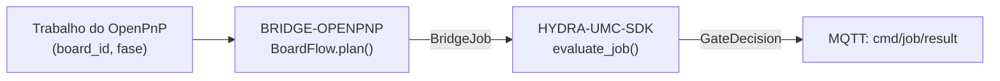

<!-- =============================================================================
HYDRA-UMC-BRIDGE-OPENPNP - OpenPnP board-flow coordination bridge
Copyright (C) JuanenRac (Electro Hobby 3D) <electrohobby3d@gmail.com>
GPL-3.0-or-later - see LICENSE
============================================================================= -->

<p align="center">
  
</p>

# 🔩 HYDRA-UMC-BRIDGE-OPENPNP

<p align="center"><a href="README.md">🇺🇸 English</a> | <a href="README_spa.md">🇪🇸 Español</a> | <a href="README_fra.md">🇫🇷 Français</a> | <a href="README_ita.md">🇮🇹 Italiano</a> | <a href="README_deu.md">🇩🇪 Deutsch</a> | <a href="README_zho.md">🇨🇳 简体中文</a> | <a href="README_jpn.md">🇯🇵 日本語</a> | 🇵🇹 <b>Português</b></p>

### 📋 Bridge de coordenação rastreável de fluxo de placas para o OpenPnP

<p align="center">
  
  
  
  
  
  
</p>

---

> **Verificação de honestidade - o que realmente corre hoje:** o núcleo rastreável de fluxo de placas e a porta de segurança (o `BoardFlow` de `board_flow.py`, que encaminha cada trabalho pelo `evaluate_job()` do próprio `HYDRA-UMC-SDK`), o inspetor só de leitura de perfis do OpenPnP (`configuration.py`), os simuladores de entrega/ciclo só de rastreio (`handoff.py`, `evidence.py`) e o transporte MQTT de comandos/evidência (`mqtt_transport.py`) são reais e estão cobertos por 241 casos `unittest` que passam (`python tools/build_test.py` - `test_board_flow.py`, `test_mqtt_transport.py`, `test_idempotency.py`). Nada disto abriu alguma vez o OpenPnP, uma ligação real a uma máquina ou um broker MQTT real: `test_mqtt_transport.py`, `test_hardening.py`, `test_mqtt_environment.py` usa um cliente de broker falso, `configuration.py` só analisa um ficheiro `machine.xml` guardado, e os simuladores de `handoff.py`/`evidence.py` são explicitamente locais, sem OpenPnP, série nem E/S de máquina. Ainda não há integração viva com uma extensão/API do OpenPnP; ver «Roteiro e limites conhecidos» abaixo, que já o diz com clareza, e `CHANGELOG.md` para saber exatamente o que foi entregue até agora. O transporte MQTT também foi executado contra um HYDRA-UMC-MQTT-BROKER real numa máquina de desenvolvimento (`tests/test_broker_integration.py`, ignorado se não houver nenhum broker instalado): publicação e subscrição com QoS 0, 1 e 2, a disponibilidade retida e o seu último testamento, e o regresso depois de o broker ter parado e arrancado de novo.

> **Estado de segurança (safety e security):** este ecossistema não é um sistema de segurança certificado. Ainda não existe um caminho de E-STOP por hardware, nem limites ou interlocks impostos pelo firmware, nem um comando de movimento verificado; as imagens de firmware são verificadas com CRC-32 e uma assinatura Ed25519, e uma compilação de versão recusa as chaves de desenvolvimento publicadas (as cabeças de ferramenta e as placas de expansão atrás do relé ainda usam os bootloaders do URTC, que aceitam um HMAC-SHA256 de chave partilhada em vez de uma assinatura); TLS e TLS mútuo são opcionais e estão desativados por defeito; nenhuma placa própria foi ainda montada ou testada. Leia a [base de segurança](https://github.com/JuanenRac/HYDRA-UMC-DOCS/blob/main/docs/SECURITY_BASELINE.md) e o [modelo de ameaças](https://github.com/JuanenRac/HYDRA-UMC-DOCS/blob/main/docs/THREAT_MODEL.md) antes de confiar em qualquer afirmação aqui para a segurança de uma pessoa.

---

## 📋 Num relance

| | |
|---|---|
| Versão | `0.2.1` |
| Maturidade | Funcional |
| Testes | 241 (`python tools/build_test.py`) |
| Tecnologia | Python / OpenPnP / HYDRA-UMC-SDK |
| Destino | O Raspberry Pi CM5 de uma célula HYDRA-UMC |
| Em hardware real | Só simulado: testado com emuladores, dublês de teste ou simuladores; não há registo de execução em hardware real para esta versão |

**Ir para:** [Visão geral](#-visão-geral) · [Arquitetura](#-arquitetura) · [Funcionalidades](#-funcionalidades) · [Segurança e proteção](#-segurança-e-proteção) · [Interfaces](#-interfaces) · [Configuração](#-configuração) · [Início rápido](#-início-rápido) · [Testes](#-testes) · [Resolução de problemas](#-resolução-de-problemas) · [Estrutura do repositório](#-estrutura-do-repositório) · [Projetos relacionados](#-projetos-relacionados)

## 🚦 Estado do projeto

Cada linha é uma parte deste repositório e a luz diz até onde chega hoje. É escrita com o que o repositório consegue demonstrar (testes, compilações, execuções), não com o que está previsto.

🟢 Feito e verificado · 🟡 Funciona, com limites conhecidos · 🟠 Feito a meio ou ainda por verificar · 🔴 Por fazer ou a não funcionar

| Área | Estado | O que significa aqui |
|---|---|---|
| Software | 🟡 | Funciona para o seu propósito principal; a verificação de honestidade acima lista o que ainda falta |
| Testes | 🟢 | 241 testes automáticos, executados a cada alteração |
| Hardware real | 🟠 | Só simulado: testado com emuladores, dublês de teste ou simuladores; não há registo de execução em hardware real para esta versão |
| Documentação | 🟢 | README em oito idiomas, verificado contra o manifesto a cada alteração |

## 🎯 Visão geral

O **HYDRA-UMC-BRIDGE-OPENPNP** é o bridge de alto nível de fluxo de placas entre o HYDRA-UMC e o OpenPnP. Coordena a preparação da PCB, o carregamento pelo robô, a colocação nativa, a descarga pelo robô e a conclusão rastreável. Não implementa cinemática de colocação, controlo de alimentadores nem movimento em bruto: isso fica inteiramente dentro do OpenPnP.

Pertence à família de **Bridges de automação externa**: um conjunto de repositórios irmãos (CNC, LASER, OPENPNP, PRINTER3D, ROS2) que falam todos o mesmo contrato de segurança partilhado do `HYDRA-UMC-SDK`, de modo que nenhum bridge possa inventar a sua própria definição de «seguro para trabalhar».

## 🧩 Papel no HYDRA-UMC

O **HYDRA-UMC-BRIDGE-OPENPNP** fica entre uma máquina pick-and-place OpenPnP e a sua linha SMT e a célula de robôs. Relata o que esse lado diz, consulta a porta partilhada antes de qualquer trabalho auxiliar e nunca assume a autoridade da máquina com que coordena.

Todos os bridges falam o contrato de segurança partilhado do `HYDRA-UMC-SDK`: um trabalho só é aceite quando a porta partilhada `evaluate_job()` o permite, e essa porta falha fechada. O projeto pai é o `HYDRA-UMC-SERVER`; este bridge não o chama, responde por MQTT, através do `HYDRA-UMC-MQTT-BROKER`, a quem comanda a célula.

## 🏛️ Arquitetura

<p align="center">
  
</p>

<details>
<summary>Versão em texto do diagrama (Mermaid)</summary>



</details>

**Porque é construído assim**

* **Porque a validação de `board_id` acontece antes de tudo o resto em `plan()`.** A primeira verificação de `BoardFlow.plan()` é `not IDENTIFIER.fullmatch(board_id)`: um identificador de placa malformado ou ambíguo é rejeitado de imediato, com um motivo explícito, em vez de ser reencaminhado a jusante, onde seria mais difícil de rastrear.
* **Porque as entregas são um dicionário fixo indexado por `JobPhase` e não formatação de texto.** `BoardFlow._handoffs` associa cada uma das seis fases suportadas a uma descrição literal e inequívoca. Uma fase futura desconhecida é rejeitada com `unrecognized-phase`; não pode tornar-se uma entrega permitida só porque a porta comum do SDK está, por outro lado, pronta.
* **Porque o bridge só planeia uma transferência produtiva quando a máquina externa está `IDLE` e a célula está `READY`.** A entrega de placas é uma operação física de dois lados; se qualquer dos lados não estiver num estado conhecido como seguro, planear uma transferência seria pedir a um robô que se mova para dentro de uma máquina imprevisível.
* **Porque `ABORT` ainda se pode pedir durante uma falha.** `JobPhase.ABORT` corresponde a `request-controlled-stop`, que a porta partilhada `evaluate_job()` não bloqueia como bloqueia as fases produtivas: um operador ou supervisor tem de poder sempre pedir uma paragem controlada, mesmo a meio de uma falha.
* **Porque a extensão/API viva do OpenPnP continua adiada.** O perfil de máquina guardado já se pode inspecionar em modo só de leitura, mas escolher uma interface de plugin ou uma superfície viva exige ainda uma sessão de teste fora de produção; isso impede que este bridge incorpore pressupostos não verificados de movimento ou de alimentadores.
* **Como se encaixa no resto do ecossistema.** O BRIDGE-OPENPNP fica entre um trabalho do OpenPnP e o `HYDRA-UMC-SDK` → `HYDRA-UMC-MQTT-BROKER` → segurança da célula: coordena o lado do robô de uma entrega de placa e nunca afirma ter a cinemática de colocação nem o controlo de alimentadores que pertencem ao próprio OpenPnP.

## ✨ Funcionalidades

* ✅ **Núcleo real e rastreável de fluxo de placas:** o `BoardFlow.plan()` de `board_flow.py` rejeita qualquer trabalho cujo `board_id` esteja vazio ou tenha espaços no início/fim *antes* de sequer avaliar a porta de segurança: cada entrega tem de levar um identificador estável e limpo. *(implementado, testado em `tests/test_board_flow.py`)*
* ✅ **Mapa real de entregas por fase:** um dicionário fixo associa cada `JobPhase` (`PREPARE`, `LOAD`, `PROCESS`, `UNLOAD`, `COMPLETE`, `ABORT`) a uma descrição de entrega explícita e legível: `verify-board-and-fixture`, `robot-loads-board-into-pnp-fixture`, `openpnp-places-declared-job`, e assim por diante. *(implementado)*
* ✅ **Porta de segurança partilhada real:** cada trabalho válido é avaliado pelo `evaluate_job()` do `bridge_contract` do `HYDRA-UMC-SDK`, a mesma porta que usam todos os bridges irmãos; uma entrega produtiva só avança quando a máquina externa indica `IDLE` e a célula do HYDRA-UMC está `READY`. *(implementado)*
* ✅ **Compilação/teste que não altera nada:** `build-test.bat`/`.sh` compilam o código-fonte e executam a suíte de rastreabilidade de placas e de falha segura sem tocar nos ficheiros de versão nem no CHANGELOG. *(implementado, ver Compilação e publicação abaixo)*
* ✅ **Inspeção só de leitura do perfil do OpenPnP:** `inspect_openpnp_config.py` analisa um `machine.xml` guardado, enquanto `openpnp-scripts/HYDRA-UMC/inspect_profile.js` é um modelo de script de menu do OpenPnP invocado manualmente; ambos comunicam apenas contagens de classes e componentes, e o modelo apresenta esse resultado numa janela informativa sem enviar nenhum comando à máquina. *(implementado, testado)*
* ✅ **Simulação de entrega só de rastreio:** `BoardIdentity` liga os identificadores de placa, receita, revisão e lote antes de `simulate_board_handoff()` aplicar a porta partilhada do SDK; emite uma impressão digital SHA-256 determinista do rasto apenas para um plano permitido e não tem OpenPnP, série nem E/S de máquina. Os campos opcionais `slot_id`/`rack_id`/`table_id` registam a colocação física real (que ranhura de alimentador, rack de armazenamento e mesa usou esta entrega exata) como identidade própria e separada, de modo que duas colocações da mesma placa nunca têm impressões digitais indistinguíveis. *(implementado, testado)*
* ✅ **Simulação do ciclo produtivo só de rastreio:** `simulate_board_cycle()` avalia a sequência ordenada `PREPARE → LOAD → PROCESS → UNLOAD → COMPLETE` sob um único estado explícito de célula/máquina; cada passo produtivo falha de forma segura fora de `READY/IDLE`, e `ABORT` continua separado no caminho de segurança do SDK. *(implementado, testado)*
* ✅ **Contrato determinista de evidência:** `docs/BOARD_TRANSFER_EVIDENCE.md` define o esquema `1.0` emitido pelos dois simuladores. Leva apenas a fase, a decisão, o motivo e uma impressão digital de identidade permitida; os valores em bruto de placa, receita, revisão e lote nunca entram no registo JSON. *(implementado, testado)*
* ✅ **Mensagens retidas e chaves repetidas:** `mqtt_transport.py` ignora as mensagens retidas (o broker reenvia-as em cada religação) e, se receber um `IdempotencyStore`, responde a uma `idempotency_key` repetida com a resposta que deu da primeira vez em vez de avaliar de novo o trabalho. *(implementado, testado em `tests/test_idempotency.py`)*
* ✅ **Estado da máquina observado (os scripts de eventos do OpenPnP):** o OpenPnP não tem API RPC, por isso `openpnp-scripts/HYDRA-UMC/Events` contém scripts de eventos (`Job.Starting`, `Job.Placement.Complete`, `Job.Finished`, `Machine.AfterHoming`, `Machine.AfterDisabled`) e um script de menu (`Report_state.js`) que escrevem um pequeno ficheiro JSON, de forma atómica, com o estado que cada evento implica; o `observation.py` lê-o (`OpenPnpStateSource`, `HYDRA_UMC_OPENPNP_STATE_FILE`) e o bridge decide por ele em vez de pelo que a mensagem do trabalho afirma. Um ficheiro em falta, com mais de 15 minutos (`HYDRA_UMC_OPENPNP_STATE_MAX_AGE_SECONDS`), escrito por outrem ou malformado é uma máquina OFFLINE que recusa o trabalho; `cmd/status` publica o `state` retido. Os scripts são testados em Node contra as poucas classes Java que usam; não correram dentro do OpenPnP e os nomes dos eventos são os documentados. *(implementado, não experimentado no OpenPnP)*
* ✅ **Sinais de passagem SMEMA:** o `SmemaReceiver` (a célula recebe placas de uma máquina a montante: lê `board available`, comanda `machine ready`) e o `SmemaSender` (a célula entrega placas a uma máquina a jusante: comanda `board available`, lê `machine ready`) de `smema.py` participam no handshake SMEMA de uma linha SMT. A leitura é filtrada contra ressaltos; COMANDAR uma saída passa pela porta partilhada: só com uma célula READY, uma máquina observada em repouso e o apoio vazio (ou uma placa preparada), e uma saída é retirada assim que a sua condição deixa de se verificar, em cada aborto e quando uma linha não se consegue escrever. `cmd/smema_status`, `cmd/smema_ready` e `cmd/smema_offer` expõem-no. Testado contra um vizinho simulado; os pinos da CM5 precisam de uma placa de interface para o cabo de 12 a 24 V. *(implementado, apenas simulado)*
* ✅ **Rastreabilidade por placa:** o `traceability.py` junta as passagens de cada placa e, no fim do seu ciclo, publica o rasto em `hydra/bridges/openpnp/event/board` (QoS 1, não retido) e envia ao HYDRA-UMC-DATALAKE uma amostra `board_handoff` por passo sob `board-<impressão>` mais um `production_event` (`good`, `cycleTimeS`) de que o HYDRA-UMC-PRODUCTION-REPORTS calcula o OEE. Por omissão só sai a impressão digital; os identificadores podem ser incluídos quando uma fábrica o permite. Um data lake parado nunca pára a célula: as amostras esperam e seguem com o rasto seguinte. *(implementado, testado contra um servidor HTTP local)*
* ✅ **Código na placa:** o `board_code.py` compara o DataMatrix lido da placa com a placa do trabalho (`HYDRA_UMC_OPENPNP_BOARD_CODE`: `off` por omissão, `advisory` ou `required`); um código diferente é recusado, um trabalho sem placa toma o único código lido, e o que não é um identificador estável não é um código. O código vem do `POST /read-code` do HYDRA-UMC-VISION-NODE (`VisionNodeCodeSource`). *(implementado, não experimentado com uma etiqueta real)*
* ✅ **Ciclo MQTT blindado e respostas honestas:** uma carga demasiado grande (mais de 16 KiB) ou ilegível, um JSON profundamente aninhado e qualquer falha inesperada recebem uma recusa no tópico de resultado e nunca terminam o ciclo; `cmd/job` e `cmd/handoff` mantêm espaços de chaves de idempotência separados (`job:`/`handoff:`), pelo que um trabalho verificado com a porta ainda pode ser entregue com a mesma chave e conserva a sua impressão de identidade; as respostas de `cmd/job` indicam `"mode": "simulation-only"` e `"observed": false` (nada olha para o OpenPnP: o estado da máquina é o que o requerente declara) e um ABORT por aí diz que nada foi parado; a porta e o rasto da entrega partilham uma única regra de identificador de placa, `cmd/handoff` aceita `slot_id`, `rack_id` e `table_id`, e um `machine.xml` com DOCTYPE é recusado em qualquer codificação; o bridge anuncia-se num tópico `availability` com Last Will. *(implementado, testado em `tests/test_hardening.py`)*
* ✅ **Segue a paragem global (desativado por defeito):** com `HYDRA_UMC_OPENPNP_GLOBAL_STOP=1` o bridge lê o anúncio retido do servidor em `hydra/swarm/safety/estop`; enquanto disser `SAFE_STOP`, ou não puder ser lido, recusa com um motivo: um trabalho (um aborto passa), uma passagem e ativar uma linha SMEMA. As paragens e os pedidos só de leitura continuam a funcionar e só `READY` termina a recusa. *(implementado, testado contra um broker real; nunca executado com um servidor real)*

## 🔒 Segurança e proteção

| Ameaça | Defesa | Onde |
|---|---|---|
| Um trabalho para uma célula ou máquina que não está em estado seguro | Todo o trabalho passa pela porta partilhada `evaluate_job()` do SDK, que falha fechada; o bridge não tem lógica própria de aceitar ou recusar | SDK `bridge_contract` |
| Dados de trabalho desmesurados | No máximo 32 parâmetros, chaves até 64 carateres, valores até 1024, identificadores até 128 (`MAX_PARAMETERS`, `MAX_PARAMETER_KEY_CHARS`, `MAX_PARAMETER_VALUE_CHARS`, `MAX_IDENTIFIER_CHARS`) | SDK `bridge_contract` |
| Uma ordem repetida ou reenviada | Um `IdempotencyStore` lembra cada chave durante 24 horas e no máximo 10 000 entradas; uma repetição recebe a primeira resposta em vez de ser avaliada de novo | SDK `job_intake` |
| Uma carga MQTT enorme ou hostil | Uma carga acima de 16 KiB, um JSON ilegível ou muito aninhado e qualquer falha inesperada recebem uma recusa no tópico de resultado e nunca terminam o ciclo | `mqtt_transport.py` |
| A placa errada na máquina | `board_code.py` lê o DataMatrix e compara-o com a placa do trabalho; `HYDRA_UMC_OPENPNP_BOARD_CODE` é `off`, `advisory` ou `required` | `board_code.py` |
| Um estado do OpenPnP caducado ou falso | O ficheiro de estado só é fiável enquanto fresco (15 minutos por predefinição), no máximo 16 KiB, escrito pela origem `openpnp-events`; uma palavra desconhecida é `OFFLINE` | `observation.py` |
| Dados de rastreabilidade sem limite e saídas SMEMA inseguras | No máximo 256 rastos abertos e 5000 amostras pendentes (enviadas em lotes de 500); os identificadores de placa cumprem `^[A-Za-z0-9][A-Za-z0-9._-]{0,95}$`; as saídas SMEMA obedecem às regras de segurança da célula | `traceability.py`, `smema.py`, `board_flow.py` |
| Um comando retido repetido ao reconectar | Uma mensagem `cmd/` retida é ignorada ao reconectar | `mqtt_transport.py` |

**O que nunca faz:** não é um controlador de movimento de colocação e nunca abre nem altera a máquina OpenPnP quando inspeciona o seu XML.

## 🔌 Interfaces

Tópicos sob `hydra/bridges/openpnp/`; não há verbo de paragem (`STOP_VERBS` está vazio).

| Tópico ou rota | O que leva |
|---|---|
| `cmd/status`, `cmd/job`, `cmd/handoff` | comandos de entrada; cada um é respondido em `<verbo>/result` |
| `cmd/smema_offer`, `cmd/smema_ready`, `cmd/smema_status` | o handshake SMEMA com os vizinhos da linha |
| `state`, `availability`, `event/board` | o estado, `online`/`offline` e os registos de cada placa (`board_handoff`, `production_event`, versão de esquema `1.0`) para o data lake e o relatório OEE |

## ⚙️ Configuração

| Variável | Predefinição | O que define |
|---|---|---|
| `HYDRA_UMC_OPENPNP_BOARD_CODE` | `off` | `off`, `advisory` ou `required`; um valor desconhecido equivale a `off` |
| `HYDRA_UMC_OPENPNP_STATE_FILE` | por definir | caminho do ficheiro que os scripts de eventos do OpenPnP escrevem; por definir significa sem fonte de estado |
| `HYDRA_UMC_OPENPNP_STATE_MAX_AGE_SECONDS` | `900` | quão antigo o ficheiro de estado pode ser antes de deixar de ser fiável |
| `HYDRA_UMC_OPENPNP_GLOBAL_STOP` | desativado | `1` segue a paragem global do servidor: enquanto o último anúncio no tópico retido `hydra/swarm/safety/estop` disser `SAFE_STOP` (ou não puder ser lido), o bridge recusa com um motivo: um trabalho (um aborto passa), uma passagem e ativar uma linha SMEMA; só `READY` lhe põe fim. `HYDRA_UMC_OPENPNP_GLOBAL_STOP_TOPIC` muda o tópico e `HYDRA_UMC_OPENPNP_GLOBAL_STOP_STRICT=1` recusa também até chegar o primeiro anúncio |
| `HYDRA_MQTT_USERNAME` | nenhum | O nome de utilizador MQTT; o broker liga-o a um prefixo de ID de cliente |
| `HYDRA_MQTT_PASSWORD` | nenhum | A palavra-passe; só vale em conjunto com o nome de utilizador |
| `HYDRA_MQTT_PASSWORD_FILE` | nenhum | A palavra-passe lida de um ficheiro (segredo do Docker ou do systemd); ignorada se `HYDRA_MQTT_PASSWORD` estiver definida |
| `HYDRA_MQTT_TLS_CA` | nenhum | O ficheiro da CA que assinou o certificado do broker: a ligação é TLS e o certificado é verificado |
| `HYDRA_MQTT_TLS` | desativado | `1` ativa o TLS, verificado com as CA de confiança do sistema |
| `HYDRA_MQTT_TLS_CERT` / `HYDRA_MQTT_TLS_KEY` | nenhum | O certificado de cliente e a sua chave para um broker que exige TLS mútuo; são precisos os dois |

## 🚀 Início rápido

Requer Python 3.11 ou superior. Os testes e os scripts de compilação esperam o `HYDRA-UMC-SDK` clonado ao lado deste repositório (`../HYDRA-UMC-SDK`) ou indicado com `HYDRA_UMC_SDK_ROOT`.

Experimente sem hardware (isto verifica todo o bridge com os seus emuladores e dublês de teste):

```bash
py -3 tools/build_test.py          # Windows
python3 tools/build_test.py         # Linux, macOS
```

Arrancar o serviço (não há um script de consola: o serviço é o `run_forever()` do transporte MQTT, que chama a partir do seu próprio código de arranque):

```python
from hydra_umc_bridge_openpnp.mqtt_transport import OpenPnpMqttBridge, run_forever
bridge = OpenPnpMqttBridge(cell_state=lambda: cell_state)   # state_source, smema_*, trace_recorder are optional
run_forever(bridge, host="192.168.0.180")                  # serves cmd/# forever
```

O nome de utilizador, a palavra-passe e os ficheiros TLS vêm das variáveis `HYDRA_MQTT_*` (ver Configuração); o código acima não precisa de credenciais próprias.

## 🧪 Testes

241 casos `unittest` automáticos correm com `python tools/build_test.py` (que também compila cada módulo). Os testes não precisam de hardware, rede nem pacotes opcionais: os que precisariam de `paho-mqtt`, `pyserial` ou de uma biblioteca do fabricante usam um substituto ou são saltados se o pacote faltar.

| Ficheiro de testes | Testes | O que cobre |
|---|---|---|
| `test_global_stop.py`, `test_global_stop_broker.py` | - | a guarda da paragem global e as suas recusas com o motivo, e o mesmo contra um broker real numa porta local livre (o anúncio em QoS 0, 1 e 2, uma paragem retida obedecida ao ligar, uma ilegível que falha fechada) |
| `test_broker_integration.py`, `broker_harness.py` | - | o cliente MQTT contra um HYDRA-UMC-MQTT-BROKER real numa porta local livre: uma ordem através do cliente, o estado retido e a última vontade, e o regresso depois de o broker cair e voltar; é ignorado quando faltam o Node.js, o `paho-mqtt` ou o broker instalado (`HYDRA_UMC_TEST_BROKER_DIR`, por omissão a pasta ao lado) |
| `test_board_flow.py`, `test_board_code.py`, `test_observation.py` | - | fases de entrega, o código de placa, o ficheiro de estado e os scripts de eventos |
| `test_smema.py`, `test_traceability.py` | - | SMEMA contra um vizinho em memória; o rasto, as amostras do data lake e um destino HTTP local real |
| `test_mqtt_transport.py`, `test_mqtt_environment.py`, `test_hardening.py`, `test_edge_cases.py`, `test_idempotency.py` | - | distribuição de tópicos, credenciais do ambiente, clientes hostis, casos limite, chaves repetidas |

A CI executa `HYDRA_UMC_CI=1 python tools/ci_validate.py`, que verifica o manifesto, os documentos, os oito README e as imagens, e corre os testes com uma cópia do SDK.

## 🏗️ Compilação e publicação

Requer Python 3.11+. `tools/build_test.py` espera o `HYDRA-UMC-SDK` extraído como diretoria irmã (`../HYDRA-UMC-SDK`) ou indicado pela variável de ambiente `HYDRA_UMC_SDK_ROOT`.

```bash
# Windows
build-test.bat      # só valida - sem alteração de versão/CHANGELOG
build.bat            # Valida e compila (compilar nunca altera a versão)

# Linux/macOS
bash build-test.sh
bash build.sh
```

`build-test` compila com `py_compile` cada módulo em `src/` e executa a suíte `unittest` completa descoberta em `tests/` (`test_board_flow.py`, `test_idempotency.py`, `test_mqtt_transport.py`, `test_hardening.py`, `test_mqtt_environment.py` - 241 testes), que prova, entre tudo o resto que cobre, a rejeição por rastreabilidade de placas e a porta de falha segura; nunca modifica o repositório. `build` executa primeiro essa mesma validação e, só se correr bem, chama `tools/bump_version.py` para sincronizar a versão em `pyproject.toml`, `hydra-umc.project.json` e `CHANGELOG.md`. Ainda não há comando `run` de máquina viva: exige uma integração validada com o OpenPnP.

## 🩺 Resolução de problemas

| Vê | Porque | Faça |
|---|---|---|
| `ModuleNotFoundError: hydra_umc_sdk` | O SDK não está instalado nem ao lado deste repositório | Clone o `HYDRA-UMC-SDK` ao lado deste repositório ou defina `HYDRA_UMC_SDK_ROOT` |
| `paho-mqtt is not installed` | O cliente MQTT é um extra opcional | `pip install ".[mqtt]"` (precisa de `paho-mqtt` 2.1 ou superior, inferior a 3) |
| `password was given without a username` | As credenciais MQTT precisam das duas partes | Defina também `HYDRA_MQTT_USERNAME`, não só a palavra-passe |
| `could not reach the MQTT broker after N attempts` | O broker está em baixo, o endereço está errado ou a porta está fechada | Arranque o `HYDRA-UMC-MQTT-BROKER` e verifique o anfitrião e a porta dados ao transporte (5 tentativas com 2 segundos de intervalo); uma falha do handshake TLS não é repetida |
| `the MQTT broker refused the connection` | O broker recusou a credencial (ou não respondeu a tempo) | Verifique `HYDRA_MQTT_USERNAME` e a palavra-passe; o ID de cliente tem de começar pelo prefixo que o broker ligou à credencial |
| `"allowed": false` + `reason` | A porta partilhada ou uma guarda recusou a ordem | Leia `reason` e corrija a causa; não repita às cegas |
| `OFFLINE` although OpenPnP is running | O ficheiro de estado falta, é mais antigo que o limite ou foi escrito por outra origem | Instale os scripts de `openpnp-scripts/` no OpenPnP, aponte `HYDRA_UMC_OPENPNP_STATE_FILE` para o ficheiro que eles escrevem e aumente `HYDRA_UMC_OPENPNP_STATE_MAX_AGE_SECONDS` só se a máquina ficar muito tempo inativa |

## 📂 Estrutura do repositório

<p align="center">
  
</p>

<details>
<summary>Versão em texto da árvore</summary>

```text
HYDRA-UMC-BRIDGE-OPENPNP/
├── src/hydra_umc_bridge_openpnp/
│   ├── board_flow.py                                        fases de entrega de placas (não é um controlador de colocação)
│   ├── board_code.py                                        DataMatrix da placa face ao trabalho
│   ├── observation.py                                       ficheiro de estado do OpenPnP, fiável se fresco
│   ├── smema.py                                             o handshake SMEMA com os vizinhos da linha
│   ├── traceability.py                                      a história de cada placa, para o data lake e o OEE
│   ├── handoff.py                                           entrega rastreável, simulada
│   ├── evidence.py                                          evidência local determinista
│   ├── configuration.py                                     verificação só de leitura de um XML
│   └── mqtt_transport.py                                    transporte MQTT de comandos, estado e eventos de placa
├── tests/                                                   208 testes, com fixtures de SMEMA e rastreabilidade
├── docs/                                                    guia do bridge, evidência de entrega
├── openpnp-scripts/                                         scripts de eventos que escrevem o ficheiro de estado que o OpenPnP expõe
├── tools/                                                   executor de compilação e testes, subida de versão, validador de CI, geradores e verificações de README e imagens
├── images/                                                  faixa e imagens do README
├── .github/                                                 fluxo de CI e modelos de questões
├── pyproject.toml                                           metadados do pacote e dependências
├── hydra-umc.project.json                                   manifesto: versão, maturidade, família
├── CHANGELOG.md                                             o que mudou em cada versão
├── build.sh build.bat                                       scripts de compilação (nunca mudam a versão)
├── build-test.sh build-test.bat                             scripts de compilação (nunca mudam a versão)
├── test.sh test.bat                                         executam os testes
├── inspect-openpnp-config.sh / inspect-openpnp-config.bat   verificação só de leitura de um XML de máquina
└── SECURITY.md SUPPORT.md CONTRIBUTING.md CODE_OF_CONDUCT.md LICENSE LICENSE.md
```

</details>

## 🗺️ Roteiro e limites conhecidos

**Limites conhecidos hoje**

**Real hoje:** versão `0.2.1`, um núcleo de entrega de PCB rastreável testado localmente (`BoardFlow`) apoiado pela porta de trabalhos partilhada do `HYDRA-UMC-SDK`, um transporte real de comandos/evidência por MQTT (`mqtt_transport.py`) que ignora mensagens retidas e não repete chaves de idempotência, uma suíte `unittest` determinista de 241 testes, um inspetor de perfil guardado que comunica evidência real de atuadores/sinalizadores/pontas de bico do OpenPnP junto com contagens de cabeças/câmaras/drivers/alimentadores, um modelo visível de script de menu do OpenPnP só de leitura, simulações de entrega/ciclo ligadas à identidade e um contrato de evidência JSON não sensível verificado pelo CI sem E/S de máquina.

**Fronteira de integração:** o OpenPnP mantém sempre a cinemática de colocação, o controlo de alimentadores e o movimento em bruto; este bridge apenas regula e rastreia a *entrega* à sua volta: carregamento pelo robô, conclusão da colocação nativa, descarga pelo robô.

**Ainda por fazer:** não se afirma nenhuma ligação viva à máquina: a extensão/API concreta do OpenPnP só será escolhida numa sessão isolada fora de produção, com um operador presente.

## 🌍 Idiomas

Este README e os documentos do repositório existem em oito idiomas: inglês, espanhol, alemão, francês, italiano, japonês, chinês e português (Portugal). São escritos em conjunto e a CI verifica que os oito ficheiros têm as mesmas secções e as mesmas ligações. Este repositório não tem ecrã nem catálogo de mensagens próprios, por isso não há textos de interface para traduzir.

## 🔗 Projetos relacionados

Este projeto faz parte do ecossistema de robótica HYDRA-UMC do mesmo autor (JuanenRac / Electro Hobby 3D). Vale a pena conhecê-los, porque um pedido pode ser, na verdade, sobre um destes e não sobre este repositório.

**Projeto-mãe**
- **[HYDRA-UMC-SERVER](https://github.com/JuanenRac/HYDRA-UMC-SERVER)** — o verdadeiro backend sem interface (REST/WebSocket) com que falam todos os clientes de controlo; este bridge não o chama: responde por MQTT, através do HYDRA-UMC-MQTT-BROKER, a quem comanda a célula.

**Projetos irmãos** — também falam com a API do próprio HYDRA-UMC-SERVER, cada um como cliente próprio
- **[HYDRA-UMC-STUDIO](https://github.com/JuanenRac/HYDRA-UMC-STUDIO)** — painel web de controlo com visualização 3D em tempo real de vários robôs.
- **[HYDRA-UMC-SUITE](https://github.com/JuanenRac/HYDRA-UMC-SUITE)** — centro de comando de enxame para desktop (PySide6) para vários servidores ao mesmo tempo, empacotado como executável independente.
- **[HYDRA-UMC-ANDROID-CONTROL](https://github.com/JuanenRac/HYDRA-UMC-ANDROID-CONTROL)** — aplicação Android nativa de controlo, com início de sessão biométrico e um companheiro Wear OS emparelhado.
- **[HYDRA-UMC-IOS-CONTROL](https://github.com/JuanenRac/HYDRA-UMC-IOS-CONTROL)** — aplicação de controlo para iOS/iPadOS (Flutter) com sincronização WebSocket em tempo real.
- **[HYDRA-UMC-DSI](https://github.com/JuanenRac/HYDRA-UMC-DSI)** — interface tátil nativa para o ecrã tátil DSI de 7" integrado, executada no próprio CM5.
- **[HYDRA-UMC-BRIDGE-AMR](https://github.com/JuanenRac/HYDRA-UMC-BRIDGE-AMR)** — fronteira de coordenação para frotas AGV/AMR através de um publicador MQTT VDA 5050 (testado apenas contra uma frota emulada).
- **[HYDRA-UMC-BRIDGE-CNC](https://github.com/JuanenRac/HYDRA-UMC-BRIDGE-CNC)** — coordenador de células CNC de alto nível com acesso ao estado GRBL e aos bytes de controlo (testado apenas contra um emulador).
- **[HYDRA-UMC-BRIDGE-DROIDS](https://github.com/JuanenRac/HYDRA-UMC-BRIDGE-DROIDS)** — fronteira de coordenação para droides com patas/humanoides, com um emissor de comandos para o Boston Dynamics Spot (testado apenas contra um emulador).
- **[HYDRA-UMC-BRIDGE-LASER](https://github.com/JuanenRac/HYDRA-UMC-BRIDGE-LASER)** — coordenador de células laser que lê 3 sinais GPIO (chave, caixa e interlock) (testado apenas contra um chip simulado; não pode armar nem disparar um laser).
- **[HYDRA-UMC-BRIDGE-PRINTER3D](https://github.com/JuanenRac/HYDRA-UMC-BRIDGE-PRINTER3D)** — fronteira de coordenação segura para impressoras 3D Moonraker/Klipper, com comandos de trabalho reais protegidos por portas.
- **[HYDRA-UMC-BRIDGE-ROS2](https://github.com/JuanenRac/HYDRA-UMC-BRIDGE-ROS2)** — coordenador com um transporte ROS 2 baseado em rclpy importado sob demanda (ainda não executado contra uma instalação ROS 2).
- **[HYDRA-UMC-BRIDGE-UAV](https://github.com/JuanenRac/HYDRA-UMC-BRIDGE-UAV)** — fronteira de coordenação para UAV com câmara, com um emissor de comandos MAVLink (testado apenas contra um emulador).

**Diretamente relacionados**
- **[HYDRA-UMC-SDK](https://github.com/JuanenRac/HYDRA-UMC-SDK)** — o contrato JSON-Schema partilhado e a fronteira de software de controlo de trabalhos contra a qual cada bridge valida os seus comandos (não é uma função de segurança certificada).
- **[HYDRA-UMC-CONNECTOR-HUB](https://github.com/JuanenRac/HYDRA-UMC-CONNECTOR-HUB)** — registo declarativo de manifestos de adaptador e validador para conectores de máquinas externas; estende a ideia de contrato do SDK a máquinas externas sem substituir os projetos de gateway industrial.
- **[HYDRA-UMC-MQTT-BROKER](https://github.com/JuanenRac/HYDRA-UMC-MQTT-BROKER)** — o transporte real de `mqtt_transport.py` para os tópicos `hydra/bridges/openpnp/...` deste bridge: a porta de trabalhos mais uma simulação completa de entrega rastreável, sem tópico `state` porque aqui não há transporte real de máquina para observar; ver o `docs/BRIDGE_TOPICS.md` desse repositório.
- **[HYDRA-UMC-SAFETY-ZONES](https://github.com/JuanenRac/HYDRA-UMC-SAFETY-ZONES)** — evidência futura de segurança por zonas da célula para este bridge.

**Também fazem parte do ecossistema**

*Hardware e plataforma centrais*
- **[HYDRA-UMC](https://github.com/JuanenRac/HYDRA-UMC)** — o desenho da placa-mãe do braço robótico: anfitrião CM5 + STM32H745 de dois núcleos, pensado para orquestrar até 8 braços de ferramenta por CAN-OTA/SPI-OTA (firmware numa fase inicial; ainda sem placa montada).
- **[HYDRA-UMC-OS](https://github.com/JuanenRac/HYDRA-UMC-OS)** — camada de produto reproduzível do Raspberry Pi OS para o CM5: agente só de leitura, configuração/perfis validados, aprovisionamento Wi-Fi de primeiro contacto.

*Backend central e clientes*
- **[HYDRA-UMC-EDITOR-URDF](https://github.com/JuanenRac/HYDRA-UMC-EDITOR-URDF)** — criador/editor gráfico de URDF para desktop que envia os modelos concluídos para o catálogo do STUDIO.
- **[HYDRA-UMC-EDITOR-STL](https://github.com/JuanenRac/HYDRA-UMC-EDITOR-STL)** — editor de modelos STL para desktop que transforma/substitui/remove/adiciona peças reais no mesmo catálogo de modelos que o HYDRA-UMC-EDITOR-URDF também edita.

*Plataforma de ferramentas URTC*
- **[URTC](https://github.com/JuanenRac/URTC)** — firmware da placa física Universal Robot Tool Controller, mais de 25 perfis de ferramenta por barramento CAN.
- **[URTC-FLASHER](https://github.com/JuanenRac/URTC-FLASHER)** — ferramenta gráfica de gravação para desktop das placas URTC, por CAN-OTA e também SWD/JTAG de chip completo.
- **[URTC-TESTER](https://github.com/JuanenRac/URTC-TESTER)** — ferramenta de diagnóstico CAN em tempo real para desktop das placas URTC, com um painel por perfil de ferramenta.
- **[URTC-WEB-STUDIO](https://github.com/JuanenRac/URTC-WEB-STUDIO)** — alternativa no navegador ao URTC-TESTER através da Web Serial API, sem instalação local.
- **[URTC-GATEWAY](https://github.com/JuanenRac/URTC-GATEWAY)** — gateway à frente do barramento CAN do URTC: lista de identificadores permitidos, limite de taxa e chave de sessão; software testado num computador, ainda não num barramento real.

*Nó de IA de visão (Hailo-8)*
- **[HYDRA-UMC-VISION-NODE](https://github.com/JuanenRac/HYDRA-UMC-VISION-NODE)** — centro de integração do pipeline de visão Hailo-8, com uma verificação real de prontidão de hardware por fase.
- **[HYDRA-UMC-DETECTION-HEF](https://github.com/JuanenRac/HYDRA-UMC-DETECTION-HEF)** — registo real de modelos compilados com verificação segura de carga por arquitetura Hailo e soma de verificação.
- **[HYDRA-UMC-VISION-STREAMER](https://github.com/JuanenRac/HYDRA-UMC-VISION-STREAMER)** — pipeline GStreamer real e gerador de configuração MediaMTX com uma fronteira de integração HailoRT real.
- **[HYDRA-UMC-VISUAL-SERVOING-API](https://github.com/JuanenRac/HYDRA-UMC-VISUAL-SERVOING-API)** — lei de correção de servovisão baseada em posição com autorização condicionada ao estado da zona; ainda sem estimativa de pose por câmara.

*Nó de IA cognitiva (Hailo-10)*
- **[HYDRA-UMC-COGNITIVE-NODE](https://github.com/JuanenRac/HYDRA-UMC-COGNITIVE-NODE)** — centro de integração do pipeline cognitivo do Hailo-10 (orquestração de LLM/VLA/voz).
- **[HYDRA-UMC-VLA-ENGINE](https://github.com/JuanenRac/HYDRA-UMC-VLA-ENGINE)** — codificação/descodificação real de tokens de ação e geração de trajetórias para um modelo Visão-Linguagem-Ação.
- **[HYDRA-UMC-VOICE-UI](https://github.com/JuanenRac/HYDRA-UMC-VOICE-UI)** — front-end de voz real (VAD + analisador de intenções) com um relé para o relógio limitado e protegido por confirmação.
- **[HYDRA-UMC-SEMANTIC-PLANNER](https://github.com/JuanenRac/HYDRA-UMC-SEMANTIC-PLANNER)** — decomposição real de tarefas baseada em regras e recuperação semântica de erros sobre os códigos de erro do MCU.
- **[HYDRA-UMC-DOCS-QA](https://github.com/JuanenRac/HYDRA-UMC-DOCS-QA)** — pesquisa real de documentos TF-IDF só com a biblioteca padrão sobre a documentação Markdown deste ecossistema.
- **[HYDRA-UMC-LOCAL-TECHNICIAN](https://github.com/JuanenRac/HYDRA-UMC-LOCAL-TECHNICIAN)** — técnico de manutenção de IA local, protegido por políticas, para o próprio ecossistema: observa, diagnostica e propõe correções; os dois níveis de maior risco não estão implementados de propósito.

*Orquestração e enxame*
- **[HYDRA-UMC-ORCHESTRATOR](https://github.com/JuanenRac/HYDRA-UMC-ORCHESTRATOR)** — centro de integração com um contrato real de relatório de saúde gRPC/Protobuf e uma máquina de estados de missões.
- **[HYDRA-UMC-JOB-DISPATCHER](https://github.com/JuanenRac/HYDRA-UMC-JOB-DISPATCHER)** — fila real de trabalhos por prioridade com deduplicação, sobre uma API HTTP real.
- **[HYDRA-UMC-NODE-HEALING](https://github.com/JuanenRac/HYDRA-UMC-NODE-HEALING)** — vigilante real de saúde da frota por gRPC com repetição/recuo e deteção de identidade incoerente.
- **[HYDRA-UMC-PATH-PLANNER-3D](https://github.com/JuanenRac/HYDRA-UMC-PATH-PLANNER-3D)** — planeador real de trajetórias 3D baseado em RRT com validação real de colisões com obstáculos e espaço de trabalho.
- **[HYDRA-UMC-SWARM-SYNC](https://github.com/JuanenRac/HYDRA-UMC-SWARM-SYNC)** — sincronização real de estado CRDT LWW-Element-Map, testada por propriedades para a convergência de várias células.

*Gémeo digital e simulação*
- **[HYDRA-UMC-TWIN](https://github.com/JuanenRac/HYDRA-UMC-TWIN)** — centro de integração do motor de gémeo digital, com um contrato real de sincronização de compatibilidade de versões.
- **[HYDRA-UMC-HIL-BRIDGE](https://github.com/JuanenRac/HYDRA-UMC-HIL-BRIDGE)** — encaminhador hardware-in-the-loop com um interlock de software de colisão entre a simulação e o hardware real (testado sem hardware real).
- **[HYDRA-UMC-PHYSICS-REPLICA](https://github.com/JuanenRac/HYDRA-UMC-PHYSICS-REPLICA)** — cinemática direta real e validação de limites de juntas sobre um subconjunto real de URDF.
- **[HYDRA-UMC-SYNTHETIC-DATA-GEN](https://github.com/JuanenRac/HYDRA-UMC-SYNTHETIC-DATA-GEN)** — gerador procedural real de cenas 2D com exportação de anotações YOLO/COCO.

*Dados e análise*
- **[HYDRA-UMC-DATALAKE](https://github.com/JuanenRac/HYDRA-UMC-DATALAKE)** — armazém real de séries temporais sobre sqlite3 com uma API HTTP real de ingestão/consulta.
- **[HYDRA-UMC-ANOMALY-DETECTOR](https://github.com/JuanenRac/HYDRA-UMC-ANOMALY-DETECTOR)** — detetor real de anomalias por FFT e linha de base estatística, com monitorização de deriva.
- **[HYDRA-UMC-PRODUCTION-REPORTS](https://github.com/JuanenRac/HYDRA-UMC-PRODUCTION-REPORTS)** — cálculo real de OEE/disponibilidade sobre o histórico do DATALAKE, com exportação CSV reprodutível.
- **[HYDRA-UMC-TELEMETRY-COLLECTOR](https://github.com/JuanenRac/HYDRA-UMC-TELEMETRY-COLLECTOR)** — pipeline real de ingestão CAN/WebSocket para o DATALAKE, com deduplicação por sequência.

*Gateway industrial*
- **[HYDRA-UMC-GATEWAY-INDUSTRIAL](https://github.com/JuanenRac/HYDRA-UMC-GATEWAY-INDUSTRIAL)** — centro de integração que retransmite para protocolos industriais, com uma camada real de lista de comandos permitidos e contrapressão.
- **[HYDRA-UMC-OPCUA-SERVER](https://github.com/JuanenRac/HYDRA-UMC-OPCUA-SERVER)** — espaço de endereços OPC-UA real, verificado com uma sessão de cliente real do protocolo binário.
- **[HYDRA-UMC-MTCONNECT-ADAPTER](https://github.com/JuanenRac/HYDRA-UMC-MTCONNECT-ADAPTER)** — endpoints XML MTConnect `/probe` e `/current` reais com saída em modo degradado.

*Ferramentas complementares e operações do ecossistema*
- **[HYDRA-UMC-DASHBOARD-AI](https://github.com/JuanenRac/HYDRA-UMC-DASHBOARD-AI)** — painéis de Resumos Inteligentes e Realce de Anomalias sobre o DATALAKE/ANOMALY-DETECTOR, com um recurso estatístico honesto.
- **[HYDRA-UMC-TOOL-CLI](https://github.com/JuanenRac/HYDRA-UMC-TOOL-CLI)** — CLI da frota com um contrato de códigos de saída real e estável, um cliente vivo genuíno da API do HYDRA-UMC-SERVER.
- **[HYDRA-UMC-WATCH](https://github.com/JuanenRac/HYDRA-UMC-WATCH)** — aplicação companheira WearOS com padrões de alerta tátil e um relé de voz para o telemóvel emparelhado (ainda não executada num relógio físico).
- **[URTC-SMART-RACK](https://github.com/JuanenRac/URTC-SMART-RACK)** — firmware de um rack de montagem de placas com descodificação real do ID da ferramenta e lógica de pré-aquecimento Smart Idle.
- **[URTC-VISION-TOOL](https://github.com/JuanenRac/URTC-VISION-TOOL)** — firmware mais um companheiro de visão em Python real para uma cabeça de ferramenta de inspeção térmica/RGB.
- **[HYDRA-UMC-UPDATER](https://github.com/JuanenRac/HYDRA-UMC-UPDATER)** — ferramenta administrativa de desktop que descobre, clona e atualiza todos os repositórios deste ecossistema.
- **[HYDRA-UMC-OS-REBUILDER](https://github.com/JuanenRac/HYDRA-UMC-OS-REBUILDER)** — ferramenta de desktop para Windows/Linux que constrói uma imagem do CM5 pronta a gravar com as versões mais recentes do ecossistema, com configuração de primeiro arranque de Wi-Fi/utilizador/SSH ao estilo do Raspberry Pi Imager.
- **[HYDRA-UMC-OPS-AGENT](https://github.com/JuanenRac/HYDRA-UMC-OPS-AGENT)** — coordenador de incidentes de manutenção: um papel de borda de poucos privilégios recolhe um inventário/estado higienizado, um papel de plano de controlo mostra-o só de leitura e pede a um fornecedor de IA que sugira um diagnóstico; nunca aplica um patch nem implanta nada.
- **[HYDRA-UMC-DEV-SERVER](https://github.com/JuanenRac/HYDRA-UMC-DEV-SERVER)** — anfitrião de desenvolvimento reproduzível (Raspberry Pi 5 / CM5) que guarda o código-fonte do ecossistema e executa tarefas limitadas de compilação/teste numa fila durável; um papel de desenvolvimento dedicado, explicitamente não um CM5 operacional.

## 📚 Documentação

Onde ler mais:

* [docs/BRIDGE_GUIDE.md](docs/BRIDGE_GUIDE.md) - âmbito, fluxo de placas, ficheiro de estado, SMEMA, rastreabilidade, scripts
* [docs/BOARD_TRANSFER_EVIDENCE.md](docs/BOARD_TRANSFER_EVIDENCE.md) - que evidência deixa uma entrega rastreável
* [Base de segurança do ecossistema](https://github.com/JuanenRac/HYDRA-UMC-DOCS/blob/main/docs/SECURITY_BASELINE.md)
* [Modelo de ameaças do ecossistema](https://github.com/JuanenRac/HYDRA-UMC-DOCS/blob/main/docs/THREAT_MODEL.md)
* [Registo de alterações deste repositório](CHANGELOG.md)
* [Licença deste repositório](LICENSE.md)

## 🤝 Contribuir e comunidade

* Antes de um pull request execute `HYDRA_UMC_CI=1 py -3 tools/ci_validate.py` (ou `HYDRA_UMC_CI=1 python3 tools/ci_validate.py`): tem de imprimir `CI_VALIDATION=PASS`. Não execute `build.sh` nem `build.bat` para esta verificação; compilar não é verificar.
* Os oito README são escritos a partir de uma única fonte em HYDRA-UMC-DOCS; não os edite à mão. Altere a fonte e escreva-os de novo com `tools/make_readmes.py`.
* Não afirme num README o que não foi executado: diga «simulado» ou «não testado em hardware» quando for a verdade.
* Consulte [CONTRIBUTING.md](CONTRIBUTING.md), o [código de conduta](CODE_OF_CONDUCT.md), [SECURITY.md](SECURITY.md) e [SUPPORT.md](SUPPORT.md).

## 👤 AUTOR

**JuanenRac (Electro Hobby 3D)** · electrohobby3d@gmail.com

## 📜 LICENÇA

GPL-3.0-or-later - [LICENSE](LICENSE).
