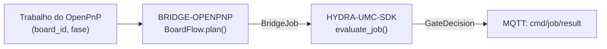

<!-- =============================================================================
HYDRA-UMC-BRIDGE-OPENPNP - OpenPnP board-flow bridge
Copyright (C) JuanenRac (Electro Hobby 3D) <electrohobby3d@gmail.com>
GPL-3.0-or-later - see LICENSE
============================================================================= -->

<p align="center">
  
</p>

# 🎯 HYDRA-UMC-BRIDGE-OPENPNP

<p align="center"><a href="README.md">🇺🇸 English</a> | <a href="README_spa.md">🇪🇸 Español</a> | <a href="README_fra.md">🇫🇷 Français</a> | <a href="README_ita.md">🇮🇹 Italiano</a> | <a href="README_deu.md">🇩🇪 Deutsch</a> | <a href="README_zho.md">🇨🇳 简体中文</a> | <a href="README_jpn.md">🇯🇵 日本語</a> | 🇵🇹 <b>Português</b></p>

### 📋 Bridge de coordenação rastreável de fluxo de placas para o OpenPnP

<p align="center">
  
  
  
</p>

---

> **Verificação de honestidade - o que realmente corre hoje:** o núcleo rastreável de fluxo de placas e a porta de segurança (o `BoardFlow` de `board_flow.py`, que encaminha cada trabalho pelo `evaluate_job()` do próprio `HYDRA-UMC-SDK`), o inspetor só de leitura de perfis do OpenPnP (`configuration.py`), os simuladores de entrega/ciclo só de rastreio (`handoff.py`, `evidence.py`) e o transporte MQTT de comandos/evidência (`mqtt_transport.py`) são reais e estão cobertos por 68 casos `unittest` que passam (`python tools/build_test.py` - `test_board_flow.py`, `test_mqtt_transport.py`, `test_idempotency.py`). Nada disto abriu alguma vez o OpenPnP, uma ligação real a uma máquina ou um broker MQTT real: `test_mqtt_transport.py`, `test_hardening.py`, `test_mqtt_environment.py` usa um cliente de broker falso, `configuration.py` só analisa um ficheiro `machine.xml` guardado, e os simuladores de `handoff.py`/`evidence.py` são explicitamente locais, sem OpenPnP, série nem E/S de máquina. Ainda não há integração viva com uma extensão/API do OpenPnP; ver «Estado atual e próximos passos» abaixo, que já o diz com clareza, e `CHANGELOG.md` para saber exatamente o que foi entregue até agora.

---

## 📋 Num relance

| | |
|---|---|
| Versão | `0.1.9` |
| Maturidade | Funcional |
| Testes | 68 (`python tools/build_test.py`) |
| Tecnologia | Python / OpenPnP / HYDRA-UMC-SDK |
| Destino | O Raspberry Pi CM5 de uma célula HYDRA-UMC |
| Em hardware real | Só simulado: testado com emuladores, dublês de teste ou simuladores; não há registo de execução em hardware real para esta versão |

## 1. 🛠️ VISÃO TÉCNICA GERAL

O **HYDRA-UMC-BRIDGE-OPENPNP** é o bridge de alto nível de fluxo de placas entre o HYDRA-UMC e o OpenPnP. Coordena a preparação da PCB, o carregamento pelo robô, a colocação nativa, a descarga pelo robô e a conclusão rastreável. Não implementa cinemática de colocação, controlo de alimentadores nem movimento em bruto: isso fica inteiramente dentro do OpenPnP.

Pertence à família de **Bridges de automação externa**: um conjunto de repositórios irmãos (CNC, LASER, OPENPNP, PRINTER3D, ROS2) que falam todos o mesmo contrato de segurança partilhado do `HYDRA-UMC-SDK`, de modo que nenhum bridge possa inventar a sua própria definição de «seguro para trabalhar».

### Funcionalidades principais:
* ✅ **Núcleo real e rastreável de fluxo de placas:** o `BoardFlow.plan()` de `board_flow.py` rejeita qualquer trabalho cujo `board_id` esteja vazio ou tenha espaços no início/fim *antes* de sequer avaliar a porta de segurança: cada entrega tem de levar um identificador estável e limpo. *(implementado, testado em `tests/test_board_flow.py`)*
* ✅ **Mapa real de entregas por fase:** um dicionário fixo associa cada `JobPhase` (`PREPARE`, `LOAD`, `PROCESS`, `UNLOAD`, `COMPLETE`, `ABORT`) a uma descrição de entrega explícita e legível: `verify-board-and-fixture`, `robot-loads-board-into-pnp-fixture`, `openpnp-places-declared-job`, e assim por diante. *(implementado)*
* ✅ **Porta de segurança partilhada real:** cada trabalho válido é avaliado pelo `evaluate_job()` do `bridge_contract` do `HYDRA-UMC-SDK`, a mesma porta que usam todos os bridges irmãos; uma entrega produtiva só avança quando a máquina externa indica `IDLE` e a célula do HYDRA-UMC está `READY`. *(implementado)*
* ✅ **Compilação/teste que não altera nada:** `build-test.bat`/`.sh` compilam o código-fonte e executam a suíte de rastreabilidade de placas e de falha segura sem tocar nos ficheiros de versão nem no CHANGELOG. *(implementado, ver COMPILAR E EXECUTAR abaixo)*
* ✅ **Inspeção só de leitura do perfil do OpenPnP:** `inspect_openpnp_config.py` analisa um `machine.xml` guardado, enquanto `openpnp-scripts/HYDRA-UMC/inspect_profile.js` é um modelo de script de menu do OpenPnP invocado manualmente; ambos comunicam apenas contagens de classes e componentes, e o modelo apresenta esse resultado numa janela informativa sem enviar nenhum comando à máquina. *(implementado, testado)*
* ✅ **Simulação de entrega só de rastreio:** `BoardIdentity` liga os identificadores de placa, receita, revisão e lote antes de `simulate_board_handoff()` aplicar a porta partilhada do SDK; emite uma impressão digital SHA-256 determinista do rasto apenas para um plano permitido e não tem OpenPnP, série nem E/S de máquina. Os campos opcionais `slot_id`/`rack_id`/`table_id` registam a colocação física real (que ranhura de alimentador, rack de armazenamento e mesa usou esta entrega exata) como identidade própria e separada, de modo que duas colocações da mesma placa nunca têm impressões digitais indistinguíveis. *(implementado, testado)*
* ✅ **Simulação do ciclo produtivo só de rastreio:** `simulate_board_cycle()` avalia a sequência ordenada `PREPARE → LOAD → PROCESS → UNLOAD → COMPLETE` sob um único estado explícito de célula/máquina; cada passo produtivo falha de forma segura fora de `READY/IDLE`, e `ABORT` continua separado no caminho de segurança do SDK. *(implementado, testado)*
* ✅ **Contrato determinista de evidência:** `docs/HANDOFF_EVIDENCE.md` define o esquema `1.0` emitido pelos dois simuladores. Leva apenas a fase, a decisão, o motivo e uma impressão digital de identidade permitida; os valores em bruto de placa, receita, revisão e lote nunca entram no registo JSON. *(implementado, testado)*
* ✅ **Mensagens retidas e chaves repetidas:** `mqtt_transport.py` ignora as mensagens retidas (o broker reenvia-as em cada religação) e, se receber um `IdempotencyStore`, responde a uma `idempotency_key` repetida com a resposta que deu da primeira vez em vez de avaliar de novo o trabalho. *(implementado, testado em `tests/test_idempotency.py`)*
* ✅ **Ciclo MQTT blindado e respostas honestas:** uma carga demasiado grande (mais de 16 KiB) ou ilegível, um JSON profundamente aninhado e qualquer falha inesperada recebem uma recusa no tópico de resultado e nunca terminam o ciclo; `cmd/job` e `cmd/handoff` mantêm espaços de chaves de idempotência separados (`job:`/`handoff:`), pelo que um trabalho verificado com a porta ainda pode ser entregue com a mesma chave e conserva a sua impressão de identidade; as respostas de `cmd/job` indicam `"mode": "simulation-only"` e `"observed": false` (nada olha para o OpenPnP: o estado da máquina é o que o requerente declara) e um ABORT por aí diz que nada foi parado; a porta e o rasto da entrega partilham uma única regra de identificador de placa, `cmd/handoff` aceita `slot_id`, `rack_id` e `table_id`, e um `machine.xml` com DOCTYPE é recusado em qualquer codificação; o bridge anuncia-se num tópico `availability` com Last Will. *(implementado, testado em `tests/test_hardening.py`)*

---

## 2. 🔄 FLUXO DE COORDENAÇÃO DO FLUXO DE PLACAS



---

## 3. 🧱 ARQUITETURA E DECISÕES DE DESENHO

* **Porque a validação de `board_id` acontece antes de tudo o resto em `plan()`.** A primeira verificação de `BoardFlow.plan()` é `not IDENTIFIER.fullmatch(board_id)`: um identificador de placa malformado ou ambíguo é rejeitado de imediato, com um motivo explícito, em vez de ser reencaminhado a jusante, onde seria mais difícil de rastrear.
* **Porque as entregas são um dicionário fixo indexado por `JobPhase` e não formatação de texto.** `BoardFlow._handoffs` associa cada uma das seis fases suportadas a uma descrição literal e inequívoca. Uma fase futura desconhecida é rejeitada com `unrecognized-phase`; não pode tornar-se uma entrega permitida só porque a porta comum do SDK está, por outro lado, pronta.
* **Porque o bridge só planeia uma transferência produtiva quando a máquina externa está `IDLE` e a célula está `READY`.** A entrega de placas é uma operação física de dois lados; se qualquer dos lados não estiver num estado conhecido como seguro, planear uma transferência seria pedir a um robô que se mova para dentro de uma máquina imprevisível.
* **Porque `ABORT` ainda se pode pedir durante uma falha.** `JobPhase.ABORT` corresponde a `request-controlled-stop`, que a porta partilhada `evaluate_job()` não bloqueia como bloqueia as fases produtivas: um operador ou supervisor tem de poder sempre pedir uma paragem controlada, mesmo a meio de uma falha.
* **Porque a extensão/API viva do OpenPnP continua adiada.** O perfil de máquina guardado já se pode inspecionar em modo só de leitura, mas escolher uma interface de plugin ou uma superfície viva exige ainda uma sessão de teste fora de produção; isso impede que este bridge incorpore pressupostos não verificados de movimento ou de alimentadores.
* **Como se encaixa no resto do ecossistema.** O BRIDGE-OPENPNP fica entre um trabalho do OpenPnP e o `HYDRA-UMC-SDK` → `HYDRA-UMC-MQTT-BROKER` → segurança da célula: coordena o lado do robô de uma entrega de placa e nunca afirma ter a cinemática de colocação nem o controlo de alimentadores que pertencem ao próprio OpenPnP.

---

## 📂 ESTRUTURA DE DIRETORIAS

```text
HYDRA-UMC-BRIDGE-OPENPNP/
├── src/
│   └── hydra_umc_bridge_openpnp/
│       ├── __init__.py
│       ├── board_flow.py        # BoardFlow: validação de board_id + porta de entrega por fase
│       ├── configuration.py     # Inspeciona um ficheiro XML de máquina do OpenPnP sem abrir nem alterar uma máquina
│       ├── evidence.py          # Evidência determinista e não sensível de simulações só locais
│       ├── handoff.py           # Valida/simula uma entrega rastreável de PCB - nunca importa o OpenPnP nem toca em E/S
│       └── mqtt_transport.py    # Transporte real por broker MQTT - aqui não existe nenhum transporte real de máquina
├── tests/
│   ├── test_board_flow.py       # Testes de rastreabilidade de placas e de falha segura
│   ├── test_idempotency.py      # Mensagens retidas e chaves de idempotência repetidas
│   └── test_mqtt_transport.py   # Testes do formato de comandos/evidência MQTT contra um cliente de broker falso
│   ├── test_mqtt_environment.py # As credenciais MQTT e o TLS do ambiente do serviço chegam ao cliente
│   └── test_hardening.py        # Cargas hostis, um espaço de chaves por verbo, respostas honestas
├── tools/
│   ├── build_test.py            # Executor de compilação + testes que não altera nada (build-test.bat/.sh)
│   ├── bump_version.py          # Sincroniza pyproject.toml, o manifesto e CHANGELOG.md
│   ├── ci_validate.py           # Base de CI sem dependências e não destrutiva (usada por .github/workflows/ci.yml)
│   ├── inspect_openpnp_config.py # CLI inspetora só de leitura de um machine.xml do OpenPnP guardado
│   ├── simulate_cycle.py        # CLI do simulador do ciclo produtivo só de rastreio
│   └── simulate_handoff.py      # CLI do simulador de entrega de placa só de rastreio
├── docs/
│   ├── BRIDGE_GUIDE.md          # Âmbito, plataformas compatíveis, scripts, porta de aceitação de hardware
│   └── HANDOFF_EVIDENCE.md      # O que conta como evidência real de entrega e o que este bridge se recusa a inferir
├── images/
│   └── HYDRA_UMC_BANNER.svg     # Banner do README
├── build-test.bat / build-test.sh  # Só valida, nunca modifica o repositório
├── build.bat / build.sh            # Valida e, se correr bem, sobe a versão + CHANGELOG
├── pyproject.toml               # Metadados do pacote; depende do HYDRA-UMC-SDK (git)
├── hydra-umc.project.json       # Manifesto do ecossistema (versão, maturidade, família)
├── CHANGELOG.md
├── CODE_OF_CONDUCT.md / CONTRIBUTING.md / SECURITY.md / SUPPORT.md
├── LICENSE / LICENSE.md
└── README.md / README_*.md      # Este ficheiro e as suas 7 traduções
```

---

## 4. ⚙️ COMPILAR E EXECUTAR

Requer Python 3.11+. `tools/build_test.py` espera o `HYDRA-UMC-SDK` extraído como diretoria irmã (`../HYDRA-UMC-SDK`) ou indicado pela variável de ambiente `HYDRA_UMC_SDK_ROOT`.

```bash
# Windows
build-test.bat      # só valida - sem alteração de versão/CHANGELOG
build.bat            # valida e, se correr bem, sobe a versão + CHANGELOG

# Linux/macOS
bash build-test.sh
bash build.sh
```

`build-test` compila com `py_compile` cada módulo em `src/` e executa a suíte `unittest` completa descoberta em `tests/` (`test_board_flow.py`, `test_idempotency.py`, `test_mqtt_transport.py`, `test_hardening.py`, `test_mqtt_environment.py` - 68 testes), que prova, entre tudo o resto que cobre, a rejeição por rastreabilidade de placas e a porta de falha segura; nunca modifica o repositório. `build` executa primeiro essa mesma validação e, só se correr bem, chama `tools/bump_version.py` para sincronizar a versão em `pyproject.toml`, `hydra-umc.project.json` e `CHANGELOG.md`. Ainda não há comando `run` de máquina viva: exige uma integração validada com o OpenPnP.

---

## ✅ Estado atual e próximos passos

**Real hoje:** versão `0.1.9`, um núcleo de entrega de PCB rastreável testado localmente (`BoardFlow`) apoiado pela porta de trabalhos partilhada do `HYDRA-UMC-SDK`, um transporte real de comandos/evidência por MQTT (`mqtt_transport.py`) que ignora mensagens retidas e não repete chaves de idempotência, uma suíte `unittest` determinista de 68 testes, um inspetor de perfil guardado que comunica evidência real de atuadores/sinalizadores/pontas de bico do OpenPnP junto com contagens de cabeças/câmaras/drivers/alimentadores, um modelo visível de script de menu do OpenPnP só de leitura, simulações de entrega/ciclo ligadas à identidade e um contrato de evidência JSON não sensível verificado pelo CI sem E/S de máquina.

**Fronteira de integração:** o OpenPnP mantém sempre a cinemática de colocação, o controlo de alimentadores e o movimento em bruto; este bridge apenas regula e rastreia a *entrega* à sua volta: carregamento pelo robô, conclusão da colocação nativa, descarga pelo robô.

**Ainda por fazer:** não se afirma nenhuma ligação viva à máquina: a extensão/API concreta do OpenPnP só será escolhida numa sessão isolada fora de produção, com um operador presente.

---

## 🔗 Projetos relacionados

Este projeto faz parte do ecossistema de robótica HYDRA-UMC do mesmo autor (JuanenRac / Electro Hobby 3D). Vale a pena conhecê-los, porque um pedido pode ser, na verdade, sobre um destes e não sobre este repositório.

**Projeto-mãe**
- **[HYDRA-UMC-SERVER](https://github.com/JuanenRac/HYDRA-UMC-SERVER)** — o verdadeiro backend sem interface (REST/WebSocket) com que falam todos os clientes de controlo; este bridge não o chama: responde por MQTT, através do HYDRA-UMC-MQTT-BROKER, a quem comanda a célula.

**Projetos irmãos** — também falam com a API do próprio HYDRA-UMC-SERVER, cada um como cliente próprio
- **[HYDRA-UMC-STUDIO](https://github.com/JuanenRac/HYDRA-UMC-STUDIO)** — painel web de controlo com visualização 3D em tempo real de vários robôs.
- **[HYDRA-UMC-SUITE](https://github.com/JuanenRac/HYDRA-UMC-SUITE)** — centro de comando de enxame para desktop (PySide6) para vários servidores ao mesmo tempo, empacotado como executável independente.
- **[HYDRA-UMC-ANDROID-CONTROL](https://github.com/JuanenRac/HYDRA-UMC-ANDROID-CONTROL)** — aplicação Android nativa de controlo, com início de sessão biométrico e um companheiro Wear OS emparelhado.
- **[HYDRA-UMC-IOS-CONTROL](https://github.com/JuanenRac/HYDRA-UMC-IOS-CONTROL)** — aplicação de controlo para iOS/iPadOS (Flutter) com sincronização WebSocket em tempo real.
- **[HYDRA-UMC-DSI](https://github.com/JuanenRac/HYDRA-UMC-DSI)** — interface tátil nativa para o ecrã tátil DSI de 7" integrado, executada no próprio CM5.
- **[HYDRA-UMC-BRIDGE-AMR](https://github.com/JuanenRac/HYDRA-UMC-BRIDGE-AMR)** — fronteira de coordenação para frotas AGV/AMR através de um publicador MQTT VDA 5050 real.
- **[HYDRA-UMC-BRIDGE-CNC](https://github.com/JuanenRac/HYDRA-UMC-BRIDGE-CNC)** — coordenador de células CNC de alto nível com acesso real ao estado GRBL e aos bytes de controlo.
- **[HYDRA-UMC-BRIDGE-DROIDS](https://github.com/JuanenRac/HYDRA-UMC-BRIDGE-DROIDS)** — fronteira de coordenação para droides com patas/humanoides, com um emissor real de comandos para o Boston Dynamics Spot.
- **[HYDRA-UMC-BRIDGE-LASER](https://github.com/JuanenRac/HYDRA-UMC-BRIDGE-LASER)** — coordenador de segurança de células laser que lê 3 proteções reais por GPIO (chave, caixa e interlock).
- **[HYDRA-UMC-BRIDGE-PRINTER3D](https://github.com/JuanenRac/HYDRA-UMC-BRIDGE-PRINTER3D)** — fronteira de coordenação segura para impressoras 3D Moonraker/Klipper, com comandos de trabalho reais protegidos por portas.
- **[HYDRA-UMC-BRIDGE-ROS2](https://github.com/JuanenRac/HYDRA-UMC-BRIDGE-ROS2)** — coordenador de segurança com um transporte ROS 2 real baseado em rclpy importado sob demanda.
- **[HYDRA-UMC-BRIDGE-UAV](https://github.com/JuanenRac/HYDRA-UMC-BRIDGE-UAV)** — fronteira de coordenação para UAV com câmara, com um emissor real de comandos MAVLink.

**Diretamente relacionados**
- **[HYDRA-UMC-SDK](https://github.com/JuanenRac/HYDRA-UMC-SDK)** — o contrato JSON-Schema partilhado e a fronteira de portas de segurança contra a qual cada bridge valida os seus comandos.
- **[HYDRA-UMC-CONNECTOR-HUB](https://github.com/JuanenRac/HYDRA-UMC-CONNECTOR-HUB)** — registo declarativo de manifestos de adaptador e validador para conectores de máquinas externas; estende a ideia de contrato do SDK a máquinas externas sem substituir os projetos de gateway industrial.
- **[HYDRA-UMC-MQTT-BROKER](https://github.com/JuanenRac/HYDRA-UMC-MQTT-BROKER)** — o transporte real de `mqtt_transport.py` para os tópicos `hydra/bridges/openpnp/...` deste bridge: a porta de trabalhos mais uma simulação completa de entrega rastreável, sem tópico `state` porque aqui não há transporte real de máquina para observar; ver o `docs/BRIDGE_TOPICS.md` desse repositório.
- **[HYDRA-UMC-SAFETY-ZONES](https://github.com/JuanenRac/HYDRA-UMC-SAFETY-ZONES)** — evidência futura de segurança por zonas da célula para este bridge.

**Também fazem parte do ecossistema**

*Hardware e plataforma centrais*
- **[HYDRA-UMC](https://github.com/JuanenRac/HYDRA-UMC)** — a placa-mãe física do braço robótico: anfitrião CM5 + STM32H745 de dois núcleos, que orquestra até 8 braços de ferramenta por CAN-OTA/SPI-OTA.
- **[HYDRA-UMC-OS](https://github.com/JuanenRac/HYDRA-UMC-OS)** — camada de produto reproduzível do Raspberry Pi OS para o CM5: agente só de leitura, configuração/perfis validados, aprovisionamento Wi-Fi de primeiro contacto.

*Backend central e clientes*
- **[HYDRA-UMC-EDITOR-URDF](https://github.com/JuanenRac/HYDRA-UMC-EDITOR-URDF)** — criador/editor gráfico de URDF para desktop que envia os modelos concluídos para o catálogo do STUDIO.
- **[HYDRA-UMC-EDITOR-STL](https://github.com/JuanenRac/HYDRA-UMC-EDITOR-STL)** — editor de modelos STL para desktop que transforma/substitui/remove/adiciona peças reais no mesmo catálogo de modelos que o HYDRA-UMC-EDITOR-URDF também edita.

*Plataforma de ferramentas URTC*
- **[URTC](https://github.com/JuanenRac/URTC)** — firmware da placa física Universal Robot Tool Controller, mais de 25 perfis de ferramenta por barramento CAN.
- **[URTC-FLASHER](https://github.com/JuanenRac/URTC-FLASHER)** — ferramenta gráfica de gravação para desktop das placas URTC, por CAN-OTA e também SWD/JTAG de chip completo.
- **[URTC-TESTER](https://github.com/JuanenRac/URTC-TESTER)** — ferramenta de diagnóstico CAN em tempo real para desktop das placas URTC, com um painel por perfil de ferramenta.
- **[URTC-WEB-STUDIO](https://github.com/JuanenRac/URTC-WEB-STUDIO)** — alternativa no navegador ao URTC-TESTER através da Web Serial API, sem instalação local.

*Nó de IA de visão (Hailo-8)*
- **[HYDRA-UMC-VISION-NODE](https://github.com/JuanenRac/HYDRA-UMC-VISION-NODE)** — centro de integração do pipeline de visão Hailo-8, com uma verificação real de prontidão de hardware por fase.
- **[HYDRA-UMC-DETECTION-HEF](https://github.com/JuanenRac/HYDRA-UMC-DETECTION-HEF)** — registo real de modelos compilados com verificação segura de carga por arquitetura Hailo e soma de verificação.
- **[HYDRA-UMC-VISION-STREAMER](https://github.com/JuanenRac/HYDRA-UMC-VISION-STREAMER)** — pipeline GStreamer real e gerador de configuração MediaMTX com uma fronteira de integração HailoRT real.
- **[HYDRA-UMC-VISUAL-SERVOING-API](https://github.com/JuanenRac/HYDRA-UMC-VISUAL-SERVOING-API)** — lei de correção real de servovisão baseada em posição, protegida pelo estado da zona a montante.

*Nó de IA cognitiva (Hailo-10)*
- **[HYDRA-UMC-COGNITIVE-NODE](https://github.com/JuanenRac/HYDRA-UMC-COGNITIVE-NODE)** — centro de integração do pipeline cognitivo do Hailo-10 (orquestração de LLM/VLA/voz).
- **[HYDRA-UMC-VLA-ENGINE](https://github.com/JuanenRac/HYDRA-UMC-VLA-ENGINE)** — codificação/descodificação real de tokens de ação e geração de trajetórias para um modelo Visão-Linguagem-Ação.
- **[HYDRA-UMC-VOICE-UI](https://github.com/JuanenRac/HYDRA-UMC-VOICE-UI)** — front-end de voz real (VAD + analisador de intenções) com um relé para o relógio limitado e protegido por confirmação.
- **[HYDRA-UMC-SEMANTIC-PLANNER](https://github.com/JuanenRac/HYDRA-UMC-SEMANTIC-PLANNER)** — decomposição real de tarefas baseada em regras e recuperação semântica de erros sobre os códigos de erro do MCU.
- **[HYDRA-UMC-DOCS-QA](https://github.com/JuanenRac/HYDRA-UMC-DOCS-QA)** — pesquisa real de documentos TF-IDF só com a biblioteca padrão sobre a documentação Markdown deste ecossistema.
- **[HYDRA-UMC-LOCAL-TECHNICIAN](https://github.com/JuanenRac/HYDRA-UMC-LOCAL-TECHNICIAN)** — técnico de manutenção de IA local, protegido por políticas, para o próprio ecossistema: observa, diagnostica e propõe correções; os dois níveis de maior risco não estão implementados de propósito.

*Orquestração e enxame*
- **[HYDRA-UMC-ORCHESTRATOR](https://github.com/JuanenRac/HYDRA-UMC-ORCHESTRATOR)** — centro de integração com um contrato real de relatório de saúde gRPC/Protobuf e uma máquina de estados de missões.
- **[HYDRA-UMC-JOB-DISPATCHER](https://github.com/JuanenRac/HYDRA-UMC-JOB-DISPATCHER)** — fila real de trabalhos por prioridade com deduplicação, sobre uma API HTTP real.
- **[HYDRA-UMC-NODE-HEALING](https://github.com/JuanenRac/HYDRA-UMC-NODE-HEALING)** — vigilante real de saúde da frota por gRPC com repetição/recuo e deteção de identidade incoerente.
- **[HYDRA-UMC-PATH-PLANNER-3D](https://github.com/JuanenRac/HYDRA-UMC-PATH-PLANNER-3D)** — planeador real de trajetórias 3D baseado em RRT com validação real de colisões com obstáculos e espaço de trabalho.
- **[HYDRA-UMC-SWARM-SYNC](https://github.com/JuanenRac/HYDRA-UMC-SWARM-SYNC)** — sincronização real de estado CRDT LWW-Element-Map, testada por propriedades para a convergência de várias células.

*Gémeo digital e simulação*
- **[HYDRA-UMC-TWIN](https://github.com/JuanenRac/HYDRA-UMC-TWIN)** — centro de integração do motor de gémeo digital, com um contrato real de sincronização de compatibilidade de versões.
- **[HYDRA-UMC-HIL-BRIDGE](https://github.com/JuanenRac/HYDRA-UMC-HIL-BRIDGE)** — interlock de segurança real de hardware-in-the-loop que encaminha comandos entre a simulação e o hardware real.
- **[HYDRA-UMC-PHYSICS-REPLICA](https://github.com/JuanenRac/HYDRA-UMC-PHYSICS-REPLICA)** — cinemática direta real e validação de limites de juntas sobre um subconjunto real de URDF.
- **[HYDRA-UMC-SYNTHETIC-DATA-GEN](https://github.com/JuanenRac/HYDRA-UMC-SYNTHETIC-DATA-GEN)** — gerador procedural real de cenas 2D com exportação de anotações YOLO/COCO.

*Dados e análise*
- **[HYDRA-UMC-DATALAKE](https://github.com/JuanenRac/HYDRA-UMC-DATALAKE)** — armazém real de séries temporais sobre sqlite3 com uma API HTTP real de ingestão/consulta.
- **[HYDRA-UMC-ANOMALY-DETECTOR](https://github.com/JuanenRac/HYDRA-UMC-ANOMALY-DETECTOR)** — detetor real de anomalias por FFT e linha de base estatística, com monitorização de deriva.
- **[HYDRA-UMC-PRODUCTION-REPORTS](https://github.com/JuanenRac/HYDRA-UMC-PRODUCTION-REPORTS)** — cálculo real de OEE/disponibilidade sobre o histórico do DATALAKE, com exportação CSV reprodutível.
- **[HYDRA-UMC-TELEMETRY-COLLECTOR](https://github.com/JuanenRac/HYDRA-UMC-TELEMETRY-COLLECTOR)** — pipeline real de ingestão CAN/WebSocket para o DATALAKE, com deduplicação por sequência.

*Gateway industrial*
- **[HYDRA-UMC-GATEWAY-INDUSTRIAL](https://github.com/JuanenRac/HYDRA-UMC-GATEWAY-INDUSTRIAL)** — centro de integração que retransmite para protocolos industriais, com uma camada real de lista de comandos permitidos e contrapressão.
- **[HYDRA-UMC-OPCUA-SERVER](https://github.com/JuanenRac/HYDRA-UMC-OPCUA-SERVER)** — espaço de endereços OPC-UA real, verificado com uma sessão de cliente real do protocolo binário.
- **[HYDRA-UMC-MTCONNECT-ADAPTER](https://github.com/JuanenRac/HYDRA-UMC-MTCONNECT-ADAPTER)** — endpoints XML MTConnect `/probe` e `/current` reais com saída em modo degradado.

*Ferramentas complementares e operações do ecossistema*
- **[HYDRA-UMC-DASHBOARD-AI](https://github.com/JuanenRac/HYDRA-UMC-DASHBOARD-AI)** — painéis de Resumos Inteligentes e Realce de Anomalias sobre o DATALAKE/ANOMALY-DETECTOR, com um recurso estatístico honesto.
- **[HYDRA-UMC-TOOL-CLI](https://github.com/JuanenRac/HYDRA-UMC-TOOL-CLI)** — CLI da frota com um contrato de códigos de saída real e estável, um cliente vivo genuíno da API do HYDRA-UMC-SERVER.
- **[HYDRA-UMC-WATCH](https://github.com/JuanenRac/HYDRA-UMC-WATCH)** — aplicação companheira WearOS com alertas hápticos reais e um relé de voz para o telemóvel emparelhado.
- **[URTC-SMART-RACK](https://github.com/JuanenRac/URTC-SMART-RACK)** — firmware de um rack de montagem de placas com descodificação real do ID da ferramenta e lógica de pré-aquecimento Smart Idle.
- **[URTC-VISION-TOOL](https://github.com/JuanenRac/URTC-VISION-TOOL)** — firmware mais um companheiro de visão em Python real para uma cabeça de ferramenta de inspeção térmica/RGB.
- **[HYDRA-UMC-UPDATER](https://github.com/JuanenRac/HYDRA-UMC-UPDATER)** — ferramenta administrativa de desktop que descobre, clona e atualiza todos os repositórios deste ecossistema.
- **[HYDRA-UMC-OS-REBUILDER](https://github.com/JuanenRac/HYDRA-UMC-OS-REBUILDER)** — ferramenta de desktop para Windows/Linux que constrói uma imagem do CM5 pronta a gravar com as versões mais recentes do ecossistema, com configuração de primeiro arranque de Wi-Fi/utilizador/SSH ao estilo do Raspberry Pi Imager.
- **[HYDRA-UMC-OPS-AGENT](https://github.com/JuanenRac/HYDRA-UMC-OPS-AGENT)** — coordenador de incidentes de manutenção: um papel de borda de poucos privilégios recolhe um inventário/estado higienizado, um papel de plano de controlo mostra-o só de leitura e pede a um fornecedor de IA que sugira um diagnóstico; nunca aplica um patch nem implanta nada.
- **[HYDRA-UMC-DEV-SERVER](https://github.com/JuanenRac/HYDRA-UMC-DEV-SERVER)** — anfitrião de desenvolvimento reproduzível (Raspberry Pi 5 / CM5) que guarda o código-fonte do ecossistema e executa tarefas limitadas de compilação/teste numa fila durável; um papel de desenvolvimento dedicado, explicitamente não um CM5 operacional.

---

## 📚 Documentação e comunidade

- **[CONTRIBUTING.md](CONTRIBUTING.md)** — pilha tecnológica e diretrizes de código para um pull request.
- **[CODE_OF_CONDUCT.md](CODE_OF_CONDUCT.md)** — as normas de comportamento esperadas nesta comunidade.
- **[SECURITY.md](SECURITY.md)** — como comunicar uma vulnerabilidade e as áreas de segurança em que este projeto se concentra.
- **[SUPPORT.md](SUPPORT.md)** — onde fazer perguntas e comunicar erros.
- **[LICENSE.md](LICENSE.md)** — a licença deste projeto.

## 👤 AUTOR
**JuanenRac** (Electro Hobby 3D)
📧 electrohobby3d@gmail.com
📺 [youtube.com/@electrohobby3d](https://youtube.com/@electrohobby3d)

## 📜 LICENÇA
GPL-3.0-or-later - consulte LICENSE para mais detalhes.

