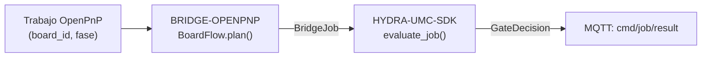

<!-- =============================================================================
HYDRA-UMC-BRIDGE-OPENPNP - OpenPnP board-flow coordination bridge
Copyright (C) JuanenRac (Electro Hobby 3D) <electrohobby3d@gmail.com>
GPL-3.0-or-later - see LICENSE
============================================================================= -->

<p align="center">
  
</p>

# 🔩 HYDRA-UMC-BRIDGE-OPENPNP

<p align="center"><a href="README.md">🇺🇸 English</a> | 🇪🇸 <b>Español</b> | <a href="README_fra.md">🇫🇷 Français</a> | <a href="README_ita.md">🇮🇹 Italiano</a> | <a href="README_deu.md">🇩🇪 Deutsch</a> | <a href="README_zho.md">🇨🇳 简体中文</a> | <a href="README_jpn.md">🇯🇵 日本語</a> | <a href="README_por.md">🇵🇹 Português</a></p>

### 📋 Puente de coordinación trazable de flujo de placas para OpenPnP

<p align="center">
  
  
  
  
  
  
</p>

---

> **Comprobación de honestidad - qué funciona realmente hoy:** el núcleo trazable de flujo de placas y su puerta de seguridad (`board_flow.py` con `BoardFlow`, que hace pasar cada trabajo por el propio `evaluate_job()` de `HYDRA-UMC-SDK`), el inspector de perfil OpenPnP de solo lectura (`configuration.py`), los simuladores de traspaso/ciclo solo de traza (`handoff.py`, `evidence.py`), y el transporte MQTT de comandos/evidencia (`mqtt_transport.py`) son reales y están cubiertos por 241 casos `unittest` que pasan (`python tools/build_test.py` - `test_board_flow.py`, `test_mqtt_transport.py`). Nada de esto ha abierto nunca OpenPnP, un enlace de máquina real, ni un broker MQTT real - `test_mqtt_transport.py`, `test_hardening.py`, `test_idempotency.py`, `test_mqtt_environment.py` usa un cliente de broker falso, `configuration.py` solo llega a analizar un archivo `machine.xml` guardado, y los simuladores de `handoff.py`/`evidence.py` son explícitamente solo locales, sin E/S de OpenPnP, serie o máquina. Todavía no existe una integración en vivo con la extensión/API de OpenPnP - ver "Estado actual y próximos pasos" más abajo, que ya lo dice con claridad, y `CHANGELOG.md` para lo que se ha entregado exactamente hasta ahora. El transporte MQTT también se ha ejecutado contra un HYDRA-UMC-MQTT-BROKER real en una máquina de desarrollo (`tests/test_broker_integration.py`, que se omite si no hay ningún broker instalado): publicar y suscribirse con QoS 0, 1 y 2, la disponibilidad retenida y su último testamento, y la vuelta tras caerse y levantarse el broker.

> **Estado de seguridad física y de ciberseguridad:** este ecosistema no es un sistema de seguridad certificado. Todavía no existe una ruta de E-STOP por hardware, ni límites ni enclavamientos aplicados por el firmware, ni un comando de movimiento verificado; las imágenes de firmware se comprueban con CRC-32 y una firma Ed25519, y una compilación de versión rechaza las claves de desarrollo publicadas (los cabezales de herramienta y las placas de expansión detrás del relé siguen con cargadores de URTC, que usan un HMAC-SHA256 de clave compartida en lugar de una firma); TLS y TLS mutuo son opcionales y están desactivados por defecto; aún no se ha poblado ni probado ninguna placa propia. Lee la [línea base de seguridad](https://github.com/JuanenRac/HYDRA-UMC-DOCS/blob/main/docs/SECURITY_BASELINE.md) y el [modelo de amenazas](https://github.com/JuanenRac/HYDRA-UMC-DOCS/blob/main/docs/THREAT_MODEL.md) antes de fiarte de cualquier afirmación de aquí para la seguridad de una persona.

---

## 📋 De un vistazo

| | |
|---|---|
| Versión | `0.2.1` |
| Madurez | Funcional |
| Tests | 241 (`python tools/build_test.py`) |
| Tecnología | Python / OpenPnP / HYDRA-UMC-SDK |
| Destino | La Raspberry Pi CM5 de una celda HYDRA-UMC |
| En hardware real | Solo simulado: probado con emuladores, dobles de prueba o simuladores; no consta ninguna ejecución en hardware real para esta versión |

**Ir a:** [Resumen](#-resumen) · [Arquitectura](#-arquitectura) · [Funciones](#-funciones) · [Seguridad y protección](#-seguridad-y-protección) · [Interfaces](#-interfaces) · [Configuración](#-configuración) · [Inicio rápido](#-inicio-rápido) · [Pruebas](#-pruebas) · [Resolución de problemas](#-resolución-de-problemas) · [Estructura del repositorio](#-estructura-del-repositorio) · [Proyectos relacionados](#-proyectos-relacionados)

## 🚦 Estado del proyecto

Cada línea es una parte de este repositorio y la luz dice hasta dónde llega hoy. Se escribe con lo que el repositorio puede demostrar (pruebas, compilaciones, ejecuciones), no con lo previsto.

🟢 Hecho y verificado · 🟡 Funciona, con límites conocidos · 🟠 Hecho a medias o sin verificar · 🔴 Sin hacer o sin funcionar

| Área | Estado | Qué significa aquí |
|---|---|---|
| Software | 🟡 | Funciona para su propósito principal; la comprobación de honestidad de arriba lista lo que aún falta |
| Pruebas | 🟢 | 241 pruebas automáticas, ejecutadas en cada cambio |
| Hardware real | 🟠 | Solo simulado: probado con emuladores, dobles de prueba o simuladores; no consta ninguna ejecución en hardware real para esta versión |
| Documentación | 🟢 | README en ocho idiomas, comprobado contra el manifiesto en cada cambio |

## 🎯 Resumen

**HYDRA-UMC-BRIDGE-OPENPNP** es el puente de alto nivel de flujo de placas entre HYDRA-UMC y OpenPnP. Coordina la preparación de PCB, la carga por robot, la colocación nativa, la descarga por robot y la finalización trazable. No implementa cinemática de colocación, control de alimentadores ni movimiento en bruto: eso permanece enteramente dentro de OpenPnP.

Pertenece a la familia **External Automation Bridges**: un conjunto de repositorios hermanos (CNC, LASER, OPENPNP, PRINTER3D, ROS2) que hablan el mismo contrato de seguridad compartido de `HYDRA-UMC-SDK`, de modo que ningún puente puede inventar su propia definición de "seguro para trabajar".

## 🧩 Papel en HYDRA-UMC

**HYDRA-UMC-BRIDGE-OPENPNP** está entre una máquina pick-and-place OpenPnP y su línea SMT y la celda de robots. Cuenta lo que dice ese lado, consulta la puerta compartida antes de cualquier trabajo auxiliar y nunca asume la autoridad de la máquina con la que coordina.

Todos los bridges hablan el contrato de seguridad compartido de `HYDRA-UMC-SDK`: un trabajo solo se acepta cuando la puerta compartida `evaluate_job()` lo permite, y esa puerta falla cerrada. El proyecto padre es `HYDRA-UMC-SERVER`; este bridge no lo llama, responde por MQTT, a través de `HYDRA-UMC-MQTT-BROKER`, a quien manda en la celda.

## 🏛️ Arquitectura

<p align="center">
  
</p>

<details>
<summary>Versión en texto del diagrama (Mermaid)</summary>



</details>

**Por qué está hecho así**

* **Por qué la validación de `board_id` ocurre antes que cualquier otra cosa en `plan()`.** La primera comprobación de `BoardFlow.plan()` es `not IDENTIFIER.fullmatch(board_id)`: un identificador de placa malformado o ambiguo se rechaza de inmediato, con una razón explícita, en lugar de reenviarse aguas abajo donde sería más difícil de trazar.
* **Por qué los traspasos son un diccionario fijo indexado por `JobPhase`, no formateo de cadenas.** `BoardFlow._handoffs` mapea cada una de las seis fases admitidas a una descripción literal e inequívoca. Una fase futura desconocida se rechaza como `unrecognized-phase`; no puede convertirse en un traspaso permitido solo porque la puerta común del SDK esté preparada.
* **Por qué el puente solo planifica un traspaso productivo cuando la máquina externa está `IDLE` y la celda está `READY`.** El traspaso de placas es una operación física de dos partes; si cualquiera de los dos lados no está en un estado conocido y seguro, planificar un traspaso significaría pedirle a un robot que se mueva hacia una máquina impredecible.
* **Por qué `ABORT` sigue siendo solicitable durante un fallo.** `JobPhase.ABORT` se mapea a `request-controlled-stop`, algo que la puerta compartida `evaluate_job()` no bloquea de la misma forma que bloquea las fases productivas — un operador o supervisor siempre debe poder pedir una parada controlada, incluso en mitad de un fallo.
* **Por qué la extensión/API viva de OpenPnP sigue aplazada.** El perfil guardado de máquina ya puede inspeccionarse en solo lectura, pero elegir una interfaz de plugin o superficie viva aún requiere una sesión de pruebas no productiva; así se evita incorporar suposiciones no verificadas de movimiento o alimentadores.
* **Cómo encaja en el resto del ecosistema.** BRIDGE-OPENPNP se sitúa entre un trabajo de OpenPnP y `HYDRA-UMC-SDK` → `HYDRA-UMC-MQTT-BROKER` → seguridad de celda: coordina el lado robótico de un traspaso de placas, nunca reclama la cinemática de colocación ni el control de alimentadores que pertenecen a OpenPnP.

## ✨ Funciones

* ✅ **Núcleo trazable de flujo de placas, real:** `board_flow.py` — `BoardFlow.plan()` rechaza cualquier trabajo cuyo `board_id` esté vacío o tenga espacios al inicio/final *antes* incluso de evaluar la puerta de seguridad; cada traspaso debe llevar un identificador estable y limpio. *(implementado, probado en `tests/test_board_flow.py`)*
* ✅ **Mapa de traspaso por fase, real:** un diccionario fijo mapea cada `JobPhase` (`PREPARE`, `LOAD`, `PROCESS`, `UNLOAD`, `COMPLETE`, `ABORT`) a una descripción explícita y legible del traspaso — `verify-board-and-fixture`, `robot-loads-board-into-pnp-fixture`, `openpnp-places-declared-job`, etc. *(implementado)*
* ✅ **Puerta de seguridad compartida, real:** cada trabajo válido se evalúa mediante `evaluate_job()` de `bridge_contract` en `HYDRA-UMC-SDK`, la misma puerta que usan todos los puentes hermanos; un traspaso productivo solo avanza cuando la máquina externa reporta `IDLE` y la celda HYDRA-UMC está `READY`. *(implementado)*
* ✅ **Compilación/prueba no mutante:** `build-test.bat`/`.sh` compilan el código y ejecutan la batería de pruebas de trazabilidad de placas y seguridad sin tocar archivos de versión ni el CHANGELOG. *(implementado, ver Compilación y publicación más abajo)*
* ✅ **Inspección de perfil OpenPnP de solo lectura:** `inspect_openpnp_config.py` analiza un `machine.xml` guardado, mientras `openpnp-scripts/HYDRA-UMC/inspect_profile.js` es una plantilla de script de menú de OpenPnP que se invoca manualmente; ambos informan solo de clase y recuentos de componentes, y la plantilla muestra ese resultado en un diálogo informativo sin enviar órdenes a la máquina. *(implementado, probado)*
* ✅ **Simulación de traspaso solo trazable:** `BoardIdentity` vincula identificadores de placa, receta, revisión y lote antes de que `simulate_board_handoff()` aplique la puerta compartida del SDK; emite una huella SHA-256 determinista solo para un plan permitido y no tiene E/S de OpenPnP, serie ni máquina. Los campos opcionales `slot_id`/`rack_id`/`table_id` registran la ubicación física real (qué slot de alimentador, qué rack de almacenamiento y qué mesa usó exactamente este traspaso) como identidad propia y separada, para que dos ubicaciones de la misma placa nunca resulten indistinguibles en la huella. *(implementado, probado)*
* ✅ **Simulación de ciclo productivo solo trazable:** `simulate_board_cycle()` evalúa la secuencia ordenada `PREPARE → LOAD → PROCESS → UNLOAD → COMPLETE` bajo un estado explícito de célula/máquina; cada paso productivo falla cerrado fuera de `READY/IDLE`, y `ABORT` permanece separado en la ruta de seguridad del SDK. *(implementado, probado)*
* ✅ **Contrato de evidencia determinista:** `docs/BOARD_TRANSFER_EVIDENCE.md` define el esquema `1.0` que emiten ambos simuladores. Solo contiene fase, decisión, motivo y una huella de identidad permitida; los valores de placa, receta, revisión y lote nunca entran en el registro JSON. *(implementado, probado)*
* ✅ **Mensajes retenidos y claves repetidas:** `mqtt_transport.py` ignora los mensajes retenidos (el broker los reenvía en cada reconexión) y, si recibe un `IdempotencyStore`, responde a una `idempotency_key` repetida con la respuesta que dio la primera vez en lugar de evaluar de nuevo el trabajo. *(implementado, probado en `tests/test_idempotency.py`)*
* ✅ **Estado de la máquina observado (los scripts de eventos de OpenPnP):** OpenPnP no tiene API RPC, así que `openpnp-scripts/HYDRA-UMC/Events` contiene scripts de eventos (`Job.Starting`, `Job.Placement.Complete`, `Job.Finished`, `Machine.AfterHoming`, `Machine.AfterDisabled`) y un script de menú (`Report_state.js`) que escriben un pequeño fichero JSON, de forma atómica, con el estado que implica cada evento; `observation.py` lo lee (`OpenPnpStateSource`, `HYDRA_UMC_OPENPNP_STATE_FILE`) y el bridge decide con él en vez de con lo que afirma el mensaje del trabajo. Un fichero ausente, de más de 15 minutos (`HYDRA_UMC_OPENPNP_STATE_MAX_AGE_SECONDS`), escrito por otro o mal formado es una máquina OFFLINE que rechaza el trabajo; `cmd/status` publica el `state` retenido. Los scripts se prueban en Node contra las pocas clases Java que usan; no se han ejecutado dentro de OpenPnP y los nombres de evento son los documentados. *(implementado, no probado en OpenPnP)*
* ✅ **Señales de traspaso SMEMA:** `SmemaReceiver` (la celda recibe placas de una máquina anterior: lee `board available`, maneja `machine ready`) y `SmemaSender` (la celda entrega placas a una máquina siguiente: maneja `board available`, lee `machine ready`) de `smema.py` participan en el protocolo SMEMA de una línea SMT. La lectura se filtra contra rebotes; MANEJAR una salida pasa por la puerta compartida: solo con una celda READY, una máquina observada en reposo y el útil vacío (o una placa preparada), y una salida se retira en cuanto su condición deja de cumplirse, en cada aborto y cuando una línea no se puede escribir. `cmd/smema_status`, `cmd/smema_ready` y `cmd/smema_offer` lo exponen. Probado contra un vecino simulado; los pines de la CM5 necesitan una placa de interfaz para el cable de 12 a 24 V. *(implementado, solo simulado)*
* ✅ **Trazabilidad por placa:** `traceability.py` junta los traspasos de cada placa y, al terminar su ciclo, publica la traza en `hydra/bridges/openpnp/event/board` (QoS 1, sin retener) y envía a HYDRA-UMC-DATALAKE una muestra `board_handoff` por paso bajo `board-<huella>` más un `production_event` (`good`, `cycleTimeS`) del que HYDRA-UMC-PRODUCTION-REPORTS calcula el OEE. Por defecto solo sale la huella; los identificadores se pueden incluir cuando una planta lo permite. Un data lake caído nunca detiene la celda: las muestras esperan y se envían con la siguiente traza. *(implementado, probado contra un servidor HTTP local)*
* ✅ **Código de la placa:** `board_code.py` compara el DataMatrix leído de la placa con la placa del trabajo (`HYDRA_UMC_OPENPNP_BOARD_CODE`: `off` por defecto, `advisory` o `required`); un código distinto se rechaza, un trabajo sin placa toma el único código leído, y lo que no es un identificador estable no es un código. El código viene del `POST /read-code` de HYDRA-UMC-VISION-NODE (`VisionNodeCodeSource`). *(implementado, no probado con una etiqueta real)*
* ✅ **Bucle MQTT blindado y respuestas honestas:** una carga demasiado grande (más de 16 KiB) o ilegible, un JSON profundamente anidado y cualquier fallo inesperado reciben una negativa en el topic de resultado y nunca terminan el bucle; `cmd/job` y `cmd/handoff` mantienen espacios de claves de idempotencia separados (`job:`/`handoff:`), de modo que un trabajo comprobado con la puerta aún puede traspasarse con la misma clave y conserva su huella de identidad; las respuestas de `cmd/job` indican `"mode": "simulation-only"` y `"observed": false` (nada mira a OpenPnP: el estado de la máquina es el que declara el solicitante) y un ABORT por ahí dice que no se detuvo nada; la puerta y la traza del traspaso comparten una sola regla de identificador de placa, `cmd/handoff` acepta `slot_id`, `rack_id` y `table_id`, y un `machine.xml` con DOCTYPE se rechaza en cualquier codificación; el bridge se anuncia en un topic `availability` con Last Will. *(implementado, probado en `tests/test_hardening.py`)*
* ✅ **Sigue la parada global (apagado por defecto):** con `HYDRA_UMC_OPENPNP_GLOBAL_STOP=1` el bridge lee el anuncio retenido del servidor en `hydra/swarm/safety/estop`; mientras diga `SAFE_STOP`, o no se pueda leer, rechaza con un motivo: un trabajo (un aborto pasa), un traspaso y activar una línea SMEMA. Las paradas y las peticiones de solo lectura siguen funcionando y solo `READY` termina el rechazo. *(implementado, probado contra un broker real; nunca ejecutado con un servidor real)*

## 🔒 Seguridad y protección

| Amenaza | Defensa | Dónde |
|---|---|---|
| Un trabajo para una celda o máquina que no está en estado seguro | Todo trabajo pasa por la puerta compartida `evaluate_job()` del SDK, que falla cerrada; el bridge no tiene lógica propia de aceptar o rechazar | SDK `bridge_contract` |
| Datos de trabajo desmesurados | Como máximo 32 parámetros, claves de hasta 64 caracteres, valores de hasta 1024, identificadores de hasta 128 (`MAX_PARAMETERS`, `MAX_PARAMETER_KEY_CHARS`, `MAX_PARAMETER_VALUE_CHARS`, `MAX_IDENTIFIER_CHARS`) | SDK `bridge_contract` |
| Una orden repetida o reenviada | Un `IdempotencyStore` recuerda cada clave 24 horas y como máximo 10 000 entradas; una repetición recibe la primera respuesta en vez de evaluarse otra vez | SDK `job_intake` |
| Una carga MQTT enorme u hostil | Una carga de más de 16 KiB, un JSON ilegible o muy anidado y cualquier fallo inesperado se responden con un rechazo en el topic de resultado y nunca terminan el bucle | `mqtt_transport.py` |
| La placa equivocada en la máquina | `board_code.py` lee el DataMatrix y lo compara con la placa del trabajo; `HYDRA_UMC_OPENPNP_BOARD_CODE` es `off`, `advisory` o `required` | `board_code.py` |
| Un estado de OpenPnP caducado o falso | El fichero de estado solo es fiable mientras está fresco (15 minutos por defecto), de 16 KiB como máximo, escrito por el origen `openpnp-events`; una palabra desconocida es `OFFLINE` | `observation.py` |
| Datos de trazabilidad sin límite y salidas SMEMA inseguras | Como máximo 256 trazas abiertas y 5000 muestras pendientes (enviadas en lotes de 500); los identificadores de placa cumplen `^[A-Za-z0-9][A-Za-z0-9._-]{0,95}$`; las salidas SMEMA obedecen las reglas de seguridad de la celda | `traceability.py`, `smema.py`, `board_flow.py` |
| Una orden retenida que se reejecuta al reconectar | Un mensaje `cmd/` retenido se ignora al reconectar | `mqtt_transport.py` |

**Lo que nunca hace:** no es un controlador de movimiento de colocación y nunca abre ni cambia la máquina OpenPnP al inspeccionar su XML.

## 🔌 Interfaces

Topics bajo `hydra/bridges/openpnp/`; no hay verbo de parada (`STOP_VERBS` está vacío).

| Topic o ruta | Qué lleva |
|---|---|
| `cmd/status`, `cmd/job`, `cmd/handoff` | órdenes de entrada; cada una se responde en `<verbo>/result` |
| `cmd/smema_offer`, `cmd/smema_ready`, `cmd/smema_status` | el protocolo SMEMA con los vecinos de la línea |
| `state`, `availability`, `event/board` | el estado, `online`/`offline` y los registros de cada placa (`board_handoff`, `production_event`, versión de esquema `1.0`) para el data lake y el informe de OEE |

## ⚙️ Configuración

| Variable | Por defecto | Qué fija |
|---|---|---|
| `HYDRA_UMC_OPENPNP_BOARD_CODE` | `off` | `off`, `advisory` o `required`; un valor desconocido equivale a `off` |
| `HYDRA_UMC_OPENPNP_STATE_FILE` | sin definir | ruta del fichero que escriben los scripts de eventos de OpenPnP; sin definir significa sin fuente de estado |
| `HYDRA_UMC_OPENPNP_STATE_MAX_AGE_SECONDS` | `900` | cuánto puede envejecer el fichero de estado antes de dejar de ser fiable |
| `HYDRA_UMC_OPENPNP_GLOBAL_STOP` | desactivado | `1` sigue la parada global del servidor: mientras el último anuncio del tema retenido `hydra/swarm/safety/estop` diga `SAFE_STOP` (o no se pueda leer), el bridge rechaza con un motivo: un trabajo (un aborto pasa), un traspaso y activar una línea SMEMA; solo `READY` lo termina. `HYDRA_UMC_OPENPNP_GLOBAL_STOP_TOPIC` cambia el tema y `HYDRA_UMC_OPENPNP_GLOBAL_STOP_STRICT=1` rechaza también hasta que llegue el primer anuncio |
| `HYDRA_MQTT_USERNAME` | ninguno | El usuario MQTT; el broker lo liga a un prefijo de ID de cliente |
| `HYDRA_MQTT_PASSWORD` | ninguno | La contraseña; solo vale junto con el usuario |
| `HYDRA_MQTT_PASSWORD_FILE` | ninguno | La contraseña leída de un fichero (secreto de Docker o systemd); se ignora si hay `HYDRA_MQTT_PASSWORD` |
| `HYDRA_MQTT_TLS_CA` | ninguno | El fichero de la CA que firmó el certificado del broker: la conexión es TLS y se verifica el certificado |
| `HYDRA_MQTT_TLS` | desactivado | `1` activa TLS, verificado con las CA de confianza del sistema |
| `HYDRA_MQTT_TLS_CERT` / `HYDRA_MQTT_TLS_KEY` | ninguno | El certificado de cliente y su clave para un broker que exige TLS mutuo; hacen falta los dos |

## 🚀 Inicio rápido

Requiere Python 3.11 o superior. Las pruebas y los scripts de compilación esperan `HYDRA-UMC-SDK` clonado junto a este repositorio (`../HYDRA-UMC-SDK`) o indicado con `HYDRA_UMC_SDK_ROOT`.

Pruébalo sin hardware (esto comprueba todo el bridge contra sus emuladores y dobles de prueba):

```bash
py -3 tools/build_test.py          # Windows
python3 tools/build_test.py         # Linux, macOS
```

Arranca el servicio (no hay un script de consola: el servicio es el `run_forever()` del transporte MQTT, que llamas desde tu propio código de arranque):

```python
from hydra_umc_bridge_openpnp.mqtt_transport import OpenPnpMqttBridge, run_forever
bridge = OpenPnpMqttBridge(cell_state=lambda: cell_state)   # state_source, smema_*, trace_recorder are optional
run_forever(bridge, host="192.168.0.180")                  # serves cmd/# forever
```

El usuario, la contraseña y los ficheros TLS salen de las variables `HYDRA_MQTT_*` (ver Configuración); el código de arriba no necesita credenciales propias.

## 🧪 Pruebas

241 casos automáticos de `unittest` se ejecutan con `python tools/build_test.py` (que también compila cada módulo). Las pruebas no necesitan hardware, red ni paquetes opcionales: las que necesitarían `paho-mqtt`, `pyserial` o una biblioteca del fabricante usan un sustituto o se saltan si falta el paquete.

| Fichero de pruebas | Pruebas | Qué cubre |
|---|---|---|
| `test_global_stop.py`, `test_global_stop_broker.py` | - | la guardia de la parada global y sus rechazos con el motivo, y lo mismo contra un broker real en un puerto local libre (el anuncio en QoS 0, 1 y 2, una parada retenida obedecida al conectar, una ilegible que falla cerrada) |
| `test_broker_integration.py`, `broker_harness.py` | - | el cliente MQTT contra un HYDRA-UMC-MQTT-BROKER real en un puerto local libre: una orden a través del cliente, el estado retenido y la última voluntad, y la vuelta tras caer y volver el broker; se omite si faltan Node.js, `paho-mqtt` o el broker instalado (`HYDRA_UMC_TEST_BROKER_DIR`, por defecto la carpeta contigua) |
| `test_board_flow.py`, `test_board_code.py`, `test_observation.py` | - | fases de entrega, el código de placa, el fichero de estado y los scripts de eventos |
| `test_smema.py`, `test_traceability.py` | - | SMEMA contra un vecino en memoria; la traza, las muestras del data lake y un destino HTTP local real |
| `test_mqtt_transport.py`, `test_mqtt_environment.py`, `test_hardening.py`, `test_edge_cases.py`, `test_idempotency.py` | - | despacho de topics, las credenciales del entorno, clientes hostiles, casos límite, claves repetidas |

El CI ejecuta `HYDRA_UMC_CI=1 python tools/ci_validate.py`, que comprueba el manifiesto, los documentos, los ocho README y las imágenes, y ejecuta las pruebas con una copia del SDK.

## 🏗️ Compilación y publicación

Requiere Python 3.11+. `tools/build_test.py` espera que `HYDRA-UMC-SDK` esté clonado como directorio hermano (`../HYDRA-UMC-SDK`) o indicado mediante la variable de entorno `HYDRA_UMC_SDK_ROOT`.

```bash
# Windows
build-test.bat      # solo valida — sin cambio de versión/CHANGELOG
build.bat            # Valida y compila (compilar nunca cambia la versión)

# Linux/macOS
bash build-test.sh
bash build.sh
```

`build-test` compila cada módulo bajo `src/` con `py_compile` y ejecuta la batería completa de `unittest` descubierta en `tests/` (`test_board_flow.py`, `test_mqtt_transport.py` - 241 tests), demostrando el rechazo por trazabilidad de placas y la puerta de seguridad entre todo lo demás cubierto — nunca modifica el repositorio. `build` ejecuta primero esa misma validación y, solo si tiene éxito, llama a `tools/bump_version.py` para sincronizar la versión en `pyproject.toml`, `hydra-umc.project.json` y `CHANGELOG.md`. Todavía no existe un comando `run` real de máquina — eso requiere una integración de OpenPnP validada.

## 🩺 Resolución de problemas

| Ves | Porque | Haz |
|---|---|---|
| `ModuleNotFoundError: hydra_umc_sdk` | El SDK no está instalado ni junto a este repositorio | Clona `HYDRA-UMC-SDK` junto a este repositorio o define `HYDRA_UMC_SDK_ROOT` |
| `paho-mqtt is not installed` | El cliente MQTT es un extra opcional | `pip install ".[mqtt]"` (necesita `paho-mqtt` 2.1 o superior, menor que 3) |
| `password was given without a username` | Las credenciales MQTT necesitan las dos partes | Define `HYDRA_MQTT_USERNAME` además de la contraseña |
| `could not reach the MQTT broker after N attempts` | El broker está caído, la dirección es errónea o el puerto está cerrado | Arranca `HYDRA-UMC-MQTT-BROKER` y revisa el host y el puerto dados al transporte (lo intenta 5 veces, con 2 segundos de pausa); un fallo del handshake TLS no se reintenta |
| `the MQTT broker refused the connection` | El broker rechazó la credencial (o no respondió dentro del plazo) | Revisa `HYDRA_MQTT_USERNAME` y la contraseña; el ID de cliente debe empezar por el prefijo que el broker ligó a la credencial |
| `"allowed": false` + `reason` | La puerta compartida o una guarda rechazó la orden | Lee `reason` y arregla la causa; no reintentes a ciegas |
| `OFFLINE` although OpenPnP is running | El fichero de estado falta, es más viejo que el límite o lo escribió otro origen | Instala los scripts de `openpnp-scripts/` en OpenPnP, apunta `HYDRA_UMC_OPENPNP_STATE_FILE` al fichero que escriben y sube `HYDRA_UMC_OPENPNP_STATE_MAX_AGE_SECONDS` solo si la máquina está inactiva mucho tiempo |

## 📂 Estructura del repositorio

<p align="center">
  
</p>

<details>
<summary>Versión en texto del árbol</summary>

```text
HYDRA-UMC-BRIDGE-OPENPNP/
├── src/hydra_umc_bridge_openpnp/
│   ├── board_flow.py                                        fases de entrega de placas (no es un controlador de colocación)
│   ├── board_code.py                                        DataMatrix de la placa frente al trabajo
│   ├── observation.py                                       fichero de estado de OpenPnP, fiable si es reciente
│   ├── smema.py                                             el protocolo SMEMA con los vecinos de la línea
│   ├── traceability.py                                      la historia de cada placa, para el data lake y el OEE
│   ├── handoff.py                                           entrega trazable, simulada
│   ├── evidence.py                                          evidencia local determinista
│   ├── configuration.py                                     revisión de solo lectura de un XML
│   └── mqtt_transport.py                                    transporte MQTT de órdenes, estado y eventos de placa
├── tests/                                                   208 pruebas, con montajes de SMEMA y trazabilidad
├── docs/                                                    guía del bridge, evidencia de entrega
├── openpnp-scripts/                                         scripts de eventos que escriben el fichero de estado que expone OpenPnP
├── tools/                                                   ejecutor de compilación y pruebas, subida de versión, validador de CI, generadores y comprobaciones de README e imágenes
├── images/                                                  banner y las imágenes del README
├── .github/                                                 flujo de CI y plantillas de incidencias
├── pyproject.toml                                           metadatos del paquete y dependencias
├── hydra-umc.project.json                                   manifiesto: versión, madurez, familia
├── CHANGELOG.md                                             qué cambió en cada versión
├── build.sh build.bat                                       scripts de compilación (nunca cambian la versión)
├── build-test.sh build-test.bat                             scripts de compilación (nunca cambian la versión)
├── test.sh test.bat                                         ejecutan las pruebas
├── inspect-openpnp-config.sh / inspect-openpnp-config.bat   revisión de solo lectura de un XML de máquina
└── SECURITY.md SUPPORT.md CONTRIBUTING.md CODE_OF_CONDUCT.md LICENSE LICENSE.md
```

</details>

## 🗺️ Hoja de ruta y límites conocidos

**Límites conocidos hoy**

**Real hoy:** versión `0.2.1`, un núcleo trazable de traspaso de PCB probado en local (`BoardFlow`) apoyado en la puerta de trabajo compartida de `HYDRA-UMC-SDK`, un transporte MQTT real de comandos/evidencia (`mqtt_transport.py`), una batería `unittest` determinista de 241 pruebas, un inspector de perfil guardado que reporta evidencia real de actuadores/señalizadores/puntas de boquilla de OpenPnP junto con los recuentos de cabezales/cámaras/drivers/alimentadores, una plantilla visible de menú OpenPnP de solo lectura, simulaciones de traspaso/ciclo vinculadas a identidad y un contrato JSON de evidencia no sensible verificado por CI sin E/S de máquina.

**Frontera de integración:** OpenPnP conserva en todo momento la cinemática de colocación, el control de alimentadores y el movimiento en bruto; este puente solo controla y traza el *traspaso* alrededor de ello — carga por robot, finalización de la colocación nativa, descarga por robot.

**Todavía pendiente:** no se afirma ninguna conexión viva con una máquina OpenPnP — la extensión/API concreta se elegirá solo en una sesión aislada no productiva con un operador presente.

## 🌍 Idiomas

Este README y los documentos del repositorio existen en ocho idiomas: inglés, español, alemán, francés, italiano, japonés, chino y portugués (Portugal). Se escriben a la vez y el CI comprueba que los ocho ficheros tengan las mismas secciones y los mismos enlaces. Este repositorio no tiene pantalla ni catálogo de mensajes propios, así que no hay cadenas de interfaz que traducir.

## 🔗 Proyectos relacionados

Este proyecto es parte del ecosistema de robótica HYDRA-UMC del mismo autor (JuanenRac / Electro Hobby 3D). Vale la pena conocerlo, ya que una petición podría en realidad ser sobre alguno de estos en vez de sobre este repositorio.

**Proyecto Padre**
- **[HYDRA-UMC-SERVER](https://github.com/JuanenRac/HYDRA-UMC-SERVER)** — el backend headless real (REST/WebSocket) con el que habla de verdad cada cliente de control; este bridge no lo llama: responde por MQTT, a través de HYDRA-UMC-MQTT-BROKER, a quien manda en la celda.

**Proyectos Hermanos** — también hablan con la propia API de HYDRA-UMC-SERVER, cada uno como su propio cliente
- **[HYDRA-UMC-STUDIO](https://github.com/JuanenRac/HYDRA-UMC-STUDIO)** — panel de control web con visualización 3D multi-robot en tiempo real.
- **[HYDRA-UMC-SUITE](https://github.com/JuanenRac/HYDRA-UMC-SUITE)** — centro de mando de enjambre de escritorio (PySide6) para varios servidores a la vez, empaquetado como ejecutable independiente.
- **[HYDRA-UMC-ANDROID-CONTROL](https://github.com/JuanenRac/HYDRA-UMC-ANDROID-CONTROL)** — app nativa de control para Android con inicio de sesión biométrico y un compañero Wear OS emparejado.
- **[HYDRA-UMC-IOS-CONTROL](https://github.com/JuanenRac/HYDRA-UMC-IOS-CONTROL)** — app de control para iOS/iPadOS (Flutter) con sincronización en tiempo real por WebSocket.
- **[HYDRA-UMC-DSI](https://github.com/JuanenRac/HYDRA-UMC-DSI)** — interfaz táctil nativa para la pantalla táctil DSI de 7" a bordo, embebida en el propio CM5.
- **[HYDRA-UMC-BRIDGE-AMR](https://github.com/JuanenRac/HYDRA-UMC-BRIDGE-AMR)** — barrera de coordinación para flotas AGV/AMR mediante un publicador MQTT VDA 5050 (probado solo contra una flota emulada).
- **[HYDRA-UMC-BRIDGE-CNC](https://github.com/JuanenRac/HYDRA-UMC-BRIDGE-CNC)** — coordinador de alto nivel para celdas CNC con acceso a estado/bytes de control GRBL (probado solo contra un emulador).
- **[HYDRA-UMC-BRIDGE-DROIDS](https://github.com/JuanenRac/HYDRA-UMC-BRIDGE-DROIDS)** — barrera de coordinación para droides con patas/humanoides, con un emisor de comandos para Boston Dynamics Spot (probado solo contra un emulador).
- **[HYDRA-UMC-BRIDGE-LASER](https://github.com/JuanenRac/HYDRA-UMC-BRIDGE-LASER)** — coordinador de celdas láser que lee 3 señales GPIO de llave/carcasa/enclavamiento (probado solo contra un chip simulado; no puede armar ni disparar un láser).
- **[HYDRA-UMC-BRIDGE-PRINTER3D](https://github.com/JuanenRac/HYDRA-UMC-BRIDGE-PRINTER3D)** — barrera de coordinación segura para impresoras 3D Moonraker/Klipper, con comandos de trabajo reales y controlados.
- **[HYDRA-UMC-BRIDGE-ROS2](https://github.com/JuanenRac/HYDRA-UMC-BRIDGE-ROS2)** — coordinador con un transporte ROS 2 rclpy importado de forma perezosa (todavía no ejecutado contra una instalación de ROS 2).
- **[HYDRA-UMC-BRIDGE-UAV](https://github.com/JuanenRac/HYDRA-UMC-BRIDGE-UAV)** — barrera de coordinación para UAV equipados con cámara, con un emisor de comandos MAVLink (probado solo contra un emulador).

**Directamente Relacionados**
- **[HYDRA-UMC-SDK](https://github.com/JuanenRac/HYDRA-UMC-SDK)** — el contrato JSON-Schema compartido y la barrera de software de puerta de trabajos contra la que cada bridge valida sus comandos (no es una función de seguridad certificada).
- **[HYDRA-UMC-CONNECTOR-HUB](https://github.com/JuanenRac/HYDRA-UMC-CONNECTOR-HUB)** — registro declarativo y validador de manifiestos de adaptador para conectores de máquinas externas; extiende la propia idea de contrato del SDK a máquinas externas sin sustituir a los proyectos de pasarela industrial.
- **[HYDRA-UMC-MQTT-BROKER](https://github.com/JuanenRac/HYDRA-UMC-MQTT-BROKER)** — el transporte real de `mqtt_transport.py` para los propios tópicos `hydra/bridges/openpnp/...` de este bridge — la barrera de trabajos y una simulación de traspaso completamente trazable, sin tópico `state` porque aquí no hay un transporte de máquina real que observar; ver el propio `docs/BRIDGE_TOPICS.md` de ese repositorio.
- **[HYDRA-UMC-SAFETY-ZONES](https://github.com/JuanenRac/HYDRA-UMC-SAFETY-ZONES)** — futura evidencia de seguridad de zona de celda para este bridge.

**También Forma Parte del Ecosistema**

*Hardware y Plataforma Base*
- **[HYDRA-UMC](https://github.com/JuanenRac/HYDRA-UMC)** — el diseño de la placa madre del brazo robótico: host CM5 + coprocesador STM32H745 de doble núcleo, pensado para coordinar hasta 8 brazos herramienta por CAN-OTA/SPI-OTA (firmware en fase temprana; todavía no hay ninguna placa poblada).
- **[HYDRA-UMC-OS](https://github.com/JuanenRac/HYDRA-UMC-OS)** — capa de producto reproducible sobre Raspberry Pi OS para el CM5: agente de solo lectura, config/perfiles validados, aprovisionamiento WiFi de primer contacto.

*Backend Central y Clientes*
- **[HYDRA-UMC-EDITOR-URDF](https://github.com/JuanenRac/HYDRA-UMC-EDITOR-URDF)** — creador/editor gráfico de URDF de escritorio que envía los modelos terminados al propio catálogo de STUDIO.
- **[HYDRA-UMC-EDITOR-STL](https://github.com/JuanenRac/HYDRA-UMC-EDITOR-STL)** — editor de escritorio de modelos STL, que transforma/reemplaza/quita/añade piezas reales en el mismo catálogo de modelos que también edita HYDRA-UMC-EDITOR-URDF.

*Plataforma de Herramientas URTC*
- **[URTC](https://github.com/JuanenRac/URTC)** — firmware para la placa física del Universal Robot Tool Controller, más de 25 perfiles de herramienta por bus CAN.
- **[URTC-FLASHER](https://github.com/JuanenRac/URTC-FLASHER)** — herramienta de escritorio con GUI para flashear placas URTC, CAN-OTA más SWD/JTAG de chip completo.
- **[URTC-TESTER](https://github.com/JuanenRac/URTC-TESTER)** — herramienta de escritorio de diagnóstico CAN-bus en vivo para placas URTC, un panel por perfil de herramienta.
- **[URTC-WEB-STUDIO](https://github.com/JuanenRac/URTC-WEB-STUDIO)** — alternativa basada en navegador a URTC-TESTER mediante la Web Serial API, sin instalación local.
- **[URTC-GATEWAY](https://github.com/JuanenRac/URTC-GATEWAY)** — pasarela delante del bus CAN de URTC: lista de identificadores permitidos, límite de tasa y clave de sesión; software probado en ordenador, aún no en un bus real.

*Nodo IA de Visión (Hailo-8)*
- **[HYDRA-UMC-VISION-NODE](https://github.com/JuanenRac/HYDRA-UMC-VISION-NODE)** — nodo de integración para el pipeline de visión Hailo-8, con una comprobación real de disponibilidad de hardware por etapa.
- **[HYDRA-UMC-DETECTION-HEF](https://github.com/JuanenRac/HYDRA-UMC-DETECTION-HEF)** — registro real de modelos compilados con verificación de carga segura por arquitectura Hailo/checksum.
- **[HYDRA-UMC-VISION-STREAMER](https://github.com/JuanenRac/HYDRA-UMC-VISION-STREAMER)** — generador real de pipeline GStreamer + config MediaMTX, con una frontera de integración HailoRT real.
- **[HYDRA-UMC-VISUAL-SERVOING-API](https://github.com/JuanenRac/HYDRA-UMC-VISUAL-SERVOING-API)** — ley de corrección Position-Based Visual Servoing con autorización condicionada al estado de zona; todavía sin estimación de pose por cámara.

*Nodo IA Cognitivo (Hailo-10)*
- **[HYDRA-UMC-COGNITIVE-NODE](https://github.com/JuanenRac/HYDRA-UMC-COGNITIVE-NODE)** — nodo de integración para el pipeline cognitivo Hailo-10 (orquestación de LLM/VLA/voz).
- **[HYDRA-UMC-VLA-ENGINE](https://github.com/JuanenRac/HYDRA-UMC-VLA-ENGINE)** — codificación/decodificación real de tokens de acción y generación de trayectoria para un modelo Vision-Language-Action.
- **[HYDRA-UMC-VOICE-UI](https://github.com/JuanenRac/HYDRA-UMC-VOICE-UI)** — front-end de voz real (VAD + analizador de intención) con un relé a Watch acotado y con confirmación.
- **[HYDRA-UMC-SEMANTIC-PLANNER](https://github.com/JuanenRac/HYDRA-UMC-SEMANTIC-PLANNER)** — descomposición real de tareas basada en reglas y recuperación semántica de errores sobre códigos de error del MCU.
- **[HYDRA-UMC-DOCS-QA](https://github.com/JuanenRac/HYDRA-UMC-DOCS-QA)** — búsqueda real de documentos TF-IDF (solo librería estándar) sobre los propios documentos Markdown de este ecosistema.
- **[HYDRA-UMC-LOCAL-TECHNICIAN](https://github.com/JuanenRac/HYDRA-UMC-LOCAL-TECHNICIAN)** — técnico de mantenimiento con IA local y con puertas de política para el propio ecosistema - observa, diagnostica y propone arreglos; los dos niveles de riesgo más altos están deliberadamente sin implementar todavía.

*Orquestación y Enjambre*
- **[HYDRA-UMC-ORCHESTRATOR](https://github.com/JuanenRac/HYDRA-UMC-ORCHESTRATOR)** — nodo de integración con un contrato real de informe de salud gRPC/Protobuf y una máquina de estados de misión.
- **[HYDRA-UMC-JOB-DISPATCHER](https://github.com/JuanenRac/HYDRA-UMC-JOB-DISPATCHER)** — cola de trabajos real basada en prioridad con deduplicación, sobre una API HTTP real.
- **[HYDRA-UMC-NODE-HEALING](https://github.com/JuanenRac/HYDRA-UMC-NODE-HEALING)** — watchdog de salud de flota real basado en gRPC, con reintento/backoff y detección de discrepancia de identidad.
- **[HYDRA-UMC-PATH-PLANNER-3D](https://github.com/JuanenRac/HYDRA-UMC-PATH-PLANNER-3D)** — planificador de rutas 3D real basado en RRT, con validación real de colisión de obstáculos/espacio de trabajo.
- **[HYDRA-UMC-SWARM-SYNC](https://github.com/JuanenRac/HYDRA-UMC-SWARM-SYNC)** — sincronización de estado real mediante CRDT LWW-Element-Map, con pruebas de propiedades para convergencia multi-celda.

*Gemelo Digital y Simulación*
- **[HYDRA-UMC-TWIN](https://github.com/JuanenRac/HYDRA-UMC-TWIN)** — nodo de integración para el motor de gemelo digital, con un contrato real de sincronización por compatibilidad de versión.
- **[HYDRA-UMC-HIL-BRIDGE](https://github.com/JuanenRac/HYDRA-UMC-HIL-BRIDGE)** — enrutador hardware-in-the-loop con un enclavamiento de software por colisión entre simulación y hardware real (probado sin hardware real).
- **[HYDRA-UMC-PHYSICS-REPLICA](https://github.com/JuanenRac/HYDRA-UMC-PHYSICS-REPLICA)** — cinemática directa real y validación de límites articulares sobre un subconjunto real de URDF.
- **[HYDRA-UMC-SYNTHETIC-DATA-GEN](https://github.com/JuanenRac/HYDRA-UMC-SYNTHETIC-DATA-GEN)** — generador real de escenas 2D procedurales con exportación de anotaciones YOLO/COCO.

*Datos y Analítica*
- **[HYDRA-UMC-DATALAKE](https://github.com/JuanenRac/HYDRA-UMC-DATALAKE)** — almacén de series temporales real respaldado por sqlite3, con una API HTTP real de ingesta/consulta.
- **[HYDRA-UMC-ANOMALY-DETECTOR](https://github.com/JuanenRac/HYDRA-UMC-ANOMALY-DETECTOR)** — detector de anomalías real basado en FFT + línea base estadística, con monitorización de deriva.
- **[HYDRA-UMC-PRODUCTION-REPORTS](https://github.com/JuanenRac/HYDRA-UMC-PRODUCTION-REPORTS)** — cálculo real de OEE/disponibilidad sobre el histórico de DATALAKE, con exportación CSV reproducible.
- **[HYDRA-UMC-TELEMETRY-COLLECTOR](https://github.com/JuanenRac/HYDRA-UMC-TELEMETRY-COLLECTOR)** — pipeline real de ingesta CAN/WebSocket hacia DATALAKE, con deduplicación por secuencia.

*Pasarela Industrial*
- **[HYDRA-UMC-GATEWAY-INDUSTRIAL](https://github.com/JuanenRac/HYDRA-UMC-GATEWAY-INDUSTRIAL)** — nodo de integración que retransmite a protocolos industriales, con una capa real de lista blanca de comandos/contrapresión.
- **[HYDRA-UMC-OPCUA-SERVER](https://github.com/JuanenRac/HYDRA-UMC-OPCUA-SERVER)** — espacio de direcciones OPC-UA real, verificado con una sesión de cliente real del protocolo binario.
- **[HYDRA-UMC-MTCONNECT-ADAPTER](https://github.com/JuanenRac/HYDRA-UMC-MTCONNECT-ADAPTER)** — endpoints XML reales `/probe` y `/current` de MTConnect, con salida en modo degradado.

*Herramientas Complementarias y Operaciones del Ecosistema*
- **[HYDRA-UMC-DASHBOARD-AI](https://github.com/JuanenRac/HYDRA-UMC-DASHBOARD-AI)** — paneles de Resúmenes Inteligentes y Resaltado de Anomalías sobre DATALAKE/ANOMALY-DETECTOR, con un respaldo estadístico honesto.
- **[HYDRA-UMC-TOOL-CLI](https://github.com/JuanenRac/HYDRA-UMC-TOOL-CLI)** — CLI de flota con un contrato real y estable de códigos de salida, cliente real y en vivo de la propia API de HYDRA-UMC-SERVER.
- **[HYDRA-UMC-WATCH](https://github.com/JuanenRac/HYDRA-UMC-WATCH)** — app compañera de WearOS con patrones de alerta háptica y un relé de voz al teléfono emparejado (todavía no ejecutada en un reloj físico).
- **[URTC-SMART-RACK](https://github.com/JuanenRac/URTC-SMART-RACK)** — firmware para un rack de montaje de placas con decodificación real de ID de herramienta y lógica de precalentamiento Smart Idle.
- **[URTC-VISION-TOOL](https://github.com/JuanenRac/URTC-VISION-TOOL)** — firmware más un compañero de visión real en Python para un cabezal de inspección térmica/RGB.
- **[HYDRA-UMC-UPDATER](https://github.com/JuanenRac/HYDRA-UMC-UPDATER)** — herramienta administrativa de escritorio que descubre, clona y actualiza cada repositorio de este ecosistema.
- **[HYDRA-UMC-OS-REBUILDER](https://github.com/JuanenRac/HYDRA-UMC-OS-REBUILDER)** — herramienta de escritorio Windows/Linux que construye una imagen de la CM5 lista para grabar, precargada con las versiones más actuales del ecosistema, con configuración de primer arranque de Wi-Fi/usuario/SSH al estilo de Raspberry Pi Imager.
- **[HYDRA-UMC-OPS-AGENT](https://github.com/JuanenRac/HYDRA-UMC-OPS-AGENT)** — coordinador de incidencias de mantenimiento: un rol edge de bajo privilegio recopila un snapshot de inventario/salud saneado, un rol control-plane lo renderiza de solo lectura y pide a un proveedor de IA que sugiera un diagnóstico - nunca aplica un parche ni despliega nada.
- **[HYDRA-UMC-DEV-SERVER](https://github.com/JuanenRac/HYDRA-UMC-DEV-SERVER)** — host de desarrollo reproducible (Raspberry Pi 5 / CM5) que almacena el código del ecosistema y ejecuta tareas acotadas de compilación/pruebas bajo una cola duradera; un rol de desarrollo dedicado, explícitamente distinto de un CM5 operativo.

## 📚 Documentación

Dónde leer más:

* [docs/BRIDGE_GUIDE.md](docs/BRIDGE_GUIDE.md) - alcance, flujo de placas, fichero de estado, SMEMA, trazabilidad, scripts
* [docs/BOARD_TRANSFER_EVIDENCE.md](docs/BOARD_TRANSFER_EVIDENCE.md) - qué evidencia deja una entrega trazable
* [Base de seguridad del ecosistema](https://github.com/JuanenRac/HYDRA-UMC-DOCS/blob/main/docs/SECURITY_BASELINE.md)
* [Modelo de amenazas del ecosistema](https://github.com/JuanenRac/HYDRA-UMC-DOCS/blob/main/docs/THREAT_MODEL.md)
* [Historial de cambios de este repositorio](CHANGELOG.md)
* [Licencia de este repositorio](LICENSE.md)

## 🤝 Contribuir y comunidad

* Antes de un pull request ejecuta `HYDRA_UMC_CI=1 py -3 tools/ci_validate.py` (o `HYDRA_UMC_CI=1 python3 tools/ci_validate.py`): debe imprimir `CI_VALIDATION=PASS`. No ejecutes `build.sh` ni `build.bat` para esta comprobación; compilar no es comprobar.
* Los ocho README se escriben desde una sola fuente en HYDRA-UMC-DOCS; no los edites a mano. Cambia la fuente y vuelve a escribirlos con `tools/make_readmes.py`.
* No afirmes en un README lo que no se ha ejecutado: di «simulado» o «sin probar en hardware» cuando esa sea la verdad.
* Mira [CONTRIBUTING.md](CONTRIBUTING.md), el [código de conducta](CODE_OF_CONDUCT.md), [SECURITY.md](SECURITY.md) y [SUPPORT.md](SUPPORT.md).

## 👤 AUTOR

**JuanenRac (Electro Hobby 3D)** · electrohobby3d@gmail.com

## 📜 LICENCIA

GPL-3.0-or-later - [LICENSE](LICENSE).
