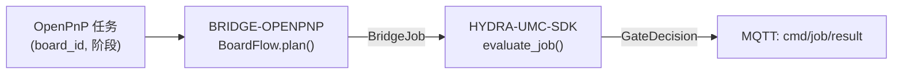

<!-- =============================================================================
HYDRA-UMC-BRIDGE-OPENPNP - OpenPnP board-flow coordination bridge
Copyright (C) JuanenRac (Electro Hobby 3D) <electrohobby3d@gmail.com>
GPL-3.0-or-later - see LICENSE
============================================================================= -->

<p align="center">
  
</p>

# 🔩 HYDRA-UMC-BRIDGE-OPENPNP

<p align="center"><a href="README.md">🇺🇸 English</a> | <a href="README_spa.md">🇪🇸 Español</a> | <a href="README_fra.md">🇫🇷 Français</a> | <a href="README_ita.md">🇮🇹 Italiano</a> | <a href="README_deu.md">🇩🇪 Deutsch</a> | 🇨🇳 <b>简体中文</b> | <a href="README_jpn.md">🇯🇵 日本語</a> | <a href="README_por.md">🇵🇹 Português</a></p>

### 📋 面向 OpenPnP 的可追溯板级流程协调桥接

<p align="center">
  
  
  
  
  
  
</p>

---

> **诚实检查——今天真正可运行的部分：** 可追溯的板流核心及其安全门控（`board_flow.py` 中的 `BoardFlow`，每个任务都会经过 `HYDRA-UMC-SDK` 自身真正的 `evaluate_job()`）、只读的 OpenPnP 配置检查器（`configuration.py`）、仅限追踪的交接/周期模拟器（`handoff.py`、`evidence.py`），以及 MQTT 命令/证据传输（`mqtt_transport.py`）都是真实的，并由 208 个通过的 `unittest` 用例覆盖（`python tools/build_test.py` —— `test_board_flow.py`、`test_mqtt_transport.py`）。以上这些都从未真正打开过 OpenPnP、真实的机器连接或真实的 MQTT broker——`test_mqtt_transport.py`、`test_hardening.py`、`test_idempotency.py`、`test_mqtt_environment.py` 使用的是一个伪造的 broker 客户端，`configuration.py` 只会解析一个已保存的 `machine.xml` 文件，而 `handoff.py`/`evidence.py` 的模拟器明确只在本地运行，没有任何 OpenPnP、串口或机器 I/O。目前还没有与 OpenPnP 扩展/API 的实时集成——详见下文的"当前状态与后续步骤"（已经如实说明了这一点），以及 `CHANGELOG.md` 中目前具体已交付的内容。

> **安全与安防现状:**本生态系统不是经认证的安全系统。目前尚无硬件 E-STOP 通路,没有由固件强制执行的限位或联锁,也没有经过验证的运动指令;固件映像使用 CRC-32 和 Ed25519 签名校验,发布构建会拒绝已公开的开发密钥(中继之后的工具头和扩展板仍运行 URTC 的引导程序,它们使用共享密钥的 HMAC-SHA256 而不是签名);TLS 与双向 TLS 均为可选项,默认关闭;自制电路板尚未组装或测试。在依赖此处任何说法来保障人身安全之前,请先阅读[安全基线](https://github.com/JuanenRac/HYDRA-UMC-DOCS/blob/main/docs/SECURITY_BASELINE.md)和[威胁模型](https://github.com/JuanenRac/HYDRA-UMC-DOCS/blob/main/docs/THREAT_MODEL.md)。

---

## 📋 速览

| | |
|---|---|
| 版本 | `0.2.0` |
| 成熟度 | 可用 |
| 测试 | 208 (`python tools/build_test.py`) |
| 技术栈 | Python / OpenPnP / HYDRA-UMC-SDK |
| 目标 | HYDRA-UMC 工作单元的 Raspberry Pi CM5 |
| 真实硬件 | 仅模拟：使用模拟器、替身或仿真测试；此版本没有在真实硬件上运行的记录 |

**跳转：** [概述](#-概述) · [架构](#-架构) · [功能](#-功能) · [安全与防护](#-安全与防护) · [接口](#-接口) · [配置](#-配置) · [快速开始](#-快速开始) · [测试](#-测试) · [故障排除](#-故障排除) · [仓库结构](#-仓库结构) · [相关项目](#-相关项目)

## 🚦 项目状态

每一行是本仓库的一个部分，灯号表示它今天做到了哪一步。内容依据仓库能够展示的证据（测试、构建、运行），而不是计划。

🟢 已完成并验证 · 🟡 可用，有已知限制 · 🟠 部分完成或尚未验证 · 🔴 未完成或不可用

| 领域 | 状态 | 在这里的含义 |
|---|---|---|
| 软件 | 🟡 | 主要用途可用；上面的诚实性检查列出了仍然缺少的内容 |
| 测试 | 🟢 | 208 项自动测试，每次变更都会运行 |
| 真实硬件 | 🟠 | 仅模拟：使用模拟器、替身或仿真测试；此版本没有在真实硬件上运行的记录 |
| 文档 | 🟢 | 八种语言的 README，每次变更都会与清单核对 |

## 🎯 概述

**HYDRA-UMC-BRIDGE-OPENPNP** 是 HYDRA-UMC 与 OpenPnP 之间的高层板级流程桥接。它协调 PCB 准备、机器人上料、原生贴装、机器人下料以及可追溯的完成流程。它不实现贴装运动学、送料器控制或原始运动——这些完全留在 OpenPnP 内部。

它属于 **External Automation Bridges** 家族:一组共享 `HYDRA-UMC-SDK` 相同安全契约的兄弟仓库(CNC、LASER、OPENPNP、PRINTER3D、ROS2),因此任何一个桥接都不能自行发明"可以安全工作"的定义。

## 🧩 在 HYDRA-UMC 中的角色

**HYDRA-UMC-BRIDGE-OPENPNP** 位于OpenPnP 贴片机及其 SMT 产线与机器人单元之间。它转述对方所说的内容，在任何辅助作业前询问共用关口，且绝不接管所协调机器的决定权。

所有桥接都遵循 `HYDRA-UMC-SDK` 的共同安全契约：只有共用的 `evaluate_job()` 关口放行，任务才会被接受，而该关口在失败时保持关闭。父项目是 `HYDRA-UMC-SERVER`；本桥接不调用它，而是通过 `HYDRA-UMC-MQTT-BROKER` 以 MQTT 回应指挥该单元的一方。

## 🏛️ 架构

<p align="center">
  
</p>

<details>
<summary>图表的文本版本（Mermaid）</summary>



</details>

**为什么这样构建**

* **为什么 `board_id` 校验会在 `plan()` 中最先发生。** `BoardFlow.plan()` 的第一项检查就是 `not IDENTIFIER.fullmatch(board_id)`——格式错误或含糊的板 ID 会立即被拒绝并给出明确原因,而不是被转发到下游、变得更难追溯。
* **为什么交接是一个按 `JobPhase` 索引的固定字典,而不是字符串格式化。** `BoardFlow._handoffs` 将六个受支持阶段中的每一个都映射为一条字面且无歧义的描述。未知的未来阶段会被拒绝为 `unrecognized-phase`;它不会仅因为共享 SDK 门控已就绪就变成允许的交接。
* **为什么桥接只有在外部机器 `IDLE` 且单元 `READY` 时才会规划生产性传输。** 板级交接是一个双方参与的物理操作;只要任一方不处于已知的安全状态,规划传输就等于要求机器人移向一台不可预测的机器。
* **为什么在故障期间仍可请求 `ABORT`。** `JobPhase.ABORT` 映射为 `request-controlled-stop`,共享的 `evaluate_job()` 门控不会像阻止生产性阶段那样阻止它——操作员或监督者必须始终能够请求受控停止,即使正处于故障中。
* **为什么实时 OpenPnP 扩展/API 仍被推迟。** 保存的机器配置文件现在可以只读检查,但选择插件接口或实时接口仍需要非生产测试会话;这样可避免写入未经验证的运动或供料器假设。
* **它如何融入整个生态系统。** BRIDGE-OPENPNP 位于一个 OpenPnP 任务与 `HYDRA-UMC-SDK` → `HYDRA-UMC-MQTT-BROKER` → 单元安全之间:它协调板级交接的机器人一侧,绝不会声称拥有本属于 OpenPnP 自身的贴装运动学或送料器控制能力。

## ✨ 功能

* ✅ **真实的可追溯板级流程核心:** `board_flow.py` 中的 `BoardFlow.plan()` 会在*甚至还未评估*安全门控之前,就拒绝任何 `board_id` 为空或前后带有空白字符的任务——每次交接都必须携带一个稳定、干净的标识符。*(已实现,并在 `tests/test_board_flow.py` 中测试)*
* ✅ **真实的按阶段交接映射:** 一个固定字典将每个 `JobPhase`(`PREPARE`、`LOAD`、`PROCESS`、`UNLOAD`、`COMPLETE`、`ABORT`)映射为一条明确、可读的交接描述——`verify-board-and-fixture`、`robot-loads-board-into-pnp-fixture`、`openpnp-places-declared-job` 等。*(已实现)*
* ✅ **真实的共享安全门控:** 每个有效任务都会通过 `HYDRA-UMC-SDK` 的 `bridge_contract` 中的 `evaluate_job()` 进行评估,这与所有兄弟桥接使用的是同一个门控;只有当外部机器上报 `IDLE` 且 HYDRA-UMC 单元为 `READY` 时,生产性交接才会继续。*(已实现)*
* ✅ **非变更式构建/测试:** `build-test.bat`/`.sh` 编译源码并运行板级可追溯性与故障安全测试套件,不会触碰版本文件或 CHANGELOG。*(已实现,见下方"构建与发布")*
* ✅ **只读 OpenPnP 配置文件检查:** `inspect_openpnp_config.py` 会解析保存的 `machine.xml`,而 `openpnp-scripts/HYDRA-UMC/inspect_profile.js` 是手动调用的 OpenPnP 菜单脚本模板;两者只报告类别和组件数量,模板会在信息对话框中显示结果,绝不发送机器命令。*(已实现,已测试)*
* ✅ **仅追溯性交接模拟:** `BoardIdentity` 会绑定板、配方、修订版和批次标识,然后由 `simulate_board_handoff()` 应用共享 SDK 门控;仅对获准计划生成确定性的 SHA-256 追溯指纹,不含 OpenPnP、串口或机器 I/O。可选的 `slot_id`/`rack_id`/`table_id` 字段将这次交接实际使用的进料槽位、存储料架和放置工作台作为独立的物理位置身份进行追踪,确保同一块板的两次不同放置永远不会在指纹上无法区分。*(已实现,已测试)*
* ✅ **仅追溯性生产周期模拟:** `simulate_board_cycle()` 在明确的单元/机器状态下评估有序 `PREPARE → LOAD → PROCESS → UNLOAD → COMPLETE` 序列;每个生产步骤在 `READY/IDLE` 之外都会安全拒绝,而 `ABORT` 仍在 SDK 安全路径中独立处理。*(已实现,已测试)*
* ✅ **确定性证据契约:** `docs/BOARD_TRANSFER_EVIDENCE.md` 定义两个模拟器产生的 `1.0` 模式。它只携带阶段、决定、原因和获准的身份指纹;原始板、配方、修订版和批次值绝不会进入 JSON 记录。*(已实现,已测试)*
* ✅ **保留消息与重复键：** `mqtt_transport.py` 会忽略保留消息（代理在每次重连时都会重放它们）；若传入 `IdempotencyStore`，对重复的 `idempotency_key` 会返回第一次给出的答复，而不是重新评估该作业。*（已实现，已在 `tests/test_idempotency.py` 中测试）*
* ✅ **观测到的机器状态(OpenPnP 事件脚本):** OpenPnP 没有 RPC API,因此 `openpnp-scripts/HYDRA-UMC/Events` 提供了事件脚本(`Job.Starting`、`Job.Placement.Complete`、`Job.Finished`、`Machine.AfterHoming`、`Machine.AfterDisabled`)和一个菜单脚本(`Report_state.js`),它们以原子方式写入一个小 JSON 文件,内容是每个事件所意味的状态;`observation.py` 读取它(`OpenPnpStateSource`、`HYDRA_UMC_OPENPNP_STATE_FILE`),桥接据此决策,而不是依据作业消息的自述。文件缺失、超过 15 分钟(`HYDRA_UMC_OPENPNP_STATE_MAX_AGE_SECONDS`)、由他人写入或格式错误,都视为拒绝作业的 OFFLINE 机器;`cmd/status` 发布保留的 `state`。脚本已在 Node 中针对其使用的少数 Java 类测试;尚未在 OpenPnP 内运行,事件名称取自文档。*(已实现,尚未在 OpenPnP 中试过)*
* ✅ **SMEMA 交接信号:** `smema.py` 的 `SmemaReceiver`(单元从上游机器接收板卡:读取 `board available`,驱动 `machine ready`)和 `SmemaSender`(单元向下游机器交付板卡:驱动 `board available`,读取 `machine ready`)参与 SMT 产线的 SMEMA 握手。读取带去抖;驱动输出要经过共享门控:仅当单元为 READY、机器被观测为空闲且治具为空(或已有待交付的板卡)时才置位,条件不再成立、每次中止以及线路无法写入时,输出都会被撤回。`cmd/smema_status`、`cmd/smema_ready` 和 `cmd/smema_offer` 对外提供。已针对模拟邻机测试;CM5 引脚需要接口板才能连接 12 至 24 V 线缆。*(已实现,仅模拟)*
* ✅ **逐板追溯:** `traceability.py` 汇集每块板的交接,并在其周期结束时把追溯记录发布到 `hydra/bridges/openpnp/event/board`(QoS 1,不保留),同时向 HYDRA-UMC-DATALAKE 发送每一步一个 `board_handoff` 样本(源为 `board-<指纹>`),外加一个 `production_event`(`good`、`cycleTimeS`),HYDRA-UMC-PRODUCTION-REPORTS 据此计算 OEE。默认只有指纹会离开;工厂允许时可附带标识符。数据湖宕机绝不会让单元停下:样本会等待,并随下一条追溯记录发出。*(已实现,已针对本地 HTTP 服务器测试)*
* ✅ **板上编码:** `board_code.py` 把从板上读到的 DataMatrix 与作业指定的板卡进行比对(`HYDRA_UMC_OPENPNP_BOARD_CODE`:默认 `off`,可选 `advisory` 或 `required`);编码不同则拒绝,没有指定板卡的作业采用读到的唯一编码,不是稳定标识符的内容不算编码。编码来自 HYDRA-UMC-VISION-NODE 的 `POST /read-code`(`VisionNodeCodeSource`)。*(已实现,尚未在真实标签上试过)*
* ✅ **加固的 MQTT 循环与诚实的回复:** 过大(超过 16 KiB)或无法读取的负载、深度嵌套的 JSON 以及任何意外故障,都会在结果主题上得到拒绝回复,绝不会终止循环;`cmd/job` 与 `cmd/handoff` 使用各自独立的幂等键空间(`job:`/`handoff:`),因此经门控检查的任务仍可用同一个键进行交接,并保留其身份指纹;`cmd/job` 的回复带有 `"mode": "simulation-only"` 和 `"observed": false`(没有任何东西在观察 OpenPnP:机器状态由请求方自行声明),通过它发出的 ABORT 会说明没有停止任何东西;门控与交接追踪共用同一条电路板标识规则,`cmd/handoff` 接受 `slot_id`、`rack_id` 和 `table_id`,带有 DOCTYPE 的 `machine.xml` 无论采用何种编码都会被拒绝;桥接在带遗嘱(Last Will)的 `availability` 主题上宣告自己。*(已实现,在 `tests/test_hardening.py` 中测试)*

## 🔒 安全与防护

| 威胁 | 防御 | 位置 |
|---|---|---|
| 对处于不安全状态的单元或机器下达任务 | 每个任务都经过 SDK 共用的 `evaluate_job()` 关口，该关口失败时保持关闭；桥接本身没有接受/拒绝逻辑 | SDK `bridge_contract` |
| 过大的任务数据 | 最多 32 个参数，键最长 64 个字符，值最长 1024，标识符最长 128（`MAX_PARAMETERS`、`MAX_PARAMETER_KEY_CHARS`、`MAX_PARAMETER_VALUE_CHARS`、`MAX_IDENTIFIER_CHARS`） | SDK `bridge_contract` |
| 重复或重放的命令 | `IdempotencyStore` 将每个键记住 24 小时、最多 10 000 条；重复请求得到第一次的答复而不是重新评估 | SDK `job_intake` |
| 巨大或恶意的 MQTT 负载 | 超过 16 KiB 的负载、不可读或嵌套过深的 JSON 以及任何意外故障，都会在结果主题上得到拒绝答复，且不会终止循环 | `mqtt_transport.py` |
| 机器里放错了板 | `board_code.py` 读取 DataMatrix 并与任务的板比对；`HYDRA_UMC_OPENPNP_BOARD_CODE` 取 `off`、`advisory` 或 `required` | `board_code.py` |
| 过期或虚假的 OpenPnP 状态 | 状态文件只在新鲜时（默认 15 分钟）、不超过 16 KiB 且来源为 `openpnp-events` 时才可信；未知词为 `OFFLINE` | `observation.py` |
| 无限制的可追溯数据和不安全的 SMEMA 输出 | 最多 256 条未关闭的跟踪和 5000 个待发样本（每批 500 个）；板标识符须匹配 `^[A-Za-z0-9][A-Za-z0-9._-]{0,95}$`；SMEMA 输出遵守单元的安全规则 | `traceability.py`, `smema.py`, `board_flow.py` |
| 重连时被重放的保留命令 | 保留的 `cmd/` 消息在重连时被忽略 | `mqtt_transport.py` |

**它绝不做的事：** 它不是贴装运动驱动，检查 XML 时也从不打开或修改 OpenPnP 机器。

## 🔌 接口

位于 `hydra/bridges/openpnp/` 下的主题；没有停止动词（`STOP_VERBS` 为空）。

| 主题或路由 | 内容 |
|---|---|
| `cmd/status`, `cmd/job`, `cmd/handoff` | 命令输入；每个都在 `<verb>/result` 上得到答复 |
| `cmd/smema_offer`, `cmd/smema_ready`, `cmd/smema_status` | 与产线相邻设备的 SMEMA 握手 |
| `state`, `availability`, `event/board` | 状态、`online`/`offline` 以及每块板的记录（`board_handoff`、`production_event`，模式版本 `1.0`），供数据湖和 OEE 报告使用 |

## ⚙️ 配置

| 变量 | 默认值 | 设置内容 |
|---|---|---|
| `HYDRA_UMC_OPENPNP_BOARD_CODE` | `off` | `off`、`advisory` 或 `required`；未知值等同于 `off` |
| `HYDRA_UMC_OPENPNP_STATE_FILE` | 未设置 | OpenPnP 事件脚本写入的文件路径；未设置表示没有状态来源 |
| `HYDRA_UMC_OPENPNP_STATE_MAX_AGE_SECONDS` | `900` | 状态文件多旧之后不再可信 |
| `HYDRA_MQTT_USERNAME` | 无 | MQTT 用户名；代理将其绑定到客户端 ID 前缀 |
| `HYDRA_MQTT_PASSWORD` | 无 | 密码；只能与用户名一起使用 |
| `HYDRA_MQTT_PASSWORD_FILE` | 无 | 从文件读取的密码（Docker 或 systemd 机密）；设置了 `HYDRA_MQTT_PASSWORD` 时忽略 |
| `HYDRA_MQTT_TLS_CA` | 无 | 签署代理证书的 CA 文件：连接使用 TLS 并验证证书 |
| `HYDRA_MQTT_TLS` | 关闭 | `1` 启用 TLS，并用系统信任的 CA 验证 |
| `HYDRA_MQTT_TLS_CERT` / `HYDRA_MQTT_TLS_KEY` | 无 | 用于要求双向 TLS 的代理的客户端证书及其密钥；两者都需要 |

## 🚀 快速开始

需要 Python 3.11 或更高版本。测试和构建脚本期望 `HYDRA-UMC-SDK` 位于本仓库旁边（`../HYDRA-UMC-SDK`），或由 `HYDRA_UMC_SDK_ROOT` 指定。

无需硬件即可试用（用模拟器和替身检查整个桥接）：

```bash
py -3 tools/build_test.py          # Windows
python3 tools/build_test.py         # Linux, macOS
```

启动服务（没有控制台脚本：服务就是 MQTT 传输的 `run_forever()`，由你自己的启动代码调用）：

```python
from hydra_umc_bridge_openpnp.mqtt_transport import OpenPnpMqttBridge, run_forever
bridge = OpenPnpMqttBridge(cell_state=lambda: cell_state)   # state_source, smema_*, trace_recorder are optional
run_forever(bridge, host="192.168.0.180")                  # serves cmd/# forever
```

用户名、密码和 TLS 文件来自 `HYDRA_MQTT_*` 变量（见“配置”）；上面的代码本身不需要凭据。

## 🧪 测试

运行 `python tools/build_test.py` 会执行 208 个自动 `unittest` 用例（同时编译每个模块）。测试不需要硬件、网络或可选软件包：需要 `paho-mqtt`、`pyserial` 或厂商库的用例使用替身，缺少软件包时则跳过。

| 测试文件 | 测试数 | 覆盖内容 |
|---|---|---|
| `test_board_flow.py`, `test_board_code.py`, `test_observation.py` | - | 交接阶段、板码、状态文件和事件脚本 |
| `test_smema.py`, `test_traceability.py` | - | SMEMA 对内存中的相邻设备；跟踪、数据湖样本和真实的本地 HTTP 接收端 |
| `test_mqtt_transport.py`, `test_mqtt_environment.py`, `test_hardening.py`, `test_edge_cases.py`, `test_idempotency.py` | - | 主题分发、环境凭据、恶意客户端、边界情况、重复键 |

CI 运行 `HYDRA_UMC_CI=1 python tools/ci_validate.py`，检查清单、文档、八个 README 和图片，并使用 SDK 副本运行测试。

## 🏗️ 构建与发布

需要 Python 3.11+。`tools/build_test.py` 期望 `HYDRA-UMC-SDK` 作为兄弟目录被检出(`../HYDRA-UMC-SDK`),或通过环境变量 `HYDRA_UMC_SDK_ROOT` 指定。

```bash
# Windows
build-test.bat      # 仅验证 —— 不改变版本/CHANGELOG
build.bat            # 先验证,成功后更新版本 + CHANGELOG

# Linux/macOS
bash build-test.sh
bash build.sh
```

`build-test` 使用 `py_compile` 编译 `src/` 下的每个模块,并运行在 `tests/` 下发现的完整 `unittest` 套件(`test_board_flow.py`、`test_mqtt_transport.py`——共 208 个测试),证明板级可追溯性拒绝逻辑和故障安全门控等均按预期工作 —— 它绝不会修改仓库。`build` 会先运行同样的验证,只有成功后才调用 `tools/bump_version.py`,在 `pyproject.toml`、`hydra-umc.project.json` 和 `CHANGELOG.md` 之间同步版本号。目前尚无真正的机器 `run` 命令 —— 这需要经过验证的 OpenPnP 集成。

## 🩺 故障排除

| 你看到 | 原因 | 处理 |
|---|---|---|
| `ModuleNotFoundError: hydra_umc_sdk` | 未安装 SDK，且不在本仓库旁边 | 把 `HYDRA-UMC-SDK` 克隆到本仓库旁边，或设置 `HYDRA_UMC_SDK_ROOT` |
| `paho-mqtt is not installed` | MQTT 客户端是可选附加包 | `pip install ".[mqtt]"`（需要 `paho-mqtt` 2.1 或更高，低于 3） |
| `password was given without a username` | MQTT 凭据需要两部分 | 除密码外还要设置 `HYDRA_MQTT_USERNAME` |
| `could not reach the MQTT broker after N attempts` | 代理未运行、地址错误或端口已关闭 | 启动 `HYDRA-UMC-MQTT-BROKER`，检查传给传输层的主机和端口（每隔 2 秒试 5 次；TLS 握手失败不会重试） |
| `the MQTT broker refused the connection` | 代理拒绝了凭据（或未在时限内应答） | 检查 `HYDRA_MQTT_USERNAME` 和密码；客户端 ID 必须以代理绑定到该凭据的前缀开头 |
| `"allowed": false` + `reason` | 共用关口或某项保护拒绝了命令 | 阅读 `reason` 并排除原因；不要盲目重试 |
| `OFFLINE` although OpenPnP is running | 状态文件缺失、超过时限或来源不同 | 把 `openpnp-scripts/` 的脚本装入 OpenPnP，让 `HYDRA_UMC_OPENPNP_STATE_FILE` 指向它们写的文件；只有机器长时间空闲时才调大 `HYDRA_UMC_OPENPNP_STATE_MAX_AGE_SECONDS` |

## 📂 仓库结构

<p align="center">
  
</p>

<details>
<summary>目录树的文本版本</summary>

```text
HYDRA-UMC-BRIDGE-OPENPNP/
├── src/hydra_umc_bridge_openpnp/
│   ├── board_flow.py                                        电路板交接阶段（不是贴装驱动）
│   ├── board_code.py                                        电路板 DataMatrix 与任务比对
│   ├── observation.py                                       OpenPnP 状态文件，新鲜时才可信
│   ├── smema.py                                             与产线相邻设备的 SMEMA 握手
│   ├── traceability.py                                      每块板的履历，供数据湖和 OEE 使用
│   ├── handoff.py                                           可追溯的交接（模拟）
│   ├── evidence.py                                          确定性的本地证据
│   ├── configuration.py                                     只读检查 XML
│   └── mqtt_transport.py                                    MQTT 命令、状态与板卡事件传输
├── tests/                                                   208 项测试（含 SMEMA 与可追溯夹具）
├── docs/                                                    桥接指南、交接证据
├── openpnp-scripts/                                         写入 OpenPnP 所暴露状态文件的事件脚本
├── tools/                                                   构建与测试运行器、版本提升、CI 校验、README 与图片的生成和检查
├── images/                                                  横幅图与 README 的图片
├── .github/                                                 CI 工作流和 Issue 模板
├── pyproject.toml                                           包元数据与依赖
├── hydra-umc.project.json                                   清单：版本、成熟度、系列
├── CHANGELOG.md                                             每个版本的变化
├── build.sh build.bat                                       构建脚本（从不改变版本）
├── build-test.sh build-test.bat                             构建脚本（从不改变版本）
├── test.sh test.bat                                         运行测试
├── inspect-openpnp-config.sh / inspect-openpnp-config.bat   只读检查机器 XML
└── SECURITY.md SUPPORT.md CONTRIBUTING.md CODE_OF_CONDUCT.md LICENSE LICENSE.md
```

</details>

## 🗺️ 路线图与已知限制

**当前已知限制**

**目前真实的部分:** 版本 `0.2.0`,一个已在本地测试过的可追溯 PCB 交接核心(`BoardFlow`),依托 `HYDRA-UMC-SDK` 的共享任务门控,一个真实的 MQTT 命令/证据传输(`mqtt_transport.py`),配有确定性的208项 `unittest` 测试套件、报告真实 OpenPnP 执行器/信号器/喷嘴头证据以及机头/摄像头/驱动器/供料器数量的保存配置文件检查器、可见的手动只读 OpenPnP 菜单模板、身份绑定交接/周期模拟以及经 CI 验证的无机器 I/O 非敏感 JSON 证据契约。

**集成边界:** OpenPnP 始终保留贴装运动学、送料器控制和原始运动;本桥接只负责门控和追踪其周围的*交接*环节——机器人上料、原生贴装的完成、机器人下料。

**仍待完成:** 目前并未声称与 OpenPnP 机器建立实时连接——具体扩展/API 只会在有操作员在场的隔离非生产会话中选定。

## 🌍 语言

本 README 和仓库文档提供八种语言：英语、西班牙语、德语、法语、意大利语、日语、中文和葡萄牙语（葡萄牙）。它们同时编写，并由 CI 检查八个文件拥有相同的章节和相同的链接。 本仓库没有自己的界面或消息目录，因此没有需要翻译的界面文字。

## 🔗 相关项目

本项目是同一作者(JuanenRac / Electro Hobby 3D)打造的 HYDRA-UMC 机器人生态系统的一部分。值得了解,因为某个请求实际上可能是关于这些项目之一,而非本仓库本身。

**父项目**
- **[HYDRA-UMC-SERVER](https://github.com/JuanenRac/HYDRA-UMC-SERVER)** — 每个控制客户端真正通信的真实无头后端(REST/WebSocket);本桥接不会调用它,而是通过 HYDRA-UMC-MQTT-BROKER 以 MQTT 回应指挥单元的一方。

**兄弟项目** —— 同样与 HYDRA-UMC-SERVER 自身 API 通信,各自作为独立客户端
- **[HYDRA-UMC-STUDIO](https://github.com/JuanenRac/HYDRA-UMC-STUDIO)** — 具有实时多机器人 3D 可视化的网页控制面板。
- **[HYDRA-UMC-SUITE](https://github.com/JuanenRac/HYDRA-UMC-SUITE)** — 面向多台服务器的桌面(PySide6)集群指挥中心，打包为独立可执行文件。
- **[HYDRA-UMC-ANDROID-CONTROL](https://github.com/JuanenRac/HYDRA-UMC-ANDROID-CONTROL)** — 具有生物识别登录和配对 Wear OS 伴侣应用的原生 Android 控制应用。
- **[HYDRA-UMC-IOS-CONTROL](https://github.com/JuanenRac/HYDRA-UMC-IOS-CONTROL)** — 具有实时 WebSocket 同步的 iOS/iPadOS 控制应用(Flutter)。
- **[HYDRA-UMC-DSI](https://github.com/JuanenRac/HYDRA-UMC-DSI)** — 面向机载 7 英寸 DSI 触摸屏的原生触控界面，直接嵌入 CM5 本体。
- **[HYDRA-UMC-BRIDGE-AMR](https://github.com/JuanenRac/HYDRA-UMC-BRIDGE-AMR)** — 通过 VDA 5050 MQTT 发布者为 AGV/AMR 车队提供的协调边界(仅针对仿真车队测试)。
- **[HYDRA-UMC-BRIDGE-CNC](https://github.com/JuanenRac/HYDRA-UMC-BRIDGE-CNC)** — 具备 GRBL 状态/控制字节访问能力的高层 CNC 单元协调器(仅针对模拟器测试)。
- **[HYDRA-UMC-BRIDGE-DROIDS](https://github.com/JuanenRac/HYDRA-UMC-BRIDGE-DROIDS)** — 面向足式/人形机器人的协调边界,带有 Boston Dynamics Spot 指令发送器(仅针对模拟器测试)。
- **[HYDRA-UMC-BRIDGE-LASER](https://github.com/JuanenRac/HYDRA-UMC-BRIDGE-LASER)** — 读取 3 路钥匙/外壳/联锁 GPIO 信号的激光单元协调器(仅针对模拟芯片测试;无法使激光器上膛或发射)。
- **[HYDRA-UMC-BRIDGE-PRINTER3D](https://github.com/JuanenRac/HYDRA-UMC-BRIDGE-PRINTER3D)** — 面向 Moonraker/Klipper 3D 打印机的安全协调边界，具备真实的受控作业指令。
- **[HYDRA-UMC-BRIDGE-ROS2](https://github.com/JuanenRac/HYDRA-UMC-BRIDGE-ROS2)** — 带有惰性导入 rclpy ROS 2 传输层的协调器(尚未在 ROS 2 环境中运行)。
- **[HYDRA-UMC-BRIDGE-UAV](https://github.com/JuanenRac/HYDRA-UMC-BRIDGE-UAV)** — 面向搭载摄像头的无人机的协调边界,带有 MAVLink 指令发送器(仅针对模拟器测试)。

**直接相关**
- **[HYDRA-UMC-SDK](https://github.com/JuanenRac/HYDRA-UMC-SDK)** — 每个桥接都据此校验自身指令的共享 JSON-Schema 契约与软件作业门限边界(并非经认证的安全功能)。
- **[HYDRA-UMC-CONNECTOR-HUB](https://github.com/JuanenRac/HYDRA-UMC-CONNECTOR-HUB)** — 面向外部机器连接器的声明式适配器清单注册与校验工具；把 SDK 自身的契约理念扩展到外部机器，而不取代工业网关类项目。
- **[HYDRA-UMC-MQTT-BROKER](https://github.com/JuanenRac/HYDRA-UMC-MQTT-BROKER)** — `mqtt_transport.py` 为本桥接自身 `hydra/bridges/openpnp/...` 主题提供的真实传输——作业门限加上完全可追溯的交接模拟,由于这里没有可观测的真实机器传输层,因此没有 `state` 主题;详见该仓库自身的 `docs/BRIDGE_TOPICS.md`。
- **[HYDRA-UMC-SAFETY-ZONES](https://github.com/JuanenRac/HYDRA-UMC-SAFETY-ZONES)** — 面向本桥接的未来单元区域安全验证。

**生态系统中的其他项目**

*核心硬件与平台*
- **[HYDRA-UMC](https://github.com/JuanenRac/HYDRA-UMC)** — 机器人手臂主板设计——CM5 主机 + 双核 STM32H745,目标是通过 CAN-OTA/SPI-OTA 协调最多 8 条工具臂(固件处于早期阶段,尚无已组装的电路板)。
- **[HYDRA-UMC-OS](https://github.com/JuanenRac/HYDRA-UMC-OS)** — 面向 CM5 的可复现 Raspberry Pi OS 产品层——只读代理、经过验证的配置/配置文件、WiFi 首次配网。

*核心后端与客户端*
- **[HYDRA-UMC-EDITOR-URDF](https://github.com/JuanenRac/HYDRA-UMC-EDITOR-URDF)** — 将完成的模型推送到 STUDIO 自身目录的桌面版图形化 URDF 创建/编辑工具。
- **[HYDRA-UMC-EDITOR-STL](https://github.com/JuanenRac/HYDRA-UMC-EDITOR-STL)** — 桌面 STL 模型编辑器，在 HYDRA-UMC-EDITOR-URDF 编辑的同一模型目录中变换/替换/移除/添加真实部件。

*URTC 工具平台*
- **[URTC](https://github.com/JuanenRac/URTC)** — 面向实体 Universal Robot Tool Controller 板卡的固件，通过 CAN 总线支持 25 种以上工具配置。
- **[URTC-FLASHER](https://github.com/JuanenRac/URTC-FLASHER)** — 面向 URTC 板卡的桌面图形烧录工具，支持 CAN-OTA 以及全芯片 SWD/JTAG。
- **[URTC-TESTER](https://github.com/JuanenRac/URTC-TESTER)** — 面向 URTC 板卡的桌面实时 CAN 总线诊断工具，每种工具配置对应一个面板。
- **[URTC-WEB-STUDIO](https://github.com/JuanenRac/URTC-WEB-STUDIO)** — 通过 Web Serial API 实现的浏览器版 URTC-TESTER 替代方案，无需本地安装。
- **[URTC-GATEWAY](https://github.com/JuanenRac/URTC-GATEWAY)** — URTC CAN 总线前的网关：允许的标识符列表、速率限制和会话密钥；软件已在计算机上测试，尚未在真实总线上测试。

*视觉 AI 节点(Hailo-8)*
- **[HYDRA-UMC-VISION-NODE](https://github.com/JuanenRac/HYDRA-UMC-VISION-NODE)** — 面向 Hailo-8 视觉流水线的集成中枢，具备逐阶段的真实硬件就绪检测。
- **[HYDRA-UMC-DETECTION-HEF](https://github.com/JuanenRac/HYDRA-UMC-DETECTION-HEF)** — 具备 Hailo 架构/校验和安全加载验证的真实编译模型注册表。
- **[HYDRA-UMC-VISION-STREAMER](https://github.com/JuanenRac/HYDRA-UMC-VISION-STREAMER)** — 具备真实 HailoRT 集成边界的真实 GStreamer 流水线 + MediaMTX 配置生成器。
- **[HYDRA-UMC-VISUAL-SERVOING-API](https://github.com/JuanenRac/HYDRA-UMC-VISUAL-SERVOING-API)** — 以区域状态为授权条件的 Position-Based Visual Servoing 修正律;尚无摄像头位姿估计。

*认知 AI 节点(Hailo-10)*
- **[HYDRA-UMC-COGNITIVE-NODE](https://github.com/JuanenRac/HYDRA-UMC-COGNITIVE-NODE)** — 面向 Hailo-10 认知流水线(LLM/VLA/语音编排)的集成中枢。
- **[HYDRA-UMC-VLA-ENGINE](https://github.com/JuanenRac/HYDRA-UMC-VLA-ENGINE)** — 面向 Vision-Language-Action 模型的真实动作 token 编解码与轨迹生成。
- **[HYDRA-UMC-VOICE-UI](https://github.com/JuanenRac/HYDRA-UMC-VOICE-UI)** — 具备受限、需确认的 Watch 中继的真实语音前端(VAD + 意图解析)。
- **[HYDRA-UMC-SEMANTIC-PLANNER](https://github.com/JuanenRac/HYDRA-UMC-SEMANTIC-PLANNER)** — 基于真实规则的任务分解，以及针对 MCU 错误码的语义化错误恢复。
- **[HYDRA-UMC-DOCS-QA](https://github.com/JuanenRac/HYDRA-UMC-DOCS-QA)** — 面向本生态系统自身 Markdown 文档的真实纯标准库 TF-IDF 文档检索。
- **[HYDRA-UMC-LOCAL-TECHNICIAN](https://github.com/JuanenRac/HYDRA-UMC-LOCAL-TECHNICIAN)** — 面向生态系统自身的本地、按策略门控的 AI 维护技师——观察、诊断并提出修复建议;两个最高风险等级目前特意尚未实现。

*编排与集群*
- **[HYDRA-UMC-ORCHESTRATOR](https://github.com/JuanenRac/HYDRA-UMC-ORCHESTRATOR)** — 具备真实 gRPC/Protobuf 健康报告契约与任务状态机的集成中枢。
- **[HYDRA-UMC-JOB-DISPATCHER](https://github.com/JuanenRac/HYDRA-UMC-JOB-DISPATCHER)** — 基于真实 HTTP API 的真实优先级任务队列，支持去重。
- **[HYDRA-UMC-NODE-HEALING](https://github.com/JuanenRac/HYDRA-UMC-NODE-HEALING)** — 具备重试/退避与身份不匹配检测的真实基于 gRPC 的车队健康看门狗。
- **[HYDRA-UMC-PATH-PLANNER-3D](https://github.com/JuanenRac/HYDRA-UMC-PATH-PLANNER-3D)** — 具备真实障碍物/工作空间碰撞校验的真实基于 RRT 的三维路径规划器。
- **[HYDRA-UMC-SWARM-SYNC](https://github.com/JuanenRac/HYDRA-UMC-SWARM-SYNC)** — 经过多单元收敛属性测试的真实 CRDT LWW-Element-Map 状态同步。

*数字孪生与仿真*
- **[HYDRA-UMC-TWIN](https://github.com/JuanenRac/HYDRA-UMC-TWIN)** — 面向数字孪生引擎的集成中枢，具备真实的版本兼容性同步契约。
- **[HYDRA-UMC-HIL-BRIDGE](https://github.com/JuanenRac/HYDRA-UMC-HIL-BRIDGE)** — 在仿真与真实硬件之间带有软件碰撞联锁的硬件在环路由器(未在真实硬件上测试)。
- **[HYDRA-UMC-PHYSICS-REPLICA](https://github.com/JuanenRac/HYDRA-UMC-PHYSICS-REPLICA)** — 面向真实 URDF 子集的真实正向运动学与关节限位校验。
- **[HYDRA-UMC-SYNTHETIC-DATA-GEN](https://github.com/JuanenRac/HYDRA-UMC-SYNTHETIC-DATA-GEN)** — 具备 YOLO/COCO 标注导出功能的真实程序化 2D 场景生成器。

*数据与分析*
- **[HYDRA-UMC-DATALAKE](https://github.com/JuanenRac/HYDRA-UMC-DATALAKE)** — 具备真实数据摄入/查询 HTTP API 的真实 sqlite3 时序数据存储。
- **[HYDRA-UMC-ANOMALY-DETECTOR](https://github.com/JuanenRac/HYDRA-UMC-ANOMALY-DETECTOR)** — 具备漂移监测能力的真实 FFT + 统计基线异常检测器。
- **[HYDRA-UMC-PRODUCTION-REPORTS](https://github.com/JuanenRac/HYDRA-UMC-PRODUCTION-REPORTS)** — 基于 DATALAKE 历史数据的真实 OEE/可用率计算，支持可复现的 CSV 导出。
- **[HYDRA-UMC-TELEMETRY-COLLECTOR](https://github.com/JuanenRac/HYDRA-UMC-TELEMETRY-COLLECTOR)** — 面向 DATALAKE 的真实 CAN/WebSocket 数据摄入管道，支持序列去重。

*工业网关*
- **[HYDRA-UMC-GATEWAY-INDUSTRIAL](https://github.com/JuanenRac/HYDRA-UMC-GATEWAY-INDUSTRIAL)** — 中继至工业协议的集成中枢，具备真实的指令白名单/背压控制层。
- **[HYDRA-UMC-OPCUA-SERVER](https://github.com/JuanenRac/HYDRA-UMC-OPCUA-SERVER)** — 经真实二进制协议客户端会话验证的真实 OPC-UA 地址空间。
- **[HYDRA-UMC-MTCONNECT-ADAPTER](https://github.com/JuanenRac/HYDRA-UMC-MTCONNECT-ADAPTER)** — 具备降级模式输出的真实 MTConnect `/probe` 与 `/current` XML 端点。

*辅助工具与生态系统运维*
- **[HYDRA-UMC-DASHBOARD-AI](https://github.com/JuanenRac/HYDRA-UMC-DASHBOARD-AI)** — 基于 DATALAKE/ANOMALY-DETECTOR 的智能摘要与异常高亮面板，具备诚实的统计回退机制。
- **[HYDRA-UMC-TOOL-CLI](https://github.com/JuanenRac/HYDRA-UMC-TOOL-CLI)** — 具备真实、稳定退出码契约的车队 CLI，是 HYDRA-UMC-SERVER 自身 API 的真实在线客户端。
- **[HYDRA-UMC-WATCH](https://github.com/JuanenRac/HYDRA-UMC-WATCH)** — 带有触觉提醒模式与配对手机语音中继的 WearOS 伴侣应用(尚未在实体手表上运行)。
- **[URTC-SMART-RACK](https://github.com/JuanenRac/URTC-SMART-RACK)** — 面向板卡安装机架的固件，具备真实的工具 ID 解码与 Smart Idle 预热逻辑。
- **[URTC-VISION-TOOL](https://github.com/JuanenRac/URTC-VISION-TOOL)** — 面向热成像/RGB 检测工具头的固件及真实 Python 视觉伴侣程序。
- **[HYDRA-UMC-UPDATER](https://github.com/JuanenRac/HYDRA-UMC-UPDATER)** — 发现、克隆并更新本生态系统中每个仓库的管理类桌面工具。
- **[HYDRA-UMC-OS-REBUILDER](https://github.com/JuanenRac/HYDRA-UMC-OS-REBUILDER)** —— 构建即刻可烧录、预装生态系统最新版本的 CM5 镜像的 Windows/Linux 桌面工具,具备类似 Raspberry Pi Imager 风格的首次启动 Wi-Fi/用户/SSH 配置。
- **[HYDRA-UMC-OPS-AGENT](https://github.com/JuanenRac/HYDRA-UMC-OPS-AGENT)** — 维护事件协调器：一个低权限的边缘角色采集经过脱敏的库存/健康快照，一个控制面角色以只读方式渲染它，并请求某个 AI 提供方给出诊断建议——从不应用补丁，也从不部署任何内容。
- **[HYDRA-UMC-DEV-SERVER](https://github.com/JuanenRac/HYDRA-UMC-DEV-SERVER)** — 可复现的开发主机（Raspberry Pi 5 / CM5），保存整个生态系统的源代码，并在持久队列下运行有界的构建/测试任务；这是专用的开发角色，明确区别于运行中的 CM5。

## 📚 文档

更多阅读：

* [docs/BRIDGE_GUIDE.md](docs/BRIDGE_GUIDE.md) - 范围、板卡流程、状态文件、SMEMA、可追溯性、脚本
* [docs/BOARD_TRANSFER_EVIDENCE.md](docs/BOARD_TRANSFER_EVIDENCE.md) - 可追溯的交接留下什么证据
* [生态系统的安全基线](https://github.com/JuanenRac/HYDRA-UMC-DOCS/blob/main/docs/SECURITY_BASELINE.md)
* [生态系统的威胁模型](https://github.com/JuanenRac/HYDRA-UMC-DOCS/blob/main/docs/THREAT_MODEL.md)
* [本仓库的更新日志](CHANGELOG.md)
* [本仓库的许可证](LICENSE.md)

## 🤝 参与贡献与社区

* 提交 pull request 之前，请运行 `HYDRA_UMC_CI=1 py -3 tools/ci_validate.py`（或 `HYDRA_UMC_CI=1 python3 tools/ci_validate.py`）：它必须输出 `CI_VALIDATION=PASS`。此检查不要运行 `build.sh` 或 `build.bat`；构建不是检查。
* 八个 README 由 HYDRA-UMC-DOCS 中的同一个源生成；请勿手工编辑。修改源文件，再用 `tools/make_readmes.py` 重新生成。
* 不要在 README 中声称尚未运行过的内容：属实时请写“仅模拟”或“尚未在硬件上试过”。
* 请参阅 [CONTRIBUTING.md](CONTRIBUTING.md)、[行为准则](CODE_OF_CONDUCT.md)、[SECURITY.md](SECURITY.md) 和 [SUPPORT.md](SUPPORT.md)。

## 👤 作者

**JuanenRac (Electro Hobby 3D)** · electrohobby3d@gmail.com

## 📜 许可证

GPL-3.0-or-later - [LICENSE](LICENSE).
